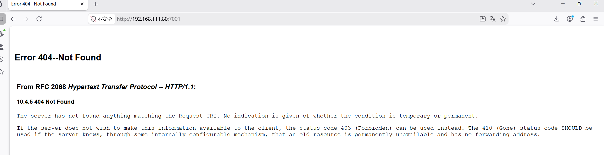

# 靶场环境搭建
靶场下载链接：
```

https://pan.baidu.com/s/1QlkyFALPCZADUQevFYf_2A?pwd=hqxi 

提取码：hqxi
```

---
# 信息收集
扫描本机网段的网络
####  参数详解

| 参数                | 作用                                   |
| ----------------- | ------------------------------------ |
| `-Pn`             | **跳过主机发现**（不发送ICMP探测包），假设所有目标主机都在线   |
| `-sS`             | **半开扫描**（SYN扫描），只发送SYN包，不完成三次握手，日志量小 |
| `-T4`             | 时间模板（激进模式），防火墙环境推荐 `-T4`             |
| `-p-`             | 全端口（1-65535）                         |
| `--min-rate=1000` | 设定最小发包速率，加快扫描                        |
```bash
# kali中用nmap扫描 在这个网段扫描常见端口
nmap -Pn -sS -T4 -p 80,135,139,443,445,1433,3389,3306,7001,8080 192.168.111.0/24
```

终端回显示例：

```bash
┌──(kali㉿kali)-[~]
└─$ nmap -Pn -sS -T4 -p 80,135,139,443,445,1433,3389,3306,7001,8080 192.168.111.0/24

Starting Nmap 7.99 ( https://nmap.org ) at 2026-04-23 17:10 +0800
Nmap scan report for 192.168.111.1
Host is up (0.00039s latency).

PORT     STATE    SERVICE
80/tcp   open     http
135/tcp  open     msrpc
139/tcp  open     netbios-ssn
443/tcp  filtered https
445/tcp  open     microsoft-ds
1433/tcp filtered ms-sql-s
3306/tcp filtered mysql
3389/tcp filtered ms-wbt-server
7001/tcp filtered afs3-callback
8080/tcp filtered http-proxy
MAC Address: 00:50:56:C0:00:08 (VMware)

Nmap scan report for 192.168.111.2
Host is up (0.00014s latency).

PORT     STATE  SERVICE
80/tcp   closed http
135/tcp  closed msrpc
139/tcp  closed netbios-ssn
443/tcp  closed https
445/tcp  closed microsoft-ds
1433/tcp closed ms-sql-s
3306/tcp closed mysql
3389/tcp closed ms-wbt-server
7001/tcp closed afs3-callback
8080/tcp closed http-proxy
MAC Address: 00:50:56:F0:62:F0 (VMware)

Nmap scan report for 192.168.111.80       # 总结：首要攻击目标！！！
Host is up (0.00022s latency).

PORT     STATE    SERVICE
80/tcp   open     http                    # 80 网站服务开着
135/tcp  open     msrpc                   # 135开启
139/tcp  open     netbios-ssn             # 139开启
443/tcp  filtered https                   # 443过滤了
445/tcp  open     microsoft-ds            # 445开着！！！重大发现
1433/tcp open     ms-sql-s                # 1433开着
3306/tcp filtered mysql                   # 3306也开着！！！重大发现
3389/tcp open     ms-wbt-server           # 3389开着！！！可以试试 
7001/tcp open     afs3-callback           # 7001开着！！重大发现，可以试试，首要目标
8080/tcp filtered http-proxy              # 8080也开着
MAC Address: 00:0C:29:AE:0B:12 (VMware)

Nmap scan report for 192.168.111.201
Host is up (0.00021s latency).

PORT     STATE    SERVICE                # 域内主机，不是首要目标
80/tcp   filtered http                   # 开放80！！！
135/tcp  open     msrpc                  # 开放135 ！！
139/tcp  open     netbios-ssn            # 开放139！！
443/tcp  filtered https                  # 443防火墙过滤掉了
445/tcp  open     microsoft-ds           # 443开着！！
1433/tcp filtered ms-sql-s               # 过滤了
3306/tcp filtered mysql                  # 过滤了
3389/tcp open     ms-wbt-server          # 3389开着！！！
7001/tcp filtered afs3-callback          # 7001，被过滤了
8080/tcp filtered http-proxy
MAC Address: 00:0C:29:85:68:26 (VMware)

Nmap scan report for 192.168.111.254    
Host is up (0.00011s latency).

PORT     STATE    SERVICE
80/tcp   filtered http
135/tcp  filtered msrpc
139/tcp  filtered netbios-ssn
443/tcp  filtered https
445/tcp  filtered microsoft-ds
1433/tcp filtered ms-sql-s
3306/tcp filtered mysql
3389/tcp filtered ms-wbt-server
7001/tcp filtered afs3-callback
8080/tcp filtered http-proxy
MAC Address: 00:50:56:F2:5A:9C (VMware)

Nmap scan report for 192.168.111.128               # 本地kali的地址
Host is up.

PORT     STATE    SERVICE
80/tcp   filtered http
135/tcp  filtered msrpc
139/tcp  filtered netbios-ssn
443/tcp  filtered https
445/tcp  filtered microsoft-ds
1433/tcp filtered ms-sql-s
3306/tcp filtered mysql
3389/tcp filtered ms-wbt-server
7001/tcp filtered afs3-callback
8080/tcp filtered http-proxy

Nmap done: 256 IP addresses (6 hosts up) scanned in 6.23 seconds
```

	分析：对方开启了多项服务，80，445，3389，7001等很多敏感端口，主要攻击点在7001端口的weblogic服务方向，可以先尝试浏览器访问这个网站，后续用专用工具进行探测
## 进一步信息收集
	知识点提示：
	7001端口是weblogic的默认端口服务，可以尝试访问一下网站
```bash
# 浏览器访问
http://192.168.111.80:7001

```



	分析：这个网站404报错显示了。。。

**使用weblogic的专用工具进行更深层次的信息收集
```bash
# 第一次使用这个工具的，可以先下载，下载下来之后再使用
# 这个工具名称为weblogicScanner，两者二选一
git clone https://github.com/0xn0ne/weblogicScanner.git
cd weblogicScanner
pip3 install -r requirements.txt             # 安装依赖，这个在扫描网站的时候报错再用

# 或者下载这个也可以，使用方法同上，的那hi这个不需要依赖
git clone https://github.com/rabbitmask/WeblogicScan.git

# 这里用的是 **0xn0ne/weblogicScanner**（检测为主，stars目录含利用脚本）。  
# 另一个 **rabbitmask/WeblogicScan** 是纯检测工具，两者二选一即可。
cd ~/tools/weblogicScanner
# 对这个网站端口进行漏洞扫描
python3 ws.py -t 192.168.111.80:7001            # 这里不要写http，不然会报错                                                      
```

**终端回显信息
```bash
# kali中的终端回显
┌──(kali㉿kali)-[~/tools/weblogicScanner]
└─$ python3 ws.py -t 192.168.111.80:7001
[17:30:05][INFO] [+][CVE-2020-2551][192.168.111.80:7001] Found module, Please verify manually!
[17:30:06][INFO] [+][Weblogic Console][192.168.111.80:7001] Found module, Please verify manually!
[17:30:06][INFO] [+][CVE-2017-10271][192.168.111.80:7001] Exists vulnerability!
[17:30:06][INFO] [+][CVE-2019-2618][192.168.111.80:7001] Found module, Please verify manually!
[17:30:06][INFO] [!][CVE-2020-14882][192.168.111.80:7001] Connection error.
[17:30:06][INFO] [-][CVE-2020-14882][192.168.111.80:7001] Not vulnerability.
[17:30:07][INFO] [+][CVE-2018-3245][192.168.111.80:7001] Exists vulnerability!
[17:30:07][INFO] [!][CVE-2016-0638][192.168.111.80:7001] Connection error.
[17:30:07][INFO] [-][CVE-2016-0638][192.168.111.80:7001] Not vulnerability.
[17:30:08][INFO] [+][CVE-2014-4210][192.168.111.80:7001] Found module, Please verify manually!
[17:30:09][INFO] [!][CVE-2018-2893][192.168.111.80:7001] Connection error.
[17:30:09][INFO] [-][CVE-2018-2893][192.168.111.80:7001] Not vulnerability.
[17:30:10][INFO] [!][CVE-2019-2890][192.168.111.80:7001] Connection error.
[17:30:10][INFO] [-][CVE-2019-2890][192.168.111.80:7001] Not vulnerability.
[17:30:10][INFO] [!][CVE-2018-2628][192.168.111.80:7001] Connection error.
[17:30:10][INFO] [-][CVE-2018-2628][192.168.111.80:7001] Not vulnerability.
[17:30:12][INFO] [-][CVE-2016-3510][192.168.111.80:7001] Not vulnerability.
[17:30:16][INFO] [-][CVE-2020-2883][192.168.111.80:7001] Not vulnerability.
[17:30:17][INFO] [!][CVE-2018-3191][192.168.111.80:7001] Connection error.
[17:30:17][INFO] [-][CVE-2018-3191][192.168.111.80:7001] Not vulnerability.
[17:30:17][INFO] [!][CVE-2017-3248][192.168.111.80:7001] Connection error.
[17:30:17][INFO] [-][CVE-2017-3248][192.168.111.80:7001] Not vulnerability.
[17:30:18][INFO] [-][CVE-2020-14883][192.168.111.80:7001] Not vulnerability.
[17:30:19][INFO] [+][CVE-2017-3506][192.168.111.80:7001] Exists vulnerability!
[17:30:19][INFO] [-][CVE-2018-2894][192.168.111.80:7001] Not found.
[17:30:19][INFO] [+][CVE-2019-2729][192.168.111.80:7001] Exists vulnerability!
[17:30:20][INFO] [+][CVE-2019-2888][192.168.111.80:7001] Found module, Please verify manually!
[17:30:21][INFO] [+][CVE-2020-14750][192.168.111.80:7001] Exists vulnerability!
[17:30:21][INFO] [-][CVE-2018-3252][192.168.111.80:7001] Not found.
[17:30:22][INFO] [+][CVE-2020-2555][192.168.111.80:7001] Exists vulnerability!
[17:30:24][INFO] [+][CVE-2019-2725][192.168.111.80:7001] Exists vulnerability!
Run completed, 23 seconds total.
                                                                                                                                                                                    
┌──(kali㉿kali)-[~/tools/weblogicScanner]
└─$ 
```
	注解：exists是代表有可用漏洞，可以尝试利用漏洞攻击

 **扫描结果中确认存在的漏洞

| CVE编号              | 协议/路径             | 漏洞类型     | 利用稳定性  | 说明                    |
| ------------------ | ----------------- | -------- | ------ | --------------------- |
| **CVE-2019-2725**  | HTTP `/_async/`   | 反序列化RCE  | ⭐⭐⭐ 极高 | 10.3.6版本最稳定的利用入口，无需认证 |
| **CVE-2017-10271** | HTTP `/wls-wsat/` | 反序列化RCE  | ⭐⭐⭐ 极高 | 经典漏洞，与2725类似，利用方式成熟   |
| **CVE-2017-3506**  | HTTP `/wls-wsat/` | 反序列化RCE  | ⭐⭐⭐ 极高 | 与10271类似，可互相替代        |
| **CVE-2019-2729**  | HTTP `/_async/`   | 反序列化RCE  | ⭐⭐⭐ 极高 | 2725的绕过版本             |
| **CVE-2018-3245**  | T3协议              | 反序列化RCE  | ⭐⭐ 中等  | 需要T3协议可达，CVSS 9.8     |
| **CVE-2020-14750** | Console           | 权限绕过+RCE | ⭐⭐ 中等  | 14882的补丁绕过，可未授权访问后台   |
| **CVE-2020-2555**  | T3/IIOP           | 反序列化RCE  | ⭐⭐ 中等  | 需要T3协议                |
| **CVE-2020-2551**  | IIOP              | 反序列化RCE  | ⭐ 一般   | 扫描器提示需手动验证            |
| **CVE-2019-2618**  | HTTP              | 文件上传RCE  | ⭐ 一般   | 需结合其他漏洞利用             |
| **CVE-2014-4210**  | HTTP              | 未授权访问    | ⭐ 一般   | 信息泄露类                 |
# 漏洞利用
| CVE编号          | 路径           | 推荐利用方式                        |
| -------------- | ------------ | ----------------------------- |
| CVE-2017-10271 | `/wls-wsat/` | `curl` 发送XML / `WeblogicTool` |
| CVE-2019-2725  | `/_async/`   | `WeblogicTool` / 集成利用脚本       |
| CVE-2019-2729  | `/_async/`   | 2725的绕过，同样路径                  |
