### burpsuite工具
BurpSuite工具分享链接：
https://www.123865.com/s/MNwXvd-YNmZh
免安装，解压直接激活即可，激活步骤在压缩包里面的文档，按照步骤做就行
#### ZeroOmega
	网页代理快捷切换插件，这个在edge，谷歌，火狐浏览器里面都能适用，建议先在GitHub里面把每个版本的下载下来，再导入使用
	火狐版本的可以和edge使用，建议谷歌和火狐或者edge都安装一个，打开开发者模式，点击加载未打包的程序，找到下载的文件，确定。完成会显示相应的界面
链接：
[zero-peak/ZeroOmega: Manage and switch between multiple proxies quickly & easily.](https://github.com/zero-peak/ZeroOmega)
### 挂代理
打开edge或者其他浏览器，点击扩展程序，打开zeroomega
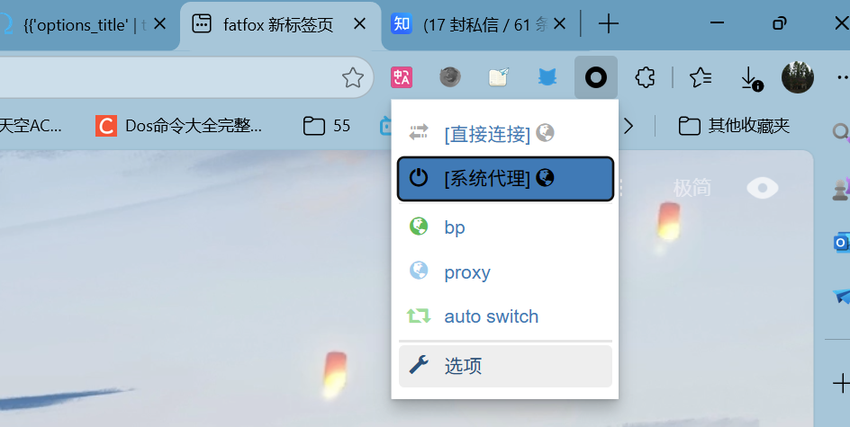
点击选项，新建情景模式，点击代理服务器，起个名称，点创建
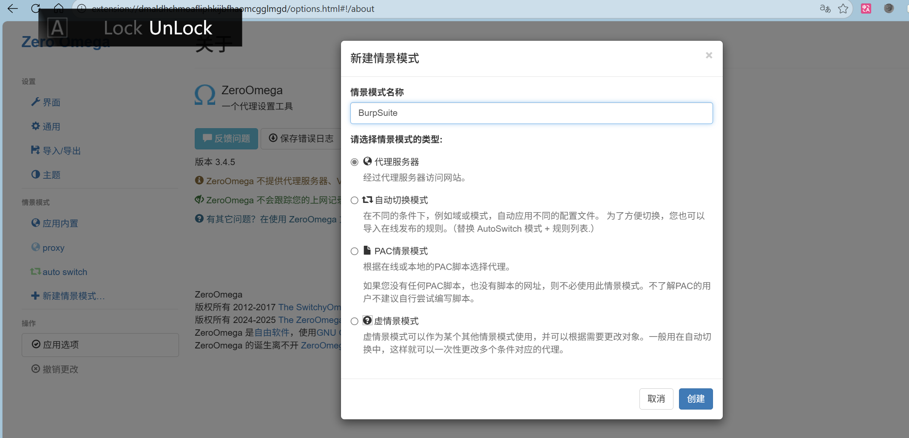

如下所示，依次配置，配置完成之后点击应用选项即可
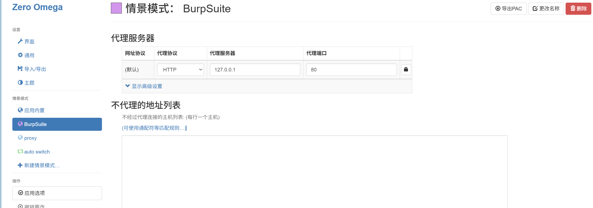
### CA证书导入
	方法一：本机根证书导入，一劳永逸（推荐）
	 导入证书是为了后续抓https的数据包，不安装的话只能抓一下本地的http，现在http的公网能访问到的网站也已经被强制使用https了。
在浏览器里面的地址栏输入:127.0.0.1:8080
进入到bp的证书下载页面，点击右上角的CA，下载保存
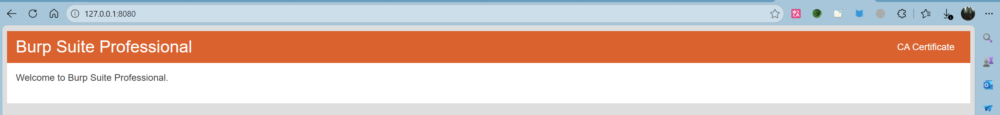
将下载的CA证书双击，点击打开，点击安装证书
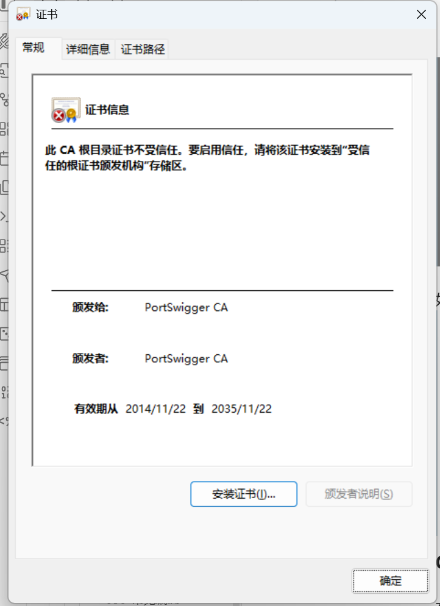
证书导入向导点击给本地计算机安装
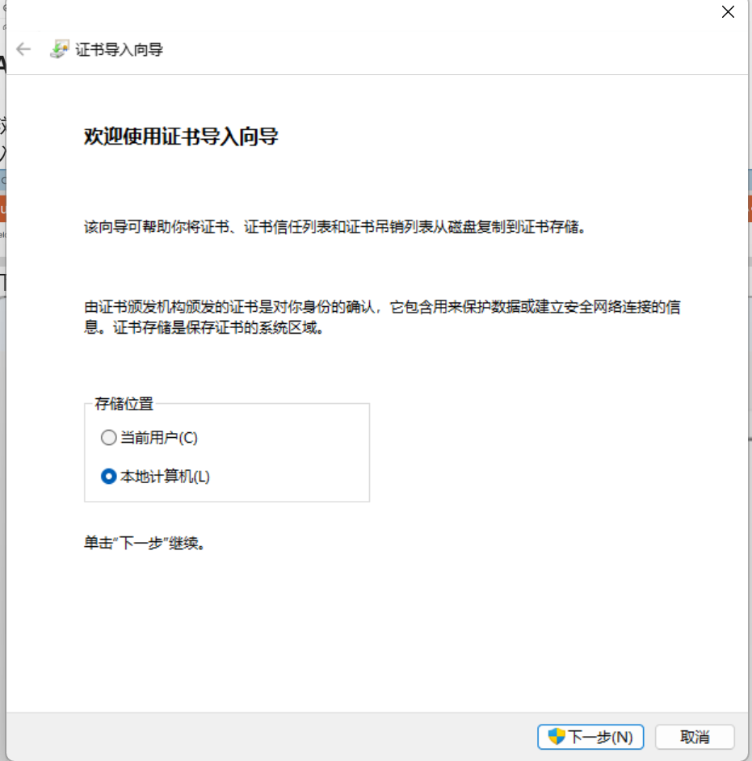
点击将所有的证书...，选择受信任的根证书颁发机构，最后点击完成即可。

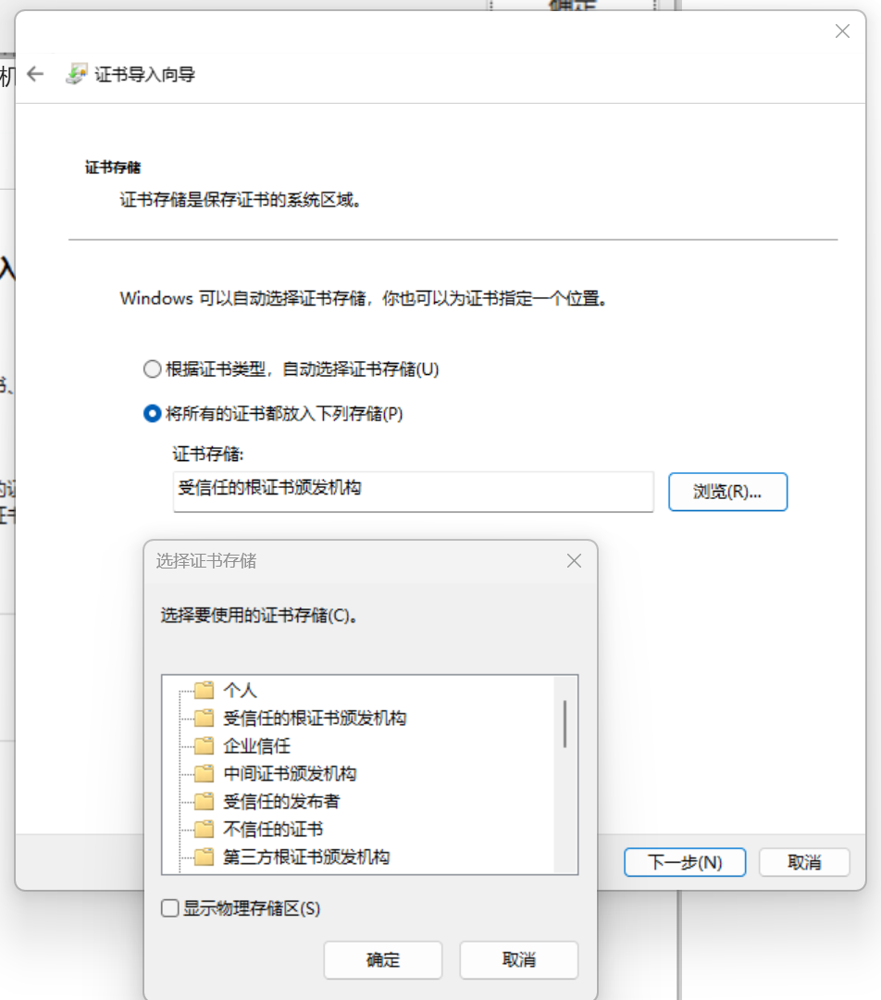
### BurpSuite初次使用
界面概览
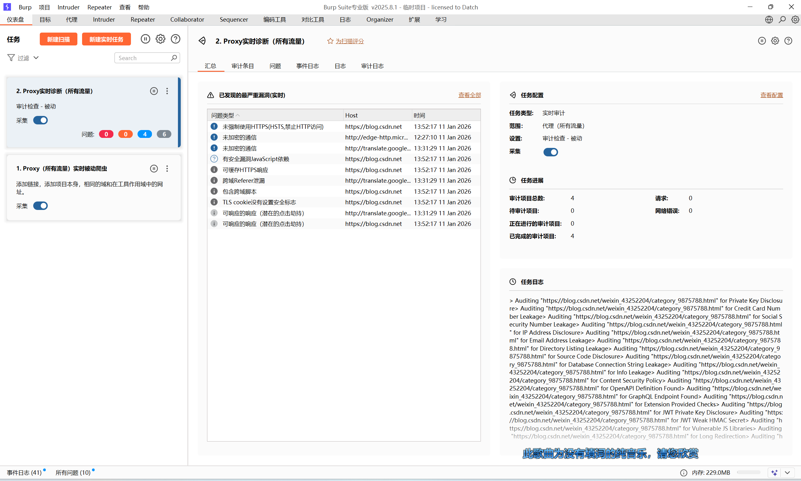
着重描述几个比较重要的模块
代理菜单是经常使用到的，拦截即是将发送的数据包拦截下来，经过修改，再发送到服务器的流程，做到篡改数据，伪造请求的步骤。在使用的时候，点击打开拦截，再次发送数据就可以拦截下来（注：打开拦截，网页是上不了网的！！）。
HTTP历史记录，挂上代理之后，所有流量请求响应都经过bp软件，这是历史记录，有些东西是在这里做的。

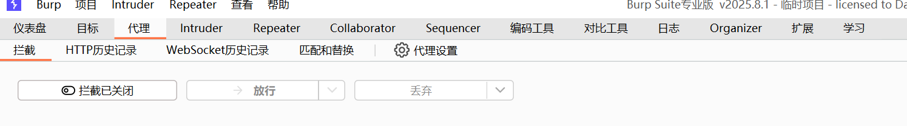Intruder模块（爆破模块）
常用在用户账密登录，部分sql注入题也可以用
攻击模式为4种，图例所示，
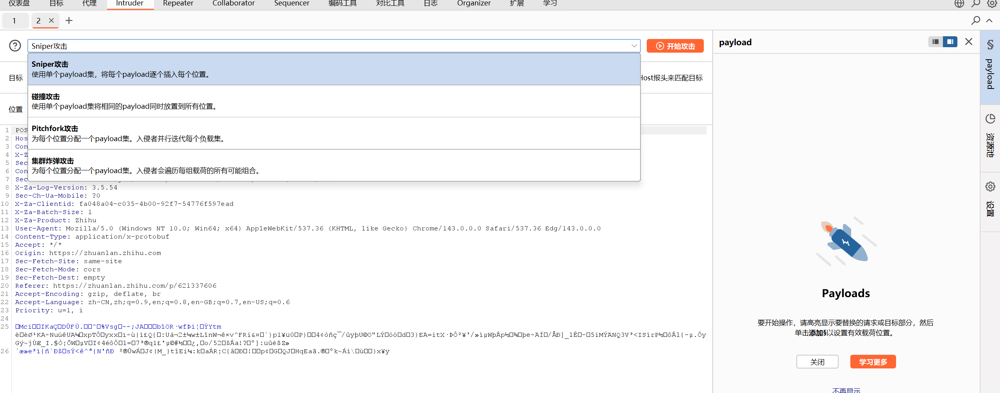
载荷目标列表，这个也属于Intruder模块
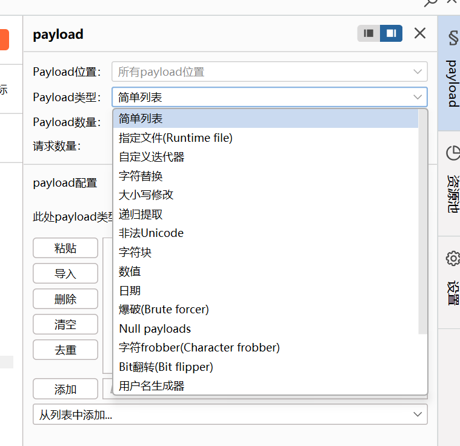
Repeater模块（重放模块）
修改数据包，发送请求，响应则是在右侧显示
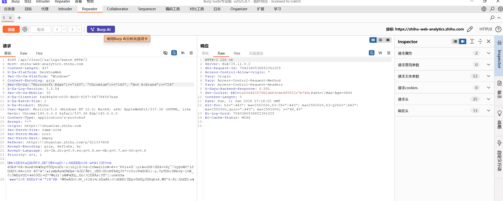
最常用的就是这几个了，其他的编码工具还有对比工具也很棒！！！
### BurpSuite的配置问题！！！
在代理插件上配置的 127.0.0.1:8080，则在 bp 上面也设置成一模一样的，不然抓不到包！！
代理配置，修改为这个，在使用的时候，记得切换到这个模式
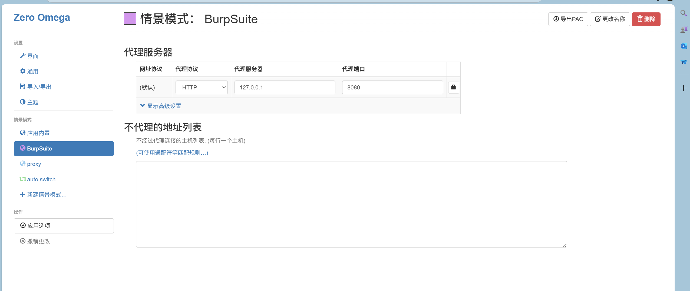
bp配置
同上配置，一般都是bp默认的地址：
127.0.0.1 
8080
两个配置成一样就行了，如果网页突然忘不了网络了，就检查一下bp软件是否开启了拦截，和网页插件是否调成了代理bp模式！！！
