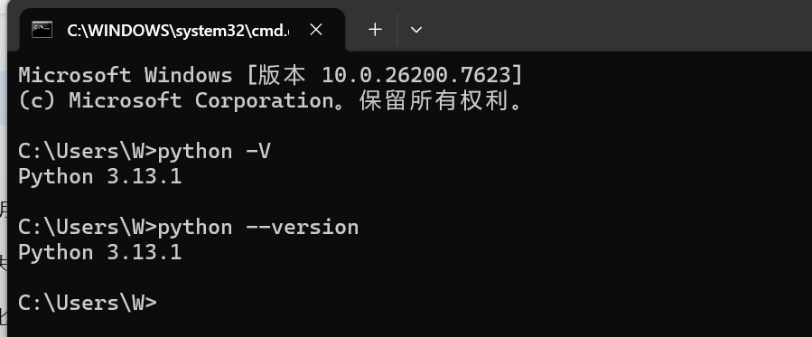

前言
所需要的软件可以选择性的下载！！！
# 所需软件
pycharm
链接：
[PyCharm，您需要的唯一 Python IDE](https://www.jetbrains.com/zh-cn/pycharm/)
vscode
链接：
[Visual Studio Code - 开源的 AI 代码编辑器](https://code.visualstudio.com/)
# 所需解释器
python解释器链接：
[Welcome to Python.org](https://www.python.org/)

# pip包管理相关
这个是一个包管理器，后续缺少第三方库会有下载实操
# 安装
安装到c盘以外的地方即可，下载完成之后记得勾选添加到PATH（环境）

### 测试安装
win+r，输入cmd，打开命令行（DOS窗口）

```python
	#查看系统版本
	python -V      
	
	或者
	
	python --version
```
如下所示
如果没有显示或者报错，即为上述操作没有将电脑重启和修改环境变量！！！
任选一个即可
