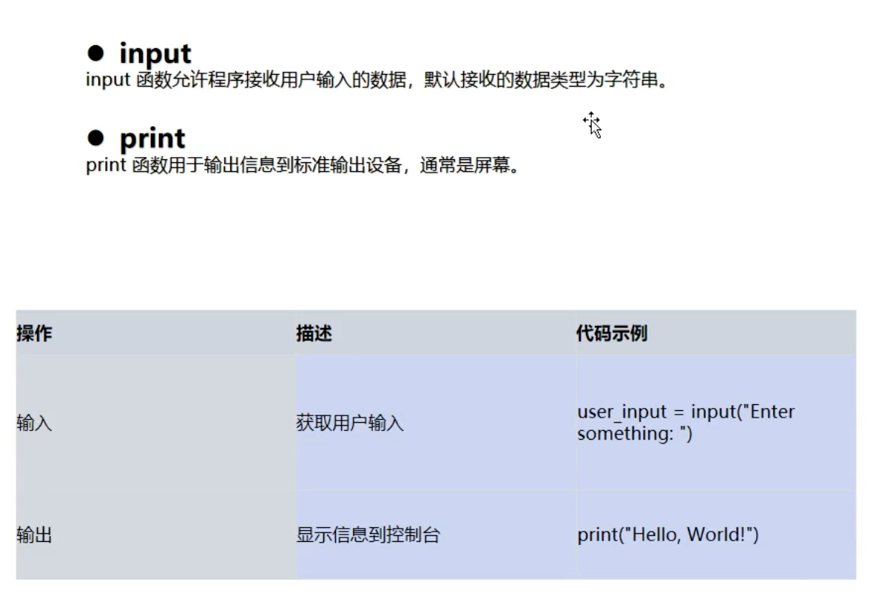

### 概览


### input
==input==函数允许程序接受用户输入的数据，默认接受的数据类型为字符串。
案例：
案例1：简单的输入输出
```python
#用户输入姓名
name = input("请输入您的姓名：")
print("您好，",name)
```
案例2：输入内容为整数
```python 
#用户输入年龄
age = int(input("请输入您的年龄："))
print("您的年龄是：",age)
```
### print
案例
案例1：输出字符串
```python
print("hello world!")
```
案例2：输出多个参数，自动添加空格分隔
```python
print("hello,","world!")
```
案例3：使用逗号和换行符
```python 
print("hello,",end = " ")
print("wordl!")
```
案例4：使用格式化输出
```python
name = "Alice"
age = 20
print("My name is {},and i am {} year old.".format(name,age))
```
==案例5：使用格式化字符串字面量（f-string）==
```python
name = "Charlie"
age = 30
print(f"My name is {},and i am {} year old.")
```
案例 6：使用格式化占位符（类似C语言中的printf）
```python
name = "David"
age = 40
print("My name is %s and I am %d years old."% (name,age))
```