### 什么时候是数据容器

	高效，简洁
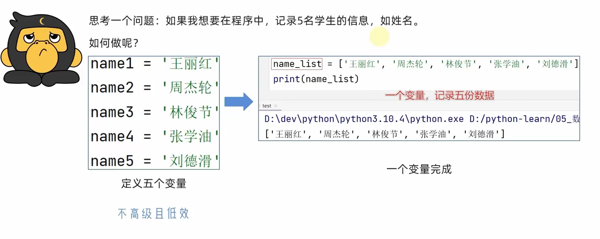
可以理解成一个盒子，里面放的一堆元素
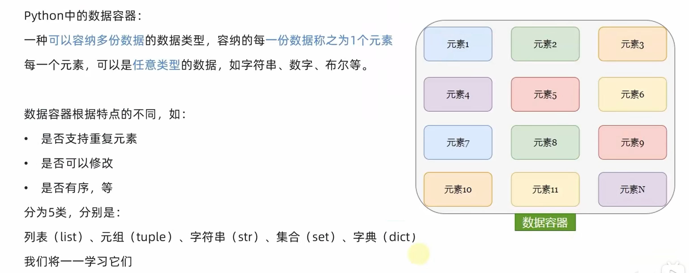

### 列表的定义语法
**什么是列表**
```python 
# 基本定义
my_list = [元素1, 元素2, 元素3, ...]

# 示例
my_list = ["itheima", "itcast", "python"]  # 纯字符串
my_list = ["itheima", 666, True]           # 混合类型
```
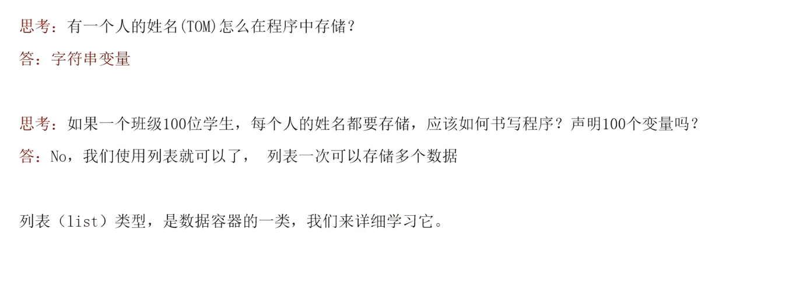

#### 列表的定义
***定义
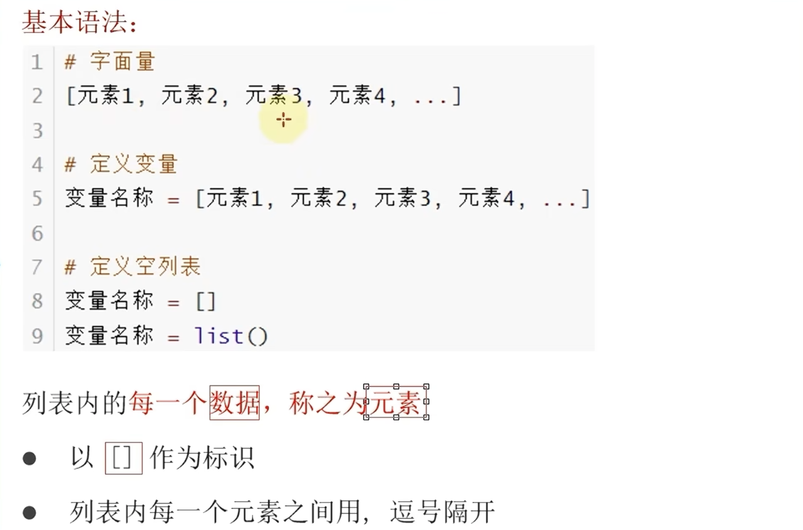

***定义方式

***注意

列表可以一次存储多个数据，且可以为不同的数据类型，支持嵌套
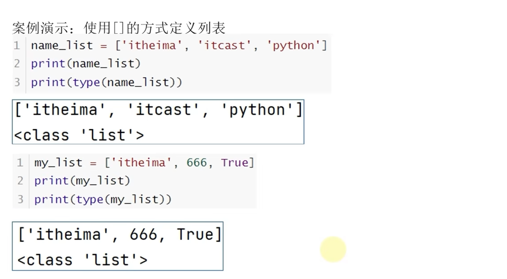

**嵌套**

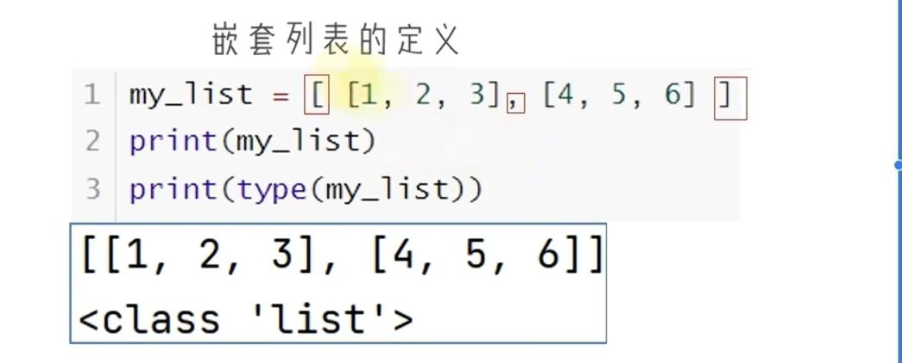

**小练习**
```python
# 定义一个列表  
my_list = ["itheima","itccast","python"]  
print(my_list)  
print(type(my_list))  
  
my_list = ["itheima",666,True]  
print(my_list)  
print(type(my_list))  
  
# 定义一个嵌套的列表  
my_list = [1,2,3,[4,5,6],[7,8,9,[10,11]],"你好呀"]  
print(my_list)  
print(type(my_list))
```

#### 列表的下标索引-正向

**如何使用呢**

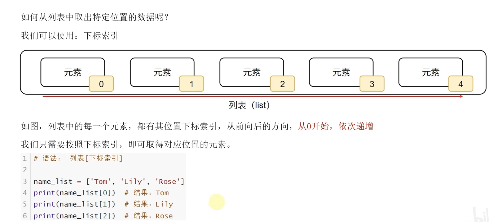


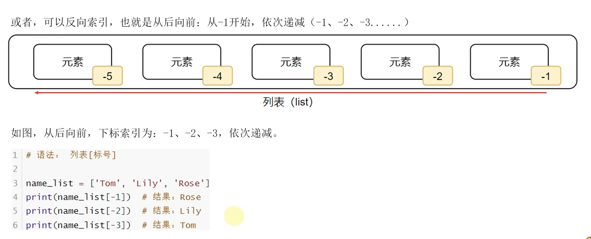

#### 列表的下标索引-反向


#### 嵌套列表的下标索引

列表索引

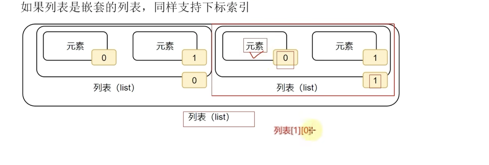

**小练习**

```python
# 通过下标索引对应位置的数据  
my_list = ["Tom","Lily","Rose"]  
# 列表[小标索引]，从前往后，从0开始，每次+1，从后向前从-1开始，每次-1  
print(my_list[0])  
print(my_list[1])  
print(my_list[2])  
  
# 反向输出  
print(my_list[-1])  
print(my_list[-2])  
print(my_list[-3])  
  
# 嵌套列表，值为11
my_list_num = [1,2,3,[4,5,6],[7,8,9,[10,11]],"你好呀"]  
print(my_list_num[4][3][1])
```

### 列表的常用操作方式

#### 方法

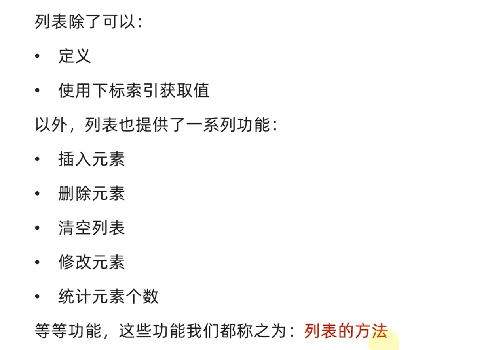


#### 列表的查询功能（方法）

方法和函数功能一样 ，有传入参数，有返回值，只是方法的使用格式不同：
函数的使用：
`num = add(1,2)`
方法的使用：
`student = Student()`
`num = student.add(1,2)`

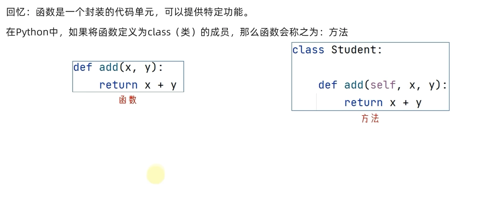