	前言
	列表的方法——说明
	功能方法非常多，不需要硬记下来。
	
	学习编程，不仅仅是Python语言本身，以后根据方向，会学习更多的框架技术。
	除了经常用的，大多数是记忆不下来的。
---

### 什么时候是数据容器

	高效，简洁
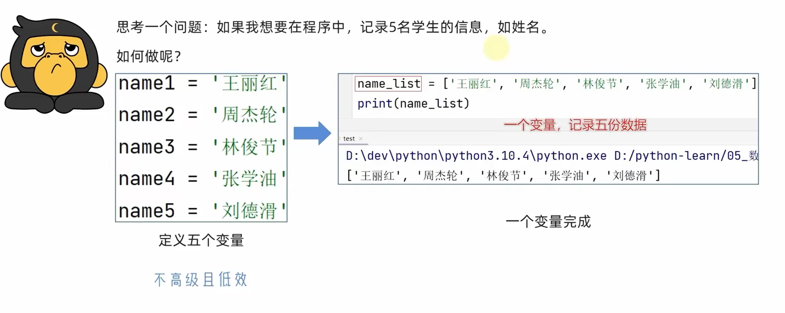
可以理解成一个盒子，里面放的一堆元素
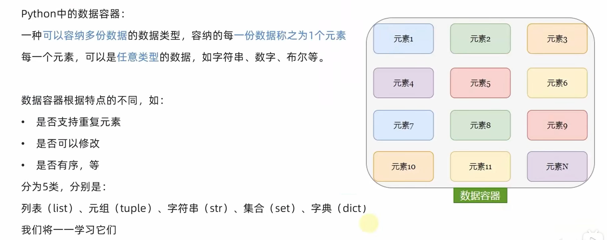

### 列表的定义语法
**什么是列表**
```python 
# 基本定义
my_list = [元素1, 元素2, 元素3, ...]

# 示例
my_list = ["itheima", "itcast", "python"]  # 纯字符串
my_list = ["itheima", 666, True]           # 混合类型
```
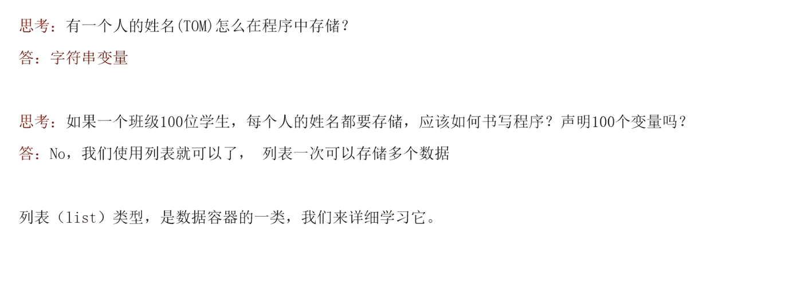

#### 列表的定义
***定义
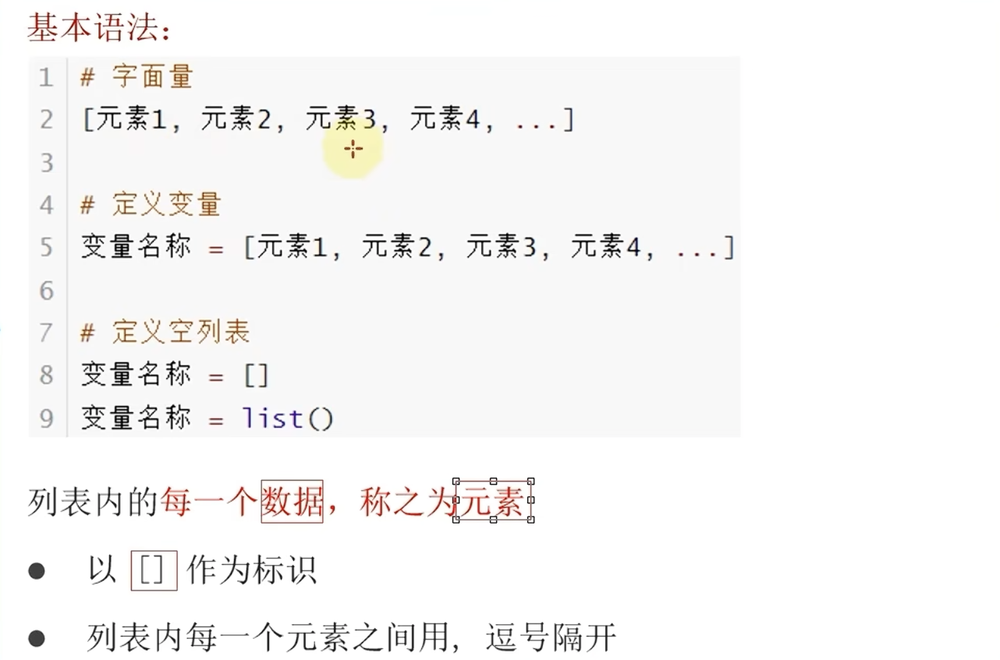

***定义方式

***注意

列表可以一次存储多个数据，且可以为不同的数据类型，支持嵌套
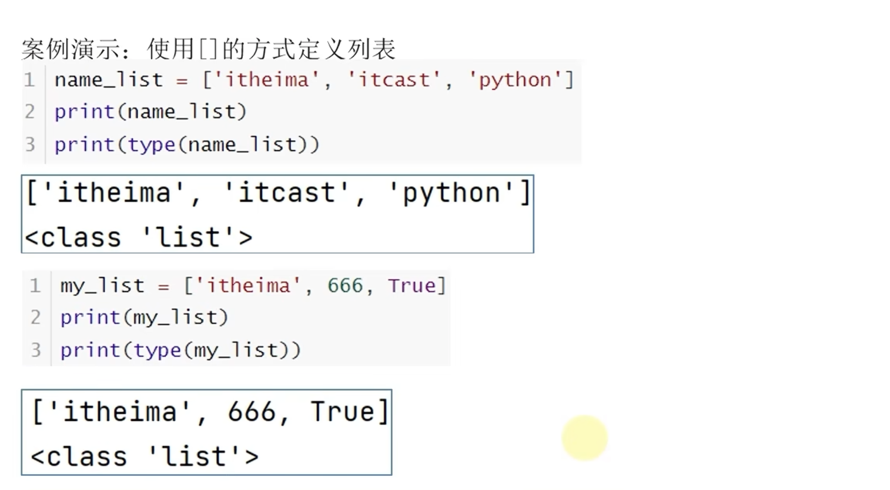

**嵌套**

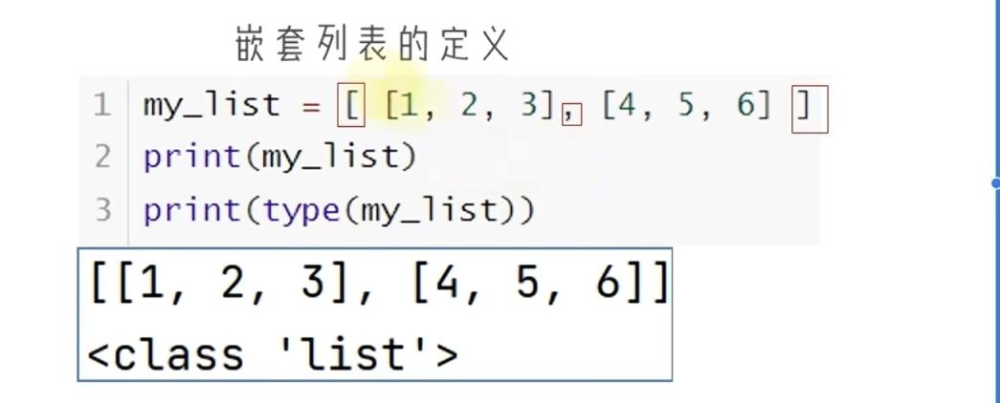

**小练习**
```python
# 定义一个列表  
my_list = ["itheima","itcast","python"]  
print(my_list)  
print(type(my_list))  
  
my_list = ["itheima",666,True]  
print(my_list)  
print(type(my_list))  
  
# 定义一个嵌套的列表  
my_list = [1,2,3,[4,5,6],[7,8,9,[10,11]],"你好呀"]  
print(my_list)  
print(type(my_list))
```

#### 列表的下标索引-正向

**如何使用呢**

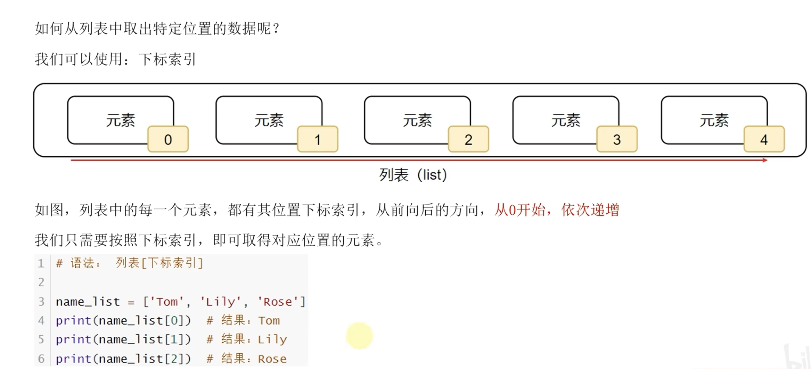


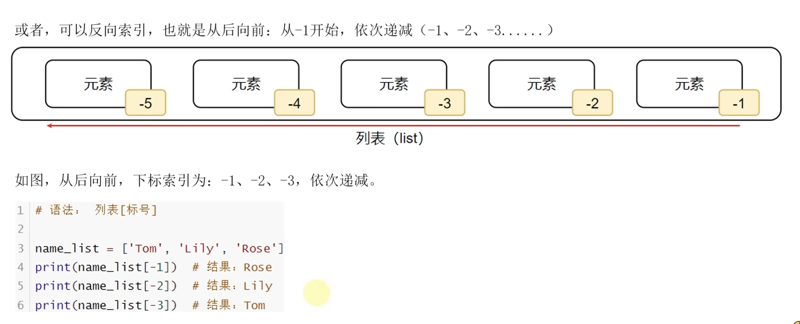

#### 列表的下标索引-反向


#### 嵌套列表的下标索引

列表索引

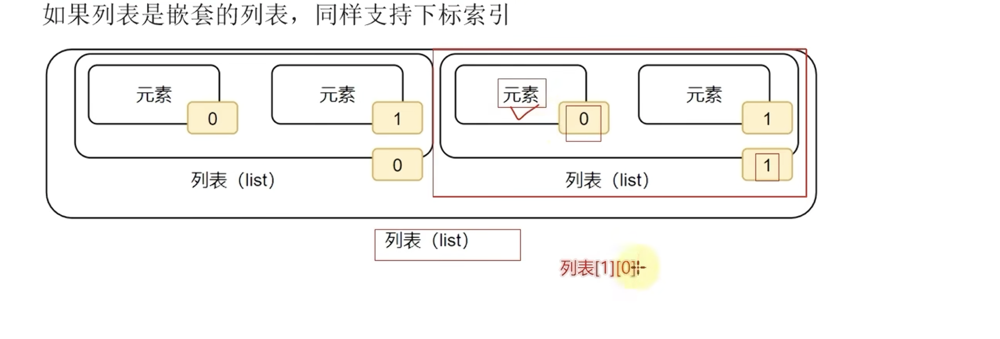

**小练习**

```python
# 通过下标索引对应位置的数据  
my_list = ["Tom","Lily","Rose"]  
# 列表[小标索引]，从前往后，从0开始，每次+1，从后向前从-1开始，每次-1  
print(my_list[0])  
print(my_list[1])  
print(my_list[2])  
  
# 反向输出  
print(my_list[-1])  
print(my_list[-2])  
print(my_list[-3])  
  
# 嵌套列表，值为11
my_list_num = [1,2,3,[4,5,6],[7,8,9,[10,11]],"你好呀"]  
print(my_list_num[4][3][1])
```

### 列表的常用操作方式

#### 方法

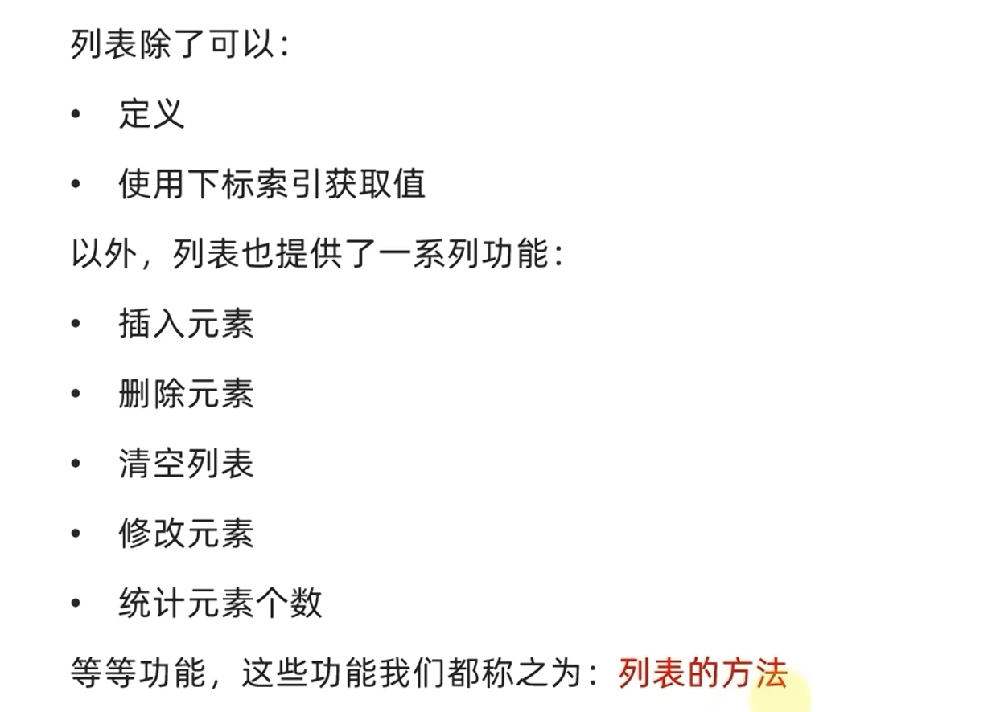


#### 列表的查询功能（方法）

方法和函数功能一样 ，有传入参数，有返回值，只是方法的使用格式不同：
函数的使用：
`num = add(1,2)`
方法的使用：
`student = Student()`
`num = student.add(1,2)`

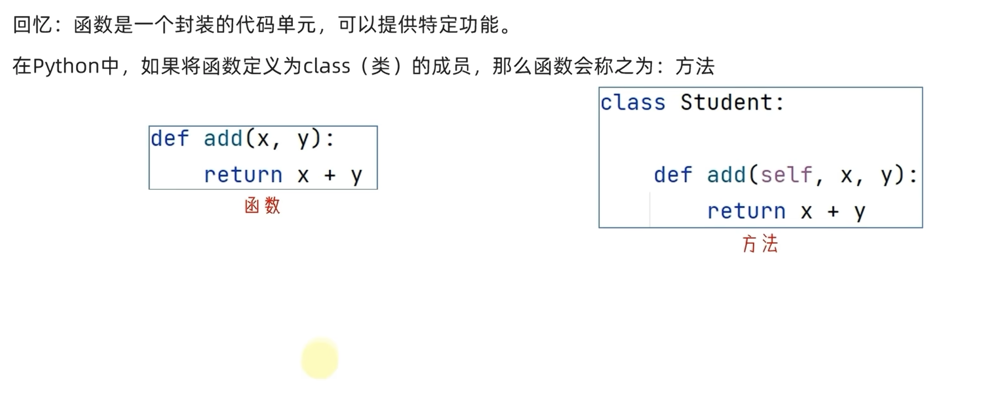

##### 查找某元素的下标**

- 功能：
	查找指定元素在列表的小标，如果找不到，报错valuError
	**语法**：
	==列表.index(元素)==
index就是列表对象(变量)内置的方法（函数）

```python

my_list = ["itheima","itcast","Python"]  
# 1.1查找某元素在列表内的下标索引  
index = my_list.index("itheima")  
print(f"itheima在列表中的小标索引值是：{index}")  
  
# 1.2如果查找的元素不存在，会报错  
index = my_list.index("hello")  
print(f"itheima在列表中的小标索引值是：{index}")
```


#### 列表的修改功能（方法）

##### 修改特定位置（索引）的元素值：

**语法：**
==列表[下标] = 值==
可以使用如上语法，直接对指定下标（正向，反向下标均可）的值进行：重新赋值（修改）
```python
# 正向下标
my_list = [1,2,3]
my_list[0] = 5
print(my_list)       # 结果是[5，2，3]

# 反向下标
my_list = [1,2,3]
my_list[-3] = 5
print(my_list)       # 结果是[5,2,3]
 
```

##### 插入元素

**插入元素**

**语法：**
==列表.insert(下标,元素),在指定的下标位置，插入指定的元素==
```python
# 示例
my_list = [1,2,3]
my_list.insert(1,"itheima")
print(my_list)                # 结果输出为[1,"itheima",2,3]
```

##### 元素的追加

**元素的追加**
- 插入元素：
	**语法**：
		`列表.insert(下标,元素),在指定的下标位置，插入指定的元素`
```python
# 示例
my_list = [1,2,3]
my_list.insert(1,"wuhu")
print(my_list)
```

- 追加元素方式1：
	**语法**：
		`列表.append(元素),将指定元素，追加到列表的尾部`
```python
# 示例
my_list = [1,2,3]
my_list.append(4)
print(my_list)            # 结果为：[1，2，3，4]

my_list = [1,2,3]
my_list.append([4,5,6])   # 结果为：[1,2,3,[4,5,6]]
print(my_list)
```

- 追加元素方式2：
	**语法**：
	`列表.extend(其他数据容器),将其他数据容器的内容取出，依次追加到列表尾部`
```Python
# 示例
my_list = [1,2,3]
my_list.extend([4,5,6])
print(my_list)          # 结果为：[1,2,3,4,5,6]
```

##### 元素的删除

- 删除元素：
	**语法1**：
	`del列表[下标]`
	**语法2：**
	`列表.pop(下标)`
```Python
# 示例
my_list = [1,2,3]

# 方法1
del my_list[0]
print(my_list)             # 结果为：[2,3]

# 方法2
my_list.pop(0)             # 结果为：[2,3] 
element = my_list.pop(2)   # 这个方法可以把删掉的值返回给它自己，接收的话
print(my_list)

my_list.pop()              # 不带参数默认删除最后一位
print(my_list)

```

- 删除某元素在列表中的第一个匹配项
	**语法**：
	`列表.remove(元素)`

```Python
# 示例
# 会去从左至右依次搜索一样的，只能移除一个，想要移除另外一个相同的，就需要再调用一次remove了
my_list = [1,2,3,4,5]
my_list.remove(2)
print(my_list)         # 结果为：[1，3，4，5]
```

- 清空列表内容：
	**语法：**
	`列表.clear()`

```Python
# 清空列表
my_list = [1,2,3,4]
my_list.clear()
print(my_list)         # 结果：[]

```

##### 统计元素

- 统计某元素在列表内的数量
	**语法：**
	`列表.count(元素)`
```Python
# 统计某元素在列表内的数量
my_list = [1,2,3,4,5,6]
print(my_list.count(1))        # 结果：[1]
```

- 统计列表内，有多少元素
	**语法**：
	`len(列表)`
	可以得到一个int数字，表示列表内的元素数量
```Python
# 统计数量
my_list = [1,2,3,"hello",4,"hello",5]
print(len(my_list))                          # 结果为：7                   
```


### 概览
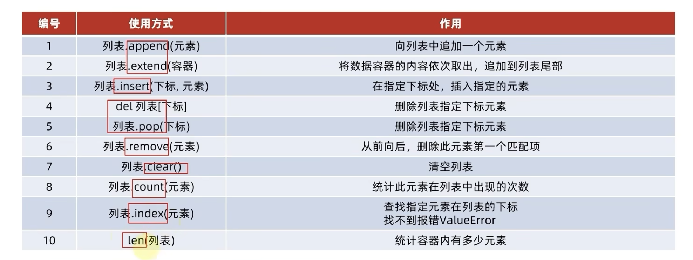
##### 列表的特点

经过上述对列表的学习，可以总结出列表有如下特点：
- 可以容纳多个元素（上线为2的63次方-1、9223372036854775807个）
- 可以容纳不同类型的元素（混装）
- 数据是有序存储的（有下标序号）
- 允许重复数据存在
- 可以修改（增加或删除元素等）

### 练习
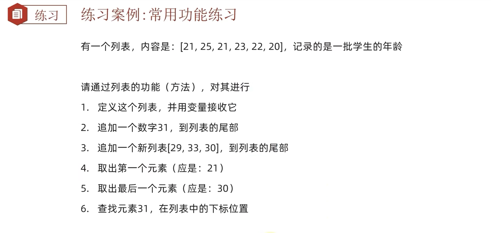

示例
```Python
# 题目
# 定义年龄列表  
age_list = [21,25,21,23,22,20]  
  
age_list.append(31)  
print(age_list)  
age_list.extend([29,33,30])  
print(age_list)  
element_num = age_list.pop(0)  
print(element_num)  
element_num = age_list.pop(-1)  
print(element_num)  
age_list.count(31)  
print(age_list)  
index = age_list.index(31)  
print(index)
```

### 列表的遍历

#### 列表的遍历——while循环

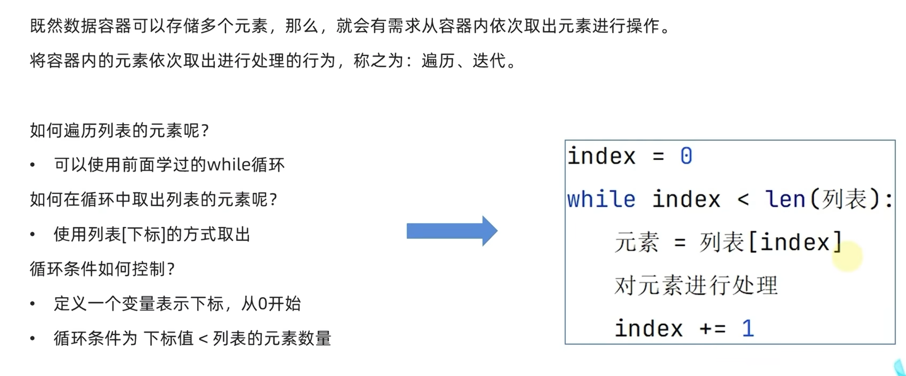
示例
```Python
# while循环
def list_while_func():
    my_list = ["你好","我是黑马程序员","欢迎来学python"]
    index = 0
    while index < len(my_list):
        element = my_list[index]
        print(element)   # 加上这行，才能看到输出
        index += 1

list_while_func()
```

#### 列表的循环——for循环

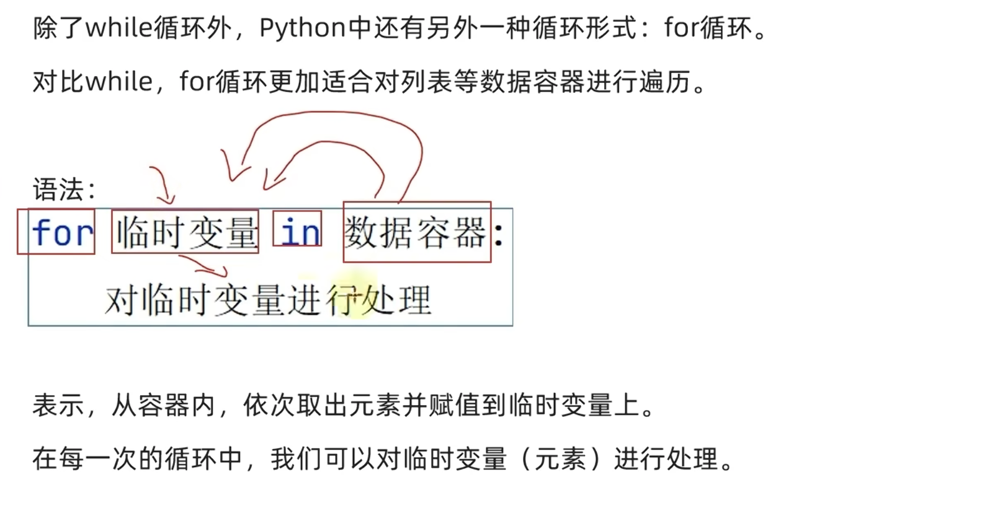

示例
```Python
# for循环
def list_for_func():
	my_list = [1,2,3,4,5]
	for element in my_list:
		print(f"列表中的元素有：{element}")

list_for_func()	
```

#### while循环和for循环的对比

while循环和for循环，都是循环语句，但细节不同：
- 在循环控制上：
	- while循环可以自定循环条件，并自行控制
	- for循环不可以自定循环条件，只可以一个个从容器内取出数据
- 在无限循环上：
	- while循环可以通过条件控制做到无限循环
	- for循环理论上不可以，因为被遍历的容器容量不是无限的
- 在使用场景上：
	- while循环适用于任何想要循环的场景
	- for循环适用于，遍历数据容器的场景或简单的固定次数循环场景

#### 小练习

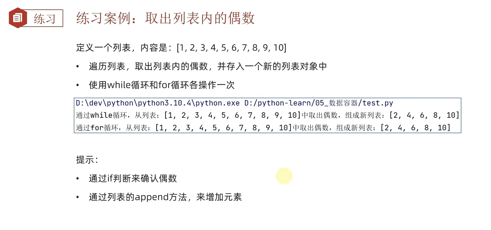

示例
```Python
# 小练
# while循环  
def list_while_func():  
    new_list = []  
    index = 0  
    while index < len(list_num):  
        num = list_num[index]  
        if num % 2 == 0:  
            new_list.append(num)  
        index += 1  
    print(f"通过while循环，从列表{list_num}中取出偶数，组成新列表：{new_list}")  
list_while_func()  
  
  
def list_for_func():  
    new_list = []  
    for num in list_num:  
        if num % 2 == 0:  
            new_list.append(num)  
    print(f"通过for循环，从列表{list_num}中取得偶数，组成新列表：{new_list}")  
  
list_for_func()
```
### 元组的定义和操作

#### 为什么需要元组

引入问题：列表是可以修改的。
如果想要传年底的信息不被篡改，列表就不合适了。

元组同列表一样，都是可以封装多个，不同类型的元素在内，但最大的不同点在于：
==元组一旦定义完成==，就不可修改

 所以，当我们需要在程序内封装数据，又不希望封装的数据被篡改，那么元组就非常的合适了。

#### 定义元组

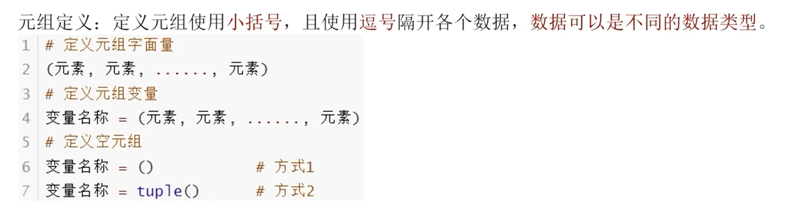

**注意事项**

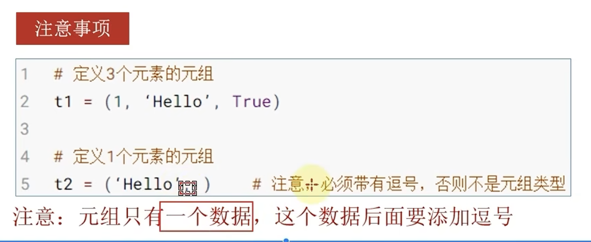

元组也支持嵌套：
```Python 
# 定义一个嵌套元组
t1 = ((1,2,3),(4,5,6))
print((t1[0][0]))        # 结果为1
```

```Python
# 小练习
 # 定义元组  
t1 = (1,"Hello world",True)  
t2 = ()  
t3 = tuple()  
print(f"t1的类型是：{type(t1)}，内容是：{t1}")  
print(f"t2的类型是：{type(t2)}，内容是：{t2}")  
print(f"t3的类型是：{type(t3)}，内容是：{t3}")  
  
# 定义单个元素的元素  
t4 = ("hello",)  
print(f"t4的类型是：{type(t4)},t4的内容是：{t4}")  
  
  
#  嵌套元组  
t5 = ((1,2,3),(4,5,6))  
print(f"t5的类型是：{type(t5)}，t5的内容是：{t5}")  
  
# 下标索引取出内容  
num = t5[1][2]  
print(f"从t5里面面取出的值是：{num}")  
  
#  元组的操作：index查找  
t6 = ("你好呀","黑马程序员","Python")  
index = t6.index("黑马程序员")  
print(f"在元组t6中查找黑马程序员的下标是:{index}")  
  
# 元组的操作：count统计方法  
t7 = ("黑马程序员","黑马程序员","Python工程师","白马程序员")  
num = t7.count(f"黑马程序员的数量是：{num}个")  
print(num)  
  
# 元组的操作：  
t8 = ("黑马程序员","黑马程序员","Python工程师","白马程序员")  
num1 = len(t8)  
print(f"t8的内容长度为：{num1}个")  
  
# 元组的遍历：while  
index = 0  
while index < len(t8):  
    print(f"元组的元素有：{t8[index]}")  
    #  至关重要  
    index += 1  
  
  
# 元组的遍历：for循环  
for element in t8:  
    print(f"2元组的元素有：{element}")

```

#### 元组的相关操作——注意事项

不可以修改元组的内容，否则会直接报错
```python
# 尝试修改元组内容
t1 = (1,2,3)
t1[0] = 5

# 报如下错误：
Traceback (mast recent call last):
	File "路径"，line 3 ，in <module>
		t1[0] = 5
TypeError:'tuple' oject does not support item assignment
```

可以修改元组内的list内容（修改元素、增加、删除、反转等）
```python
#  尝试修改元组内容
t1 = (1,2,['itheima','itcast'])
t1[2][1] = 'best'
print(t1)                 # 结果(1,2,['itheima','best'])

# 定义一个元组  
t9 = (1,2,['itheima','itcast'])  
print(f"t9的内容为：{t9}")  
t9[2][0] = "黑马程序员"  
t9[2][1] = "教育！！"  
print(f"t9更改之后的内容是：{t9}")

```

####  元组的特点

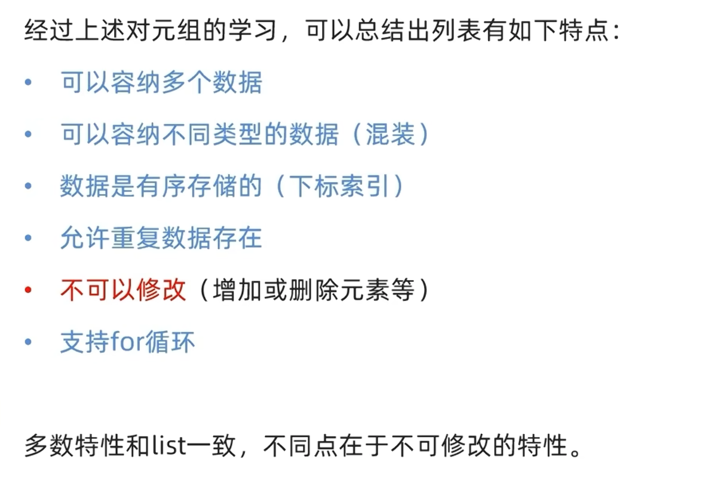
#### 元组练习

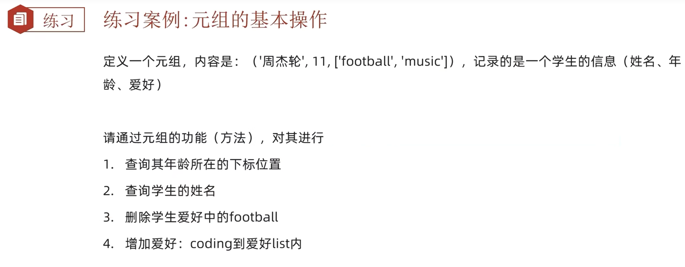


示例
```Python
# 小练习
# 定义一个元组  
tuple_list = ("周杰轮",11,['football','music'])  
  
# 查询其年龄的下标  
num = tuple_list.index(11)  
print(f"年龄的下标是：{num}")  
  
# 查询学生的姓名  
name = tuple_list[0]  
print(f"学生的姓名是：{name}")  
  
# 删除学生爱好中的football  
del tuple_list[2][0]  
print(f"删除学生的football之后剩余的信息是：{tuple_list}")  
  
# 增加爱好：coding爱好到list内  
tuple_list[2].append('coding')  
print(f"加入新的爱好之后，个人信息为：{tuple_list}")
```

### 字符串的定义和操作

#### 再识字符串

尽管字符串看起来不像：列表，元组那样，一看就是存放了很多数据的容器
但不可否认的是，字符串同样也是数据容器的一员。

字符串是字符的容器，一个字符串可以存放任意数量的字符。
如：字符串：“itheima”

#### 字符串的下标（索引）

和其他容器如：列表，元组一样，字符串也可以通过下标进行访问
- 从前向后，下标从0开始
- 从后向前，下标从-1开始

```Python
# 通过下标获取特定位置字符
name = "itheima"
print(name[0])              # 结果：i
print(name[-1])             # 结果：a
```

同元组一样，字符串是一个无法修改的容器。
所以：
- 修改指定下标的字符   (如：字符粗[0] = 'a')
- 移除特定下标的字符   (如，del字符串[0]、字符粗.remove()、字符串.pop等)
- 追加字符等                 (如，字符串.append())
均无法完整。如果必须要做，只能得到一个新字符串，老的字符串是无法修改的。

**小练习**
```python
my_str = "it heima and it cast"  
# t通过下标索引取值  
value1 = my_str[3]  
value2 = my_str[-17]  
print(f"从字符串{my_str}中取下标为3的元素，正向索引取值的信息是：{value1}")  
print(f"从字符串{my_str}中取下标为-17的元素，向索引取值的信息是：{value2}")  
```

#### 字符串的常用操作

##### 查找特定字符串的下标索引值
	==语法：==
	`字符串.index(字符串)`
```python
my_str = "itcast and itheima"
print(my_str.index("and"))     # 结果为7
```

示例

```python
my_str = "it heima and it cast"
# index方法  
value3 = my_str.index("and")  
print(f"在字符串{my_str}中查找and，起始下标是：{value3}")
```

##### 字符串的替换

==语法==：
	`字符串.replace(字符串1，字符串2)`
==功能==：
	将字符串内的全部，字符串1，替换为字符串2
==注意==：
不是修改字符串本省，而是得到了一个新字符串

示例
```python
my_str = "it heima and it cast"
# replace方法  
new_str = my_str.replace("it","程序")  
print(f"将字符出{my_str}，进行替换后得到：{new_str}")
```

##### 字符出的分割（分隔）

==语法==：
	`字符串.split(分隔符字符串)`
==功能==：
	按照指定的分隔符字符串，将字符串划分为多个字符串，并存入列表对象中
==注意==：
	字符串本身不变，二十得到了一个列表对象

示例
```python
# split方法  
my_str = "hello python itheima itcast"  
my_str_list = my_str.split(" ")  
print(f"将字符串{my_str}进行split切分后得到：{my_str_list},类型是：{type(my_str_list)}")
```

##### 字符串的规整操作（去前后空格）
==语法==：
	`字符串.strip`
```Python
my_str = " itheima and itcast "
print(my_str.strip())                 # 结果：itheima and itcast
```

##### 字符串的规整操作（去前后指定字符串）
==语法==：
	`字符串.strip(字符串)`
```Python
my_str = "12itheima and itcast21"
print(my_str.strip(12))               # 结果为：itheima and itcast
```
==注意==：
	传入的是"12"其实就是："1"和"2"都会移除，是按照单个字符。

示例
```Python
# strip 方法  
my_str = " itheima and itcast "  
new_my_str = my_str.strip()         # 不传入阐述，默认去除前后空格  
print(f"字符串{my_str}被strip后，结果：{new_my_str}")  
  
my_str = "12itheima and itcast21"  
new_my_str = my_str.strip("12")  
print(f"字符串{my_str}被strip('12),结果：{new_my_str}")  
  
# 统计字符串中年某字符串出现的次数,count()  
my_str = " itheima and itcast "  
count = my_str.count("it")  
print(f"字符出{my_str}中it出现的次数是：{count}")  
  
# 统计字符出的长度，len()  
my_str = " itheima and itcast "  
number = len(my_str)  
print(f"字符出{my_str}的字符出的长度是：{number}")

```

**图标汇总**

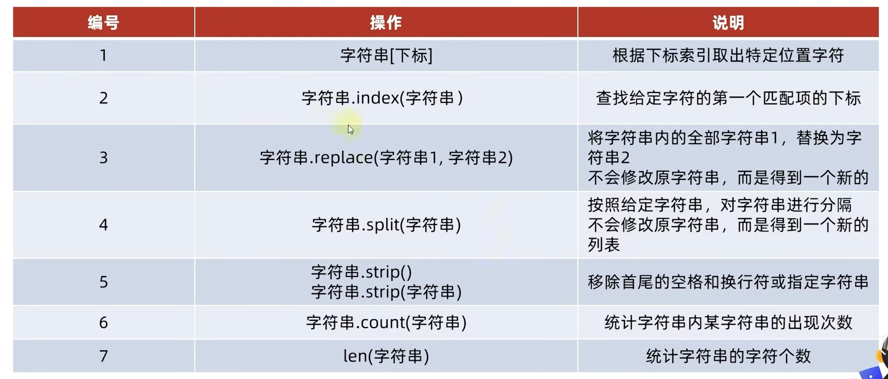

##### 字符串的遍历

同列表，元组一样，字符出也支持while循环和for循环进行遍历

示例
```Python
my_str = "黑马程序员"  
  
for i in my_str:  
    print(i)  
  
index = 0  
while index < len(my_str):  
    print(my_str[index])  
    index += 1
```
##### 小练习

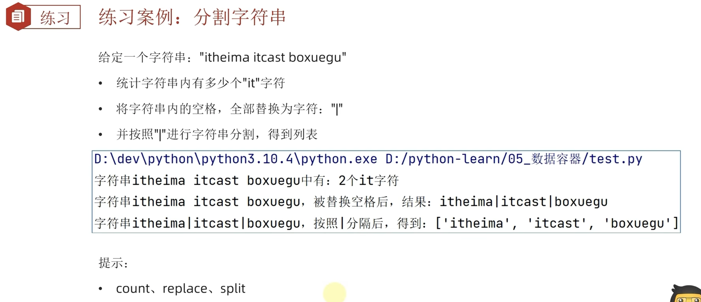

示例
```Python
  
my_str = "itheima itcast boxuegu"  
  
# 统计字符出内有多少个it字符  
count_my_str = my_str.count("it")  
print(f"字符出{my_str}中有{count_my_str}个it")  
  
# 按照“|”进行字符风格，得到列表  
replace_my_str = my_str.replace(" ","|")  
print(f"字符出{my_str}，被替换空格后，结果：{replace_my_str}")  
  
# 将字符串内的空格，全部替换为字符：“”  
split_my_str = my_str.split(" ")  
print(f"字符串{my_str}中替换字符之后的结果是：{split_my_str}")
```