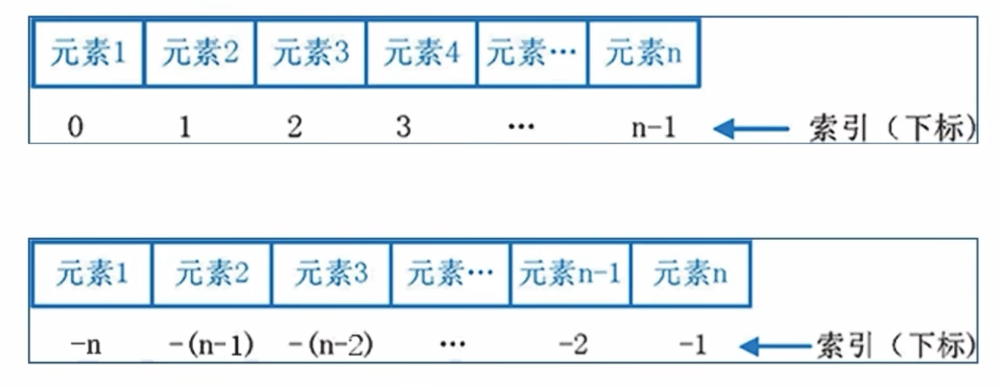
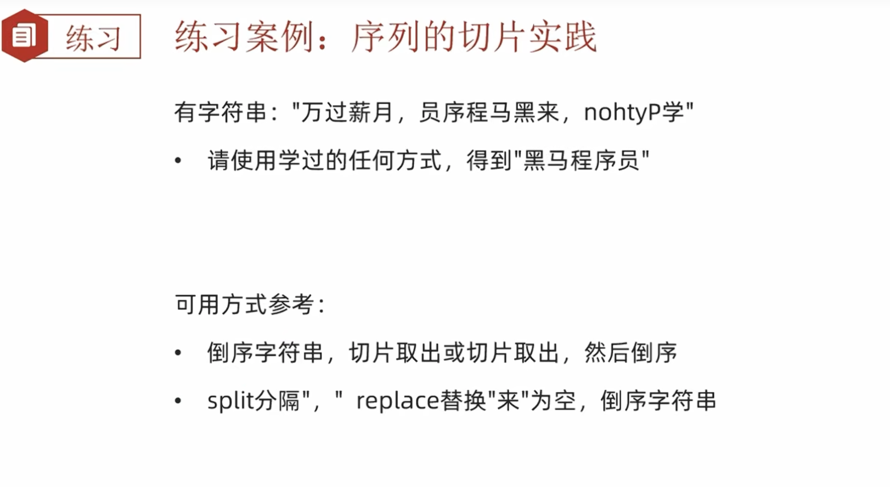

### 序列

==序列是指==：
	内容连续、有序、可使用下标索引的一类数据容器
==列表、元组、字符串均可以是为序列==


### 序列的常用操作——切片

序列支持切片，即：列表、元组、字符串均支持切片操作
切片：从一个序列中，取出一个子序列

==语法==：
	`序列[起始下标:结束下标:步长5]`
	表示从序列中，从指定位置开始，依次取出元素，到指定位置，得到一个新序列：
- 起始下标表示从何处开始，可以留空，留空是做从头开始
- 结束下标（不含）表示何处结束，可以留空，留空视作截取到结尾
- 步长表示，依次取元素的间隔
	- 步长1表示，一个个取元素
	- 步长2表示，每次跳过1个元素取
	- 步长N表示，每次跳过N-1个元素取
	- 步长为负数表示，反向取（注意（起始下标和结束下标也要反向标记）
注意：此操作**不会影响序列本身，而是会得到一个新的序列（列表，元组，字符串）**

**小练习**

```Python
# 对list进行切片，从1开始，4奇数，步长1  
my_list = [0,1,2,3,4,5,6]  
result1 = my_list[1:4]  
print(f"结果1是：{result1}")  
  
# 对tuple进行切片，从头开始，到最后结束，步长1  
my_tuple = (0,1,2,3,4,5,6)  
result2 = my_tuple[:]  
print(f"结果2是:{result2}")  
  
# 对str进行切片，从头开始，到最后结束，步长2  
str_list = "0123456"  
result3 = str_list[::2]  
print(f"结果3是：{result3}")  
  
# 对str进行切片，从头开始，到最后结束，步长-1  
str_list = "0123456"  
result4 = str_list[::-1]  
print(f"结果4是：{result4}")  
  
# 对列表进行切片，从3开始，到1结束，步长-1  
my_list = [0,1,2,3,4,5,6]  
result5 = my_list[3:1:-1]  
print(f"结果5是“{result5}")  
  
# 对元组进行切片，从头开始，到尾结束，步长-2  
my_tuple = (0,1,2,3,4,5,6)  
result6 = my_tuple[::-2]  
print(f"结果6是：{result6}")
```

### 练习




**示例**

```Python
# 定义一个字符串  
str_list = "万过薪月，员序程马黑来，nohtyP学"  
  
# 倒序输出到new_list  
new_list = str_list[::-1][9:14]  
print(f"方法一：结果是：{new_list}")  
  
# split分割“,”，replace替换“来”为空，倒序字符串  
result1 = str_list[5:10][::-1]  
print(f"方法二的结果是：{result1}")  
  
replace1 = str_list.split("，")[1].replace("来","")[::-1]  
print(f"方法三的结果是：{replace1}")
```