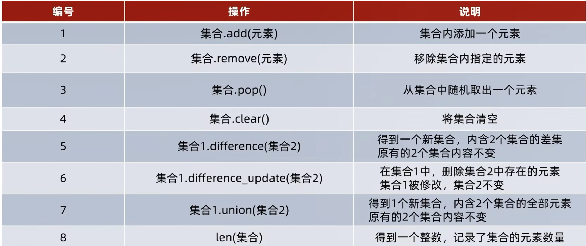
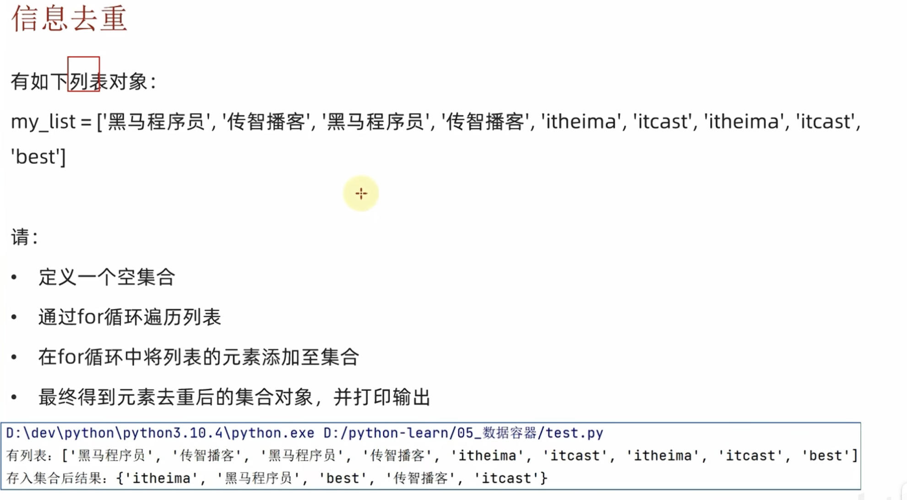

### 为什么用使用集合

目前接触懂了列表、元组、字符串三个数据容器了。基本满足大多数的使用需求，为=为何有需要学习新的集合类型呢？

通过特性来分析：
- 列表可修改、支持重复元素且有序
- 元组、字符串不可修改、支持重复元素且有序

局限就在于：他们都支持重复发元素
如果场景需要对内容去做去重处理，列表，元组，字符串就不方便了。
而集合，最主要的特点就是：不支持元素的重复，并且内容无序。 

### 集合的定义

基本语法
```Python
# 定义集合字面量
{元素,元素,...,元素}
# 定义集合变量
变量名称 = {元素,元素,...,元素}
# 定义空集合
变量名称 = set()
```

==和列表、元组、字符串等定义基本相同：==
- 列表使用：[]
- 元组使用：()
- 字符串从使用：""
- 集合使用：{}

**小练习**

```Python
# 定义集合  
my_set = {"传旨","黑马程序员","你好呀","吃法了没？","python","传旨","黑马程序员","你好呀","吃法了没？","python","传旨","黑马程序员","你好呀","吃法了没？","python",}  
my_set_empty = set()  
print(f"my_set的内容是：{my_set},他的类型是：{type(my_set)}")  
print(f"my_set_empty的内容是：{my_set_empty}，他的类型是：{my_set_empty}")
```

### 集合的常用操作-修改

因为集合是无序的，所以集合不支持：下标索引访问
但是集合和列表一样，是允许修改的。

- 添加新元素
	==语法==：
		`集合.add(元素)`
		将指定元素，添加到集合内。
	==结果==：
		集合本身被修改，添加了新元素。
```Python
my_set = {"Hello","World"}
my_set.add("itheima")
print(my_set)                 # 结果：{'Hello','itheima'}
```

**小练习**

```python
# add方法
my_set = {"传旨","黑马程序员","你好呀","吃法了没？","python","传旨","黑马程序员","你好呀","吃法了没？","python","传旨","黑马程序员","你好呀","吃法了没？","python",}  
my_set.add("Python")  
my_set.add("你好呀")  
print(f"结果是:{my_set}")
```

- 删除元素
	==语法==：
		`集合.remove(元素)`
		将指定元素，从集合内移除
	==结果：==
		集合本身被修改，移除了元素

```python
my_set = {"Hello","World"}
my_set.remove(""World)
print(my-set)
```

**小练习**

```python
my_set = {"传旨","黑马程序员","你好呀","吃法了没？","python","传旨","黑马程序员","你好呀","吃法了没？","python","传旨","黑马程序员","你好呀","吃法了没？","python",} 
my_set.remove("你好呀")  
print(f"结果是：{my_set}")
```

- 从集合中取出随机一个元素
	==语法==：
		`集合.pop()`
		功能，从集合中随机取出一个元素
	==结果==：
		会得到一个元素的结果，同时集合本身被修改，元素被移除
```python
my_set = {"Hello","World"}
element = my_set.pop()
print(my_-set)      # 结果：{"Hello","你好呀"}
print(element)      # 结果：'Hello'
```

**小练习**
```python
 # 随机取出一个  
my_set = {"传旨","黑马程序员","你好呀","吃法了没？"}  
elenmet = my_set.pop()  
print(f"原数据：{my_set}，随机之后的数据：{elenmet}")
```


- 清空集合
  ==语法==：
	`集合.clear()`
	功能，清空集合
	==结果==：
		集合本身被清空
```python
my_set = {"传旨","黑马程序员","你好呀","吃法了没？"}
my_set.clear()
print(f"集合被清空啦：{my_set}")            # 结果：set()
```

- 取出2个集合的差集
	==语法==：
		`集合1.difference(集合2)`
		==功能==：
		取出集合1和集合2的差集（集合1有而集合2没有的）
	==结果==：
		得到一个新集合，集合1和集合2不变

```python
set1 = {1,2,3}
set2 = {1,5,6}
set3 = set1.difference(set2)
print(set3)      # 结果：{2，3}     得到新的集合
print(set1)      # 结果：{1，2，3}  不变脸
print(set2)      # 结果：{1，5，6}  不变
```

- 消除2个集合的差集
	==语法==：
		`集合1.difference_update(集合2)`
		==功能==：
		对比集合1和集合2，在集合1内，删除和集合2相同的元素
	==结果==：
		结合1被修改，集合2不变
```python
# 消除2个集合的差集
set1 = {1,2,3}
set2 = {1,5,6}
set3 = set1.difference_update(set2)
print(set3)      # 结果：{2,3}
print(set1)      # 结果：{1，5，6}  
```

- 2个集合合并
	==语法==：
		`集合1.union(集合2)`
		功能：
		将集合1和集合2组合成新集合
	==结果==：
		得到新集合，集合1和集合2不变
```python
# 2个集合合并  
set1 = {1,2,3}  
set2 = {1,5,6}  
set3 = set1.union(set2)  
print(f"2结合合并后结果：{set3}")      # 结果：{1，2，3，5，6}  
print(f"合并后结合1：{set1}")      # 结果：{1，2,3}  
print(f"合并后集合2：{set2}")      # 结果：{1，5，6}
```

- 统计集合的元素数量len()
```python
# 统计集合元素数量len()  
set1 = {1,2,3,4,5,6,7,8,9}  
num = len(set1)  
print(f"集合内的元素数量有:{num}")
```

- 集合的遍历
	集合不支持下标索引，不能用while循环
	但是可以用for循环
```python
# 集合的遍历  
set1 = {1,2,3,4,5,6,9}  
for element in set1:  
    print(f"集合的元素有：{element}")
```

### 概览总结



### 练习



示例
```python
# 信息去重  
# 定义一个空集合以及一个需要去重的集合  
  
# 空集合  
empty_set = set()  
  
# 需要去重的集合  
my_list = ['黑马程序员','传智播客','黑马程序员','传智播客','itheima','itcast','itheima','itcast','best']  
  
# for循环遍历列表  
for item in my_list:  
    empty_set.add(item)  
  
print(f"有列表：{my_list}\n去重之后的列表为：{empty_set}")
```