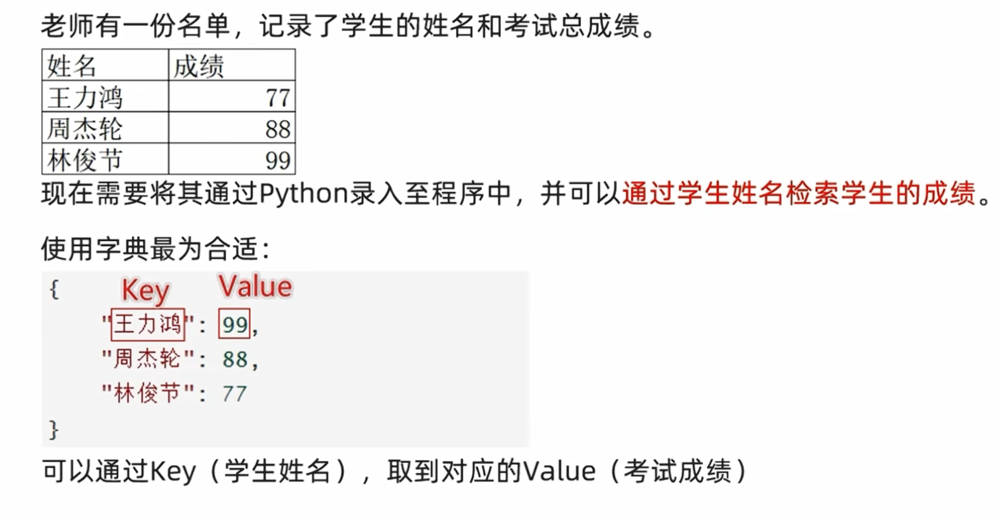
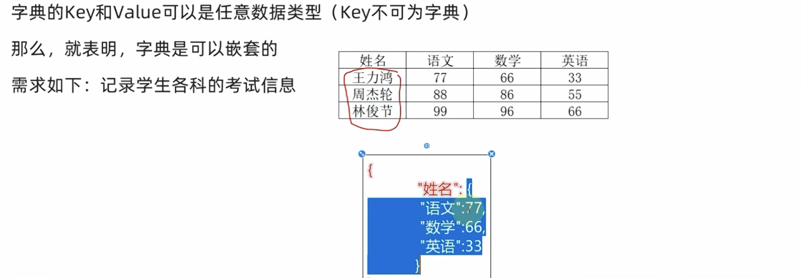

### 认识字典


### 字典的定义

同样使用{}，不过存储的元素是一个个的：==键值对==，如下语法：
```python
# 定义字典字面量 
{key:value,key:value,...,key:value}

# 定义字典变量
my_dict = {key:value,key:value,...,kye:value}

# 定义空空字典
my_dict = {}           # 字典定义方式1
my_dict = dict{}       # 字典定义方式2
```

**小练习**

```python
# 定义字典  
my_dict1 = {  
    "周杰轮":99,  
    "王力洪":100,  
    "林俊节":90  
}  
  
# 定义空字典  
my_dict2 = {}  
my_dict3 = dict()  
print(f"字典1的内容：{my_dict1}，类型是：{type(my_dict1)}")  
print(f"字典2的内容：{my_dict2}，类型是：{type(my_dict2)}")  
print(f"字典3的内容：{my_dict3}，类型是：{type(my_dict3)}")
```

### 字典数据的获取

字典同集合一样，不可以使用下标索引
但是字典可以通过Key值来取得对对应的Value

```python
# 语法，字典[key]可以取得对应的Value
stu_score = {"王力洪":99,"周杰轮":88,"林俊节":77}
print(stu_score["王力洪"])           # 结果99
print(stu_score["周杰轮"])           # 结果88
print(stu_score["林俊节"])           # 结果77
```

### 字典的嵌套

字典的Key和Value可以是任意数据类型（key不可谓自带你

**小练习**

```Python
# 定义嵌套字典  
stu_score_dict = {  
    "王力洪":{  
        "语文":77,  
        "数学":66,  
        "英语":33  
    },"周杰轮":{  
        "语文":88,  
        "数学":86,  
        "英语":55  
    },"林俊节":{  
        "语文":99,  
        "数学":96,  
        "英语":66  
    }  
}  
  
print(f"学生的考试信息是：{stu_score_dict}")  
  
# 查询周杰轮的语文信息  
  
score = stu_score_dict["周杰轮"]["语文"]  
print(f"周杰轮的语文分数是：{score}")  
score = stu_score_dict["林俊节"]["英语"]  
print(f"林俊节的英语分数是：{score}")
```