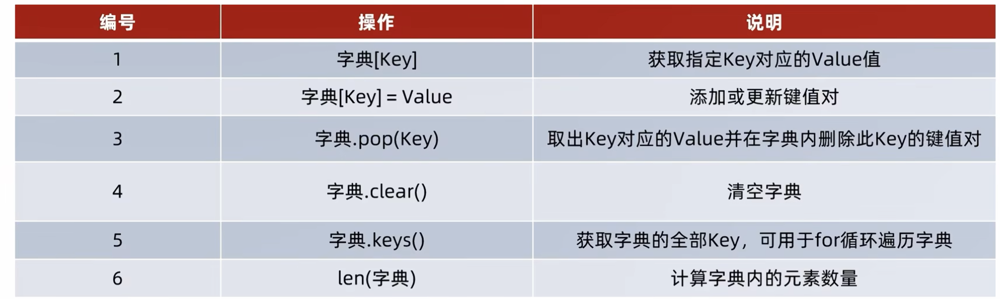
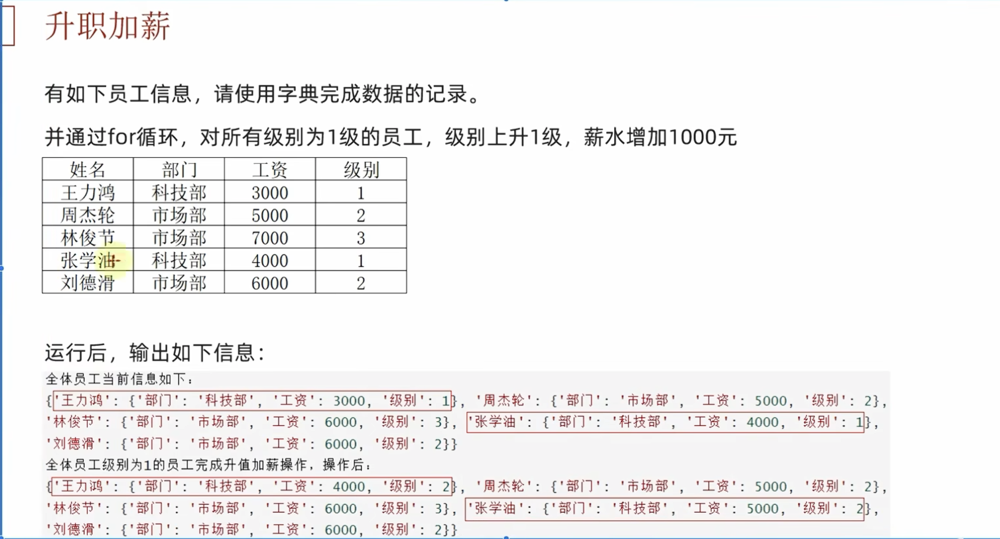

### 字典的常用擦欧总

#### 新增元素
	==语法==：
		`字典[key] = value`
	==结果==：
		字典被修改，新增了元素
```python
stu_score = {
	"王力洪":99,  
    "周杰轮":100,  
    "林俊节":90  
}
# 新增：张学油的考试成绩
stu_score["张学油"] = 66
print(stu_score)           # 结果："王力洪":99,  "周杰轮":100, "林俊节":90 ，"张学油":66
```

#### 更新元素
	==语法==：
		`字典[key] = value，结果：字典被修改，元素被更新`
	==注意==：
		字典key不可以重复，所以对已存在的key执行上述操作，就是更新value值

```python
stu_score = {
	"王力洪":99,  
    "周杰轮":100,  
    "林俊节":90  
}
# 更新王力洪的考试成绩
stu_score['王力洪'] = 100
print(stu_score)         
```

**小练习**

```python
# 定义一个字典  
my_dict = {"周杰轮": 99,"林俊节": 88,"张学油": 77}  
  
# 新增元素  
my_dict["张信哲"] = 66  
print(f"字典经过新增元素后，结果：{my_dict}")  
  
# 更新元素  
my_dict["周杰轮"] = 33  
print(f"字典经过更新后，结果：{my_dict}")
```

#### 删除元素
	==语法==：
		`字典.pop(key)`
	结果：
		获得指定Key和Value，同时字典被修改，指定key的数据被删除
```python
# 删除元素  
stu_score = {  
    "周杰轮": 77,  
    "王力洪": 88,  
    "林俊节": 99  
}  
value = stu_score.pop("王力洪")  
print(value)           # 结果：77  
print(stu_score)       # 结果：{'周杰轮': 77, '林俊节': 99}
```

#### 清空字典
	==语法==：
		`字典.clear()`
	结果：
		字典被修改，元素被清空
```python
# 清空字典  
stu_score = {  
    "周杰轮": 77,  
    "王力洪": 88,  
    "林俊节": 99  
}  
stu_score.clear()  
print(stu_score)     # 结果：{}
```


#### 获取全部的key
	==语法==：
		`字典.key()`
	结果：
		得到字典这中的全部key
```python
# 获取全部的key  
stu_score = {  
    "周杰轮": 77,  
    "王力洪": 88,  
    "林俊节": 99  
}  
key_stu_score = stu_score.keys()  
print(key_stu_score) 
```

#### 遍历字典

```python
# 遍历字典，方式1  
stu_score = {  
    "周杰轮": 77,  
    "王力洪": 88,  
    "林俊节": 99  
}  
for key in key_stu_score:  
    print(f"1字典的全部key是：{key}")  
    print(f"1字典的value是：{stu_score[key]}")  
  
# 遍历字典，方式2，for循环  
stu_score = {  
    "周杰轮": 77,  
    "王力洪": 88,  
    "林俊节": 99  
}  
for key in stu_score:  
    print(f"2字典的全部key：{key}")  
    print(f"2字典的value是：{stu_score[key]}")
```


#### 统计字典内的元素数量len()

```python
# 统计自带你内的元素数量  
num = len(stu_score)  
print(f"字典中打的元素数量有：{num}个")
```

### 概览总结



### 练习



示例

```python 
### 感觉好啰嗦。。。
# 升职加薪  
# 定义公司  
# 组织字典记录数据  
company_dict = {  
    "王力洪":{  
        "部门":"科技部",  
        "工资":3000,  
        "级别":1  
    },  
    "周杰轮":{  
        "部门":"市场部",  
        "工资":5000,  
        "级别":2  
    },  
    "林俊节":{  
        "部门":"市场部",  
        "工资":7000,  
        "级别":3  
    },  
    "张学油":{  
        "部门":"科技部",  
        "工资":4000,  
        "级别":1  
    },  
    "刘德滑":{  
        "部门":"科技部",  
        "工资":6000,  
        "级别":2  
    }  
}  
print(f"全体员工当前信息如下:\n{company_dict}")  
  
# for循环  
for name in company_dict:  
  
    # if判断  
    if company_dict[name]["级别"] == 1:  
        # 升职加薪  
        # 级别提升  
        level_company_dict = company_dict[name]  
        # 修改员工信息  
        level_company_dict["级别"] = 2  
        level_company_dict["工资"] += 1000  
  
        # 更新信息  
        company_dict[name] = level_company_dict  
print(f"f升职加薪！！！{company_dict}")  
print(f"对员工升职加薪后的结果是：{company_dict}")

```

```python
# 我写的！
# 升职加薪
# 定义公司
company_dict = {
    "王力洪":{"部门":"科技部","工资":3000,"级别":1},
    "周杰轮":{"部门":"市场部","工资":5000,"级别":2},
    "林俊节":{"部门":"市场部","工资":7000,"级别":3},
    "张学油":{"部门":"科技部","工资":4000,"级别":1},
    "刘德滑":{"部门":"科技部","工资":6000,"级别":2}
}
print(f"全体员工当前信息如下:\n{company_dict}")

# for循环遍历字典
for name, info in company_dict.items():  # 必须加 .items()，且变量名要在字典后面
    # 判断当前这个人（info）的级别是不是 1
    if info["级别"] == 1:                # 这里不能用 company_dict["王力洪"]
        # 升职加薪
        info["工资"] += 1000             # 修改当前这个人的 info
        info["级别"] += 1

print(f"升职加薪后的结果：\n{company_dict}")
```