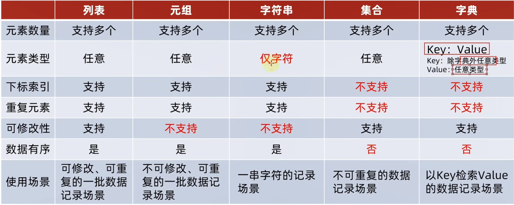
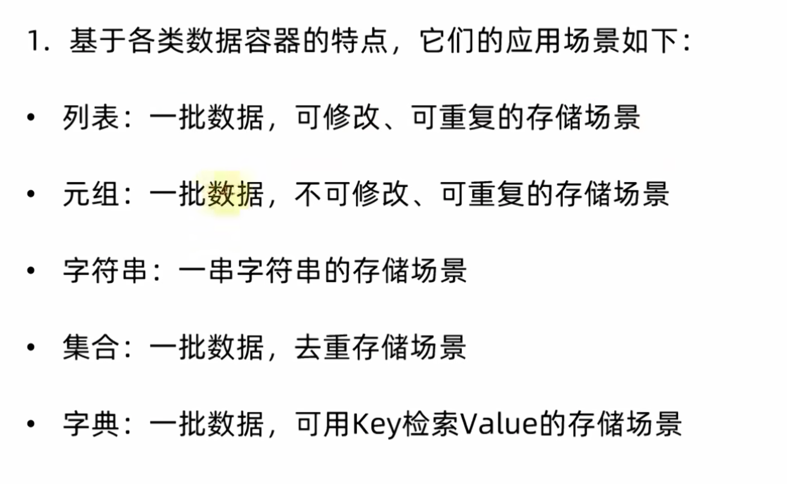

### 数据分类

数据容器可以从以下视角进行简单的分类：

- 是否支持下标索引
	支持：
		列表、元组、字符串——序列类型
	不支持：
		集合、字典——非序列类型
- 是否支持重复元素：
	支持：
		列表、元组、字符串——序列类型
	不支持：
		集合、字典——非序列类型
- 是否可以修改
	支持：
		列表、集合、字典
	不支持：
		元组、字符串

### 数据容器特点对比

### 总结

