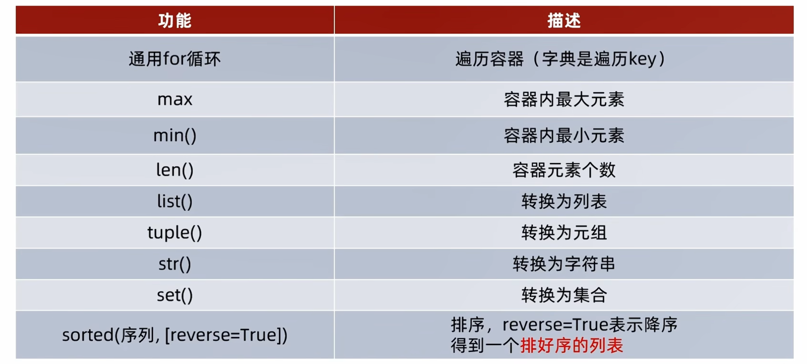

### 遍历

数据容器尽管各有各自的特点，但是他们也有通用的一些操作。

首先，在遍历上：

- 5类数据容器都支持for循环遍历
- 列表、元组、字符串支持while循环，集合、字典不支持（没有下标索引）

尽管遍历的形式各有不同，但是，他们都支持遍历操作

### 数据容器的通用统计功能

除了遍历这个共性外，数据容器可以通用非常多的功能方法

- len(==容器==)
	统计容器的元素个数
```Python
my_list = [1,2,3]
my_luple = (1,2,3,4,5)
my_str = "itheima"

print(len(my_list))     # 解雇 3
print(len(my_tuple))    # 结果 5
print(len(my_str))      # 结果 7
```

- ==max==(容器)
	统计容器最大元素
```Python
my_list = [1,2,3]
my_luple = (1,2,3,4,5)
my_str = "itheima"

print(len(my_list))     # 解雇 3
print(len(my_tuple))    # 结果 5
print(len(my_str))      # 结果 t
```

min(==容器==)
	统计容器的最小元素
```Python
my_list = [1,2,3]
my_luple = (1,2,3,4,5)
my_str = "itheima"

print(len(my_list))     # 解雇 1
print(len(my_tuple))    # 结果 1
print(len(my_str))      # 结果 a
```


**小练习**


```Python
# 定义  
my_list = [1,2,3,4,5,6]  
my_tuple = (1,2,3,4,5,6)  
my_str = "abcdefg"  
my_set = {1,2,3,4,5,6}  
my_dict = {"key1": 1,"kye2": 2,"key3": 3,"key4": 4,"key5": 5}  
  
# len函数  
print(f"列表 元素个数有：{len(my_list)}")  
print(f"元组 元素个数有：{len(my_tuple)}")  
print(f"字符串 元素个数有：{len(my_str)}")  
print(f"集合 元素个数有：{len(my_set)}")  
print(f"字典 元素个数有：{len(my_dict)}")  
  
# max函数  
print(f"列表 最大的元素是：{max(my_list)}")  
print(f"元组 最大的元素是：{max(my_tuple)}")  
print(f"字符串 最大的元素是：{max(my_str)}")  
print(f"集合 最大的元素是：{max(my_set)}")  
print(f"字典 最大的元素是：{max(my_dict)}")  
  
# min函数  
print(f"列表 最小的元素是：{min(my_list)}")  
print(f"元组 最小的元素是：{min(my_tuple)}")  
print(f"字符串 最小的的元素是：{min(my_str)}")  
print(f"集合 最小的元素是：{min(my_set)}")  
print(f"字典 最小的元素是：{min(my_dict)}")  
  
```

### 容器的通用 转换功能

除了下标索引这个共性外，还可以通用类型转换

- list(容器)
	将给定容器转换为列表

```Python
# 类型转换：容器转列表  
print(f"列表转列表的结果是：{list(my_list)}")  
print(f"元组转列表的结果是：{list(my_tuple)}")  
print(f"字符串转列表的结果是：{list(my_str)}")  
print(f"集合转列表的结果是：{list(my_set)}")  
print(f"字典转列表的结果是：{list(my_dict)}")
```

- str(容器)
	将给定容器转换为字符串
	
```Python
# 类型转转：容器转字符串  
print(f"列表转字符串的结果是：{str(my_list)}")  
print(f"元组转字符串的结果是：{str(my_tuple)}")  
print(f"字符串转字符串结果是：{str(my_str)}")  
print(f"集合转字符串的结果是：{str(my_set)}")  
print(f"字典转字符串的结果是：{str(my_dict)}")
```

- tuple(容器)
	将给定容器转换为元组
```Python
# 类型转转：元组字符串  
print(f"列表转元组的结果是：{tuple(my_list)}")  
print(f"元组转元组的结果是：{tuple(my_tuple)}")  
print(f"字符串转元组结果是：{tuple(my_str)}")  
print(f"集合转元组的结果是：{tuple(my_set)}")  
print(f"字典转元组的结果是：{tuple(my_dict)}")
```

- set(容器)
	将给定容器转换为集合
```Python
# 类型转转：容器转集合  
print(f"列表转集合的结果是：  {set(my_list)}")  
print(f"元组转集合的结果是：  {set(my_tuple)}")  
print(f"字符串转集合结果是：  {set(my_str)}")  
print(f"集合转集合的结果是：  {set(my_set)}")  
print(f"字典转集合的结果是：  {set(my_dict)}")
```

### 容器的通用排序功能

- sorted(容器,[reverse=True])
	将给定容器进行排序

```Python
# sorted排序  
# 进行容器排序  
my_list = [2,1,5,6,3,4]  
my_tuple = (5,4,2,3,1,6)  
my_str = "acdegbf"  
my_set = {1,3,2,5,6,4}  
my_dict = {"key1": 1,"kye2": 2,"key3": 3,"key4": 4,"key5": 5}  
  
print(f"列表对象的正向排序结果是：{sorted(my_list)}")  
print(f"元组对象的正向排序结果是：{sorted(my_tuple)}")  
print(f"字符串对象正向排序结果是：{sorted(my_str)}")  
print(f"集合对象的正向排序结果是：{sorted(my_set)}")  
print(f"字典对象的正向排序结果是：{sorted(my_dict)}")  
  
# 反向排序  
print(f"列表对象的反向排序结果是：{sorted(my_list,reverse=True)}")  
print(f"元组对象的反向排序结果是：{sorted(my_tuple,reverse=True)}")  
print(f"字符串对象反向排序结果是：{sorted(my_str,reverse=True)}")  
print(f"集合对象的反向排序结果是：{sorted(my_set,reverse=True)}")  
print(f"字典对象的反向排序结果是：{sorted(my_dict,reverse=True)}")
```

### 功能总览




