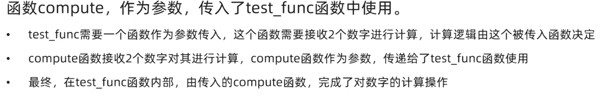
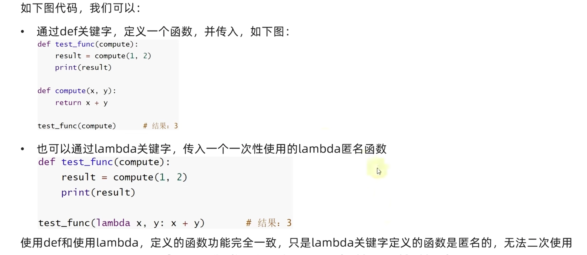

### 函数的多返回值

正常来说，一个函数只能返回一个return值，如下：
```
def return_num():
	return 1
	return 2

result = return_num()
print(result)          # 返回return1那个
```

只执行了一个1，2后面的都不会被执行，但是，有语法可以输出多个return！

#### 多个返回值

如果一个函数要有多个返回值，如下书写：
```Python
def return_num():
	return 1,2
	
x,y = return_num()
print(x)      # 结果1
print(y)      # 结果2
```

按照返回值的顺序，写对应舒徐的等多个变量接受即可
变量之间用都逗号隔开，支持不同类型的数据return。

**小练习**

```Python
def return_num():  
    return 1,"Hello",True  
  
x, y, z = return_num()  
print(x)  # 结果1  
print(y)  # 结果2  
print(z)
```

### 函数多种传参方式

#### 函数参数种类

==使用方式上的不同，函数有4中常见参数使用方式：==
- ==位置参数==
- ==关键词参数==
- ==缺省参数==
- ==不定长参数==

#### 位置参数

==位置参数：==
	调用函数时根据函数定义的==参数位置来传递参数==
```Python
def user_info(name,age,gender):
	print(f"您的名字是i{name}，年龄是{age}，性别是{gender}")

user_info('TOM',2O,'男')
```

注意：
	==传递的参数和定义的参数的顺序及其个数必须一致==

#### 关键字参数

关键字参数：
函数调用时通过“键=值”形式传递参数。
作用：
可以让函数更加清晰、容易使用，同时也清除了参数的顺序需求。
```Python
def user_info(name,age,gender):
	print(f"您的名字是i{name}，年龄是{age}，性别是{gender}")
	
# 关键字传参
user_info(name="小明",age=20,gender="男")
# 可以不按照固定顺序
user_info(gender="男",name="小明",age=20)
# 可以和位置参数混用，位置参数必须在前，且匹配参数顺序
user_info("小明",age=20,gender="男")
```

注意：
	函数调用时，如果有位置参数时，位置参数必须在关键字参数的前面，但关键字参数之间不存在先后顺序。

**小练习**
```Python
def user_info(name,age,gender):  
    print(f"您的姓名是：{name}，年龄是：{age},性别是：{gender}")  
# 位置参数——默认使用形式  
user_info("小明",20,"男")  
  
# 关键字参数  
user_info(name="巴鲁",age=10000,gender="虫子")  
user_info(age=20,gender="女",name="小美")  
user_info("不及格",gender="女",age=19)
```

#### 缺省参数

- 缺省参数：
	也叫默认参数，用于定义函数，为参数提供默认值，调用函数时，不可传该默认参数的值（注意）所有位置参数必须出现在啊默认参数前，包括函数定义和调用）
- 作用：
	当调用函数时没有传递参数，就会使用默认是缺省参数对应的值。
```Python
def user_info(name,age,gender):  
    print(f"您的姓名是：{name}，年龄是：{age},性别是：{gender}")  
    
user_info('TOM',20)
user_info('Rose',18,'女')
```

注意：
	函数调用时，如果为缺省参数传值则修改默认参数值，否则，使用这个默认值。

```Python
# 缺省参数（默认值）  
def user_info(name,age,gender='男'):  
    print(f"您的姓名是：{name}，年龄是：{age},性别是：{gender}")  
  
user_info('小天',21)  
user_info('小天',21,gender='女z')
```

#### 不定长参数

- 不定长参数：
也叫可变参数，用于不确定调用的时候会传递多少个参数（不传参也可以）的场景。
- 作用：
	当调用函数时不确定参数个数时，可以使用不定长参数

不定长参数的类型：
- 位置传递
- 关键词传递

##### 位置传递

```Python
def user_info(*args):
	print(args)
	
# ('TOM',)
user_info('TOM')
# ('TOM',18)
user_info('TOM',18)
```

注意：
	传进的所有参数都会被args变量收集，它会根据传进参数的位置合并为一个元组（tuple），这就是位置传递。

##### 关键字传递

```Python
def user_info(**kwargs):
	print(kwargs)
	
# {'name': 'TOM','age': 18,'id': 110}
user_info(name='TOM',age=18,id=110)
```

注意：
	参数是“键=值”形式的情况下，所欲“键=值”都会被kwargs收集，同时会根据“键=值”组成字典。
```Python
# 不定长 -位置不定长  
# 不定长的形式参数会作为tuple元组存在，接受不定长数量的参数传入  
def user_info(*args):  
    print(f"arge参数的类型是：{type(args)},内容是：{args}")  
  
user_info(1,2,3,'小明','男孩')  
  
# 不定长——关键字不定长  
def user_info(**kwargs):  
    print(f"kwargs参数的类型是：{type(kwargs)},内容是：{kwargs}")  
  
user_info(name='小明',age=11,gender='男孩',add='湖南')
```

### 匿名函数

#### 函数作为参数传递

上述函学习中，都是接受数据作为参数传入：
- 数字
- 字符串
- 字典、列表、元组等

其实，学习函数的本身，也可以作为参数传入另一个函数内。

如下代码：
```Python
def test_func():
	result = compute(1,2)
	print(result)
	
def compute(x,y):
	return x + y
	
test_func(compute)
```



 所以，这是一种，计算逻辑的传递，而非数据的传递。
 像上述代码那样，不仅仅是相加，相减、相除、等任何逻辑都可以自定义并作为参数传入
```Python
 def t_func(compute):
    result = compute(1, 2)    # 调用传入的函数
    print(f"compute参数的类型是：{type(compute)}")
    print(f"计算结果：{result}")

# 定义一个函数，准备作为参数传入
def compute(x, y):
    return x + y

# 调用，并传入函数
t_func(compute)
```

#### lambda函数

函数定义中
- ==def== 关键字，可以定义**带有名称**的函数
- ==lambda== 关键字，可以**定义匿名函数**（无名称）
有名称的函数，可以基于名称==重复使用==。
无名称的匿名函数，只可==临时使用一次==。

匿名函数定义语法：
==lambda== `传入参数:函数体（一行代码）`
- lambda 是关键字，表示定义匿名函数
- 传入参数表示匿名函数的形式参数，如：x，y表示接受2个形式参数
- 函数体，就是函数的执行逻辑，要注意：只能写一行，无法写多行代码



```Python
def t_func(compute):  
    result = compute(1,2)  
    print(f"结果是：{result}")  
  
t_func(lambda x, y : x + y)
```