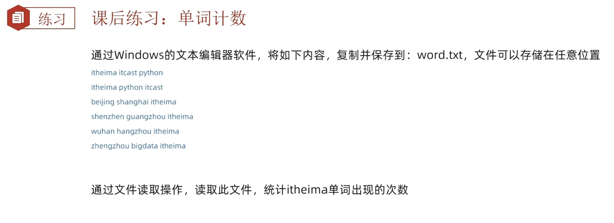
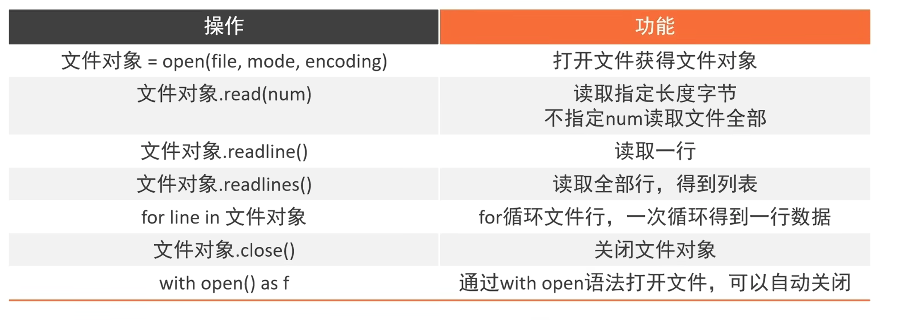

### 什么是文件


#### 文件操作包含哪些内容？

在生活中，文件操作主要包括==打开、关闭、读取、写入==等操作。 

### 文件的操作步骤

1. 打开文件
2. 读写文件
3. 关闭文件

注意事项：
可以只打开和关闭文件，不进行任何读写
#### mode常用的三种基础访问模式


| 模式  | 描述                                                       |
| --- | -------------------------------------------------------- |
| r   | 以只读方式打开文件。文件的指针将会放在文件的开头。这是默认模式                          |
| w   | 打开一个文件只用于写入。如果该文件已存在则打开文件，并从头开始编辑，原有内容会被删除。              |
| a   | 打开一个文件用于追加。如果该文件已存在，新的内容将会被写入到已有内容之后。如果该文件不存在，创建新文件进行写入。 |

#### open()打开函数

在python中，使用open函数，可以打开一个已经存在的文件，或者创建一个新文件，语法如下：
```python
open(name,mode,encoding)
```

==注解==：
**name**：是要打开的目标文件名的字符串（可以包含二五年间所在的具体路径）
**mode**：设打开文件的模式（访问模式）：只读、写入、追加等
**encoding**：编码格式（推荐使用UTF-8）
示例代码：
```python
# encoding的顺序不是第三位，所以不能用位置参数，用关键字直接指定
f = open('python.txt','r',encoding='UTF-8')
```

注意事项：
此时的'f'是'open'函数的文件对象，对象是python中一种特殊的数据类型，拥有属性和方法，可以使对象，属性或对象。


**小练习**
```python
# 打开文件，反斜杠的话可能会报错，改成正斜杠会好点
f = open("K:/Mirror_Void_Arsenal/Python/day12/open_read.txt","r",encoding="UTF-8")  
print(type(f))
```

#### 读操作相关方法
##### read()方法

```python
文件对象.read(num)
```

num表示要从文件中读取的数据长度（单位是字节）如果没有传入num值，那么就表示读取文件中所有的数据

##### readlines()方法

readlines可以按照行的方式把整个文件中的内容进行一次性读取，并且返回的是一个列表，其中每一行的数据为一个元素。
```python
f = open('python.txt)
content = f.readlines()

#['hello world\n','abcdefg\n','add\n','bbb\n','ccc']
print(content)

# 关闭文件
f.close() 
```

##### readline()方法

**readline()方法，一次读取一行内容**
```python
f = open('python.txt')
content = f.readline()
print(f"第一行：{content}")

content = f.readline()
print(f"第二行：{content}")

# 关闭文件
f.close()
```


##### for循环读取文件行
```python
for line in open("python.txt","r"):
	print(line)
# 每一个line临时变量，就记录了问年间的一行数据	
```

###### close()关闭文件对象
```python
f = open("pyhton.txt","r")

f.close()
# 最后通过close，关闭文件对象，也就是关闭对文件的占用。
# 如果不调用close，同时程序没有停止运行，那么这个文件将一直被python程序占用
```

##### with open语法
```python
with open("python.txt","r") as f:
	f.readlines()
	
# 通过在with open的语句块中对文件进行操作
# 可以在操作完成后自动关闭close文件，避免遗忘掉closes方法
```

**综合小练习**

```python
# 打开文件  
import time  
  
f = open("K:/Mirror_Void_Arsenal/Python/day12/open_read.txt","r",encoding="UTF-8")  
# print(type(f))  
  
# 读取文件，如果多次调用read方法，第二个或者后续得是从哪个上一次得read开始继续接着读  
# print(f"读取10个字节的结果：{f.read(10)}")  
# print(f"读取全部字节的结果：{f.read()}")  
  
# 读取文件readline  
# lines = f.readlines()  
# print(f"lines对象的类型是：{type(lines)}")  
# print(f"lines对象的内容是：{lines}")  
  
# readline方法读取  
# line1 = f.readline()  
# line2 = f.readline()  
# line3 = f.readline()  
# line4 = f.readline()  
# print(f"第一行：{line1}")  
# print(f"第二行：{line2}")  
# print(f"第三行：{line3}")  
# print(f"第四行：{line4}")  
  
#  for循环  
for line in f:  
    print(f"每一行的数据是：{line}")  
# 每一个line临时变量，就记录了问年间的一行数据  
  
# 关闭文件  
f.close()  
  
# with open  
with open("K:/Mirror_Void_Arsenal/Python/day12/open_read.txt","r",encoding="UTF-8") as f:  
    for line in f:  
        print(f"每一行的数据是：{line}")
```
### 练习



示例
```python
# 打开并读取文件内容，我做的。。。
from mpmath.functions.zetazeros import count_to  
  
f = "K:/Mirror_Void_Arsenal/Python/day12/word.txt"  
file_text = open("K:/Mirror_Void_Arsenal/Python/day12/word.txt","r",encoding="UTF-8")  
  
count = 0  
  
for line in file_text:  
    words = line.split()  
    for word in words:  
        if word == "itheima":  
            count += 1  
print(f"itheima出现的次数为：{count}")  
  
file_text.close()


# 官方答案
# 方式1  
content = file_text.read()  
count = content.count("itheima")  
print(f"itheima出现的次数是：{count}")  
  
# 方式2  
count = 0  
for line in file_text:  
    line = line.strip()  
    words = line.split(" ")  
    for word in words:  
        if word == "itheima":  
            count += 1  
print(f"itheima 出现的次数是：{count}")  
  
  
file_text.close()
```


### 操作汇总

