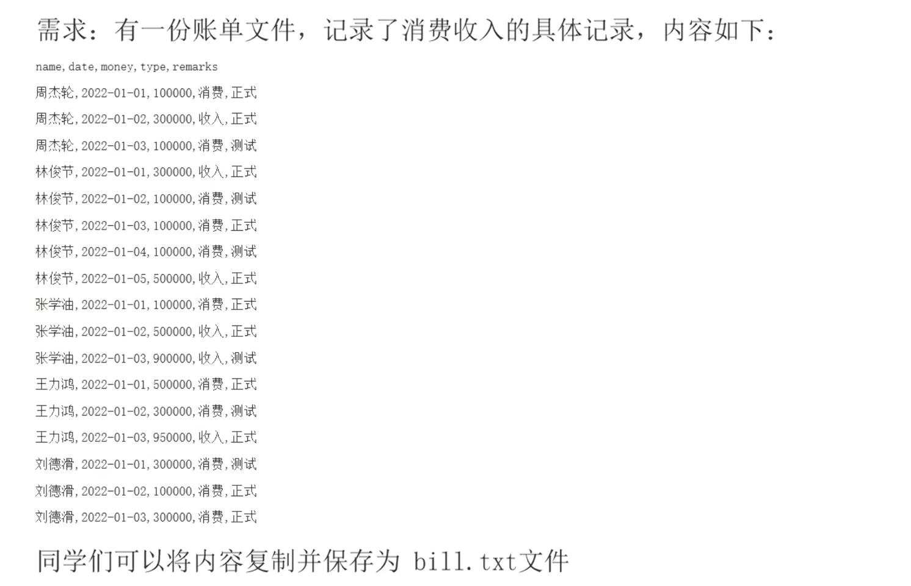
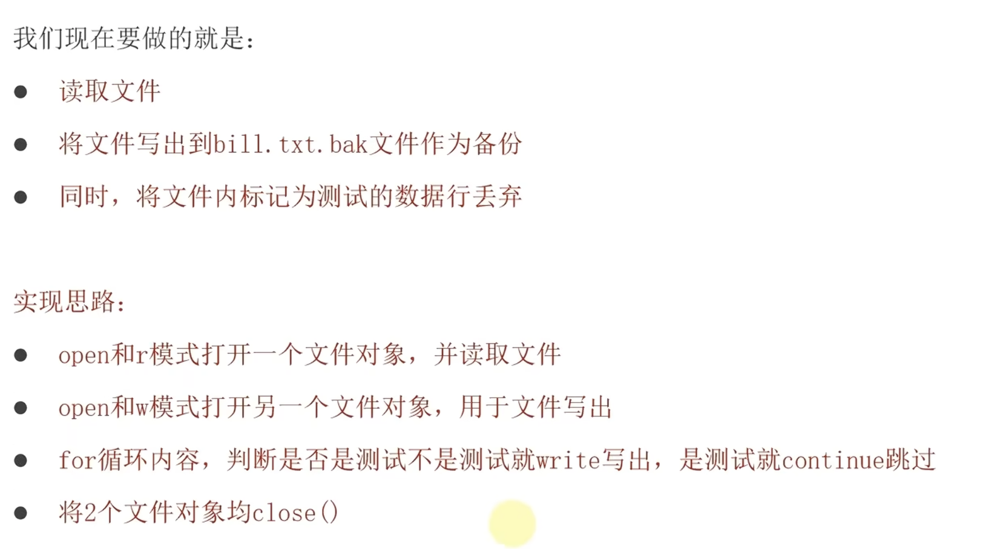

### 需求分析



### 表格信息

```text
name,date,money,type,remarks
周杰轮,2022-01-01,100000,消费,正式
周杰轮,2022-01-02,300000,收入,正式
周杰轮,2022-01-03,100000,消费,测试
林俊节,2022-01-01,300000,收入,正式
林俊节,2022-01-02,100000,消费,测试
林俊节,2022-01-03,100000,消费,正式
林俊节,2022-01-04,100000,消费,测试
林俊节,2022-01-05,500000,收入,正式
张学浩,2022-01-01,100000,消费,正式
张学浩,2022-01-02,500000,收入,正式
张学浩,2022-01-03,900000,收入,测试
王力鸿,2022-01-01,500000,消费,正式
王力鸿,2022-01-02,300000,消费,测试
王力鸿,2022-01-03,950000,收入,正式
刘德清,2022-01-01,300000,消费,测试
刘德清,2022-01-02,100000,消费,正式
刘德清,2022-01-03,300000,消费,正式
```

### 要求


示例
```python

```