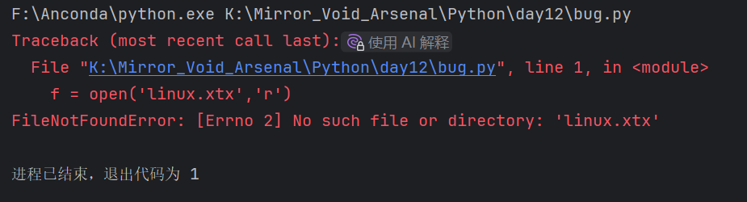
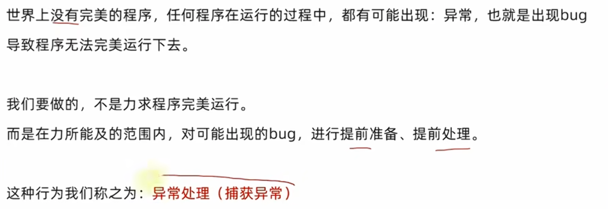
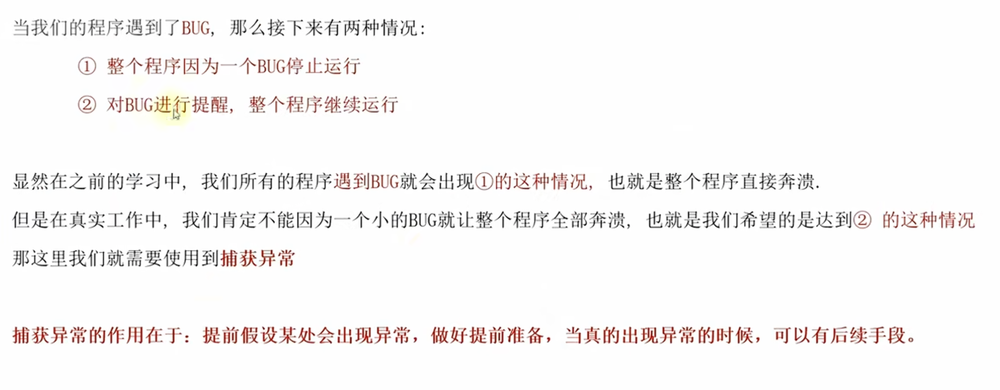
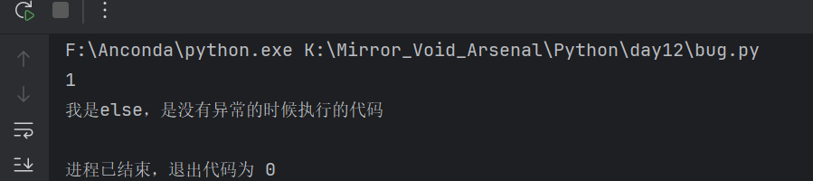

### 什么是异常？

当检测到一个错误时，Python解释器就无法继续执行了，反而出现了一些错误的提示，这就是所谓的“异常”，也就是我们常说的BUG

#### 世界上第一个 Bug 的真实记录

##### 事件经过

1947年9月9日下午3点45分，哈佛大学马克二型（Mark II）计算机突然宕机，输出结果完全错误。

技术人员排查了很久，最终定位到**第70号继电器**出了故障。负责人格蕾丝·霍珀（Grace Hopper）仔细观察这个继电器，发现有一只飞蛾被夹在了继电器的触点中间，已经被电死。

霍珀用镊子小心翼翼地把飞蛾夹出来，然后用透明胶布把它粘在了当天的“事件记录本”（Log Book）上，并在旁边工整地写下了一行字：

> **“First actual case of bug being found.”**  
> （翻译：这是发现的第一例“虫子”Bug案例。）

从此以后，人们就把程序中的错误、缺陷、故障，统称为 **Bug**，而修复这些错误的过程，就叫 **Debug（调试/捉虫）**。

#### 异常演示

例如：以'r'方式打开一个不存在的文件。
```
f = open('linux.xtx','r')
```



### 异常捕获

#### 为什么需要捕获异常





### 捕获常规异常

##### 基本语法：

```python
try:
	可能发生错误的代码
except:
	如果出现异常执行的代码
```

##### 快速入门

需求：尝试以'r'模式打开文件，如果文件不存在，则以'w'方式打开

```python
try:
	f = open('linux.txt','r')
except:
	f = open('linux.txt','w')
```

### 捕获指定异常

##### 基本语法

```python
try:
	print(name)
except NameError as e:
	print('name变量名称未定义错误')
	print(e)
```

==注意事项==：
如果尝试执行的代码的异常类型和要捕获的异常类型不一致，则无法捕获异常。
一般try下方只放一行执行的代码。


### 捕获多个异常

当捕获多个异常时，可以把要捕获的异常类型的名字，放到except后，并使用元组的方式进行书写。
```python
try:
	pirnt(1/0)
except(NameError,ZeroDivisionError)
	print(f“ZeroDivision错误")
```

### 捕获所有异常

```python
# 捕获所有异常  
try:  
    f = open("linux.txt", "r", encoding="UTF-8")  
except Exception as e:  
    print(f"出现异常了")
```

### 异常else

else表示如果没有异常要执行的代码。
```python
try:
	print(1)
except Exception as e:
	print(e)
else:
	print(f"我是else，是没有异常的时候执行的代码")
```



### 异常的finally

finally表示的是无论是否异常都要执行的代码，例如关闭文件。
```python
# finally  
try:  
    f = open("text.txt","r",encoding="UTF-8")  
except Exception as e:  
    print("出现异常了")  
    f = open("123.txt","w",encoding="UTF=8")  
else:  
    print("没有异常，真开心")  
finally:  
    print(f"我是finally，有没有异常我都要执行")  
    f.close() 
```
