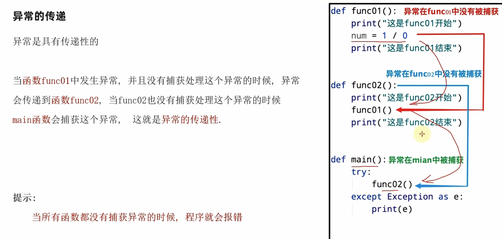

### 异常的传递性



```python
# fun1函数  
# 定义一个带有异常的  
def func1():  
    print(f"func1 开始执行")  
    num = 1 / 0  
    print(f"func1 结束执行")  
  
# 调用上面的函数  
def func2():  
    print(f"func2 开始执行")  
    func1()  
    print(f"func2 结束执行")  
  
# 调用上面的函数  
def main():  
    try:  
        print(f"抛出异常")  
        func2()  
    except Exception as e:  
        print(f"出现异常了，已经捕获了")  
main()
```