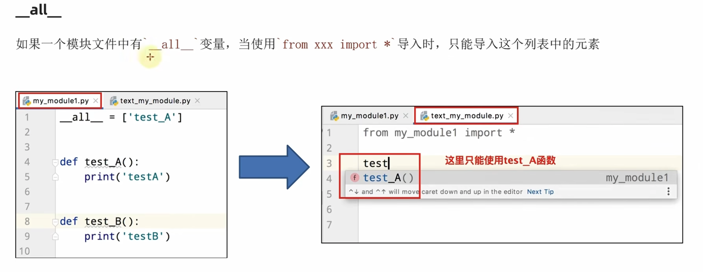
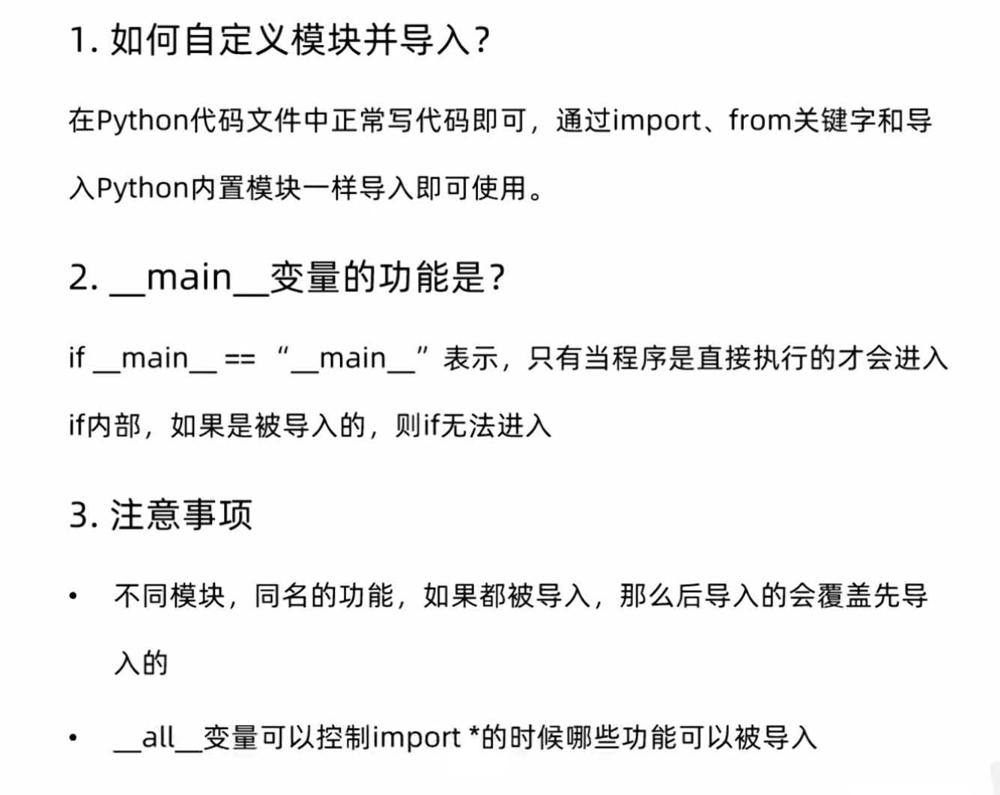

### 制作自定义模块

Python中已经帮我们实现了还能多的模块，不过有时候我们需要一些个性化的模块，这里就可以用自定义模块就能实现，也就是自己制作一个模块

案例：
新建一个Python文件，命名为my_module1.py，并定义test函数

注意：
每个Python文件都可作为一个模块，模块的名字就是文件的名字，也就是说自定义模块名必须要符合标识符命名规则

#### 制作自定义模块

```python
def test(a,b):  
    print(a + b)
```

#### 使用自定义模块

```Python
# import my_modlue1  
from my_modlue1 import test  
  
test(1,2)
```


注意事项
当导入多个模块的时候偶，且模块内有同名功能，当调用这个同名功能的时候，调用到的是后面导入的模块的函数

```Python
# 模块1代码
def my_test(a,b):
	print(a + b)
	
# 模块2代码
def my_test(a,b)
	print(a - b)
	
# 导入模块和调用功能代码
from my_module1 import my_test
from my_module2 import my_test

# my_test函数是模块2中的函数
my_test(1,1)
```

#### __all__变量



### 总结


