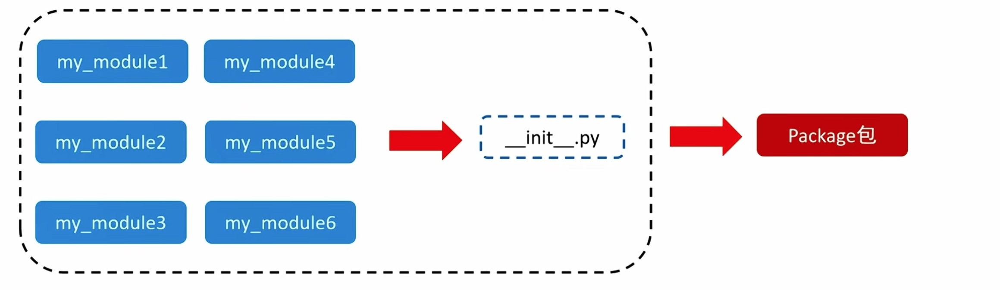
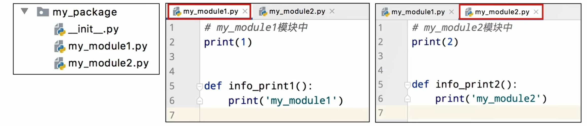
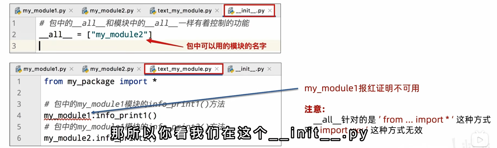
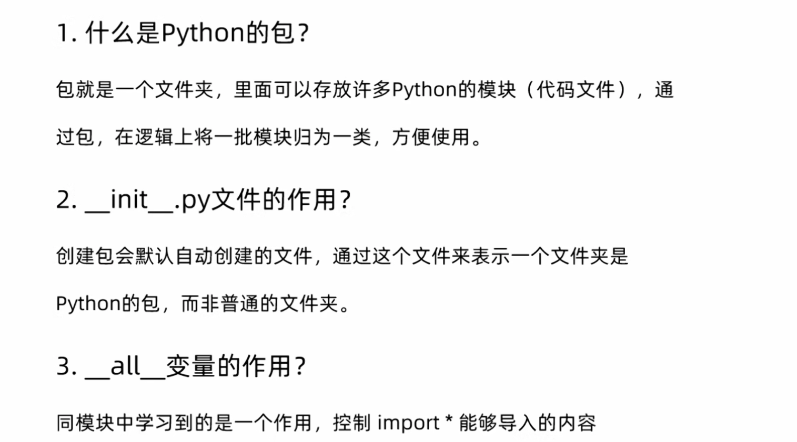

### 什么是Python包

从物理上看，包就是一个文件夹，在该文件夹下面包含了一个__init__.py文件，该文件夹可用于包含多个模块文件，从逻辑上看，包的本质依然是模块




==包的作用==：
	当我们的模块文件越来越多时，包可以帮助我们管理这些模块，包的作用激素hi包含多个模块，但包的本质依然是模块

### 快速入门

==步骤如下==：
1. 新建包'my_package'
2. 新建包内模块：'my_module1'和'my_module2'
3. 模块内代码如下



Pycharm中的基本步骤
[New] ->[Python Package] -> 输入包名 -> [OK] -> 新建功能模块（有联系的模块）

注意:
新建包之后，包内部会自动创建__init__.py文件，这个文件控制着包的导入行为

### 导入包

#### 方式一

```
import 包名.模块名
包名.模块名.目标
```

做好上述创建包之后的事情
```Python
# 导入包  
import my_package.my_module1  
import my_package.my_module2  
  
  
# 调用模块  
my_package.my_module1.info_print1()  
my_package.my_module2.info_print2()


# # 导入包  
import my_package.my_module1  
import my_package.my_module2  
  
  
# 调用模块  
my_package.my_module1.info_print1()  
my_package.my_module2.info_print2()  
  
from my_package import my_module1  
from my_package import my_module2  
  
my_module1.info_print1()  
my_module2.info_print2()  
  
  
from my_package.my_module1 import info_print1  
from my_package.my_module2 import info_print2  
info_print1()  
info_print2()
```


#### 方式二

注意：
必须在__init__.py文件中添加__all__ = []，控制允许导入的模块列表
```
from 包名 import *
模块名.目标
```



```Python
# 报错了
from my_package import *  
my_module1.info_print1()  
my_module2.info_print2()
```

### 总结

