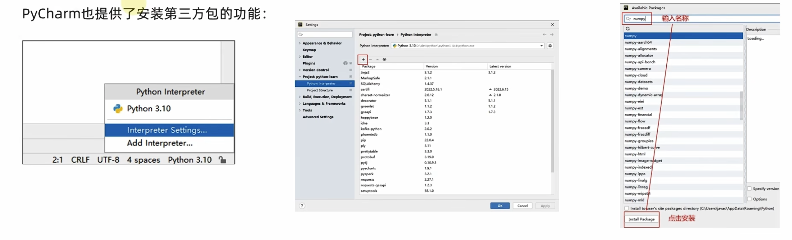
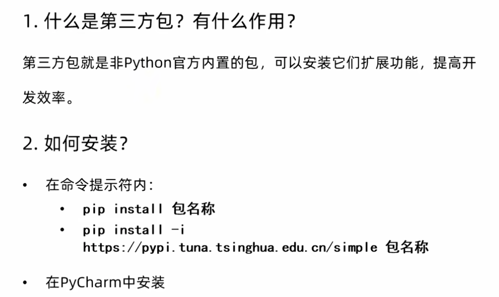

### 什么是第三方包

我们知道，包可以包含一堆的Python模块，而每个模块又内涵许多的功能。
所以，我们可以认为：一个包，就是一堆同类型功能的集合体。

在Python程序的生态中，有许多非常多的第三方包（非Python官方），可以极大的帮助我们提高开发效率，如：
- 科学计算中常用的：numpy包
- 数据分析中常用的：pandas包
- 大数据计算中常用的：pyspark、apache-flink包
- 图形可视化常用的：matplotlib、pyecharts
- 人工智能常用的：tensorflow
- 等
这些第三方的包，极大的丰富了Python打的生态，提高了开发效率。
但是由于是第三方，所以Python没有内置，所以我们需要安装他们才可以导入使用

### 安装第三方包——pip

第三方包的安装非常简单，我们只需要使用Python内置的pip程序即可。

打开我们许久未见得：命令提示符程序，在里面输入：
pip install 包名称
即可通过网络快速安装第三方包

#### pip的网络优化

由于pip是连接的国外的网站进行包的下载，所以有的时候会速度很慢。我们可以通过如下命令，让其连接国内的网站进行包的安装：
https://pypi.tuna.tsinghua.edu.cn/simple 是清华大学提供的一个镜像网站，可供pip程序下载第三方包
```cmd
pip install -i https://pypi.tuna.tsinghua.edu.cn/simple 包名称
```

#### 安装第三方包——Pycharm

Pycharm也提供了安装第三方包的功能：


### 总结


