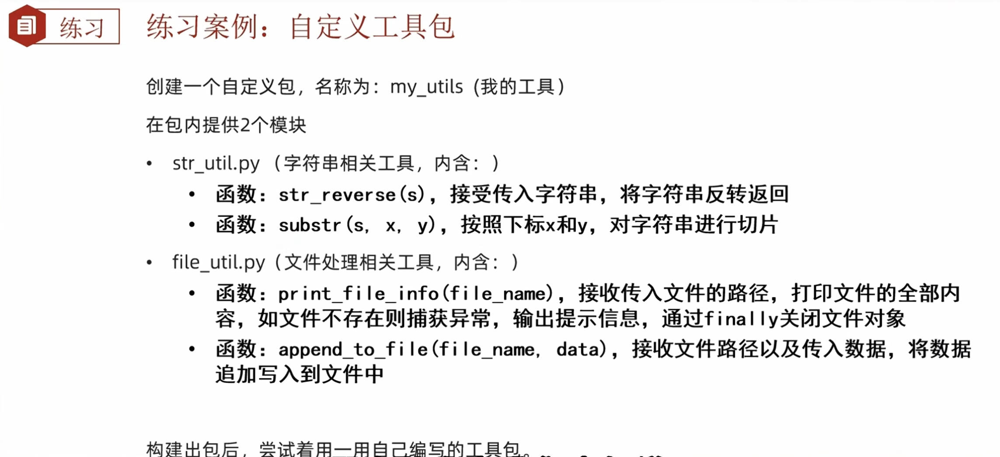

### 自定义工具包



示例
****
**str_reverse函数**

```python
# str_reverse(s)函数编写
# 定义函数，逆转  
def str_reverse(s):  
  
    result = s[::-1]  
    print(f"反转信息为：{result}")  
    return result  
  
  
  
def substr(s,x,y):  
    result1 = s[x:y]  
    print(f"切片信息为：{result1}")  
    return result1  
  
##################################################  
# 讲解  
def str_reverse(s):  
    return s[::-1]  
  
def substr(s,x,y):  
    return s[x:y]  
  
  
# 功能测试  不会出现在正常环境里面，仅仅用作测试
if __name__ == '__main__':  
    print(str_reverse(f"你好啊，学python学傻了都快"))  
    print(substr("你好，工作好难找啊。。。",1,5))

```


**file_name函数**

```python
# # 读取文件  
def print_file_info(file_name):  
    f = None  
    try:  
        f = open(file_name, "r", encoding="UTF-8")  
        print(f.read())  
    except Exception as e:  
        print(e)  
    else:  
        print(f"没有异常")  
    finally:  
        if f:  
            f.close()  
  
  
def append_to_file(file_name,data):  
    f = open(file_name,"a",encoding="UTF-8")  
    f.write(data)  
    f.close()  
  
##############################################  
# 讲解  
def print_file_info(file_name):  
    f = None  
    try:  
        f = open(file_name,"r",encoding="UTF-8")  
        content = f.read()  
        print(f"读取文件，文件内容如下:{content}")  
    except Exception as e:  
        print(f"出现异常，异常信息为：{e}")  
    finally:  
        if f:          # 如果变量是None表示False，如果有内容就是Ture  
            f.close()  
  
def append_to_file(file_name,data):  
    f = open(file_name,"a",encoding="UTF-8")  
    f.write(data)  
    f.write("\n")  
    f.close()  
  
  
if __name__ == '__main__':  
    print_file_info("K:/Mirror_Void_Arsenal/Python/day13/text.txt")  
    append_to_file("K:/Mirror_Void_Arsenal/Python/day13/text1.txt","你好！！！！！！！！！")
```

**调用**

```python
# 调用  
import my_utils.str_util  
from my_utils import file_util  
  
print(my_utils.str_util.str_reverse("好难。。"))  
  
print(my_utils.str_util.substr("这对吗",0,1))  
  
print(my_utils.file_util.append_to_file("K:/Mirror_Void_Arsenal/Python/day13/text1.txt","年后！！！！！！！！！！！！！！！！！！！！！！！！！！！！"))  
  
print(my_utils.file_util.print_file_info("K:/Mirror_Void_Arsenal/Python/day13/text1.txt"))
```