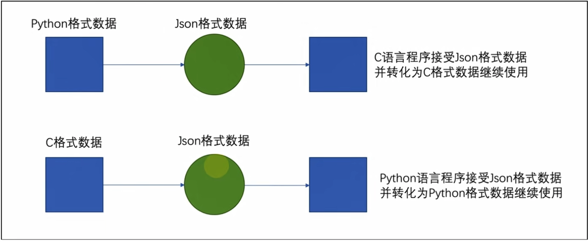
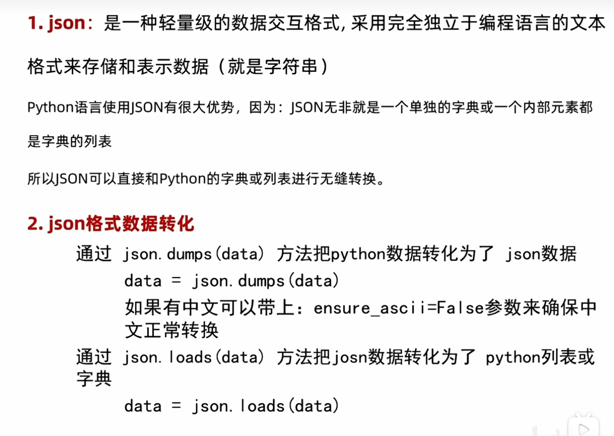

### 什么是JSON

- JSON是一种轻量级的数据交互格式。可以按照JSON指定的格式去组织和封装数据。
- JSON本质上是一个带有特定格式的字符串

==主要功能==：
	json就是一种在各个变成语言中流通的数据格式，负责不通编程语言中的数据传递和交互，类似于：
- 国际通用语言——英语
- 中国56个民族不同地区的通用语言——普通话

### json有什么用

- 各种编程语言存储数据的容器不尽相同，在Python中有字典dict这样的数据类型，而其他语言可能没有对应的字典。

为了让不同的语言都能够相互通用的互相传递数据，JSON就是一种非常良好的中转数据格式。如下图，以Python和C语言互传数据为例：



### json格式数据转化

json格式的数据要求很严格，如下所示

```json
# json数据的格式可以是：
{"name":"admin","age":18}

# 也可以是：
[{"name":"admin","age":18},{"name":"root","age":16},{"name":"张三","age":20}]
```

### Python数据和Json数据的相互转化

- Python数据和Json数据的相互转化

```Python
# 导入json模块
import json

# 准备符合json格式要求的python数据
data = [{"name":"老王","age":18},{"name":"张三","age":20}]

# 通过josn.dumps(data)方法把python数据转化为了json数据
data = json.dumps(data)

# 通过json.loads(data) 方法把json数据转化为了python数据
data = json.loads(data)
```

**小练习**

```python
import json  
  
data = [{"name":"admin","age":19},{"name":"root","age":20},{"name":"王大锤","age":10}]  
json_str = json.dumps(data,ensure_ascii=False)  
print(type(data))  
print(type(json_str))  
print(json_str)  
  
  
# 字典，将字典传换成json  
d = {"name":"张大仙","age":10,"地址":"地球"}  
json_str2 = json.dumps(d,ensure_ascii=False)  
print(type(d))  
print(d)  
  
# 将json字符串信息转换为python数据类型  
j = '[{"name": "admin", "age": 19}, {"name": "root", "age": 20}, {"name": "王大锤", "age": 10}]'  
json.loads(j)  
print(type(j))  
print(j)  
  
# 同上  
s = '{"name": "admin", "age": 19}'  
json.loads(s)  
print(type(s))  
print(s)
```


### 总结

