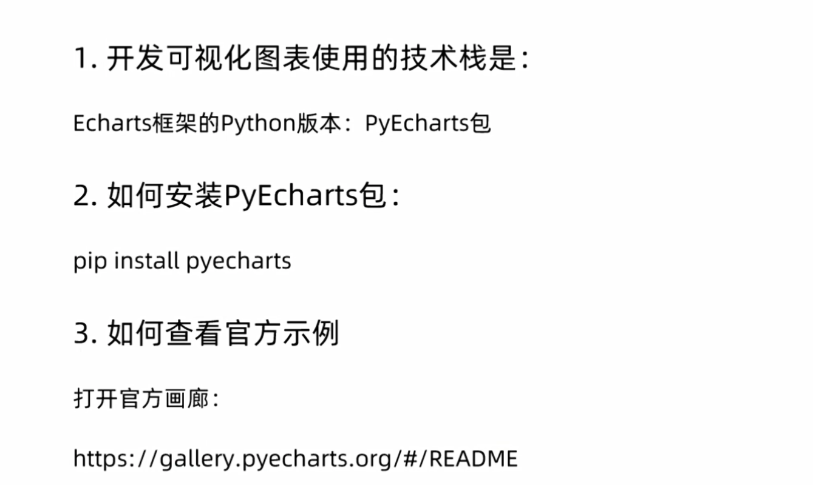

### pyecharts模块

网站：
pyecharts官网
https://pyecharts.org/#/zh-cn/

百度python开源开发
http://python.itheima.com/
- 如果想要做出数据可视化效果图，可以借助pyecharts模块来完成。

画廊
https://gallery.pyecharts.org/

- 概况：
	pyecharts是由百度开源的数据可视化，凭借着良好的交互性，精巧的图标设计，得到了众多开发者的认可，而python是门富有表达力的语言，很适合用于数据处理，当数据分析遇上数据可视化时pyecharts就诞生了


### pyecharts模块安装

- 使用之前python自带打的pip命令安装pyecharts
```cmd
pip install pyecharts
```

### 总结

