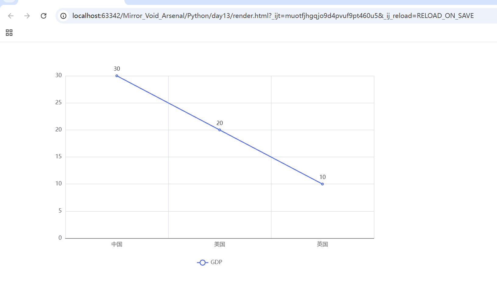
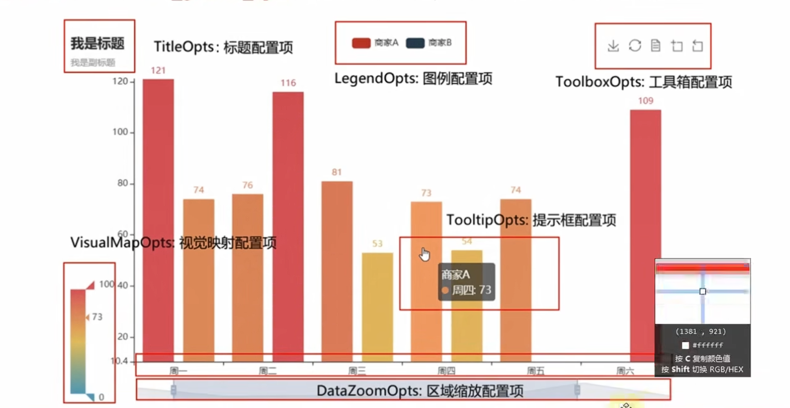
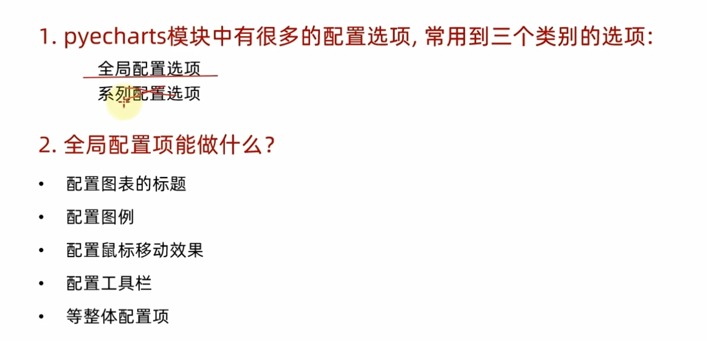

### 构造一个折线图

#### 基础折线图

```python
# 导包，导入lin功能构造折线图对象
from pyeccharts.charts import Line

# 得到折线图对象
line = Line()

# 添加x轴数据
line.add_xaxiss(["中国","美国","英国"])

# 添加y轴数据
line.add_yaxis(["GDP",[30,20,1-]])

# 生成图标
line.render()
```

代码执行成功之后，就去当前目录查看生成了一个html的文件，用浏览器打开即可。



### pyecharts有哪些配置选项

pyecharts模块中有很多的配置选项，常用到2个类别的选项
- 全局配置选项
- 系列配置选项

#### set_global_opts方法

这里全局配置选项可以通过 set_global_opts方法来进行配置，相应的选项和功能如下：


#### 系列配置项，后续再说

#### set_global_optss方法

```python
# 导入包  
from pyecharts.charts import Line  
from pyecharts.options import TitleOpts,LegendOpts,ToolboxOpts,VisualMapOpts  
from streamlit import title  
  
# 创建折线图  
line = Line()  
  
# xy轴坐标  
line.add_xaxis(["中国","美国","英国"])  
line.add_yaxis("GDP",[30,20,10])  
  
# 设置全局项  
line.set_global_opts(  
    title_opts=TitleOpts(title = "GDP展示",pos_left="center",pos_bottom="7%"),  
    legend_opts=LegendOpts(is_show=True),  
    toolbox_opts=ToolboxOpts(is_show=True),  
    visualmap_opts=VisualMapOpts(is_show=True)  
  
)  
  
# 生成折线图  
line.render()
```

### 总结

