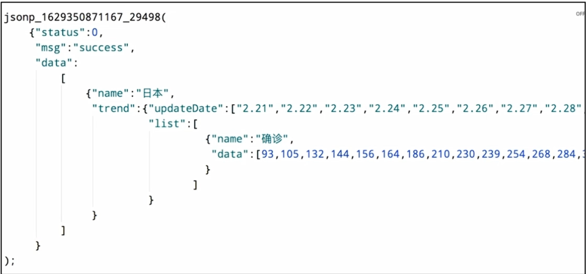
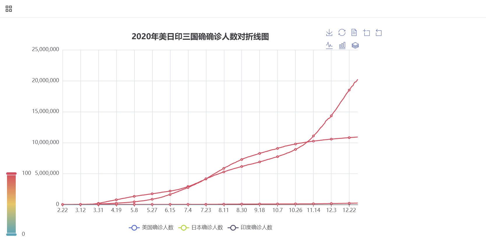

### 数据处理

#### 原始数据格式



代码如下

```python
import json  
# K:/Mirror_Void_Arsenal/可视化案例数据/折线图数据/美国.txt  
  
# 处理数据  
f_us = open("K:/Mirror_Void_Arsenal/可视化案例数据/折线图数据/美国.txt","r",encoding="UTF-8")  
us_data = f_us.read()  
  
# 去掉不符合json规范的开头  
us_data = us_data.replace("jsonp_1629344292311_69436(","")  
  
#去掉json不符合尾部的部分  
us_data = us_data[:-2]  
  
# json转python字典  
us_dict = json.loads(us_data)  
print(type(us_dict))  
print(us_dict)  
  
# 获取trend的keyi  
trend_data = us_dict['data'][0]['trend']  
print(type(trend_data))  
print(trend_data)  
  
# 获取日期数据，用于x轴，取2020年（大奥314结束）  
x_data = trend_data['updateDate'][:314]  
print(x_data)  
  
# 获取y轴  
y_data = trend_data['list'][0]['data'][:314]
```

### 生成折线图

```PYTHON
import json  
from pyecharts.charts import Line  
from pyecharts.options import TitleOpts,ToolboxOpts,VisualMapOpts,LegendOpts,LabelOpts  
# K:/Mirror_Void_Arsenal/可视化案例数据/折线图数据/美国.txt  
  
# 处理数据  
f_us = open("K:/Mirror_Void_Arsenal/可视化案例数据/折线图数据/美国.txt","r",encoding="UTF-8")  
us_data = f_us.read()        # 美国数据  
  
f_jp = open("K:/Mirror_Void_Arsenal/可视化案例数据/折线图数据/日本.txt","r",encoding="UTF-8")  
jp_data = f_jp.read()        #  日本数据  
  
f_in = open("K:/Mirror_Void_Arsenal/可视化案例数据/折线图数据/印度.txt","r",encoding="UTF-8")  
in_data = f_in.read()        # 印度数据  
  
# 去掉不符合json规范的开头  
us_data = us_data.replace("jsonp_1629344292311_69436(","")  
jp_data = jp_data.replace("jsonp_1629350871167_29498(","")  
in_data = in_data.replace("jsonp_1629350745930_63180(","")  
  
#去掉json不符合尾部的部分  
us_data = us_data[:-2]  
jp_data = jp_data[:-2]  
in_data = in_data[:-2]  
  
# json转python字典  
us_dict = json.loads(us_data)  
jp_dict = json.loads(jp_data)  
in_dict = json.loads(in_data)  
  
  
  
print(type(us_dict))  
print(us_dict)  
  
# 获取trend的keyi  
us_trend_data = us_dict['data'][0]['trend']  
jp_trend_data = jp_dict['data'][0]['trend']  
in_trend_data = in_dict['data'][0]['trend']  
print(type(us_trend_data))  
print(us_trend_data)  
  
# 获取日期数据，用于x轴，取2020年（大奥314结束）  
us_x_data = us_trend_data['updateDate'][:314]  
jp_x_data = jp_trend_data['updateDate'][:314]  
in_x_data = in_trend_data['updateDate'][:314]  
print(us_x_data)  
  
# 获取y轴  
us_y_data = us_trend_data['list'][0]['data'][:314]  
jp_y_data = jp_trend_data['list'][0]['data'][:314]  
in_y_data = in_trend_data['list'][0]['data'][:314]  
  
# 构建折线图对象  
line = Line()  
  
# 构建x轴，x轴公用  
line.add_xaxis(us_x_data)  
  
# y轴  
line.add_yaxis("美国确诊人数",us_y_data,label_opts=LabelOpts(is_show=False))  
line.add_yaxis("日本确诊人数",jp_y_data,label_opts=LabelOpts(is_show=False))  
line.add_yaxis("印度确诊人数",in_y_data,label_opts=LabelOpts(is_show=False))  
  
# 全局配置  
line.set_global_opts(  
    # 标题  
    title_opts=TitleOpts(title="2020年美日印三国确确诊人数对折线图",pos_left="center",pos_bottom="90%"),  
    legend_opts=LegendOpts(is_show=True),  
    toolbox_opts=ToolboxOpts(is_show=True),  
    visualmap_opts=VisualMapOpts(is_show=True)  
)  
  
# 调用render方法，生成图表  
line.render()  
  
# 关闭文件  
f_us.close()  
f_jp.close()  
f_in.close()
```

