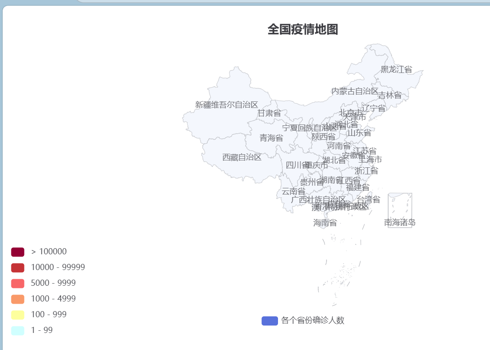
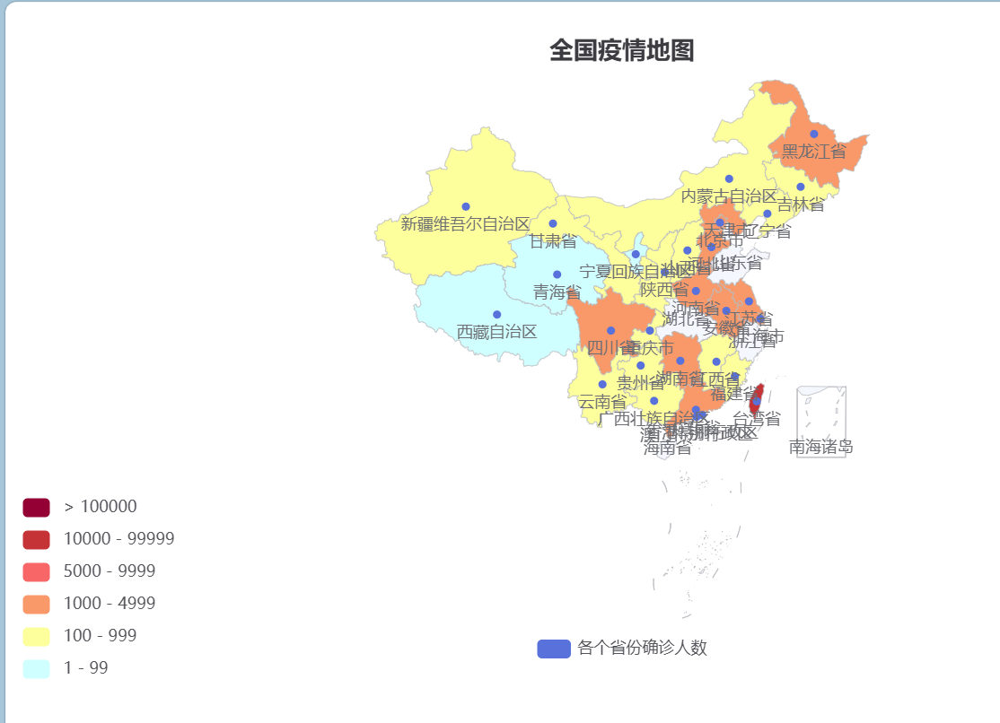
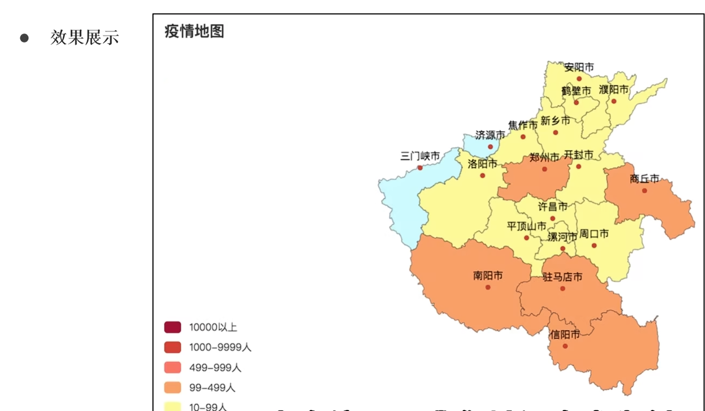
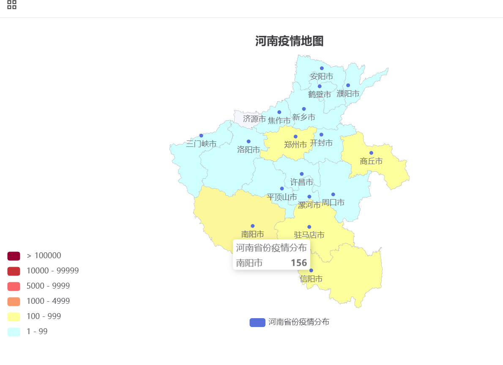

### 基础地图演示

```Python
# 导入包  
from pyecharts.charts import Map  
  
map_1 = Map()  
data = [  
    # 直辖市 (4个)  
    ("北京市", 99),  
    ("天津市", 88),  
    ("上海市", 199),  
    ("重庆市", 77),  
  
    # 省 (23个)  
    ("河北省", 66),  
    ("山西省", 55),  
    ("辽宁省", 44),  
    ("吉林省", 33),  
    ("黑龙江省", 22),  
    ("江苏省", 111),  
    ("浙江省", 222),  
    ("安徽省", 299),  
    ("福建省", 333),  
    ("江西省", 444),  
    ("山东省", 555),  
    ("河南省", 666),  
    ("湖北省", 599),  
    ("湖南省", 299),  
    ("广东省", 399),  
    ("海南省", 111),  
    ("四川省", 222),  
    ("贵州省", 333),  
    ("云南省", 444),  
    ("陕西省", 555),  
    ("甘肃省", 666),  
    ("青海省", 777),  
    ("台湾省", 199),  
  
    # 自治区 (5个)  
    ("内蒙古自治区", 88),  
    ("广西壮族自治区", 99),  
    ("西藏自治区", 111),  
    ("宁夏回族自治区", 222),  
    ("新疆维吾尔自治区", 333),  
  
    # 特别行政区 (2个)  
    ("香港特别行政区", 888),  
    ("澳门特别行政区", 999),  
]  
map_1.add("地图",data,"china")  
  
# 生成地图  
map_1.render()
```

图例：



### 基础地图演示-视觉映射器

```Python
import json  
from pyecharts.charts import Map  
import pyecharts  
from pyecharts.options import TitleOpts, VisualMapOpts  
  
# K:/Mirror_Void_Arsenal/可视化案例数据/折线图数据/美国.txt  
# 读取文件  
f = open("K:/Mirror_Void_Arsenal/可视化案例数据/地图数据/疫情.txt","r",encoding="UTF-8")  
data = f.read()  
  
# 关闭文件  
f.close()  
  
# 文档json数据转化为python字典数据  
data_dict = json.loads(data)  
  
# 取出省份数据  
province_data_list = data_dict["areaTree"][0]["children"]  
data_list = []  
# 组装每个省份和确证人数为元组，都放入列表中  
for province_data in province_data_list:  
    province_name = province_data["name"]                   # 省份名称  
    province_confirm = province_data["total"]["confirm"]    # 确诊人数  
    data_list.append((province_name,province_confirm))  
  
# 构建地图  
map_1 = Map()  
map_1.add("各个省份确诊人数",data_list,"china")  
  
# 全局设置  
map_1.set_global_opts(  
    title_opts=TitleOpts(title="全国疫情地图"),  
    visualmap_opts=VisualMapOpts(  
        is_show=True,  
        is_piecewise=True,  
        pieces=[  
            {"min": 1,"max": 99,"color":"#CCFFFF"},  
            {"min": 100,"max": 999,"color":"#FFFF99"},  
            {"min": 1000,"max": 4999,"color":"#FF9966"},  
            {"min": 5000,"max": 9999,"color":"#FF6666"},  
            {"min": 10000,"max": 99999,"color":"#CC3333"},  
            {"min": 100000,"color":"#990033"}  
        ]  
    )  
)  
map_1.render("全国疫情地图.html")
```

图例：



### 省级疫情地图




```Python
import json  
import pyecharts  
from pyecharts.charts import Map  
from pyecharts.options import TitleOpts,VisualMapOpts  
  
from Python.day14.全国地图 import data_list  
  
# 读取文件  
f = open("K:/Mirror_Void_Arsenal/可视化案例数据/地图数据/疫情.txt","r",encoding="UTF-8")  
data = f.read()  
  
# json格式转化成python的字典  
data_dict = json.loads(data)  
  
# 取河南省数据信息  
cities_data = data_dict["areaTree"][0]["children"][3]["children"]  
  
# 准备数据为元组放入list  
city_list = []  
for city_data in cities_data:  
    city_name = city_data["name"] + "市"  
    city_confirm = city_data["total"]["confirm"]  
    city_list.append((city_name,city_confirm))  
  
# 手动添加济源市数据  
data_list.append(("济源市",5))  
  
# 构建地图  
map_city = Map()  
map_city.add("河南省份疫情分布", city_list,"河南")  
  
  
map_city.set_global_opts(  
    title_opts=TitleOpts(title="河南疫情地图"),  
    visualmap_opts=VisualMapOpts(  
        is_show=True,  
        is_piecewise=True,  
        pieces=[  
            {"min": 1,"max": 99,"color":"#CCFFFF"},  
            {"min": 100,"max": 999,"color":"#FFFF99"},  
            {"min": 1000,"max": 4999,"color":"#FF9966"},  
            {"min": 5000,"max": 9999,"color":"#FF6666"},  
            {"min": 10000,"max": 99999,"color":"#CC3333"},  
            {"min": 100000,"color":"#990033"}  
        ]  
    )  
)  
  
map_city.render("河南省疫情地图分布.html")
```


