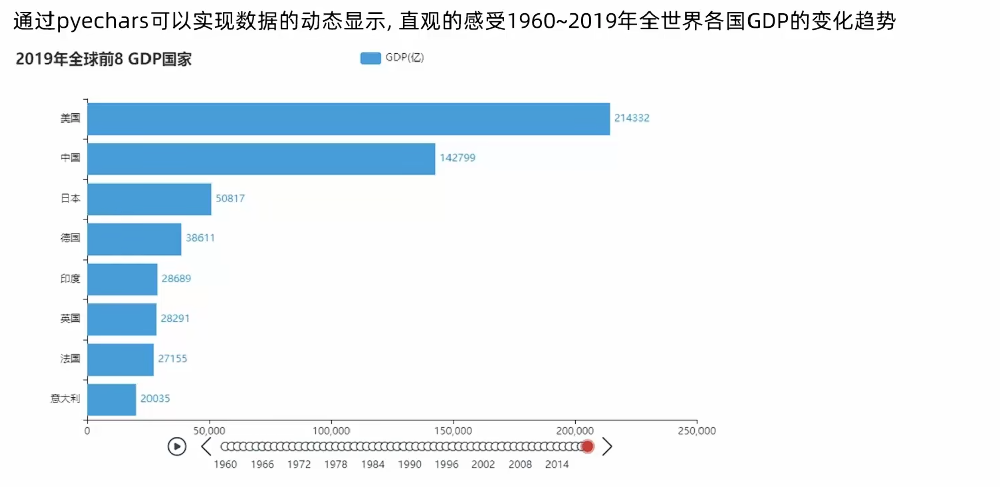
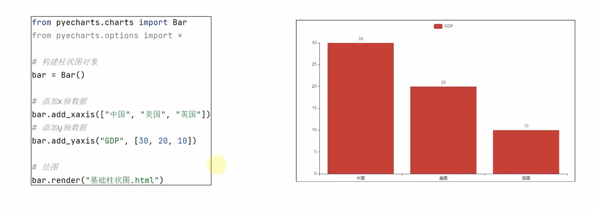
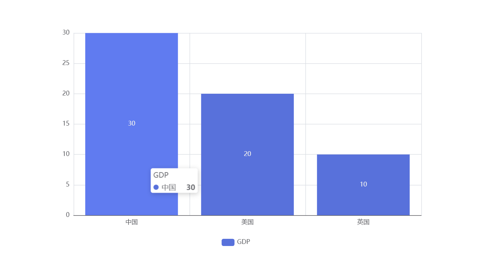
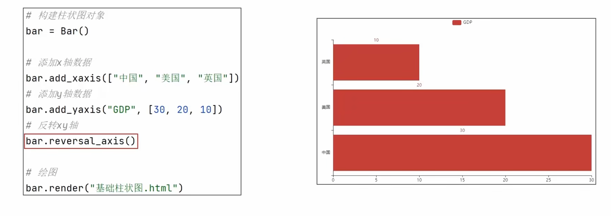
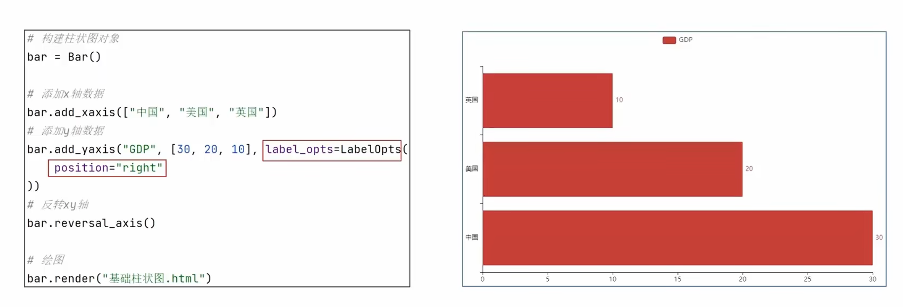

### 动态柱状图

#### 案例效果



**通过Bar构建基础柱状图**




```python
import pyecharts  
from pyecharts.charts import Bar  
  
# 使用Bar构建基础柱状图  
bar_image = Bar()  
  
# 田间xy轴数据  
bar_image.add_xaxis(["中国","美国","英国"])  
bar_image.add_yaxis("GDP",[30,20,10])  
  
# 绘图  
bar_image.render("基础柱状图.html")
```



### 反转xy轴



### 数值标签在右侧



