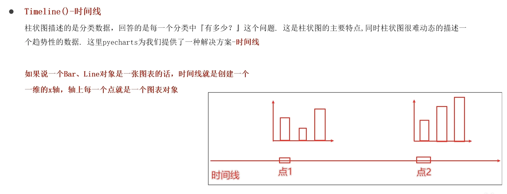
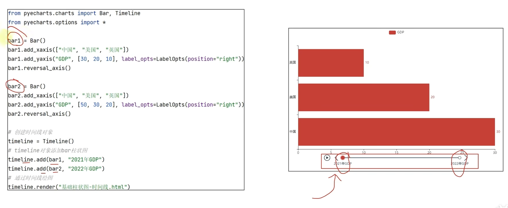
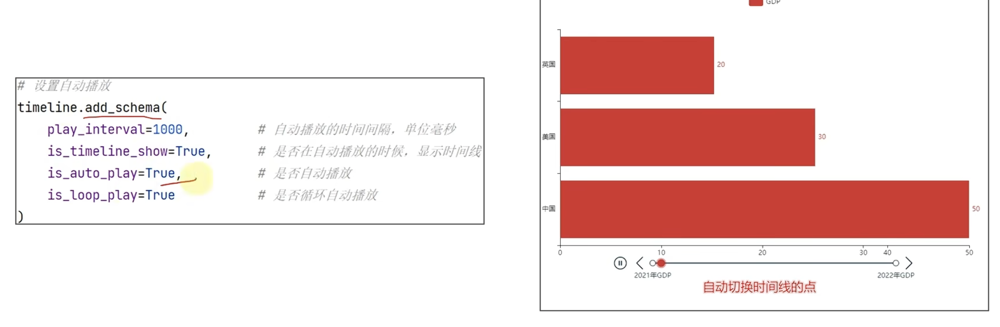
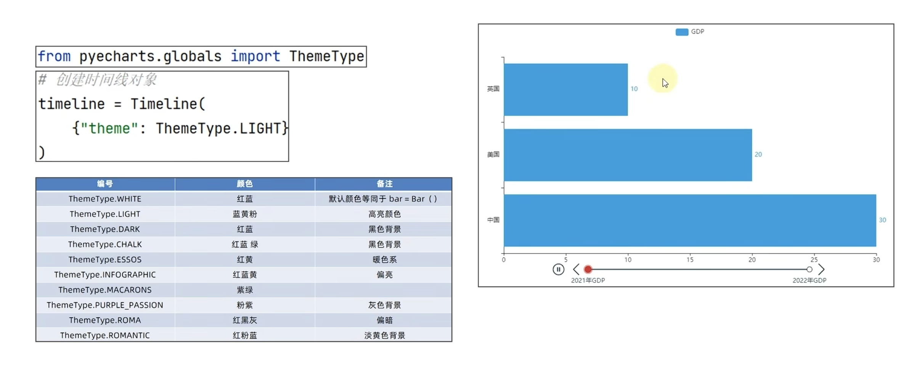

### 创建时间线






### 自动播放




### 时间线设置主题


### 代码

```Python
import pyecharts  
from plotly.express import timeline  
from pyecharts.charts import Bar,Timeline  
from pyecharts.options import LabelOpts  
from pyecharts.globals import ThemeType  
# 使用Bar构建基础柱状图1  
bar_image1 = Bar()  
bar_image1.add_xaxis(["中国","美国","英国"])  
bar_image1.add_yaxis("GDP",[30,20,10],label_opts=LabelOpts(position="right"))  
bar_image1.reversal_axis()  
  
# 使用Bar构建基础柱状图1  
bar_image2 = Bar()  
bar_image2.add_xaxis(["中国","美国","英国"])  
bar_image2.add_yaxis("GDP",[40,30,20],label_opts=LabelOpts(position="right"))  
bar_image2.reversal_axis()  
  
  
# 使用Bar构建基础柱状图1  
bar_image3 = Bar()  
bar_image3.add_xaxis(["中国","美国","英国"])  
bar_image3.add_yaxis("GDP",[50,40,30],label_opts=LabelOpts(position="right"))  
bar_image3.reversal_axis()  
  
# 使用Bar构建基础柱状图1  
bar_image4 = Bar()  
bar_image4.add_xaxis(["中国","美国","英国"])  
bar_image4.add_yaxis("GDP",[60,50,40],label_opts=LabelOpts(position="right"))  
bar_image4.reversal_axis()  
  
# 创建时间线对象  
timeline = Timeline({"theme": ThemeType.CHALK})  
# 构建时间线内柱状图  
timeline.add(bar_image1,"时间节点1")  
timeline.add(bar_image2,"时间节点2")  
timeline.add(bar_image3,"时间节点3")  
timeline.add(bar_image4,"时间节点4")  
  
# 自动播放  
timeline.add_schema(  
    play_interval=1000,        # 自动播放的时间间隔，单位毫秒，也就是一秒这里  
    is_timeline_show=True,     # 是否在自动播放的时候显示时间线  
    is_auto_play=True,         # 是否自动播放  
    is_loop_play=True          # 是否循环自动播放  
)  
  
# 绘图是用时间先对象绘图  
timeline.render("基础时间线柱状图.html")  
  
# 绘图
```