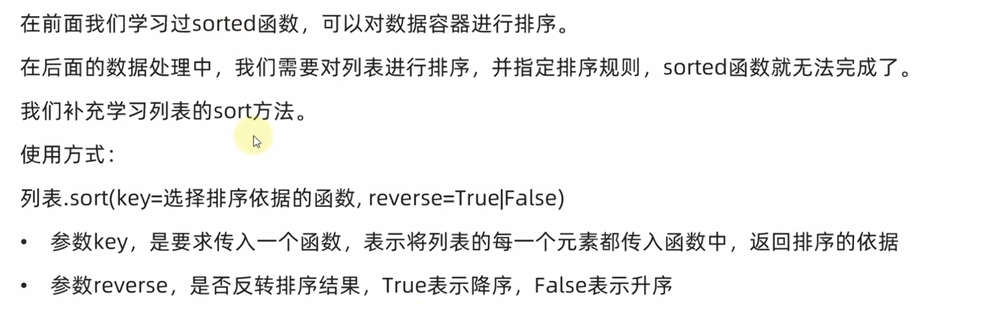
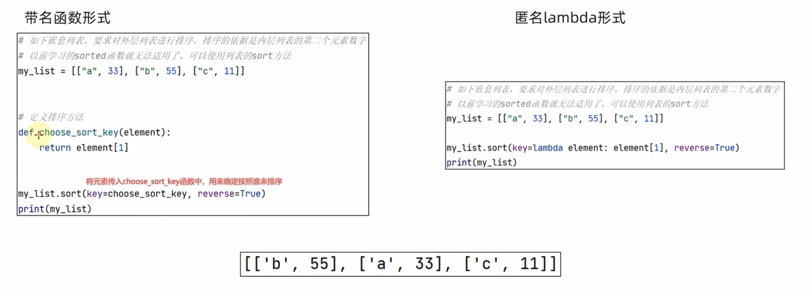
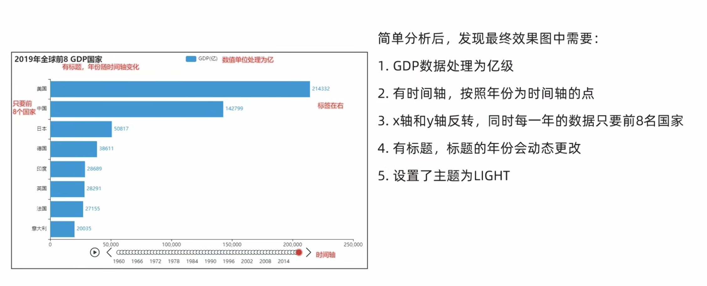
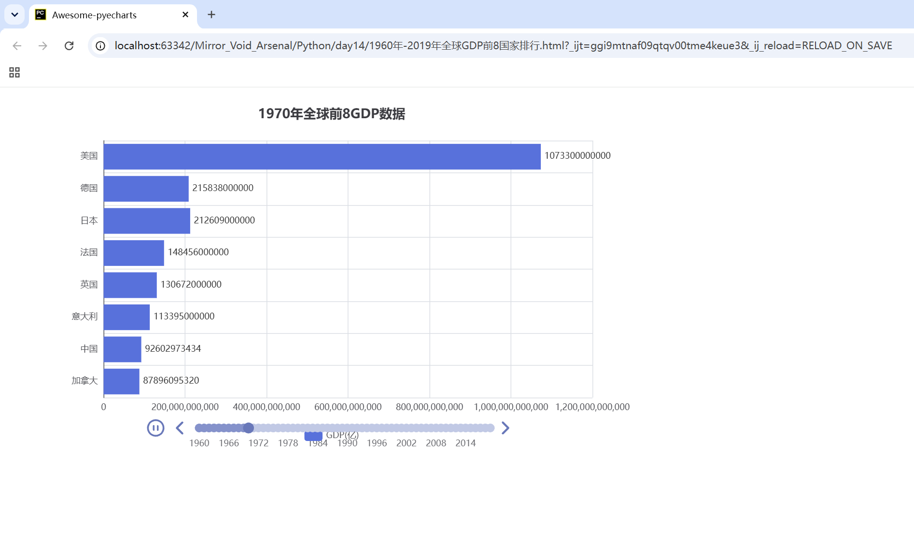

### 列表的sort方法



 

### 需求分析



### 成品！！！



```Python
from tkinter.ttk import Label  
import pyecharts  
from pyecharts.charts import Bar,Timeline  
from pyecharts.globals import ThemeType  
  
# 读取数据  
from github import enable_console_debug_logging  
from pyecharts.options import LabelOpts, TitleOpts  
from pyecharts.types import Title  
  
from Python.day14.基础时间线柱状图 import timeline  
  
f = open("K:/Mirror_Void_Arsenal\可视化案例数据/动态柱状图数据/1960-2019全球GDP数据.csv","r",encoding="GB2312")  
data_lines = f.readlines()  
  
# 关闭文件  
f.close()  
  
# 创建时间线对象  
timeline = Timeline({"theme":ThemeType.LIGHT})  
  
  
  
# 删除第一条数据  
data_lines.pop(0)  
  
# 定义字典  
data_dict = {}  
for line in data_lines:  
    year = int(line.split(",")[0])        # 年份  
    country = line.split(",")[1]          # 国家  
    gdp = float(line.split(",")[2])       # gdp数据  
    # 如何判断字典里面有没有指定的key呢？  
    try:  
        data_dict[year].append([country,gdp])  
    except KeyError:  
        data_dict[year] = []  
        data_dict[year].append([country,gdp])  
  
# print(data_dict)  
  
  
# 排序年份  
sorted_year_list = sorted(data_dict.keys())  
print(sorted_year_list)  
  
for year in sorted_year_list:  
    data_dict[year].sort(key=lambda element : element[1],reverse=True)  
    year_data = data_dict[year][0:10]  
    x_data = []  
    y_data = []  
    for country_gdp in year_data:  
        x_data.append((country_gdp[0]))       # x轴国家  
        y_data.append((country_gdp[1]))       # y轴添加gdp  
  
    # 构建柱状图  
    bar = Bar()  
    x_data.reverse()  
    y_data.reverse()  
    bar.add_xaxis(x_data)  
    bar.add_yaxis("GDP(亿)",y_data,label_opts=LabelOpts(position="right"))  
    # 反转xy轴  
    bar.reversal_axis()  
    # 设置标题  
    bar.set_global_opts(  
        title_opts=TitleOpts(title=f"{year}年全球前8GDP数据")  
    )  
    # 创建时间线  
    timeline.add(bar,str(year))  
  
# fox循环每一年的数据，基于每一年的数据，创建每一年的bar对象  
# 在for循环中，将每一年的bar对象添加到时间线中。  
  
  
# 设置时间线自动播放  
timeline.add_schema(  
    play_interval=1000,  
    is_timeline_show=True,  
    is_auto_play=True,  
    is_loop_play=True  
)  
  
# 绘图  
timeline.render("1960年-2019年全球GDP前8国家排行.html")
```