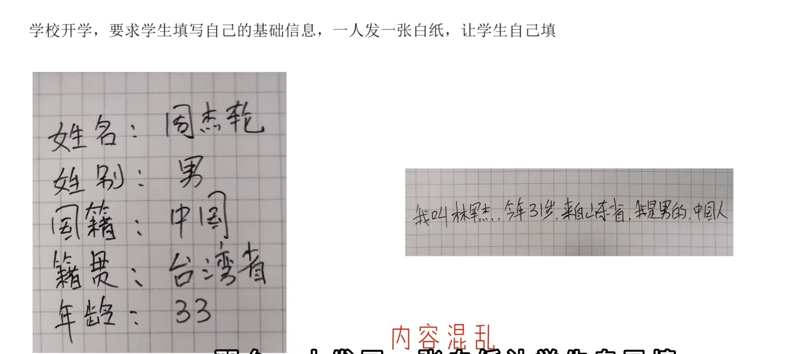
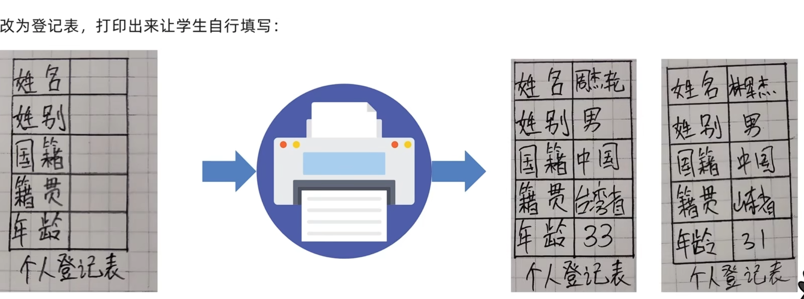
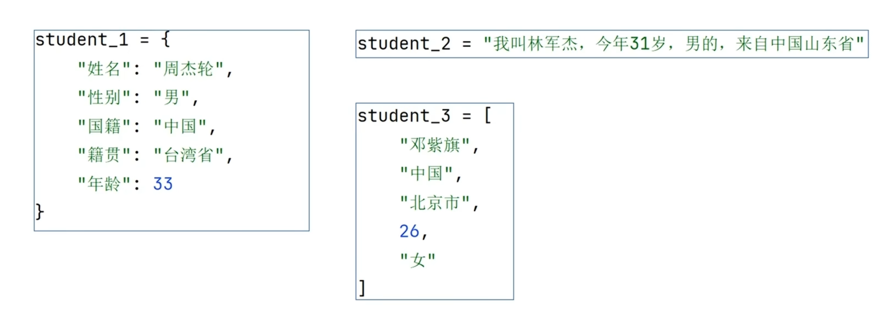
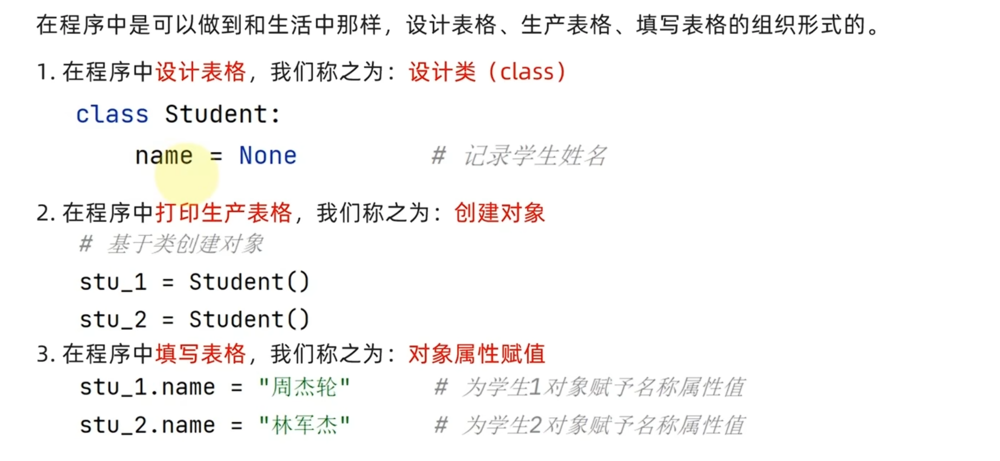
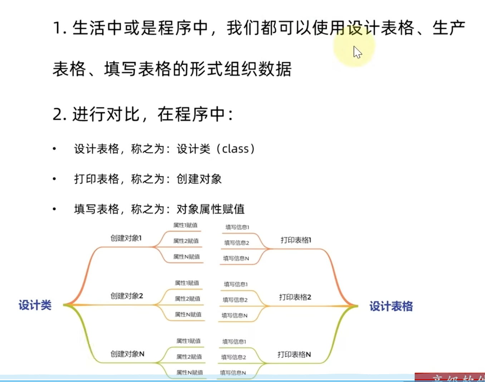

### 生活中数据的组织






### 程序中使用变量来记录学生信息



### 使用对象组织数据




**小练习 **

```Python
# 1、设计一个类（登记表）  
  
class Student:  
    name = None           # 记录信息  
    gender = None         # 记录性别  
    nationality = None    # 记录国籍  
    native_place = None   # 记录籍贯  
    age = None            # 记录年龄  
  
# 2、设创建一个对象（打印登记表）  
stu_1 = Student()  
  
# 3、对象属性进行赋值（填写表单）  
stu_1.name = "刘德滑"  
stu_1.gender = "男"  
stu_1.nationality = "中国"  
stu_1.native_place = "山东神"  
stu_1.age = 30  
  
# 4、获取对象中所记录 的信息  
print(stu_1.name)  
print(stu_1.gender)  
print(stu_1.nationality)  
print(stu_1.native_place)  
print(stu_1.age)
```


### 总结


