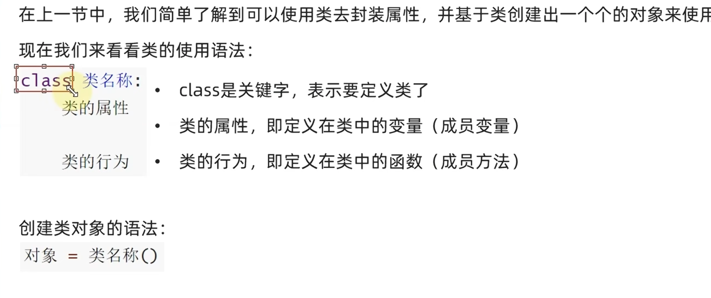
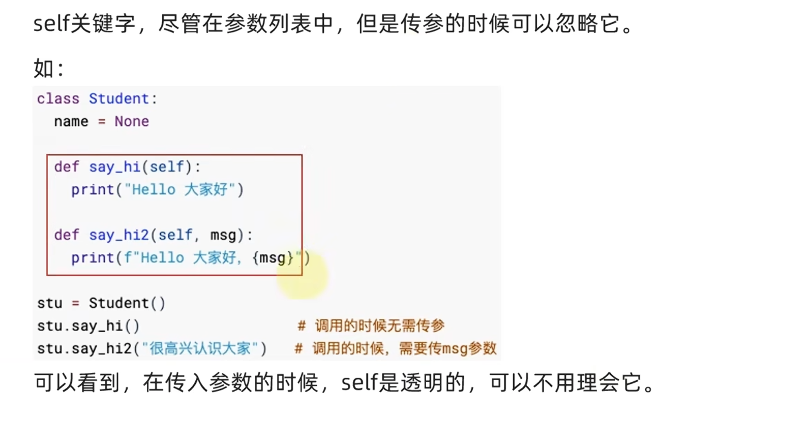
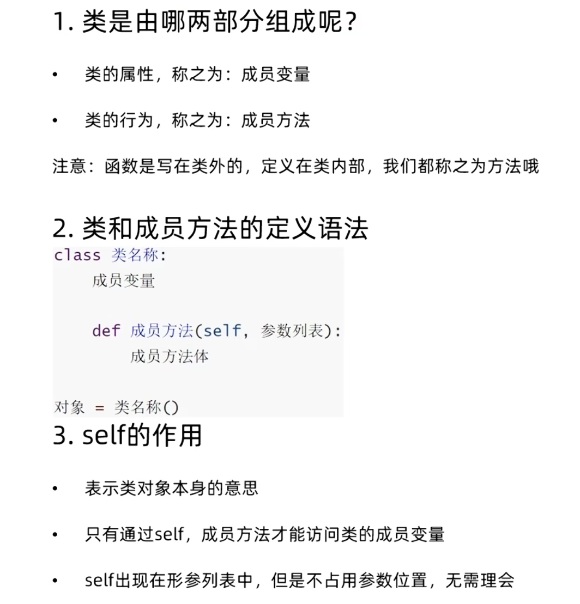

### 类的定义和使用


### 成员变量和成员方法

那么，什么是类的行为（方法）呢？
```Python
class student:
	name = None
	age = None
	
	def say_hi(self):
		print(f"hi大家好，我是{self.name}")
```

```Python
stu = Studnet():
stu.name = "周杰轮"
stu.say_hi()                 # 输出hi大家好，我是周杰轮
```

**可以看出，类中：**
- 不仅可以定义属性来记录数据
- 也可以定义函数，用来记录行为
**其中：**
- 类中定义的属性（变量），我们称之为：成员变量
- 类中定义的行为（函数），我们称之为：成员方法

### 成员方法的定义语法

在类中定义成员方法和函数基本一致，等任有细微区别：
```Python
def 方法名(self,形参1，形参2.。。。形参N):
	方法体
```

可以看到，在方法定义的参数列表中，有一给：self关键字
self关键字是成员方法定义的时候，==必须填写==的。
- 它用来表示类对象自身的意思
- 当我们使用类对象调用方法的时候，self会自动被python传入
- 在方法体内部，想要访问类的成员变量，必须使用self

### 注意事项




**小练习**

```Python
# 定义一个类  
class Student():  
    name = None  
  
    def say_hi(self):  
        print(f"大家好呀，我是{self.name},欢迎大家多多关照")  
  
  
    def say_hi2(self,msg):  
        print(f"大家好，我是：{self.name},{msg}")  
  
stu_1 = Student()  
stu_1.name = "周杰轮"  
stu_1.say_hi2("哎呦不错呀")  
  
stu_1.name = "林俊节"  
stu_1.say_hi2("小胡子我看好你")
```


### 总结

