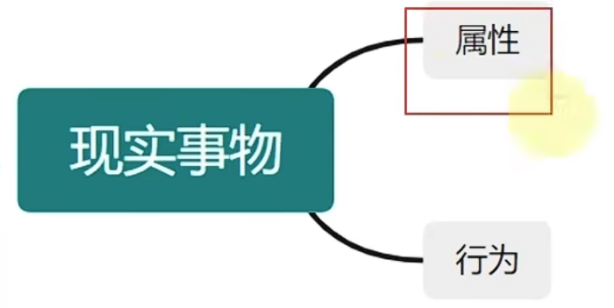
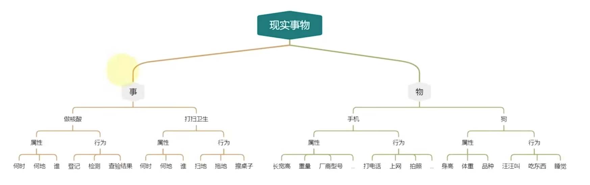
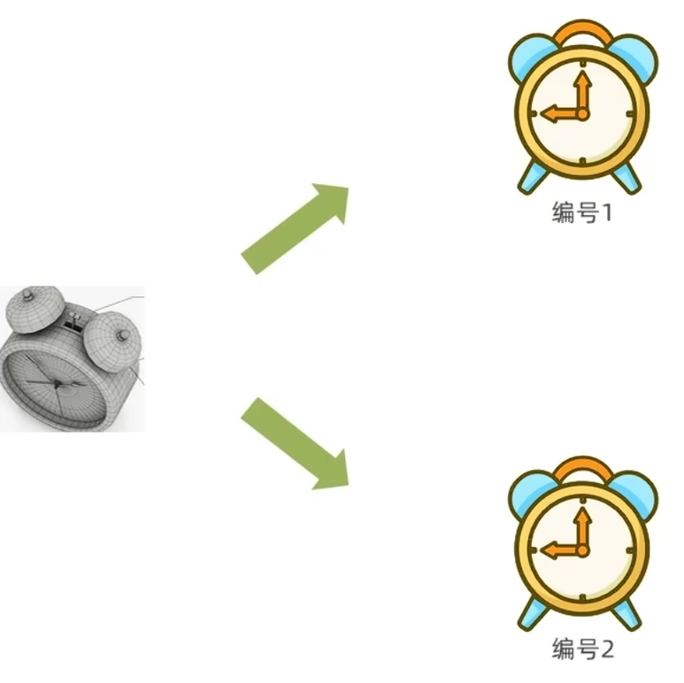
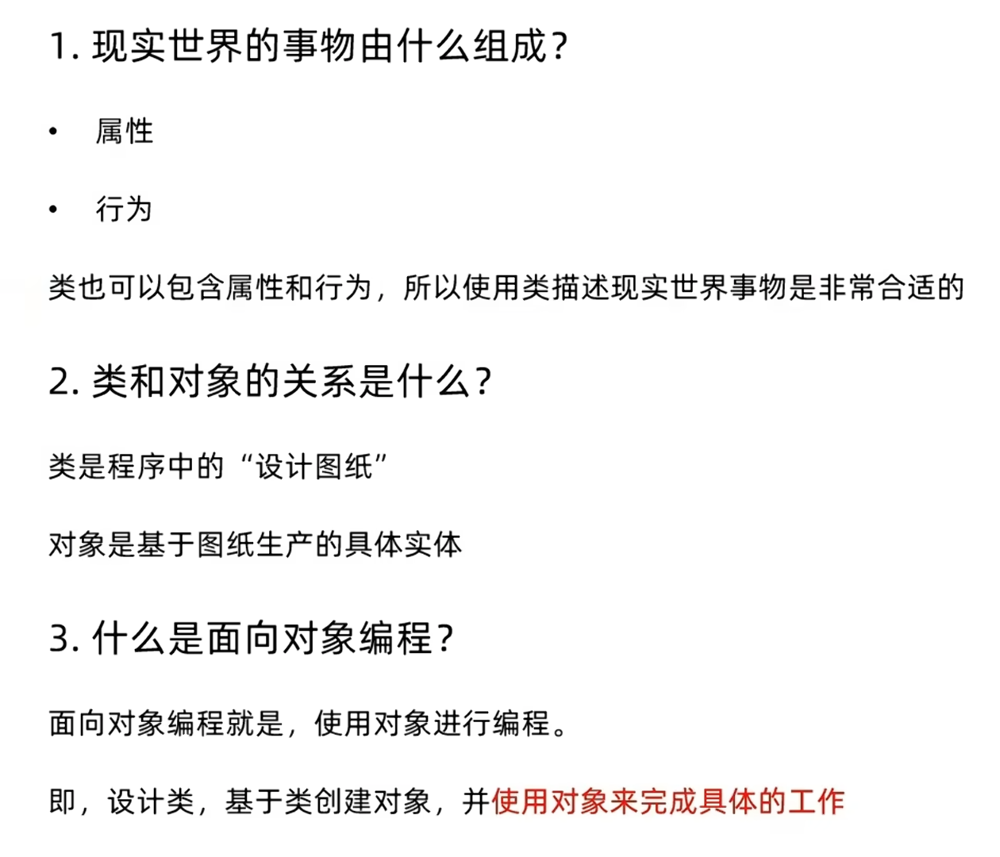

### 现实世界的事物和类别





现实世界的事物也有属性和行为，类也有属性和行为。
使用程序中的类，可以完美的描述现实世界的事物


### 类和对象

基于类创建对象的语法：对项目=类名称（）
为什么非要创建对象才能使用呢?

**类只是一种程序内的“设计图纸”，需要基于图纸生产实体（对象），才能正常工作，这种套路，承称之为面向对象编程。**

### 基于类创建对象

```Python
class Clock:
	id = None              # 序列号
	price = None           # 零售价
	
	def ring(self):        # 响铃
		import winsound
		winsounnd.Beep(2000,3000)
		
		
clock1 = Clock()             #  基于类创建对象
clock1.id = "003032"
clock1.price = 19.99
print(f"闹钟id:{clock1.id},价格：{clock1.price}")
clock1.ring()               # 使用对象的属性和方法

clock2 = Clock()             #  基于类创建对象
clock2.id = "003032"
clock2.price = 19.99
print(f"闹钟id:{clock2.id},价格：{clock2.price}")
clock2.ring()               # 使用对象的属性和方法
```

### 总结

