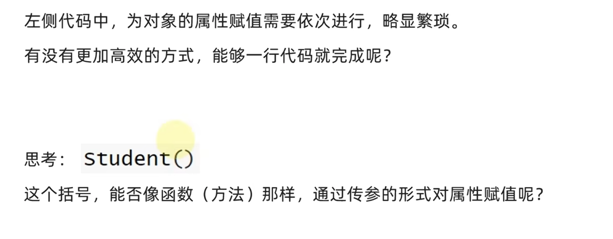
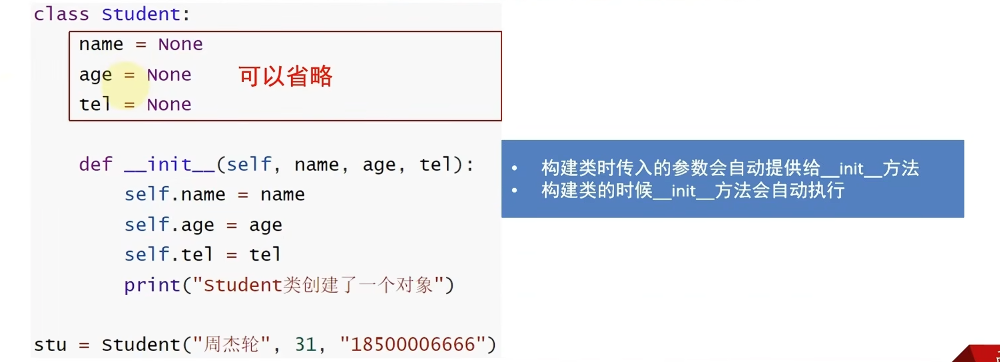
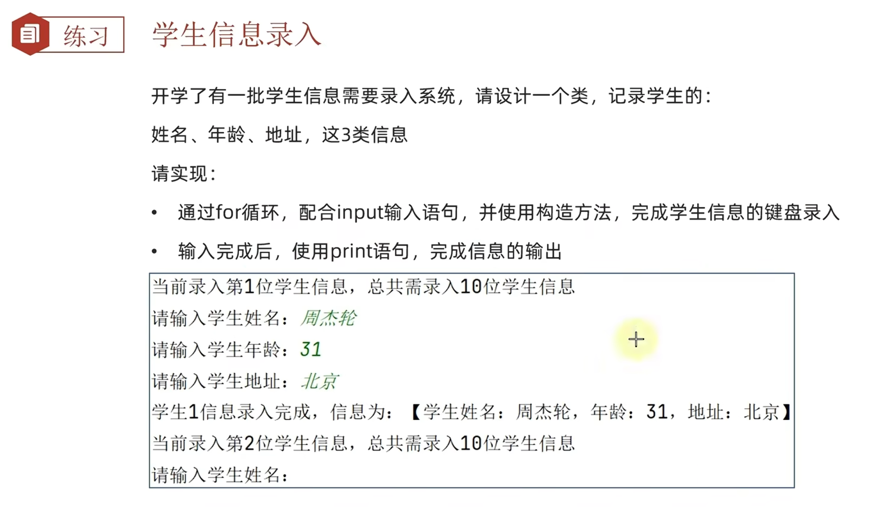
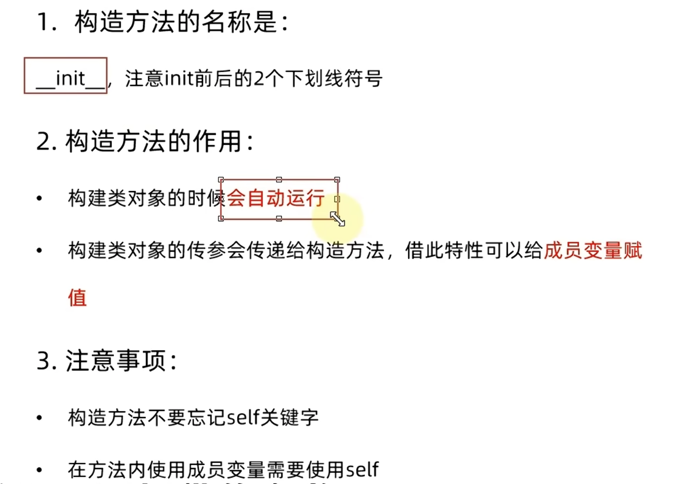

### 属性（成员变量）的赋值

```Python
class Student:
		name = None  # 名称
		age  = None  # 年龄
		tel None     # 手机号
		
student1 = Student()
student1.name = "周杰轮"
student1.age = 31
student1.tel  "19999999999"

student2 = Student()
student2.name = "林俊节"
student2.age = 30
student2.tel  "19799999999"

```



### 构造方法

Python类可以使用：==`__init__()`方法==，称之为构造方法。
可以实现：
- 在创建类对象（构造类）的时候，会自动执行。
- 在创建类对象（构造类）的时候，将传入参数自动传递给==`__init__()`方法==使用


### 构造方法注意事项

- 重要的事情说三遍，构造方法名称：
```Python
__init__
__init__
__init__
```

- 构造方法也是成员变量，不要忘记在参数列表中提供：self
- 构造方法内定义成员变量，需要使用self关键字
```Python
def __init__(self,name,age,tel):
	self.name = name
	self.age = age
	self.tel = tel        
```

- 这是因为：变量是定义在构造方法内部，如果要成为成员变量，需要使用self来表示。


### 练习



示例
```Python
# # 学生类  
#  
#  
# class Student:  
#     name = None  
#     age = None  
#     address = None  
#  
# student_num = Student()  
# for count in range(1,11):  
#     print(f"当前录入第{count}位学生信息，总共需要录入10位学生信息")  
#     student_num.name = input("请输入学生姓名：")  
#     student_num.age = int(input("请输入学生年龄："))  
#     student_num.address = input("请输入学生地址：")  
#     print(f"当前学生{count}信息录入完成，信息为：[学生姓名：{student_num.name,student_num.age,student_num.address}")  
#  
student_lsit = []  
class Student:  
    def __init__(self,name,age,address):  
        self.name = name  
        self.age = age  
        self.address = address  
  
for count in range(1,11):  
    print(f"当前录入第{count}位学生信息，总共需要录入10位学生信息")  
    name = input(f"请输入学生姓名：")  
    age = int(input(f"请输入学生年龄："))  
    address = input(f"请输入学生住址：")  
    stu = Student(name,age,address)  
    student_lsit.append(stu)  
    print(f"学生{count}信息录如完成，信息为：【学生信息：{stu.name},学生年龄：{stu.age},学生住址：{stu.address}】")  
  
  
print("\n===== 所有学生信息录入完毕 =====")  
for i, stu in enumerate(student_lsit, 1):  
    print(f"学生{i}：姓名：{stu.name}，年龄：{stu.age}，地址：{stu.address}")
```

### 总结

