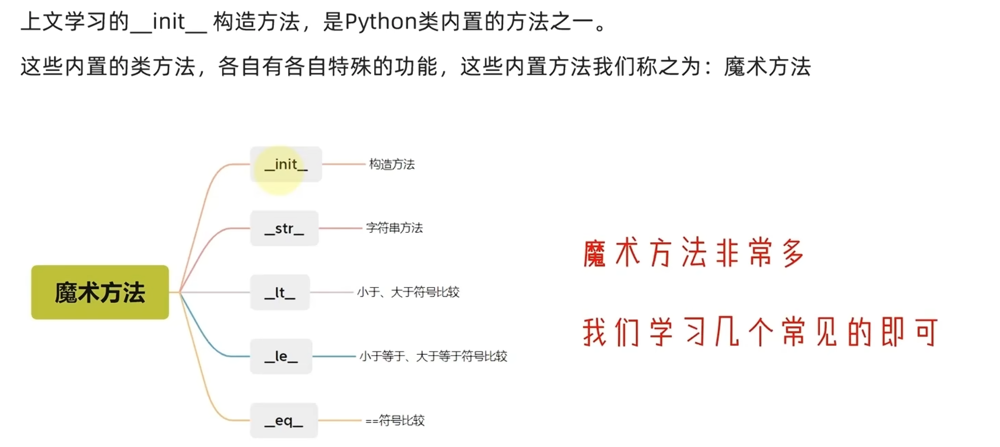
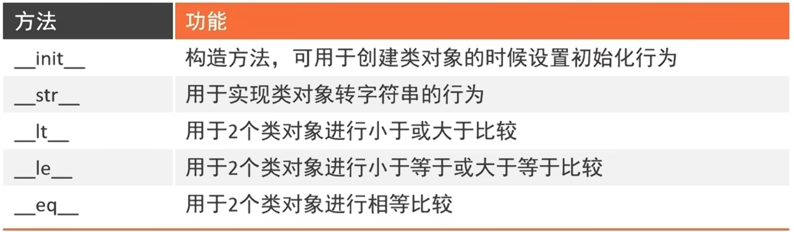

### 魔术方法



### `__str__`字符串方法

```Python
class Student:  
    def __init__(self,name,age):  
        self.name = name  
        self.age = age  
  
student = Student("周杰轮",10)  
print(student)          # 结果：<__main__.Student object at 0x0000017570717230>  
print(str(student))     # 结果：<__main__.Student object at 0x0000017570717230>
```
当类对象需要被转换成字符串之时，会输出如上结果！（内存地址）

内存地址没有多大作用，我们可以通过`__str__`方法，控制类转换为字符串的行为

```Python
class Student:  
    def __init__(self,name,age):  
        self.name = name  
        self.age = age  
  
    def __str__(self):  
        return f"Student类对象，name={self.name},age={self.age}"  
student = Student("周杰轮",11)  
print(student)          # 结果：Student类对象，name=周杰轮,age=11  
print(str(student))     # 结果：Student类对象，name=周杰轮,age=11
```

### `__lt__`小于符号比较方法

```Python
# 错误示范  
class Student:  
    def __init__(self,name,age):  
        self.name = name  
        self.age = age  
  
  
stu1 = Student("周杰轮子",12)  
stu2 = Student("林俊节",13)  
print(stu1 < stu2)
```

直接对两个对象进行比较是不可以的，但是在类中实现==__lt__方法==，即可同时完成：小==于符合和大于符号 2中比较==

```Python
# 正确示范  
class Student:  
    def __init__(self,name,age):  
        self.name = name  
        self.age = age  
  
    def __lt__(self, other):  
        return self.age < other.age  
  
stu1 = Student("周杰轮",19)  
stu2 = Student("林俊节",30)  
print(stu1 < stu2)         # 结果：True  
print(stu1 > stu2)         # 结果：False
```

### `__le__`小于等于比较符号方法

魔术方法：__le__可用于：<=、>=两种比较运算符上

```Python
class Student:  
    def __init__(self,name,age):  
        self.name = name  
        self.age = age  
  
  
    def __le__(self,other):  
        return self.age <= other.age  
  
stu1 = Student("周杰轮",11)  
stu2 = Student("林俊节",100)  
print(stu1 <= stu2)  
print(stu1 >= stu2)
```


### `__eq__`比较运算符实现方法

不实现__eq__方法，对象之间可以比较，但是是比较对象内存地址，也即是：不同对象 == 比较一定是False结果
实现了__eq__方法，就可以按照自己的想法来决定2个对象是否相等了。

```Python
class Student:  
    def __init__(self,name,age):  
        self.name = name  
        self.age = age  
  
    def __eq__(self,other):  
        return self.age == other.age  
  
stu1 = Student("周杰轮",30)  
stu2 = Student("林俊节",29)  
print(stu1 == stu2)
```

### 总结

