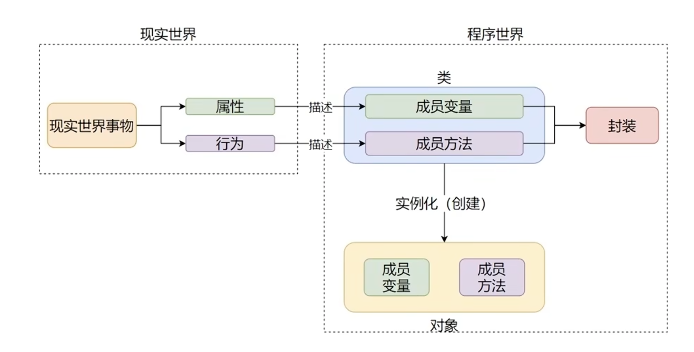
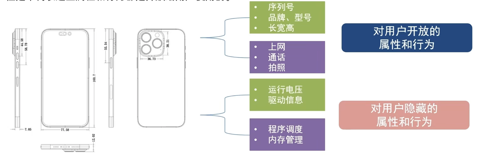
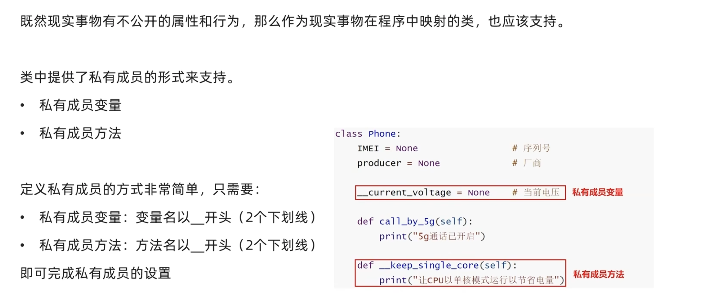
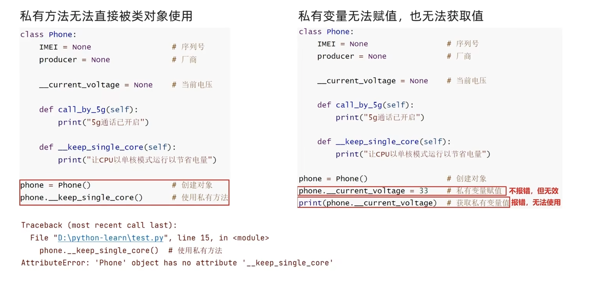
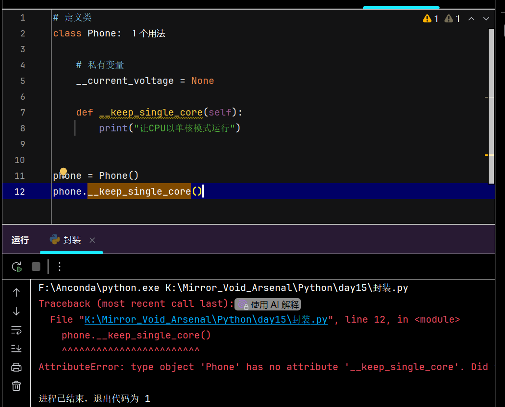
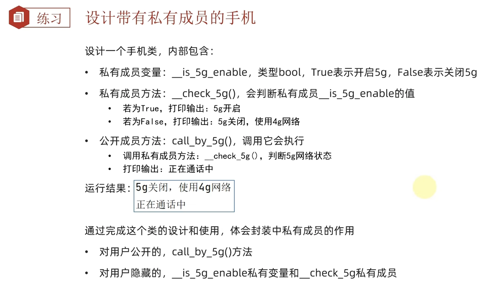
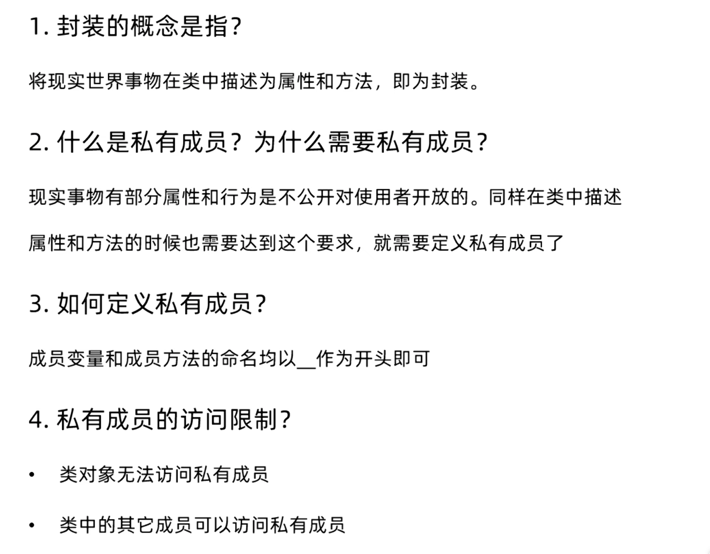

### 面向对象的三大特性

面向对象编程，是许多编程语言都支持的一种编程思想。
简单理解是：基于模板（类）去创建实体（对象），使用对象完成功能开发


面向对象包含3大主要特性：
- **封装**
- **继承**
- **多态**

### 封装

封装表示的是，将现实世界事物的：
- **==属性**==
- ==**行为==**

封装到类中，描述为：
1. ==**成员变量**==
2. ==**成员方法==**

从而完成程序对现实世界事物的描述




#### 对用户隐藏的属性和行为

现实世界中的事物，有属性和行为。
但是不代表这些顺序ing和行为都是开放给用户使用的。



### 私有成员

**私有成员的意义/作用**

==在类中提供仅供内部使用的属性和方法，而不对外开放（类对象无法使用）==



#### 使用私有成员

正确使用私有成员变量以及方法
```Python
class Phone:  
    __current_voltage = 1           # 当前收集运行电压  
  
    def __keep_sing_core(self):  
        print("让CPU以单核模式运行")  
  
  
    def call_by_5g(self):  
        if self.__current_voltage >= 1:  
            print("5g通话已开启")  
        else:  
            self.__keep_sing_core()  
            print("电量不足，无法使用5g童话，并设置为单核运行进行甚省电")  
  
phone = Phone()  
phone.call_by_5g()
```


错误示范
报错了。。。



### 练习




示例
```Python
# 手机类  
class Phone:  
    # 私有变量  
    __is_5g_enable = False  
    # 私有成员方法  
    def __check_5g(self):  
        if self.__is_5g_enable == True:  
            print("5g开启")  
        else:  
            print("5g关闭，使用4g网络")  
    # 公开  
    def call_by_5g(self):  
        self.__check_5g()  
        print("正在通话中")  
phone = Phone()  
phone.call_by_5g()
```


### 总结

