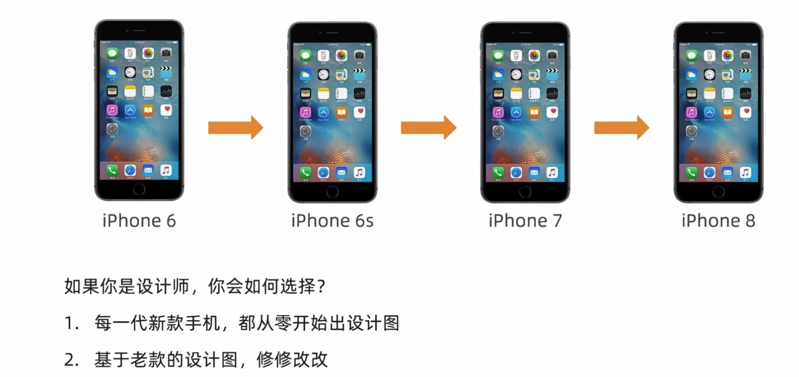
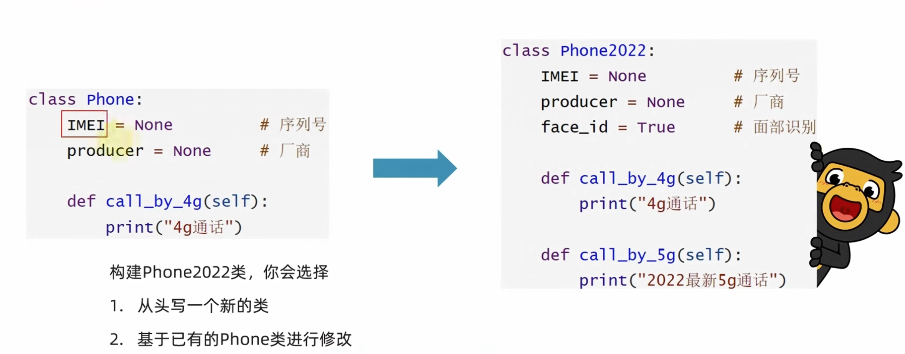
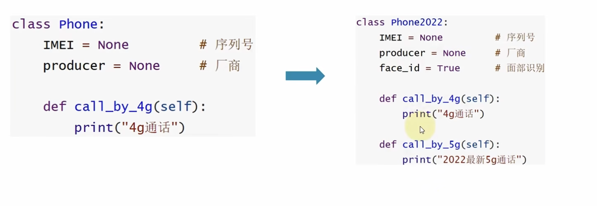
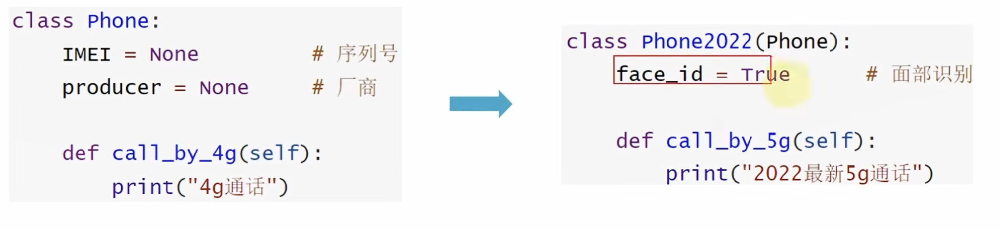
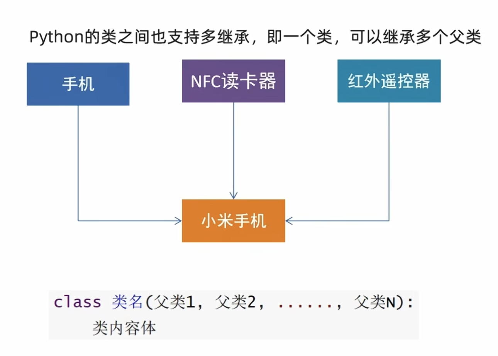
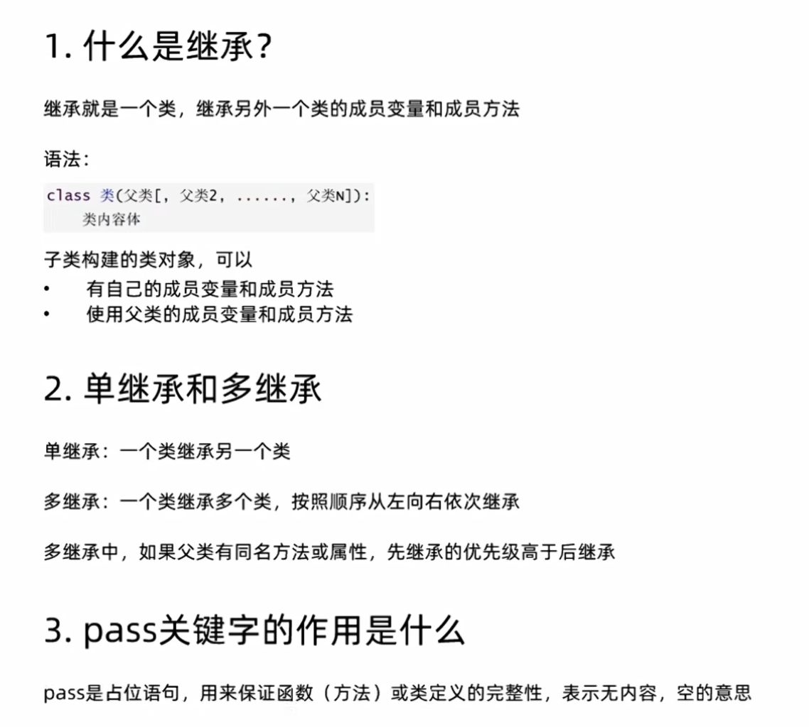

### 继承的引出





### 单继承

没用继承之前

继承之后

#### 单继承语法

```Python
class 类名(父类名):
	类内容体
```

**继承分为单继承和多继承**
使用如图语法，可以完成类的单继承
继承表示：
将从父类那里继承（复制）来成语变量和成员方法（不含私有）

#### 单继承
```Python
class Phone:  
  
    IMEI = None  
    producer = "HM"  
  
    def call_by_4g(self):  
        print("4g通话")  
  
class Phone2022(Phone):  
    face_id = "100001"  
  
    def call_by_5g(self):  
        print("2022年新款功能：5g通话")  
  
  
phone = Phone2022()  
print(phone.producer)  
phone.call_by_4g()  
phone.call_by_5g()
```

#### 多继承



示例
```Python
class phone:  
    IMEI = None  
    producer = "CAT!!!"  
  
    def call_by_5g(self):  
        print("5g通话")  
  
class NFCReader:  
    nfc_type = "瑞克五代"  
    producer = "HM"  
  
    def read_card(self):  
        print("读取NFC卡")  
  
    def write_card(self):  
        print("写入NFC卡")  
  
class RemoteControl:  
    rc_type = "红外遥控"  
  
    def control(self):  
        print("红外遥控开启")  
  
class MyPhone(phone,NFCReader,RemoteControl):  
    pass  
  
phone = MyPhone()  
phone.call_by_5g()  
phone.read_card()  
phone.write_card()  
phone.control()  
  
print(phone.producer)
```


### 总结

