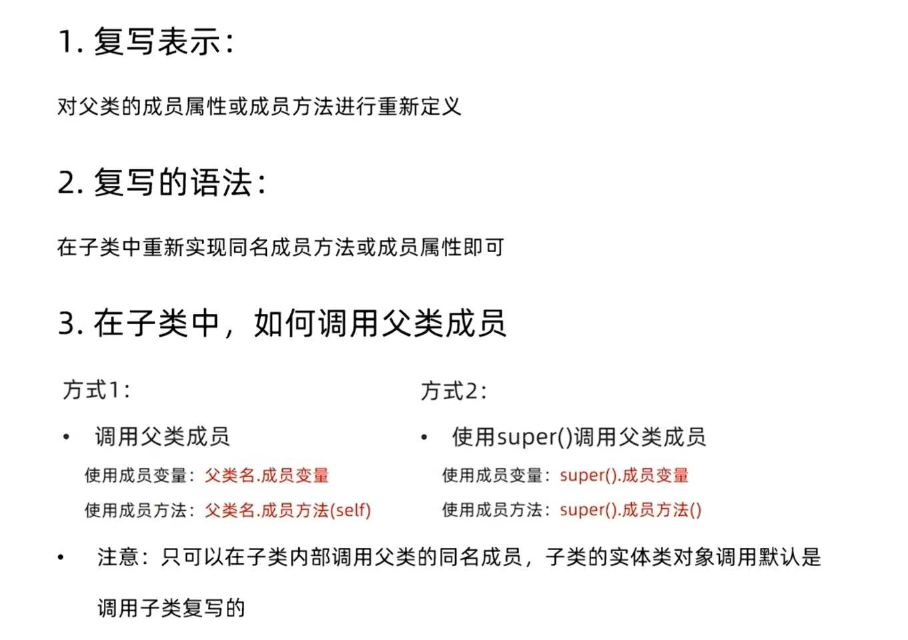

### 复写

子类继承父类的成员属性和成员方法后，如果对其“不满意”，那么可以进行覆写。
即：在子类中重新定义同名的属性或方法即可。

```Python
class Phone:  
    IMEI = None  
    producer = "ITCAST"  
  
    def call_by_5g(self):  
        print("父类的5g通话")  
  
class MyPhone(Phone):  
    producer = "ITHEIMA"           #  覆写父类的属性  
  
    def call_by_5g(self):  
        print("开启CPU单核模式，确保通话的时候省电")  
        print("使用5g网络进行通话")  
        print("关闭CPU单核模式，确保性能")  
  
  
phone = MyPhone()  
phone.call_by_5g()  
print(phone.producer)
```

### 调用父类同名成员

一旦覆写父类成员，那么类对象调用成员的时候，就会调用覆写后的新成员。
如果需要使用被覆写的父类的成员，需要特殊的调用方式：
#### 方式一
- **调用父类成员**
	使用成员变量：==父类名.成员变量==
	使用成员方法：==父类名.成员方法(self)==

#### 方式二
- 使用super()调用父类成员
	使用成员变量：==super().成员变量==
	使用成员方法：==super().成员方法(self)==

示例

```Python
class Phone:  
    IMEI = None  
    producer = "ITCAST"  
  
    def call_by_5g(self):  
        print("使用5g网络进行通话")  
  
class MyPhone(Phone):  
    producer = "ITHEIMA"           #  覆写父类的属性  
  
    def call_by_5g(self):  
        print("开启CPU单核模式，确保通话的时候省电")  
        # 方式1  
        # print(f"父类的厂商是：{Phone.producer}")  
        # Phone.call_by_5g(self)        # 方式2  
        # print(f"父类的厂商是：{super().producer}")  
        # super().call_by_5g()        print("关闭CPU单核模式，确保性能")  
  
  
phone = MyPhone()  
phone.call_by_5g()  
print(phone.producer)
```


### 总结

