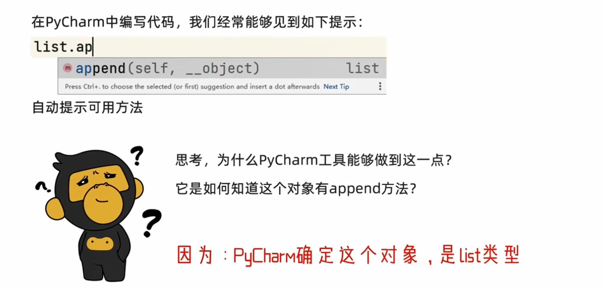
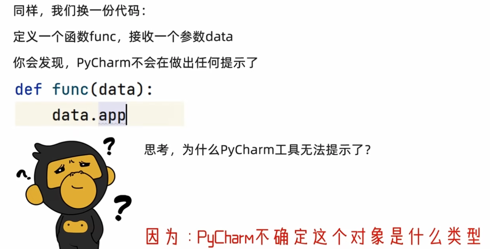
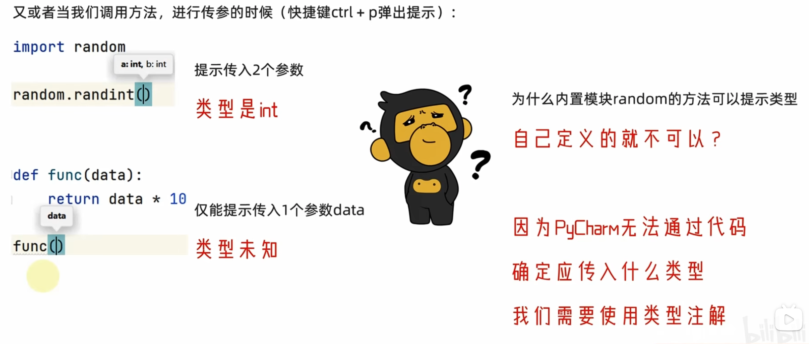
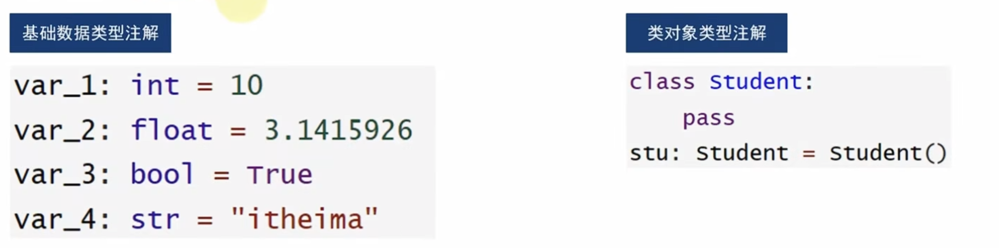
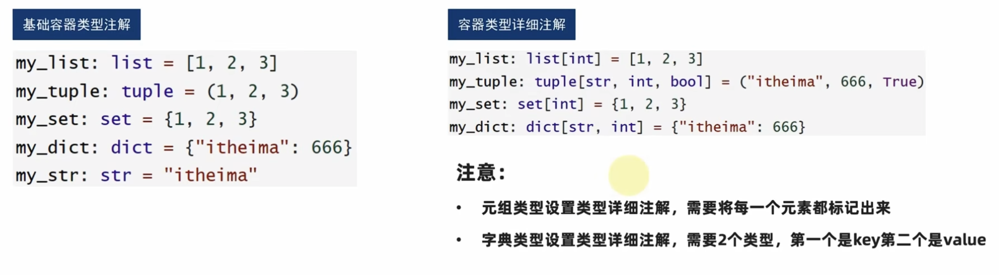
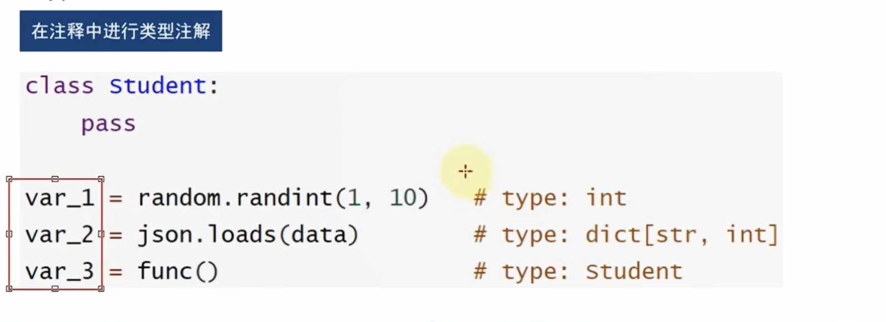
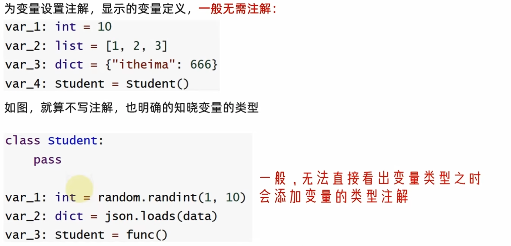
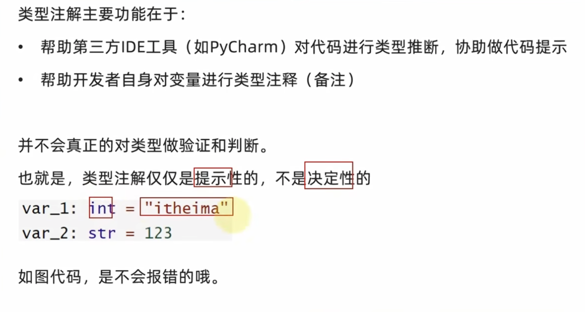
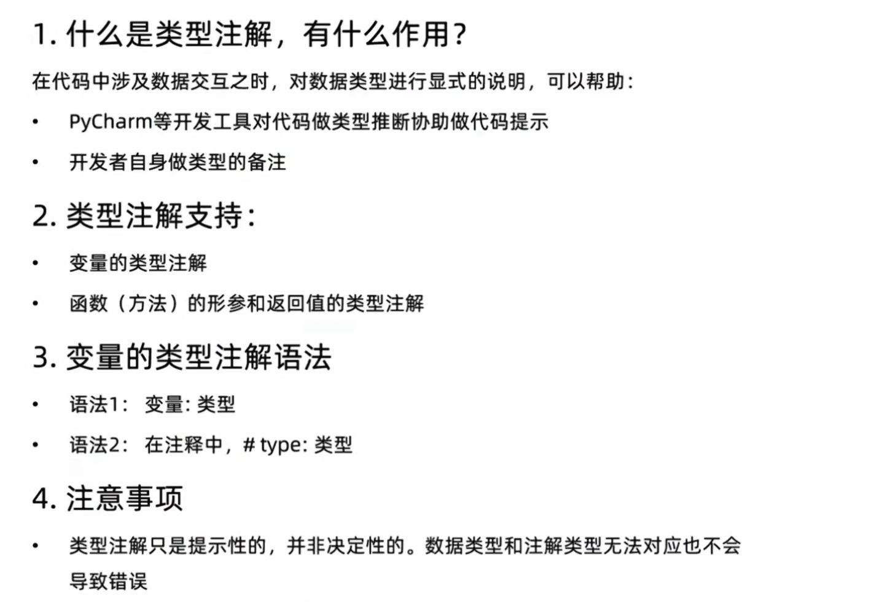

### 为什么需要类型注解






好用


### 类型注解

Python在3.5版本的时候引入了类型注解，以方便静态类型检测工具，IDE的第三方工具。
类型注解：在代码中设计数据交互的地方，提供数据类型的注解（显示的说明）
- 主要功能：
	- 帮助第三方IDE工具（如pycharm）对代码类型推断，协助做代码提示。
	- 帮助开发者自身对变量进行类型注释。

支持
- 变量的类型注释：
- 函数（方法）形参和返回值的类型注解

### 类型注解的语法

**为变量设置**
==基础语法：变量:类型==



容器类注解



#### 示例

```Python
# 基础数据类型注解  
var_1: int = 10  
var_2: str = "itheima"  
var_3: bool = True  
  
# 类对象类型注解  
class Student:  
    pass  
stu: Student = Student()  
  
# 基础容器类型数据  
my_list: list[int] = [1,2,3]  
my_tuple: tuple[int,str,bool] = (1,"ithiema",True)  
my_dict: dict[str,int] = {"itheima": 777}
```

除了使用变量:类型这种语法注解以外，也可以在注释中进行类型注解。
语法：
**type:类型**




示例
```python
import random  
import json  
# 基础数据类型注解  
var_1: int = 10  
var_2: str = "itheima"  
var_3: bool = True  
  
# 类对象类型注解  
class Student:  
    pass  
stu: Student = Student()  
  
# 基础容器类型数据  
my_list: list[int] = [1,2,3]  
my_tuple: tuple[int,str,bool] = (1,"ithiema",True)  
my_dict: dict[str,int] = {"itheima": 777}  
  
# 在注释中进行类型注释                          # 对比 intvar_4 = random.randint(1,20)         # type:int  
var_5 = json.loads('{"name": "zhangsan"}') # type: dict[str,str]  
def func():  
    pass  
  
var_6 = func()                             # type:int
```

尽量自己用第二种，提醒自己



### 类型注解的限制



### 总结

