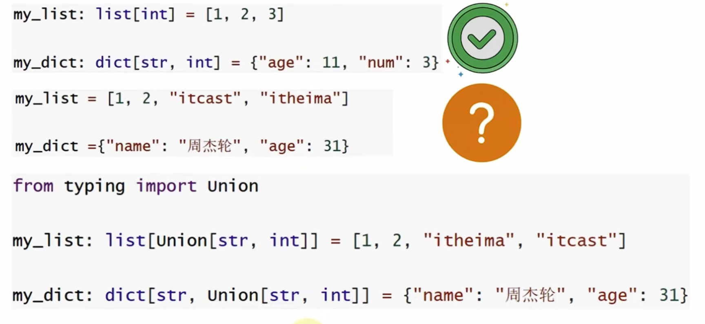
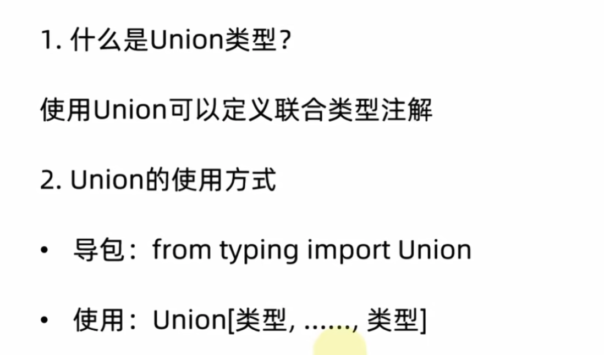

### union类型

语法
union[类型,...,类型]
可以定义联合类型注解


```Python
# 导包  
import typing  
from typing import Union  
  
my_list: list[Union[int,str]] = [1,2,"itheima","itcast"]  
  
def func(data: Union[int,str]) -> Union[int,str]:  
    pass  
func()
```

### 总结

