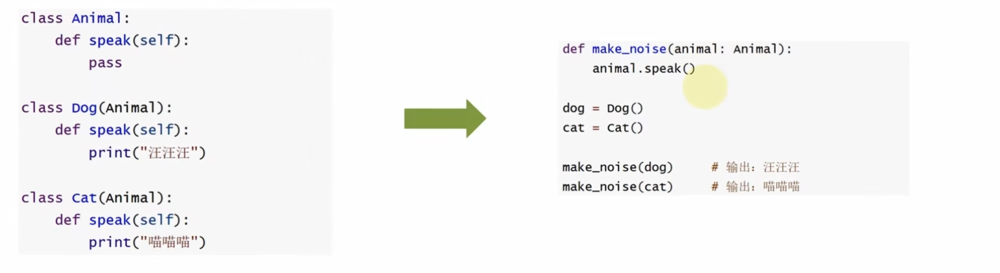
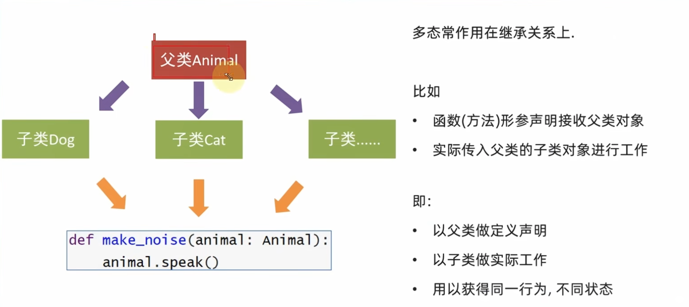
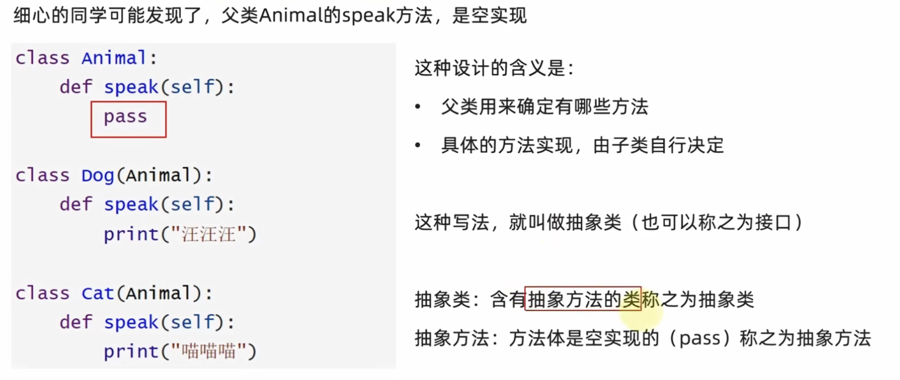
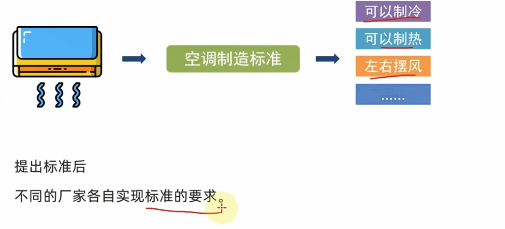
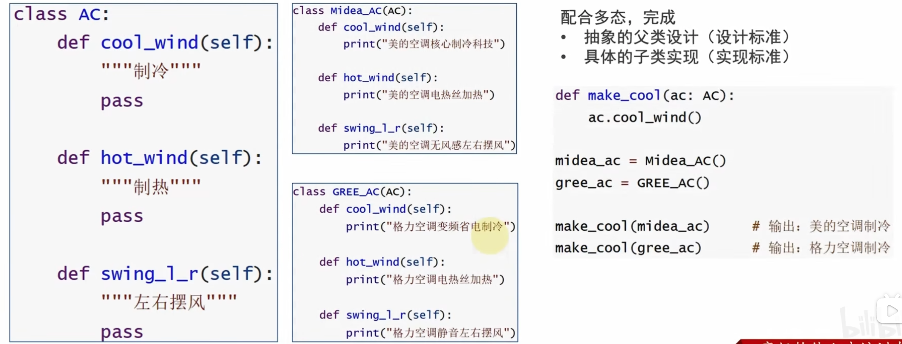
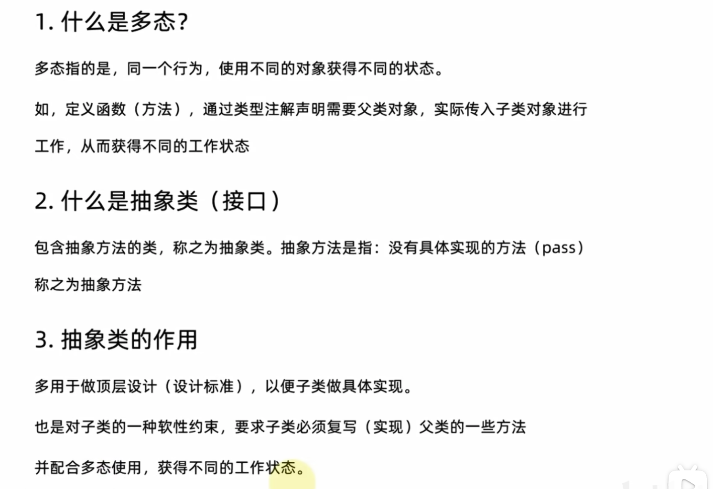

### 多态

多态，值得是：多种状态，即完成某个行为时，使用不同对象会得到不同的状态
如何理解？

同样的行为（函数），传入不同的对象，得到不同的状态
```Python
class Animal:  
    def speak(self):  
        pass  
  
  
class Dog(Animal):  
    def speak(self):  
        print("汪汪汪")  
  
class Cat(Animal):  
    def speak(self):  
        print("喵喵喵")  
  
def make_noise(animal: Animal):  
    """  
    制造点噪音，需要传入Animal对象  
    """    animal.speak()  
  
  
# 演示多态，使用2个子类对象来调用函数  
dog = Dog()  
cat = Cat()  
  
make_noise(dog)  
make_noise(cat)
```


#### 概览



### 抽象类（接口）



为什么要使用抽象类呢？


抽象类就好比定义一个标准，包含了一些抽象的方法，要求子类必须实现。



### 代码

```Python
# 抽象类  
class AC:  
    def cool_wind(self):  
        """制冷"""  
        pass  
  
    def hot_wind(self):  
        """制热"""  
        pass  
  
    def swing_l_r(self):  
        """左右摆风"""  
        pass  
  
  
  
class Midea_AC(AC):  
    def cool_wind(self):  
        print("美的空调制冷")  
  
  
    def hot_wind(self):  
        print("美的空调制热")  
  
  
    def swing_l_r(self):  
        print("美的空调左右摆风")  
  
  
class GREE_AC(AC):  
    def cool_wind(self):  
        print("格力空调制冷")  
  
  
    def hot_wind(self):  
        print("格力空调制热")  
  
  
    def swing_l_r(self):  
        print("格力空调左右摆风")  
  
def make_cool(ac: AC):  
    ac.cool_wind()  
  
midea_ac = Midea_AC()  
gree_ac = GREE_AC()  
  
make_cool(midea_ac)  
make_cool(gree_ac)
```

### 总结

