### 1、C语言是什么

人和人2交流使用的是**自然语言**，如：汉语，英语，日语。
那人和计算机是字母交流的呢？使用的是**计算机语言**。
目前已知已经有上千种计算机语言，人们是通过计算机语言写的程序，给计算机下达指令，让计算机工作的。
C语言就是众多计算机语言中的一种，当然C++/Java/Go/Python都是计算机语言

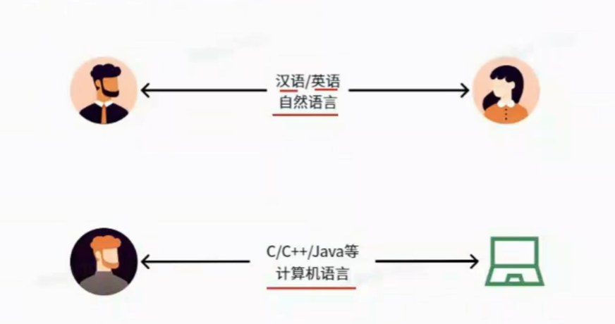

### 2、C语言的历史和辉煌

C语言最初作为Unix系统的开发工具而发明的。

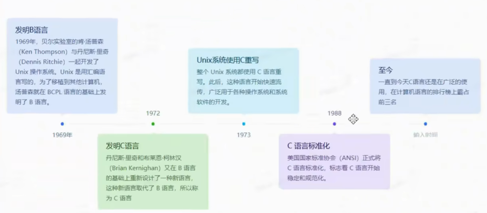

### 3、编译器的选择-VS2026

#### 编译和链接

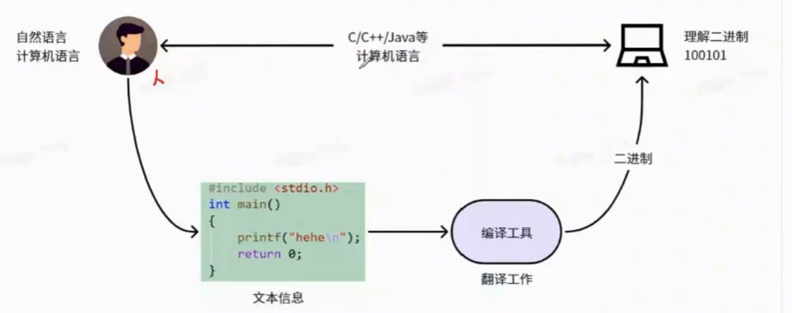

C语言是一门**编译型**计算机语言，C语言源代码都是文本本文件，文本文件本身无法执行，必须通过**编译器**和**链接器**的链接，生成**二进制的可执行文件**，可执行文件才能执行。

C语言代码是放在.c为后缀的文件中的，要得到最终运行的可执行程序，中间要经过**编译**和**链接**2个过程。

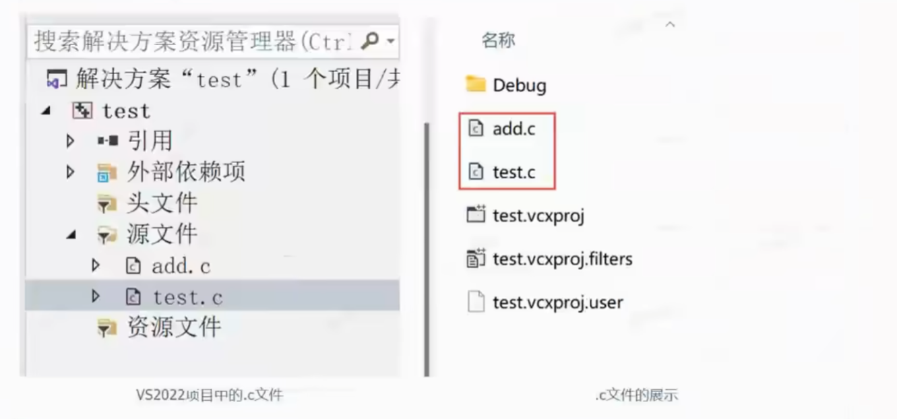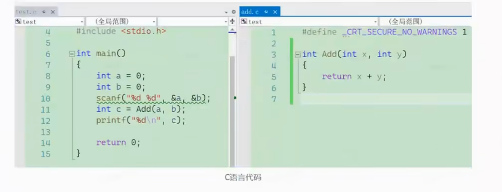

一个工程一般都会有多个源文件组成，如下图所示，演示了源程序经过编译器和链接器处理的过程
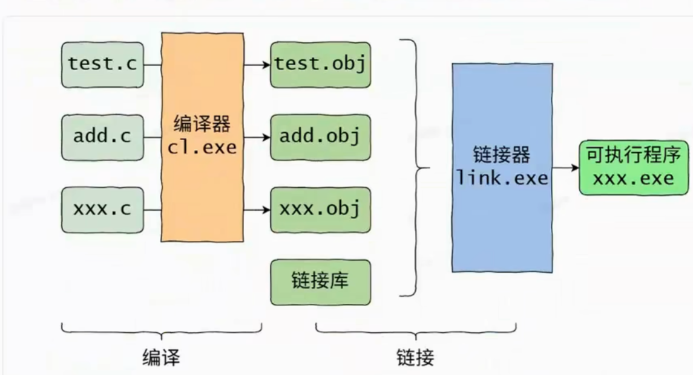

***注：***
1. 每个源文件(.c)单独经过**编译器**处理生成对应的目标文件（.obj为后缀的文件）
2. 多个目标文件和库文件经过**链接器**处理生成对应的可执行文件(.exe文件)
这就是在Windows电脑上C语言程序生成的可执行exe文件
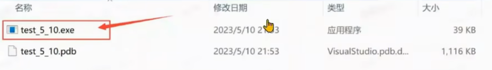
#### 编译器的对比

C语言是一门编译型的计算机语言，需要依赖编译器将计算机语言转换成机器能够执行的机器指令。
那我们常见的C语言编译器都有哪些呢？
比如：**msvc**、**clang**、**gcc** 就是一些常见的编译器，当然也有一些集成开发环境，如：VS2022、XCode、CodeBlocks、DevC++、Clion 等。

>集成开发环境（IDE）用于提供程序开发环境的应用程序，一般包括代码编辑器、编译器、调试器和图形用户界面等工具。集成了代码编写功能、分析功能、编译功能、调试功能等一体化的开发软件服务套。

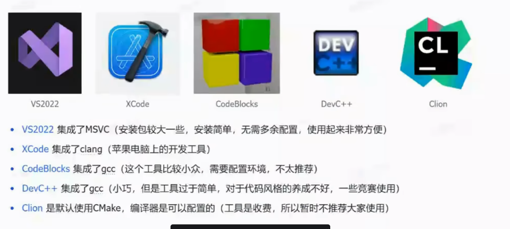

 整体考虑，推荐搭建安装VS2022/VS2026的社区版本学习，免费，使用方便，工作中常见。

#### VS2026的优缺点
**优点：**
- VS2026 是一个主流的集成开发环境，企业中使用较为普遍
- VS2026 包含了：编辑器+编译器+调试器，功能强大
- 直接安装即可使用，基本不用额外配置环境，上手容易
- 默认界面是中文的，初学者友好
**缺点：**
- 功能丰富，安装包大，占用空间多

#### VS项目和源文件、头文件介绍

在VS上写代码，我们需要创建项目的，直接新建项目就可以了。
C语言把`.c`为后缀的称为**源文件**，把`.h`为后缀的文件称为**头文件**

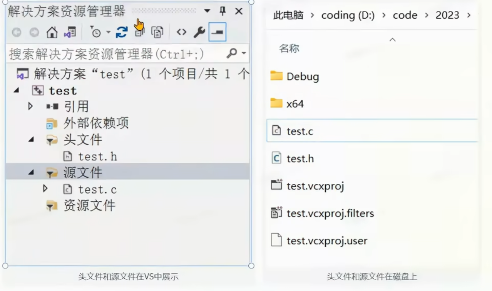


### 4、VS2026上写代码
1. 创建项目（使用项目的方式来管理代码，而不是裸奔）
2. 创建.C文件-源文件
3. 写代码

#### 创建项目
![[01-C语言常见概念之认识C语言-2026-09-03-15-46-28.png]]
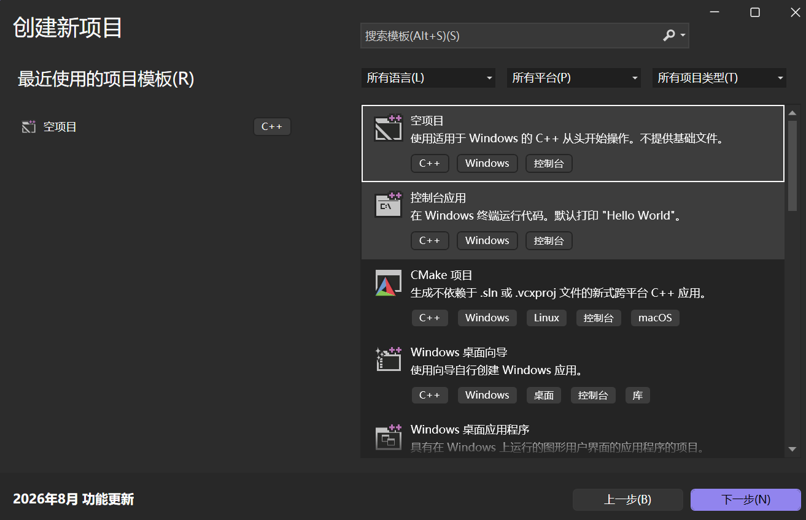

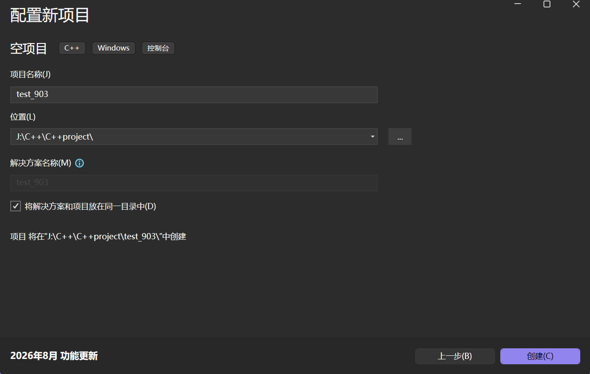

软件界面

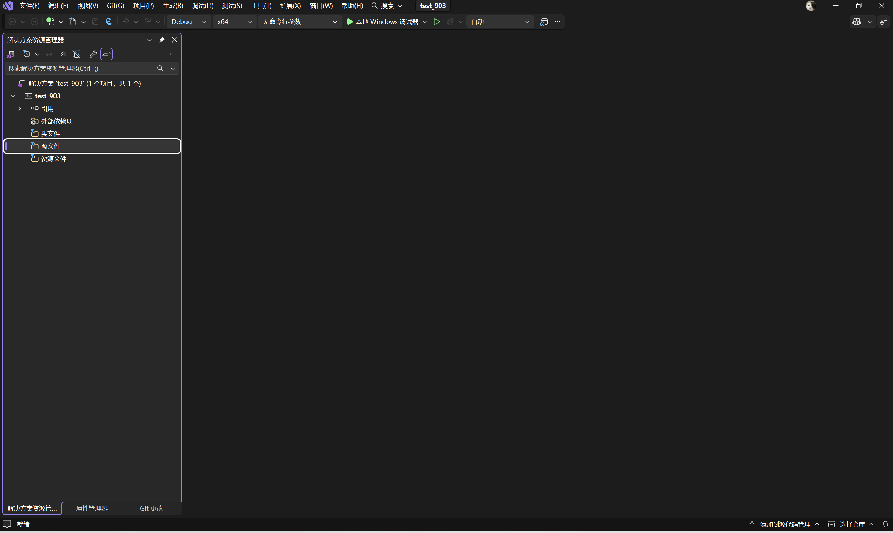

#### 新建源文件
点击新建项，创建一个源文件（.c）
建议点击显示可用模板。
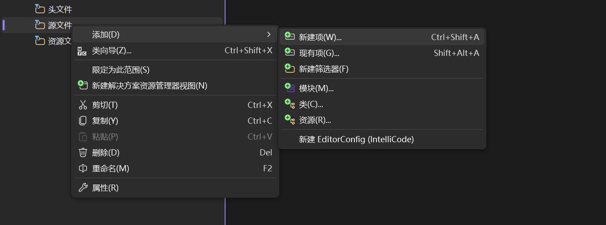

创建一个test_c.c的c程序源文件
***注：***
==C程序的后缀是：.c==
==C++程序的后缀是：.cpp==
==C++是C的超集，cpp的缩写是c plus plus==
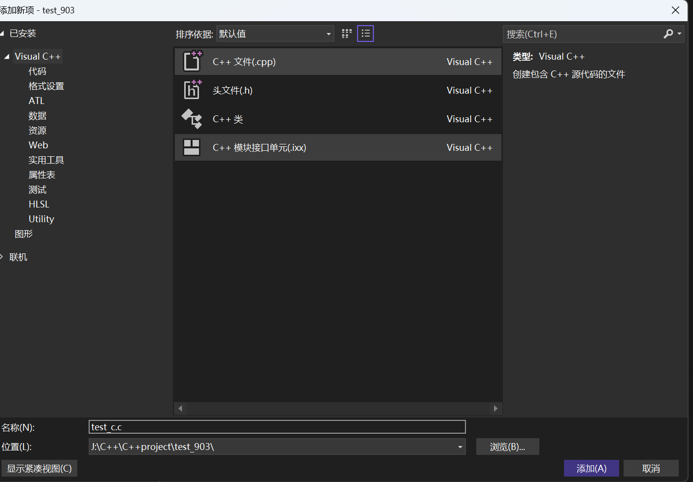

#### 第一个C语言程序

写一个C语言的程序，在屏幕上打印：hello C

>4.运行程序
>a.编译+链接   ——>xxx.exe       二进制
>b.运行程序     ——>hello C
>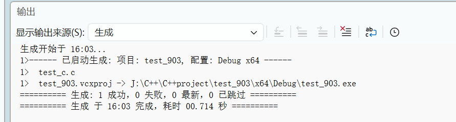


```C
# include <stdio.h>
int main() 
{
	printf("hello C");
	
	return 0;
}
```

这里展示的是VS2026中创建项目和编写C代码的过程，并运行出结果。
在VS2026上运行代码的快捷键是：CTRL+F5


### 5、mian函数

C语言——计算机语言之语法规则
写C语言程序，就得按照规则来写
按F10，让代码启动，然后继续按F10，可以一句一句的执行代码

每个 C 语言程序不管有多少行代码，都是从 **`main`** 函数开始执行的，`main` 函数是程序的入口，`main` 函数也被叫做：**主函数**。`main` 前面的 `int` 表示 `main` 函数执行结束的时候返回一个整型类型的值。所以在 `main` 函数的最后写 `return 0;` 正好前后呼应。
- `main` 函数是程序的入口
- `main` 函数有且仅有一个
- 即使一个项目中有多个 `.c` 文件，也只能有一个 `main` 函数（因为程序的入口只能有一个）

 **第一次写代码，一些常见的错误总结：**
- `main` 被写成了 `mian`
- `main` 后边的 `()` 漏掉了
- 代码中不能使用中文符号，比如括号和分号
- 一条语句结束后，有分号

### 6、printf和库函数

在上面的代码中有一句代码如下：
```c
	printf("hello C\n");
```

代码中使用了 `printf` 函数，实现了在屏幕上的信息的打印。
这里简单的介绍一下 `printf`，`printf` 是一个库函数，它的功能是在标准输出设备（一般指屏幕）上进行信息的打印。上面的代码是使用 `printf` 函数打印字符串。只要把想要打印的一串字符放在双引号中并传递给 `printf` 函数就可以打印。

`printf` 函数也可以用来打印其他类型的数据，比如：
```c
//%d   打印整数
//%c   打印字符
//%f   打印浮点型数据
int n = 100;
printf("%d\n", n);     // printf打印整型
printf("%c\n", 'q');   // printf打印字符
printf("%f\n", 3.14);  // printf打印双精度浮点型
```

这里的%d，%c等是占位符，会被后边的值替换。
同时我们在使用库函数的时候，是需要包含头文件的，比如：printf需要包含的就是stdio.h这个头文件，具体的方法是：
```c
# include <stdio.h>
```

#### 什么是库函数

为了不再重复实现常见的代码，让程序员提升开发效率，C语言标准规定了一组函数，这些函数再由不同的编译器厂商根据标准进行实现，提供给程序员使用。这些函数组成了一个函数库，被称为**标准库**，这些函数也被称为**库函数**。在这个基础上一些编译器厂商可能会额外扩展提供部分函数（这些函数其他编译器不一定支持）。
一个系列的库函数一般会声明在同一个**头文件**中，所以库函数的使用，要包含对应的头文件。
库函数比较多，后期慢慢来介绍，提前了解可参考链接：
[https://cplusplus.com/reference/clibrary/](https://cplusplus.com/reference/clibrary/)

### 7、关键字介绍

C语言中有一批保留的名字的符号，比如：`int`、`if`、`return`，这些符号被称为**保留字**或者**关键字**。

- 关键字都有特殊的意义，是保留给C语言使用的
- 程序员自己在创建标识符的时候是不能和关键字重复的
- 关键字也是不能自己创建的。

C语言的32个关键字如下：
```c
auto break case char const continue default do double else enum extern
float for goto if int long register return short signed sizeof static
struct switch typedef union unsigned void volatile while
```
注：在C99标准中加入了 `inline`、`restrict`、`_Bool`、`_Complex`、`_Imaginary` 等关键字。
一些关键字大家可以了解一下，不过使用最多的还是上面的32个关键字。
参考链接：[https://zh.cppreference.com/w/c/keyword](https://zh.cppreference.com/w/c/keyword)（C语言关键字的全称介绍）
后期我们讲课的过程中，会慢慢介绍这些常用的关键字。

### 8、字符和ASCII编码

在键盘上可以敲出各种字符，如：`a`、`q`、`@`、`#`等。这些符号都被称为**字符**，C语言中字符是用**单引号**括起来的，如：`'a'`、`'b'`、`'@'`。
我们知道在计算机中的所有数据都是以二进制的形式存储的，那些字符在内存中分别以什么样的二进制存储的呢？如果我们每个人自己给这些字符中的每个字符编一个二进制序列，这个叫做**编码**，为了方便大家相互通信，不造成混乱，后来美国国家标准学会（ANSI）出台了一个标准 **ASCII 编码**，C语言中的字符就遵循了 ASCII 编码的方式。

以下是ASCII码表参考
[[28-Python-拓展（字符串比较，ASCII码表）]]

### 9、字符串和\0

C语言中如何表示字符串呢？**使用双引号括起来的一串字符就被称为字符串，如：“abcdef”**，就是一个字符串。
字符串的打印格式可以使用%s来指定，也可以直接打印如下：

```c
# include <stdio.h>

int main()
{
	printf("%s\n","hello C");
	printf("hello C");
	return 0;
}
```
C语言字符串中一个特殊的知识，就是在字符串的末尾隐藏放着一个\0字符，这个字符是字符串的结束标志。

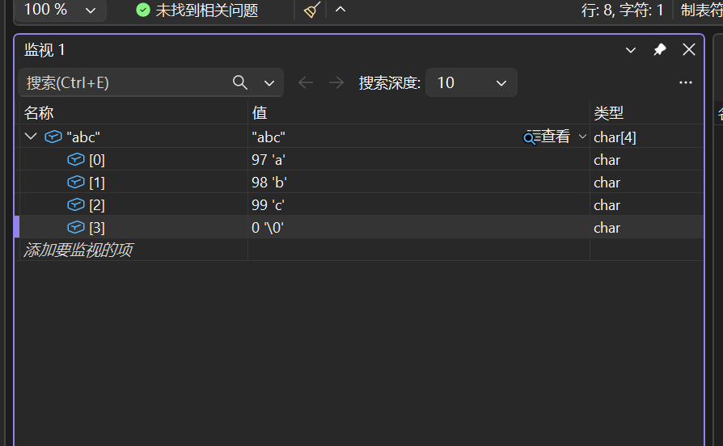

```c
# include <stdio.h>
int main()
{
	char arr1[] = "abc";
	char arr2[] = { 'a', 'b', 'c' };
	printf("%s\n", arr1);
	printf("%s\n", arr2);
	return 0;
}
```

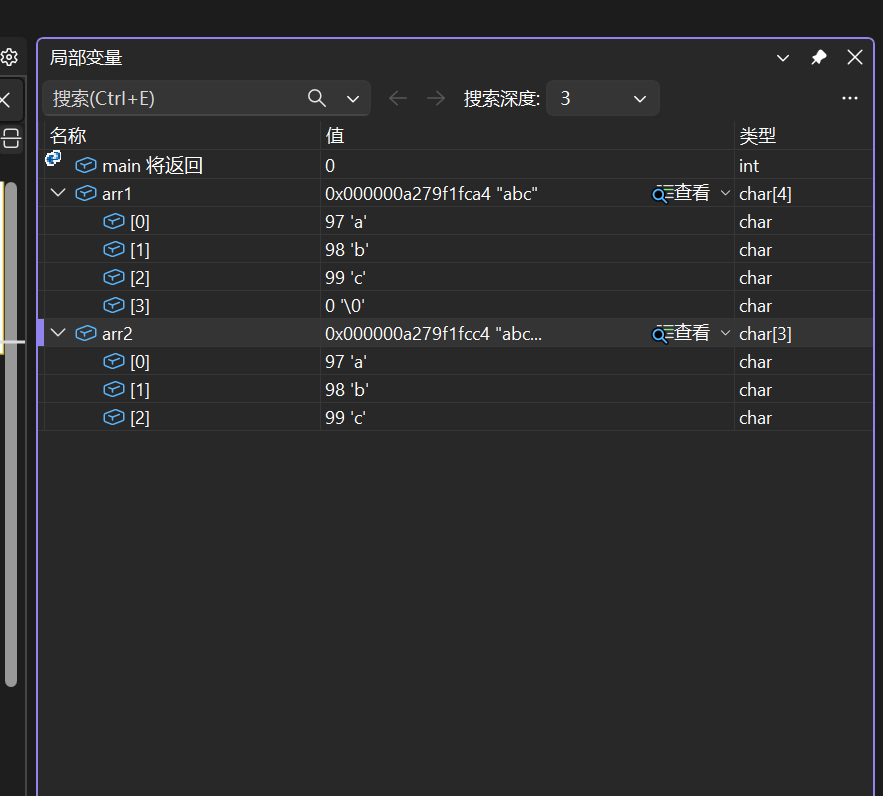

对于字符串"abc"，我们实际上看到了4个字符：a，b，c，但是实际上在末尾害隐藏着一个\0的转义字符，\0是字符串的结束标志，所以我们在使用库函数printf()打印字符串或者strlen()计算字符串长度的时候，遇到\0的时候就自动停止了。

C语言中也可以把一个字符串放在一个字符数组中，我们在这里利用下面的代码验证一下\0的功能。

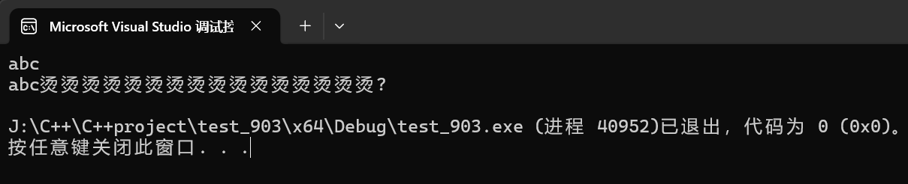

从图中可以看到，`arr1` 字符数组在打印的时候，打印了 `a`、`b`、`c` 后还打印了一些随机值，这就是因为 `arr1` 在末尾的地方没有 `\0` 字符作为结束标志，在打印的时候没有停止。
但是 `arr2` 的打印就是完全正常的，就是因为 `arr2` 数组是使用字符串常量初始化的，数组中有 `\0` 作为结束标志，打印可以正常停止。
如果我们在 `arr1` 数组中单独放一个 `'\0'` 字符会怎么样呢？
```c
# include <stdio.h>

int main()
{
	char arr1[] = { 'a', 'b', 'c', '\0' };
	char arr2[] = "abc";
	printf("%s\n", arr1);
	printf("%s\n", arr2);
	printf("%s\n", "abc\0def");
	return 0;
}
```

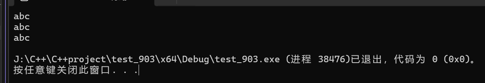

看到三次打印的结果都是一样的了，都是打印到\0的时候就停止了，那从上述的例子我们确实能够观察到\0的作用和重要性的。


### 10、转义字符

也许在前面的代码中你看到\n，\0很纳闷是啥。起始在字符中有一组特殊的字符是**转义字符**，转义字符顾名思义：转变原来意思的字符。

比如：我们有字符n，在字符串中打印的时候自然能打印出这个字符，如下：
```c
# include <stdio.h>

int main()
{
	printf("abcdef");
	return 0;
}
```
f
输出的结果：
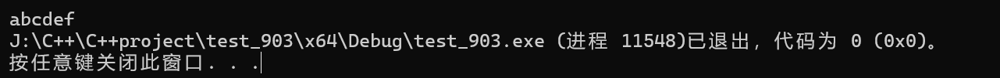

修改前后代码输出的结果截然不同，这就是转义字符的问题。`\n` 是一个转义字符表示换行的意思，可以理解为 `\` 让 `n` 的意思发生了转变——`n` 本来是一个普通的字符，被 `\` 转义为换行的意思。

**C语言中像这样的转义字符还有一些，具体如下：**
- `\?`：在书写连续多个问号时使用，防止它们被解析成三字母词，在新的编译器上没法验证了。
- `\'`：用于表示字符常量
- `\"`：用于表示一个字符串内部的双引号
- `\\`：用于表示一个反斜杠，防止它被解释为一个转义序列符。
- `\a`：警报，这会使得终端发出警报声或出现闪烁，或者两者同时发生。
- `\b`：退格键，光标退回一个字符，但不删除字符。
- `\f`：换页符，光标移到下一页。在现代系统上，这已经反映不出来了，行为改成类似于 `\v`。
- `\n`：换行符。
- `\r`：回车符，光标移到同一行的开头。
- `\t`：制表符，光标移到下一个水平制表位，通常是下一个 4/8 的倍数。
- `\v`：垂直分隔符，光标移到下一个垂直制表位，通常是下一行的同一列。

**下面2种转义字符可以理解为：字符的8进制或者16进制表示形式**

- `\ddd`：`d d d` 表示1~3个八进制的数字。如：`\130` 表示字符 `X`
- `\xdd`：`d d` 表示2个十六进制数字。如：`\x30` 表示字符 `0`
- `\0`：null 字符，代表没有内容，`\0` 就是 `\ddd` 这类转义字符的一种，用于字符串的结束标志，其ASCII码值是0。

```c
// 代码示例
# include <stdio.h>
# include <string.h>

//int main()
//{
	//printf("%c\n", 'X');
	//printf("%c\n", '\130');

	//printf("%c\n", '0');
	//printf("%c\n", '\x30');

//	printf("%c\n", 'Q');        // 字符输入     —> Q
//	printf("%c\n", '\x51');     // 十六进制输入 —> Q
//	printf("%c\n", '\121');     // 八进制输入   —> Q
//	printf("%c\n", 81);         // ASCII码输入  —> Q
//
//	printf("%d\n", 71);
//	printf("%d\n", 071);
//
//	return 0;
//}

int main()
{
	//string length
	//int len = strlen("abc");
	//a b c \0
	//string 函数统计的是字符串中\之前的个数，不包括\

	//int len = strlen("c:\test\16\test.c");
	//printf("%d\n", len);

	int len = strlen("c:\\test\\16\\test.c");
	printf("%d\n", len);

	return 0;

}
```


### 11、语句和语句分类

C语言的代码是由一条一条的语句构成的，C语言中的语句可分为一下五类：
- 空语句
- 表达式语句
- 函数调用语句
- 复合语句
- 控制语句

#### 空语句

空语句是最简单的，一个分号就是一条语句，是空语句。
```c
# include <stdio.h>
int main()
{
	;//空语句
	return 0;
}
```
空语句，一般出现的地方是：这里需要一条语句，但是这个语句不需要做任何事，就可以写一个空语句。

#### 表达式语句

表达式语句就是在表达式的后边加上分号，如下所示：
```c
# include <stdio.h>
int main()
{
	int a = 20;
	int b = 0;
	b = a + 5; //表达式语句
	return 0;
}
```

#### 函数调用语句

函数调用的时候，也会加上分号，就是哈桑农户调用语句。
```c
# include <stdio.h>

int Add(int x, int y)
{
	return x + y;
}

int main()
{
	printf("helhe\n");//函数调用语句
	int ret = Add(2, 3);//函数调用语句
	return 0;
}
```

#### 复合语句

复合语句其实就是**代码块**，成对括号中的代码就是构成一个代码块，也被称为复合语句。
```c
# include <stdio.h>

void print(int arr[], int sz)//函数的大括号中的代码也构成复合语句
{
	int i = 0;
	for(i = 0; i < sz; i++)
	{
		printf("%d ", arr[i]);
	}
}

int main()
{
	int i = 0;
	int arr[10] = {0};
	for(i = 0; i < 10; i++)//for循环的循环体的大括号中的就是复合语句
	{
		arr[1] = 10 - i;
		printf("%d\n", arr[i]);
	}
	return 0;
}
```

#### 控制语句

**控制语句**用于控制程序的执行流程，以实现程序的各种结构方式（C语言支持三种结构：顺序结构、选择结构、循环结构），它们由特定的语句定义符组成，C语言有 **九种控制语句**。

可分成以下三类：

1. **条件判断语句也叫分支语句**：`if` 语句、`switch` 语句；
2. **循环执行语句**：`do while` 语句、`while` 语句、`for` 语句；
3. **转向语句**：`break` 语句、`goto` 语句、`continue` 语句、`return` 语句。

C语言是**结构化**的程序设计语言，支持三种结构：
- 顺序结构
- 选择结构
- 循环结构

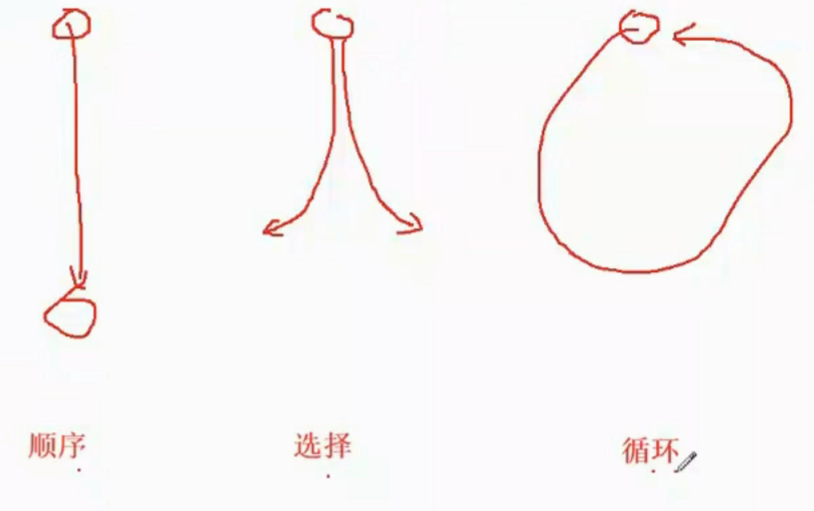

### 12、注释是是吗？为什么写注释？

注释是对代码的说明，编译器会忽略注释，也就是说，注释对实际代码没有影响。
注释是给程序员自己，或者其他程序员看的。
好的注释可以帮我们更好的理解代码，但是也不要过度注释，不要写没必要的注释。
当然不写注释可能会让后期阅读代码的人抓狂。
写注释一定程度上反应了程序作者的素质，建议大家写必要的注释，在未来找工作的时候，写代码时留下必要的注释也会给面试官留下更好的印象。

#### 注释的2种形式

C语言的注释有两种表达方法：
#####  `/**/的形式`

第一种方法是将注释放在`/*......*/`之间，内部可以分行。
```C
/* 注释 */

/*
	这是一行注释
*/
```
这种注释可以插在行内。

- 一次可以注释多行，但是不支持嵌套注释
- C语言早期的注释方式

##### //的形式

第二种写法是将注释放在双斜杠//后面，从双斜杠到行尾都属于注释。这种注释只能是单行，可以放在首行，也可以放在一行语句的结尾。这是C99标准新增的语法。

用法：
`ctrl + /` 
```C
// 这是一行注释

int x = 1; // 这也是注释
```
不管是哪一种注释，都不能放在双引号里面。
双引号里面的注释符号，会成为字符串的一部分，解释为普通符号，失去注释作用。
```C
printf("// hehe /* world */ ");
```
上面示例种，双引号里面的注释符号，都会被视为普通字符，没有注释作用。

#### 注释会被替换

编译时，注释会被替换成一个空格，所以`min/* 这里是注释 */Value 会编程min Value，而不是minValue。`