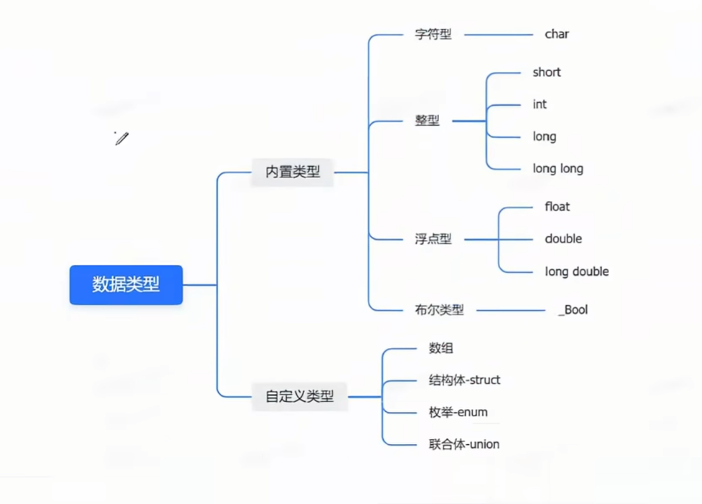
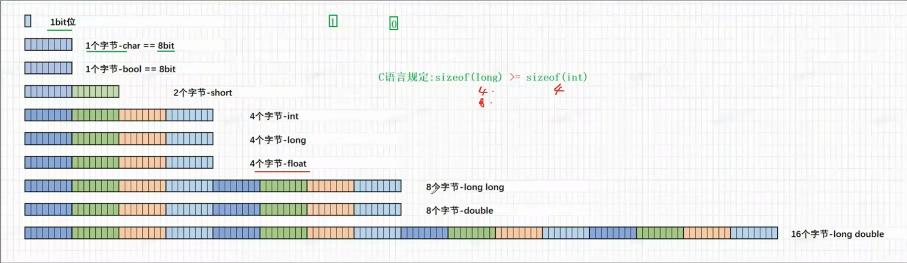
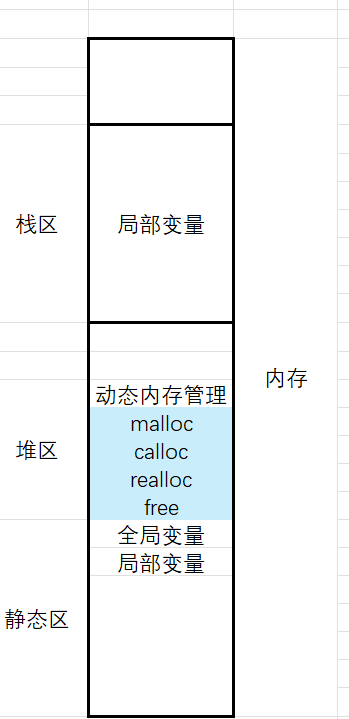

### 数据类型介绍

C语言提供了丰富的**数据类型**来描述生活中的各种数据。


购物的小票中可能包含的信息如下：

| 货号      | 品名    | 单位  | 单价（元）  | 数量  | 小计     |
| ------- | ----- | --- | ------ | --- | ------ |
| 1501111 | 麻辣小虾米 | 袋   | 1.00   | 5   | 5.00   |
| 1501112 | 键盘    | 个   | 200.00 | 1   | 200.00 |
在这个小票当中我们包含了很多的信息，货号，品名，单位，单价，数量，小计，分析我们发现：

| 货号  | 整数/字符串 |
| --- | ------ |
| 品名  | 字符串    |
| 单位  | 字符串    |
| 数量  | 整数     |
| 小计  | 小数     |
使用整型类型来描述整数，使用字符类型来描述字符，使用浮点型类型来描述小数。
所谓“类型”，就是相似的数据所拥有的共同特征，编译器只有知道了数据的类型，才知道怎么操作数据。
下面盘点一下C语言提供的各种数据类型，本章节主要探讨**内置数据类型**。


#### 字符型

字符的英文单词是character，再C语言中使用char表示字符类型。
```C
char // character
[signed] char //有符号的
unsigned char //无符号的
```
字符类型：
存储的时候是存储ASCII值，ASCII值是整数，所以字符类型是属于整形家族的。
#### 整形

整形的英文单词是integer，在C语言中使用int来表示整形类型。
```C
// 整形-integer

// 短整型
short [int]
[signed] short [int]
unsigned short [int]

// 整形
int
[signde] int
unsigned int

// 长整型
long int
[signed] long [int]
unsigned long [int]

// 更长的整形
//C99中引入
long longj [int]
[signed] long long [int]
unsigned long long [int]
```

#### 浮点型

```C
float  // 单精度浮点型
double // 双精度浮点型
long double
```

#### 布尔类型

C语言原来并没有为布尔值单独设置一个类型，而是使用整数0表示假，非0值表示真。
在C99中也引入了布尔类型，是专门表示真假的。
```C
_Bool
```
布尔类型的使用得包含头文件<stdbool.h>
布尔类型变量得取值是：true或者false。

```C
#define bool _Bool
#define false 0
#define true 1
```
代码演示：
```C
_Bool flag = true;
if (flag)
	printf("i like C\n");
```

### 各种数据类型得长度

每一种数据类型都有自己的长度，使用不同的数据类型，能够创建出长度不同的变量，变量长度的不同，存储的数据范围就有所差异。

##### sizeof操作符
`sizeof` 是一个关键字，也是操作符，专门是用来计算 `sizeof` 的操作数的类型长度的，单位是**字节**。
`sizeof` 操作符的操作数可以是**类型**，也可是**变量**或者**表达式**。
```C
sizeof( 类型 )
sizeof 表达式
```
`sizeof` 的操作数如果不是类型，是表达式的时候，可以省略掉后边的括号的。
`sizeof` 后边的表达式是**不真实参与运算**的，根据表达式的类型来得出大小。
`sizeof` 的计算结果是 `size_t` 类型的，如果要打印在屏幕上，可以使用 `%zu` 的占位符。
- `sizeof` 运算符的返回值，C 语言只规定是无符号整数，并没有规定具体的类型，而是留给系统自己去决定，`sizeof` 到底返回什么类型。不同的系统中，返回值的类型有可能是 `unsigned int`，也有可能是 `unsigned long`，甚至是 `unsigned long long`，对应的 `printf()` 占位符分别是 `%u`、`%lu` 和 `%llu`。这样不利于程序的可移植性。

C 语言提供了一个解决方法，创造了一个类型别名 `size_t`，用来统一表示 `sizeof` 的返回值类型。对应当前系统的 `sizeof` 的返回值类型，可能是 `unsigned int`，也可能是 `unsigned long long`。

```C
#include <stdio.h>
#include <stdbool.h>

int main()
{
	_Bool flag = true;
	if (flag)
		printf("i like C\n");

	printf("%zu\n", sizeof(char));
	printf("%zu\n", sizeof(int));
	printf("%zu\n", sizeof(short int));
	printf("%zu\n", sizeof(long int));
	printf("%zu\n", sizeof(long));
	printf("%zu\n", sizeof(short));
	printf("%zu\n", sizeof(long double));
	printf("%zu\n", sizeof(double));
	printf("%zu\n", sizeof(long long));

	return 0;
}
```

#### 数据长度
在VS2026 x64配置下的输出：
```C
1
4
2
4
4
2
8
8
8
```



#### sizeof中表达式不计算
```C
#include <stdio.h>
int main()
{
	short s = 12;
	int b = 10;
	printf("%zu\n", sizeof(s = b + 1));
	printf("s = %d\n", s);
	
	return 0;
}
```

### signed和unsigned

C 语言使用 `signed` 和 `unsigned` 关键字修饰 **字符型和整型** 类型的。
- `signed` 关键字，表示一个类型带有正负号，包含负值；
- `unsigned` 关键字，表示该类型不带有正负号，只能表示零和正整数。

对于 `int` 类型，默认是带有正负号的，也就是说 `int` 等同于 `signed int`。
由于这是默认情况，关键字 `signed` 一般都省略不写，但是写了也不算错。

```C
signed int a;
// 等同于int a;
```
int类型也可以不带正负号，指标是非负整数。这时就必须使用关键字`unsigned`声明变量就。
```C
unsigned int a;
```

整形变量声明为`unsigned`的好处是，同样长度的内存能够表示的最大整数值，增大了一倍。
比如，16位的`signed short int`的取值范围是：-32768~32767，最大是32767；而`unsigned short int`的取值范围是：0~65535，最大值增加到了65535。32位的s`igned int`的取值范围可以参看`limits.h`中给出的定义。

下面的定义是VS2026环境中，limits.h中相关定义。
```C
#define SHRT_MIN (-32768)          // 有符号16位整型的最小值
#define SHRT_MAX 32767             // 有符号16位整型的最大值
#define USHRT_MAX 0xffff           // 无符号16位整型的最大值
#define INT_MIN (-2147483647 - 1)  // 有符号整型的最小值
#define INT_MAX 2147483647         // 有符号整型的最大值
```

unsigned int 里面的int可以省略，所以上面的变量声明也可以写成下面这样。
```C
unsigned a;
```
字符类型 char可以以设置signed和unsigned。
```C
signed char c;   // 范围为-128到127
unsigned char c; // 范围为0到255
```
注意：
C语言规定char类型默认是否带有正负号，由当前系统决定。
也就是说，char不等同于`signed char`，它有可能是`signed char`，也有可能是`unsigned char`。这一点与int不同，int就是等同于`signed int`。

### 数据类型的取值范围

上述的数据类型很多，尤其数整型类型就有short、int、long、long long 四种，为什么呢？

其实每一种数据类型有自己的取值范围，也就是存储的数值的最大值和最小值的区间，有了丰富的类型，我们就可以在适当的场景下去选择适合的类型。如果要查看当前系统上不同数据类型的极限值：
`limits.h` 文件中说明了整型类型的取值范围。
`float.h` 这个头文件中说明浮点型类型的取值范围。
为了代码的可移植性，需要知道某种整数类型的极限值时，应该尽量使用这些常量。
- `SCHAR_MIN` ， `SCHAR_MAX` ： signed char 的最小值和最大值。
- `SHRT_MIN` ， `SHRT_MAX` ： short 的最小值和最大值。
- `INT_MIN` ， `INT_MAX` ： int 的最小值和最大值。
- `LONG_MIN` ， `LONG_MAX` ： long 的最小值和最大值。
- `LLONG_MIN` ， `LLONG_MAX` ： long long 的最小值和最大值。
- `UCHAR_MAX` ： `unsigned char` 的最大值。
- `USHRT_MAX` ： `unsigned short` 的最大值。
- `UINT_MAX` ： `unsigned int` 的最大值。
- `ULONG_MAX` ： `unsigned lon`g 的最大值。
- `ULLONG_MAX` ： `unsigned long long` 的最大值。

### 变量

#### 变量的创建

了解清楚了类型，我们使用类型做什么呢？类型是用来创建**变量**的。
什么是变量呢？C语言中把经常变化的值称为**变量**，不变的值称为**常量**。
变量创建的语法形式是这样的：
```C
data_type name;
	|       |
	|       |
 数据类型  变量名
```

变量名的一般规则：
- 只能由字母（包括大写和小写）、数字和下划线（`_`）组成。
- 不能以数字开头。
- 长度不能超过63个字符。
- 变量名中区分大小写的。
- 变量名不能使用关键字。
```C
#include <stdio.h>

int main()
{
	int age;			// 整形变量
	char ch;			// 字符变量
	double weight;		// 浮点型变量

	return 0;
}
```
变量在创建的时候就给一个初始值，就叫初始化。
```C
#include <stdio.h>

int main()
{
	int age = 18;
	char ch = 'w';
	double weight = 48.0;
	unsigned int height = 10;
	
	return 0;
}
```

#### 变量的分类

**全局变量**：在大括号外部定义的就是全局变量
全局变量的适用范围更广，整个工程中想使用，都是有办法使用单独。

**局部变量**：在大括号内部定义的变量就是局部变量
局部变量的使用范围比较局限，只能在自己所在的局部范围内使用
```C
#include <stdio.h>

int global = 2026; // 全局变量

int main()
{
	int local = 2010; // 局部变量
	printf("%d\n", local);
	printf("%d\n", global);
	
	return 0;
}
```
如果局部变量和全局变量，名字相同呢？
```C
#include <stdio.h>

int n = 10000;
int main()
{
	int n = 100;
	printf("%d\n", n);
	return 0;
}
```
其实当局部变量和全局变量同名的时候，局部变量优先使用。

#### 全局变量和局部变量在内存中存储在哪里呢？

一般我们在学习C/C++语言的时候，我们会关注内存中的三个区域：
**栈区、堆区、静态区。**

1. 局部变量是放在内存的**栈区**
2. 全局变量是放在内存的**静态区**
3. 堆区是用来动态内粗管理的（后面会学习到）

其实内存区域的划分会更加细致，以后再操作系统的相关知识的时候会介绍




### 算数操作符：+、-、*、/、%

在写代码时候，一定会涉及到计算。
C语言中为了方便运算，提供了一系列操作符，其中有一组操作符叫：**算术操作符**。分别是：`+` `-` `*` `/` `%`，这些操作符都是**双目操作符**。
注：操作符也被叫做：**运算符**，是不同的翻译，意思是一样的。

#### `+`和`-`
`+`和`-`用来完成加法和减法。
`+`和`-`都是有2个操作数的，位于操作符两端的就是它们的操作数，这种操作符也叫**双目运算符**。

```C
#include <stdio.h>
int main()
{
	int x = 5 + 22;
	int y = 65 - 23;
	printf("%d\n", x);
	printf("%d\n", y);
	
	return 0;
}
```

#### `*`

运算符`*`用来完成乘法。
```C
#include <stdio.h>
int main()
{
	int num = 3;
	printf("%d\n", num * num); // 输出结果是25
	return 0;
}
```

#### `/`

运算符`/`用来完成除法
除号的两端如果是整数，执行的是整数除法，得到的结果也是整数。
```C
#include <stdio.h>
int main()
{
	float x = 6 / 4;
	int y = 6 / 4;
	printf("%f\n", x);    // 输出1.000000
	printf("%d\n", y);    // 输出1
	return 0;
}
```
上面示例中，尽管变量X的类型是float（浮点数），但是6 / 4得到的结果是1.0，而不是1.5。原因就在于C语言里里面的整数除法是整除，只会返回整数部分，丢弃小数部分。

如果希望得到浮点数的结果，`两个运算数必须至少有一个浮点数`，这时C语言就会进行浮点数除法。
```C
# include <stdio.h>
int main()
{
	float x = 6.0 / 4;    // 或者携程6 / 4.0
	printf("%f\n", x);    // 输出1.500000
	return 0;
}
```

再看一个例子：
```C
#include <stdio.h>
int main()
{
	int score = 5;
	score = (score / 20) * 100;
	printf("%d\n", score);
	return 0;
}
```
上面的代码，你可能觉得经过运算，score会等于25，但是实际上score=0，这是因为score / 20 是整除，会得到一个整数0，所以乘以100得到的也是0.
为了得到预想的结果，可以将除数20改成20.0，让整除变成浮点书整除。
```C
#include <stdio.h>
int main()
{
	int score = 5;
	score = (score / 20.0) * 100;
	printf("%d\n", score);
	return 0;
}
```

#### %

运算符%表示求模（取余）运算，即返回两个整数相除的余值。这个运算符只能用于整数，不能用于浮点数。
```C
#include <stdio.h>
int main()
{
	int x = 6 % 4;  // 2
	return 0;
}
```
负数求模的规则是，结果的正负号由第一个运算数的正负号决定。
```C
#include <stdio.h>
int main()
{
	printf("%d\n", 11 % -5);  // 1
	printf("%d\n", -11 % -5); // -1
	printf("%d\n", -11 % 5);  // -1
	return 0;
}
```
上面示例中，第一个运算数的正负号（11或-11）决定了结果的正负号。

### 赋值操作符：=和复合赋值

在变量创建的时候给一个初始值叫初始化，在变量创建好后，再给一个值，这叫赋值。
```C
int a = 100; // 初始化
a = 200;     // 赋值，这里使用的就是赋值操作符
```
赋值操作符 = 是一个随时可以给变量赋值的操作符。

#### 连续赋值

赋值操作符也可以连续赋值，如：
```C
int a = 3;
int b = 5;
int c = 0;
c = b = a + 3; // 连续赋值，从右向左一次赋值的
```
C语言虽然支持这种连续赋值，但是写出的代码不容易理解，建议还是拆开来写，这样方便观察代码的执行细节。
```C
int a = 3;
int b = 5;
int c = 0;
c = a + 3;
```
这样写，在调试的时候，每一次赋值的细节都是可以很方便的观察的。

#### 复合赋值符

在写代码时，我们经常可能对一个数进行自增，自减的操作，如下代码：
```C
int a = 10;
a = a + 3;
a = a - 2;
```
这样代码C语言给提供了更加方便的写法：
```C
int a = 10;
a += 3;
a -= 3;
```
C语言中提供了复合赋值符，方便我们编写代码，这些赋值符有：
```
+=        -=
*=        /=

>>=        <<=
&=        |=        ^=
```

### 单目操作符：++、--、+、-

前面介绍的操作符都是双目操作符，有2个操作数的。C语言中还有一些操作符只有一个操作数，被称为单目操作符。`++`、`--`、`+`（正）、`-`（负）就是单目操作符的。

#### ++和--

`++` 是一种自增的操作符，又分为**前置++**和**后置++**，`--` 是一种自减的操作符，也分为**前置--**和**后置--**。

##### 前置++

```C
int a = 10;
int b = ++a;   // ++的操作数是a，是放在a的前面的，就是前置++
printf("a=%d b=%d\n", a, b);
```
**计算口诀**：先+1，后使用；
a原来是10，先+1，后a变成了11，再使用就是赋值给b，b得到的也是11，所以计算结束后，a和b都是11，相当于这样的代码。
```C
int a = 10;
a = a + 1;
b = a;
printf("a = %d b = %d\n", a, b);
```
##### 后置++
```C
int a = 10;
int b = a++;// ++的操作数是a，是放在a的后面的，就是后置++
```
**计算口诀**：先使用，后+1
a原来是10，先使用，就是先赋值给b，b得到了10，再+1，然后a变成了11，所以直接结束后a是11，b是10，相当于这样的代码。
```C
int a = 10;
int b = a;
a = a + 1;
printf("a = %d b = %d\n", a, b);
```
##### 前置--
与上一个同理，只是把+1换成了-1；
**计算口诀**：先-1，后使用。
```C
int a = 10;
int b = --a;// --的操作数是a，是放在a的前面的，就是前置--
printf("a = %d b = %d\n", a, b);
```
##### 后置--
同理，后置--类似于后置++，只是把+1换成了-1。
计算口诀：先使用，后-1
```C
int a = 10;
int b = a--;// --的操作数是0，是放在a的后面的，就是后置--
printf("a = %d b = %d\n", a, b);
```
#### +和-

这里的`+`是正号，`-`是负号，都是单目操作符。
运算符`+`对正负值没有影响，是一个完全可以省略的运算符，但是写了也不会报错。
```C
int a = +10;  // 等价于 int a = 10;
```
运算符`-`用来改变一个值的正负号，负数前面加上`-`就会得到正数，正数的前面加上`-`会得到负数。
```C
int a = 10;
int b = -a;
int c = -10;
printf("b=%d c=%d\n", b, c); // 这里的b和c都是-10

int a = -10;
int b = -a;
printf("b=%d\n", b); // 这里的b是10
```

### 强制类型转换

在操作符中还有一种特殊的操作符是强制类型转换，语法形式很简单，形式如下：
```C
(类型)
```
请看代码：
```C
int a = 3.14;
// a的是int类型，3.14是double类型，两边的类型不一致，编译器会报警告
```
为了消除这个警告，我们可以使用强制类型转换：
```C
int a = (int)3.14;   // 意思是将3.14强制类型转换为int类型，这种强制类型转换只取整数部分
```
俗话说，强扭的瓜不甜，我们使用强制类型转换都是万不得已的时候使用，如果不需要强制类型转化就能实现代码，这样自然更好的。

### scanf和printf介绍

#### printf

###### 基本用法

`printf()` 的作用是将参数文本输出到屏幕。它名字里面的 `f` 代表 **format**（格式化），表示可以定制输出文本的格式。
```C
#include <stdio.h>
int main()
{
    printf("Hello World");
    return 0;
}
```
上面命令会在屏幕上输出一行文字“Hello World”。
`printf()` 不会在行尾自动添加换行符，运行结束后，光标就停留在输出结束的地方，不会自动换行。
为了让光标移到下一行的开头，可以在输出文本的结尾，添加一个换行符 `\n`。
```C
#include <stdio.h>
int main()
{
    printf("Hello World\n");
    return 0;
}
```
如果文本内部有换行，也是通过插入换行符来实现，如下方代码：
```C
#include <stdio.h>
int main()
{
    printf("Hello\nWorld\n");
    return 0;
}
```
`printf()` 是在标准库的头文件 `stdio.h` 定义的。使用这个函数之前，必须在源码文件头部引入这个头文件。

###### 占位符

`printf()` 可以在输出文本中指定**占位符**。
所谓“占位符”，就是这个位置可以用其他值代入。
```C
// 输出 There are 3 apples
#include <stdio.h>
int main()
{
    printf("There are %d apples\n", 3);
    return 0;
}
```
上面示例中，`There are %d apples\n` 是输出文本，里面的 `%d` 就是占位符，表示这个位置要用其他值来替换。
占位符的第一个字符一律为百分号 `%`，第二个字符表示占位符的类型，`%d` 表示这里代入的值必须是一个整数。
`printf()` 的第二个参数就是替换占位符的值，上面的例子是整数 `3` 替换 `%d`。执行后的输出结果就是 `There are 3 apples`。

常用的占位符除了 `%d`，还有 `%s` 表示代人的是字符串。
```C
#include <stdio.h>
int main()
{
	printf("%s will come tonighht\n","zhangsan");
	return 0;
}
```
上面示例中，`%s` 表示代入的是一个字符串，所以 `printf()` 的第二个参数就必须是字符串，这个例子是 `zhangsan`。执行后的输出就是 `zhangsan will come tonight`。
输出文本里面可以使用**多个占位符**。
```C
#include <stdio.h>
int main()
{
    printf("%s says it is %d o'clock\n", "lisi", 21);
    return 0;
}
```
上面示例中，输出文本 `%s says it is %d o'clock` 有两个占位符，第一个是字符串占位符 `%s`，第二个是整数占位符 `%d`，分别对应 `printf()` 的第二个参数（`lisi`）和第三个参数（`21`）。执行后的输出就是 `lisi says it is 21 o'clock`。

`printf()` 参数与占位符是**一一对应关系**，如果有 `n` 个占位符，`printf()` 的参数就应该有 `n + 1` 个。如果参数个数少于对应的占位符，`printf()` 可能会输出内存中的任意值。

###### 占位符列举

`printf()` 的占位符有许多种类，与 C 语言的数据类型相对应。下面按照字母顺序，列出常用的占位符，方便查找，具体含义在后面章节介绍。

- `%a`：十六进制浮点数，字母输出为小写。
- `%A`：十六进制浮点数，字母输出为大写。
- `%c`：字符。//char
- `%d`：十进制整数（有符号的10进制整数）。//int
- `%e`：使用科学计数法的浮点数，指数部分的 e 为小写。
- `%E`：使用科学计数法的浮点数，指数部分的 E 为大写。
- `%i`：整数，基本等同于 `%d`。
- `%f`：小数（包含 float 类型和 double 类型）。//float %f double - %lf
- `%g`：6 个有效数字的浮点数。整数部分一旦超过 6 位，就会自动转为科学计数法，指数部分的 e 为小写。
- `%G`：等同于 `%g`，唯一的区别是指数部分的 E 为大写。
- `%hd`：十进制 short int 类型。
- `%ho`：八进制 short int 类型。
- `%hx`：十六进制 short int 类型。
- `%hu`：unsigned short int 类型。
- `%ld`：十进制 long int 类型。
- `%lo`：八进制 long int 类型。
- `%lx`：十六进制 long int 类型。
- `%lu`：unsigned long int 类型。
- `%lld`：十进制 long long int 类型。
- `%llo`：八进制 long long int 类型。
- `%lo`：八进制 long int 类型。
- `%lx`：十六进制 long int 类型。
- `%llu`：unsigned long long int 类型。
- `%Le`：科学计数法表示的 long double 类型浮点数。
- `%Lf`：long double 类型浮点数。
- `%n`：已输出的字符串数量。该占位符本身不输出，只将值存储在指定变量之中。
- `%o`：八进制整数。
- `%p`：指针（用来打印地址）。
- `%s`：字符串。
- `%u`：无符号整数（unsigned int）。
- `%x`：十六进制整数。
- `%zu`：size_t 类型。
- `%%`：输出一个百分号。
###### 输出格式

