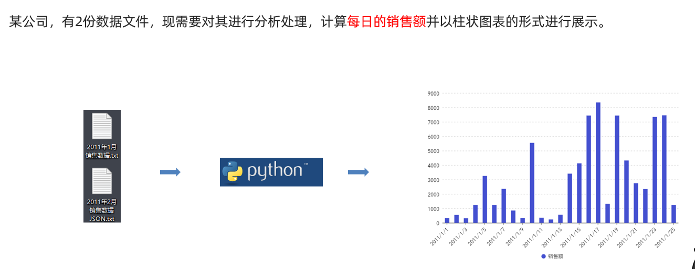
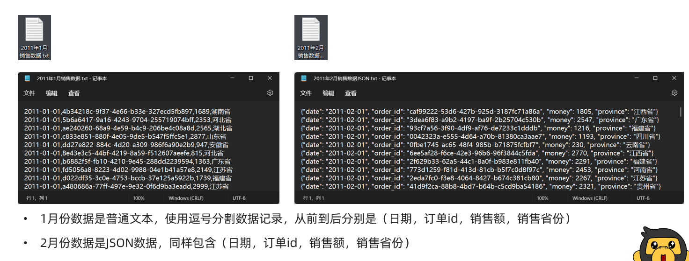
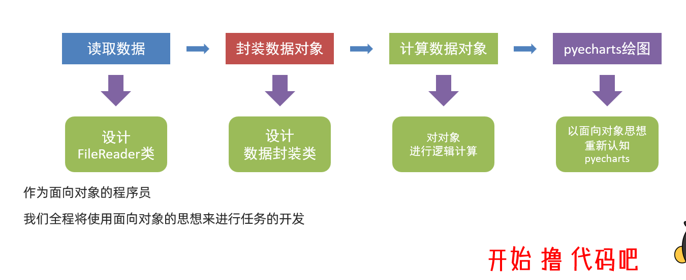

### 数据分析案例



### 数据内容



### 需求分析



### 撸代码

#### fine_define.py文件

```Python
# 定义一个抽象类用来做顶层设计，确定有哪些功能需要实现  
import json  
from data_define import Record  
  
  
class FileReader:  
  
    def read_data(self) -> list[Record]:  
        """ 读取文件的数据，读到每一条数据都转换为Record对象，将他们都封装到list内返回即可"""  
        pass  
  
# 文件读取器类  
class TextFileReader(FileReader):  
    def __init__(self, path):  
        self.path = path      # 定义成员变量记录读取文件路径  
  
  
    # 覆写  
    def read_data(self) -> list[Record]:  
        f = open(self. path, "r", encoding="UTF-8")  
        record_list = []  
        for line in f.readlines():  
            line = line.strip()                   # 处理换行符  
            data_list = line.split(",")  
            record = Record(data_list[0], data_list[1], int(data_list[2]), data_list[3])  
            record_list.append(record)  
        f.close()  
        return record_list  
  
  
class JsonFileReader(FileReader):  
  
    def __init__(self, path):  
        self.path = path            # 定义成员变量记录文件的路径  
  
    def read_data(self) -> list[Record]:  
        f = open(self.path, "r", encoding="UTF-8")  
        record_list = []  
  
        for line in f.readlines():  
            data_dict = json.loads(line)  
            record = Record(data_dict["date"], data_dict["order_id"], data_dict["money"], data_dict["province"])  
            record_list.append(record)  
  
        f.close()  
        return record_list  
  
  
if __name__ == '__main__':  
    text_file_reader = TextFileReader("K:/Mirror_Void_Arsenal/Python/day16/2011年1月销售数据.txt")  
    json_file_reader = JsonFileReader("K:/Mirror_Void_Arsenal/Python/day16/2011年2月销售数据JSON.txt")  
    list1 = text_file_reader.read_data()  
    list2 = json_file_reader.read_data()  
  
    for l in list1:  
        print(l)  
  
  
    for l in list2:  
        print(l)
```

#### data_define.py文件

```Python
"""  
数据定义的类  
"""  
# 类  
class Record:  
     # date = None  
     # order_id = None     # money = None     # province = None  
     def __init__(self,date,order_id,money,province):  
         self.date  = date          # 订单日期  
         self.order_id = order_id   # 订单ID  
         self.money = money         # 订单金额  
         self.province = province   # 销售省份  
  
  
     def __str__(self):  
         return f"{self.date}, {self.order_id}, {self.money}, {self.province}"
```

#### 案例.py

```Python
# "K:/Mirror_Void_Arsenal/Python/day16/2011年1月销售数据.txt"  
# "K:/Mirror_Void_Arsenal/Python/day16/2011年2月销售数据JSON.txt"  
"""  
1、设计一个类，可以完成数据的封装  
2、设计一个抽象类，定义文件读取的相关内容，并使用子类实现机具体功能  
3、读取文件，生产数据对象  
4、进行数据需求的逻辑计算（计算每一天的销售额）  
5、通过pyecharts进行图形绘制  
"""  
from panel.models.tabulator import theme  
  
# 导包  
from data_define import Record  
from file_define import FileReader,JsonFileReader,TextFileReader  
from pyecharts.charts import Bar  
from pyecharts.options import *  
from pyecharts.globals import *  
  
text_file_reader = TextFileReader("K:/Mirror_Void_Arsenal/Python/day16/2011年1月销售数据.txt")  
json_file_reader = JsonFileReader("K:/Mirror_Void_Arsenal/Python/day16/2011年2月销售数据JSON.txt")  
  
jan_data: list [Record] = text_file_reader.read_data()  
feb_data: list [Record] = json_file_reader.read_data()  
  
# 两个文件合并成一个list  
all_data: list [Record] = jan_data + feb_data  
  
# 开始数据计算  
# 字典  
data_dict = {}  
for record in all_data:  
    if record.date in data_dict.keys():  
        # 当前日期已经有记录了  
        data_dict[record.date] += record.money  
    else:  
        data_dict[record.date] = record.money  
  
# 可视化图标开发  
bar = Bar(init_opts=InitOpts(theme=ThemeType.ROMANTIC))  
bar.add_xaxis(list(data_dict.keys()))                 # 添加x轴数据  
bar.add_yaxis("销售额",list(data_dict.values()),label_opts=LabelOpts(is_show=False))    # 添加y轴数据  
bar.set_global_opts(  
    title_opts=TitleOpts(title="每日销售额")  
)  
bar.render("可视化图标设计.html")
```