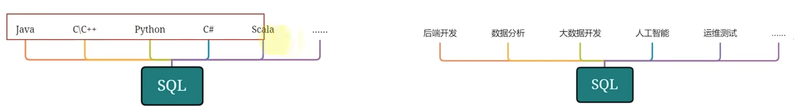
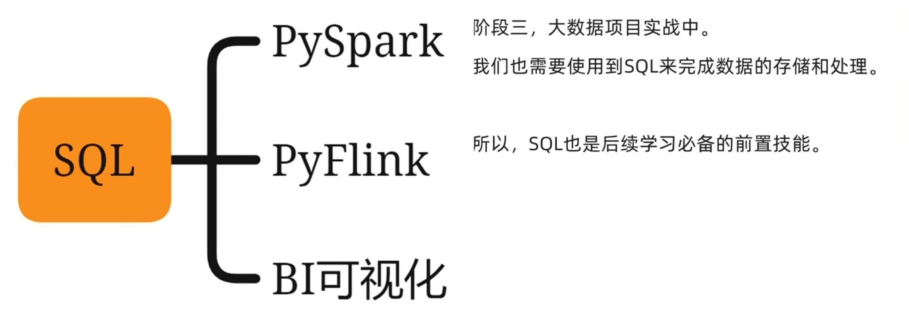

### 无处不在的SQL

涉及到的方向

#### 后续学习的铺垫

### 学到什么程度

SQL博大精深，深入学习SQL这一门技术，并不是这篇python学习文档可以完成的。目前只需要学习这些必须的即可。
**需掌握内容**：
	- 掌握SQL基础的语法，如数据的增删改查
	- 掌握MySQL数据库软件的基础使用，如安装，启动，连接，使用
如果想要特别提升MySQL，可以在这个网址学习。
	https://www.bilibili.com/video/BV1iF411z7Pu

### 