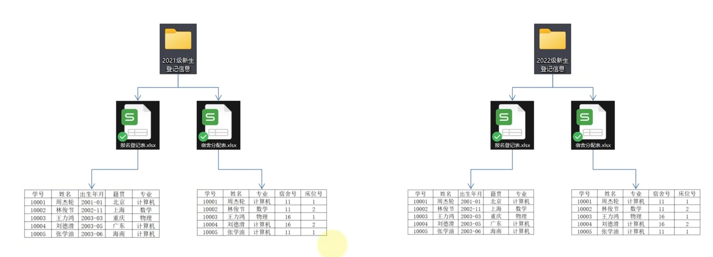
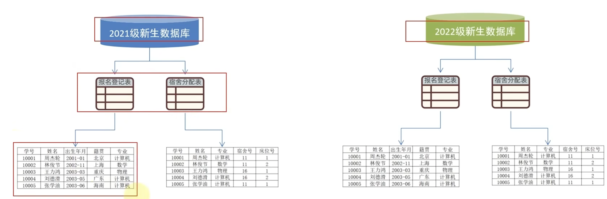
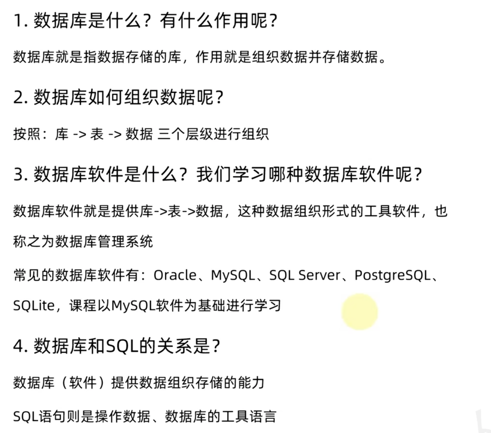

### 无处不在的数据库

数据库就是存储数据的库，那么他是如何组织数据并存储的呢？

### 数据库如何存储数据

现实生活中，excel组织数据的存储

数据库组织数据

### 数据库管理系统（数据软件）

要想管理这种形式的数据信息，就需要数据库管理系统
常见的数据库管理系统有：
- **Oracle**
- **MySQL**
- **SQLServer**
- **PostgreSQL**
- **SQLite**

### 数据库和SQL的关系

数据库是用来存储数据的，在这个过程中，会涉及到：
- 数据的新增
- 数据的删除
- 数据的修改
- 数据的查询
- 数据库、数据表的管理
而SQL语言，就是一种对数据库、数据进行操作、管理、查询的工具

==使用数据库软件去获得库->表->数据，这种数据组织、存储的能力，并借助SQL语言，完成对数据的增删改查等操作==

### 总结

