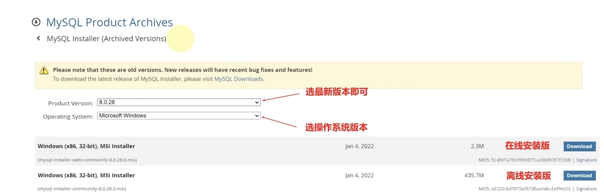
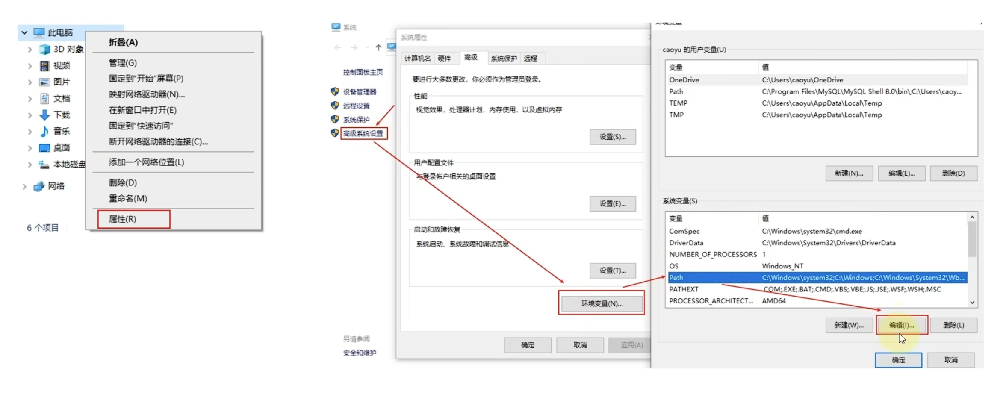
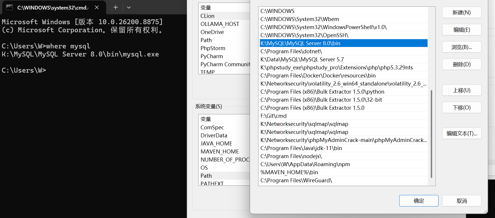
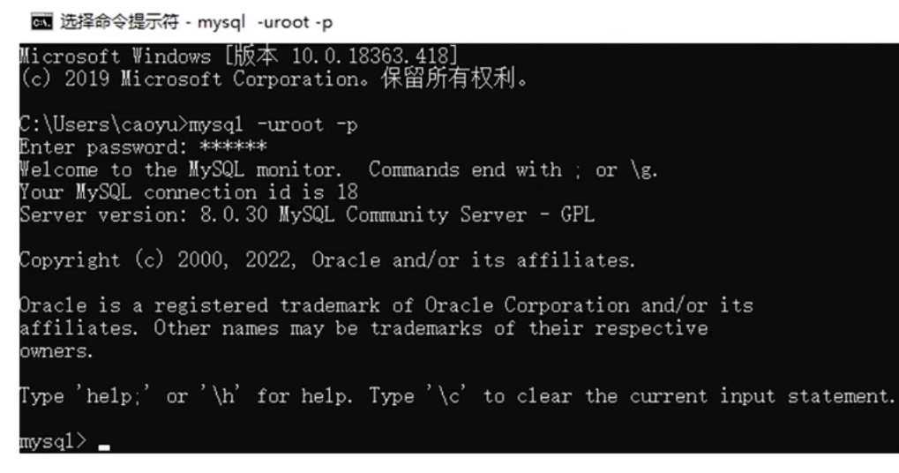

### MySQL的介绍

- MySQL数据库管理系统由瑞典的**DataKonsultAB**公司研发，该公司被**Sun公司**收购，现在Sun公司又被**Oracle公司**收购，因此MySQL目前属于**Oracle旗下产品**。
- MySQL软件采用了**双授权政策**，分为**社区版**和**商业版**，由于其**体积小、速度快、总体拥有成本低**，一般开发都选择MySQL作为数据库。
- 大多数开发人员都会和MySQL打交道，可以说是开发人员**必须会使用**的一款数据库软件。

### MySQL的版本

针对不同的用户，MySQL分为两种不同的版本：

**免费：**
- ==**MySQL Community Server**==：社区版本，免费，但MySQL不提供官方技术支持。
- ==**MySQL Cluster**==：集群版，开源免费，可将几个MySQL Server封装成一个Server。

**收费：**

- ==**MySQL Enterprise Edition**==：商业版，收费版本，可试用30天，官方提供技术支持。
- ==**MySQL Cluster CGE**==：高级集群版，需付费。

### MySQL的安装

下载地址：
https://downloads.mysql.com/archives/listaller

##### 官网下载

[https://www.mysql.com/cn/](https://www.mysql.com/cn/)

下载社区版：

注：社区版免费

选择Windows版本

下载离线版本

#### 安装

将下载好的文件双击打开，在弹出的窗口点击确定。

server only：仅服务器

client only：仅客户端

full：安装关于MySQL所有组件和服务

custom：自定义安装！强烈推荐，不想c盘_**boom~~**_就用这个

小技巧：先点击”full“，点击“Next“，再点击”Back“，接着点击”custom“，点击”Next“，就可以看到所需的组件都已经提前添加进去了。

点击右侧第一个，再点击下方的”advance“。

_**更改安装路径！！！**_

第一个为存放软件组件程序。

路径修改位置：

**D:\MySQL\MySQL Server 8.0**

第二为存放数据库文件。

路径修改位置：

**D:\MySQLData\MySQL\MySQL Server 8.0**

这些文件路径是自动生成的，只需要将“C:\”的位置改成其他的，我这里用的是D盘，尽量挑一个空间比较大的位置存放。

修改完成之后，点击OK，继续修改下面的。以此类推，下面这些是数据库组件及服务，只需要修改一个即可，文件存放位置跟_**第一个**_一样，只需要复制盘符的路径的路径即可。

例：

D:\MySQL\MySQL Workbench 8.0  

D:\MySQL\MySQL Shell 8.0

D:\]MySQL\MySQL Router 8.0

D:\MySQL\MySQL Documentation 8.0

D:\MySQL\Samples and Examples 8.0

修改完点击“Next”，再点击execute，安装组件，稍等几分钟，之后点击“Next”,再点击“Next”。

这里用默认的即可，直接点击“Next”

port：3306

是数据库链接端口，后面用得到

使用推荐的密码设置，点击“Next”

设置管理员密码。

密码可以设置简单一点，设置完成后点击“Next”

数据库服务名称（MySQL80）

直接点击“Next”，默认设置即可

一直点击“Next”，到这个页面点击“execute”

检查组件是否安装完成。

完成

点击”finish“，再点击“Next”，点击“finish”，点击“Next”

验证

到这个页面之后，输入刚才设置的管理员密码，点击“check”（检查）

验证通过后，点击“Next”，再点击“execute”通过验证。校准无误，再次点击“finish”或者“Next”

收工完成

点击“finish”

弹出两个窗口则为安装完成。

#### 配置环境变量

将MySQL的安装目录的bin文件夹的路径，复制进入即可。

最后输入mysq -u root -p，输入密码就能进去了
