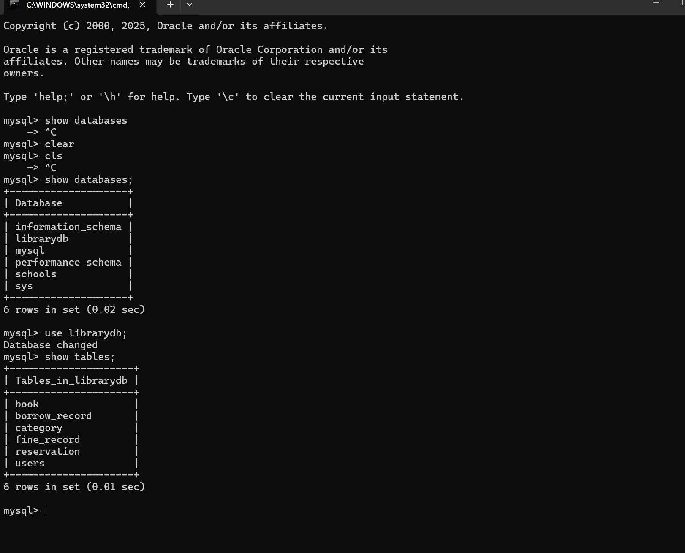
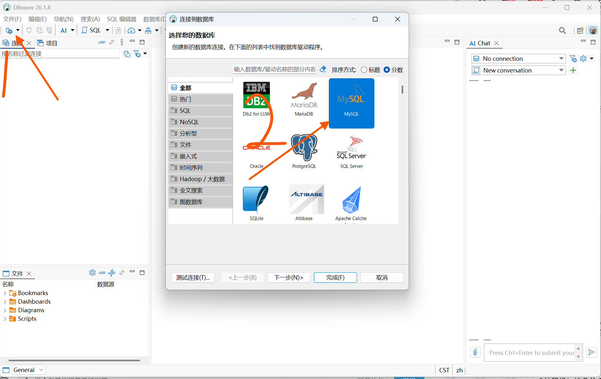
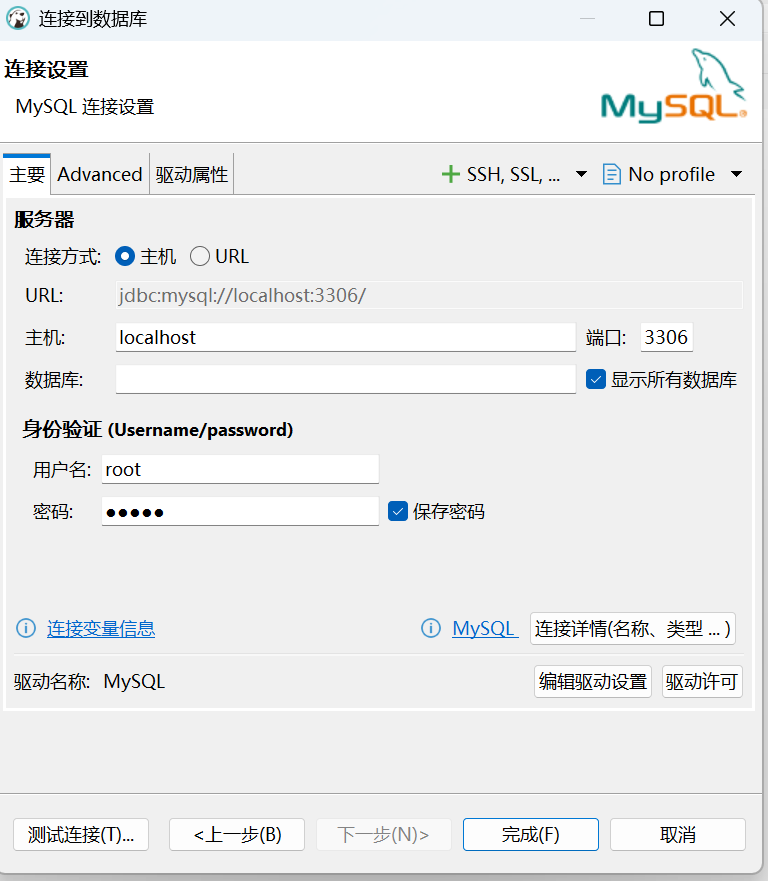
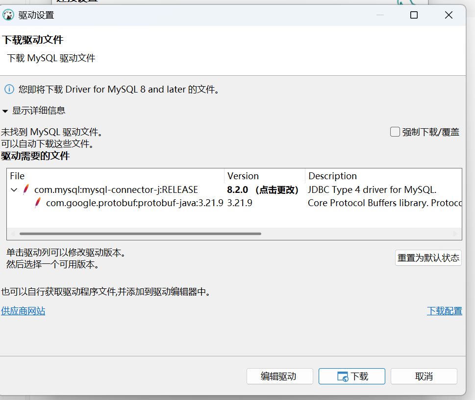
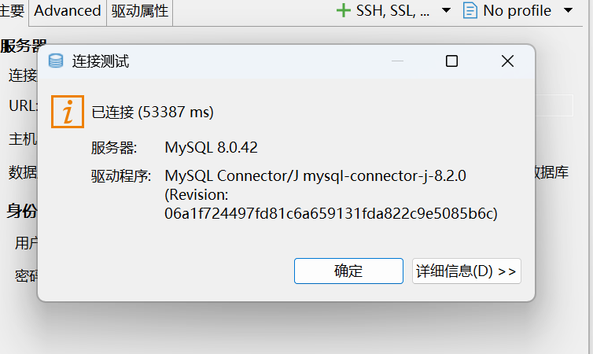
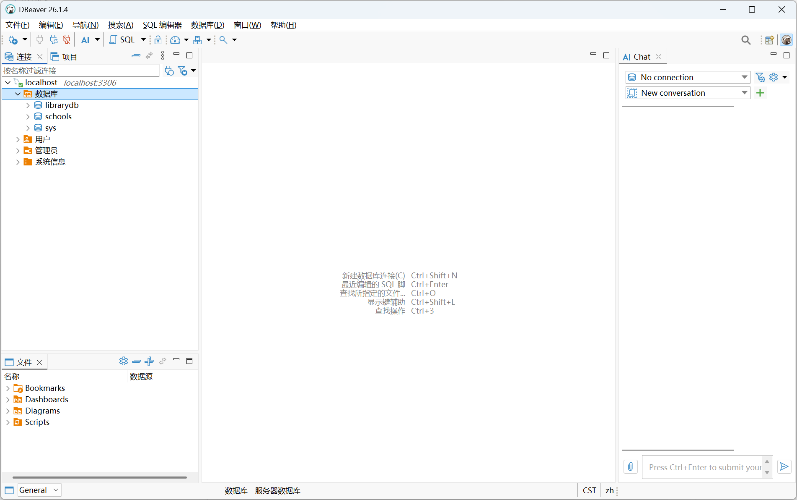

### 在命令行提示符内使用MySQL

MySQL安装之后，就可以简单的鹅是用它了。

**命令概览：**

| 命令              | 作用           |
| --------------- | ------------ |
| show databases; | 查看有哪些数据库     |
| use 数据库名称;      | 使用某个数据库      |
| show tables;    | 查看数据库内有哪些表   |
| exit            | 退出MySQL命令行环境 |
如下所示

### 使用图形化工具操作MySQL

使用命令提示符进行MySQL的操作，不是太方便，一般开发者都会使用第三方的图形化工具进行使用。

可用于MySQL的图形化工具非常多，课程使用跨平台、开源、免费的图形化工具：**DBeaver**

**DBeaver Community 22.2.0**

下载地址：[https://dbeaver.io/download](https://dbeaver.io/download)

我们选择免费的社区版（DBeaver Community）

选择适用自己电脑系统的安装包下载即可。

**安装步骤同上。。。**

### dbeavern使用

**连接**
点击左侧连接，选择MySQL，点击下一步

**配置连接设置**
只需要输入密码，其他保持默认，点击测试连接

**驱动信息下载**
如果弹出来这个，就点击下载即可。

**连接成功**
驱动下载完毕之后，会弹出来连接测试成功的字样，点击确定，再点击完成，就连接上了。

### 界面信息
连接之后，会发现数据库只有这几个，跟cmd命令中查询到的几个数据库对不上。这是软件为了一些误操作而把这些内置数据库隐藏了。

