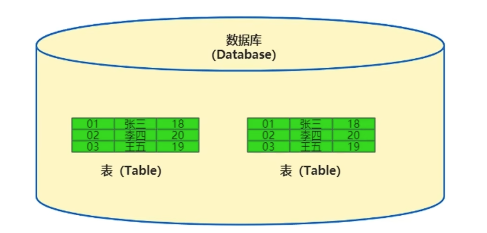

### DML

DML是指数据操作语言，英文全称是 **Data Manipulation Language**，用来对数据库中的表的数据记录进行更新。

**关键字：**

- **INSERT** — 插入
- **DELETE** — 删除
- **UPDATE** — 更新


### 数据插入INSERT

基础语法：

```MySQL
INSERT INTO 表[(列1, 列2, ......, 列N)] VALUES(值1, 值2, ......, 值N)[, (值1, 值2, ......, 值N)]
```

示例

```MySQL  
CREATE TABLE student(
    id INT,
    name VARCHAR(20),
    age INT
);

-- 仅插入id列数据
INSERT INTO student(id) VALUES(10001), (10002), (10003);

-- 插入全部列数据
INSERT INTO student(id, name, age) VALUES(10001, '周杰轮', 31), (10002, '王力鸿', 33), (10003, '林俊节', 26);

-- 插入全部列数据，快捷写法（省略列名）
INSERT INTO student VALUES(10001, '周杰轮', 31), (10002, '王力鸿', 33), (10003, '林俊节', 26);
```

### DELETE-数据删除

**基础语法**
```MySQL
DELETE FROM 表名称 [WHERE 条件判断]
```


**演示**
```MySQL
DROP TABLE IF EXISTS student;
CREATE TABLE student(
    id INT,
    name VARCHAR(20),
    age INT
);

INSERT INTO student VALUES(10001, '周杰轮', 31), (10002, '王力鸿', 33), (10003, '林俊节', 35), (10004, '张学沛', 36), (10005, '刘德清', 30);

-- 删除name为林俊节的数据
DELETE FROM student WHERE name = '林俊节';

-- 删除age > 33的数据
DELETE FROM student WHERE age > 33;

-- 删除全部数据
DELETE FROM student;
```

**条件判断**：
```text
列 操作符 值
```

**操作符**：
```text
= < > <= >= !=等等
```

### 数据更新-UPDATA

基础语法：
```MySQL
UPDATE 表名 SET 列=值 [WHERE 条件判断];
```

**演示：**
```MySQL
DROP TABLE IF EXISTS student;
CREATE TABLE student(
    id INT,
    name VARCHAR(20),
    age INT
);

INSERT INTO student VALUES (10001, '周杰轮', 31), (10002, '王力鸿', 33), (10003, '林俊节', 35), (10004, '张学油', 36), (10005, '刘德清', 30);

-- 修改id为10001的name为陈一讯
UPDATE student SET name = '陈一讯' WHERE id = 10001;

-- 修改全部数据的age为11
UPDATE student SET age = 11;
```

**条件判断：**
```text
列 操作符 值
```

**操作符：**
```text
id = 5
id < 3
id >= 6
id != 5
```